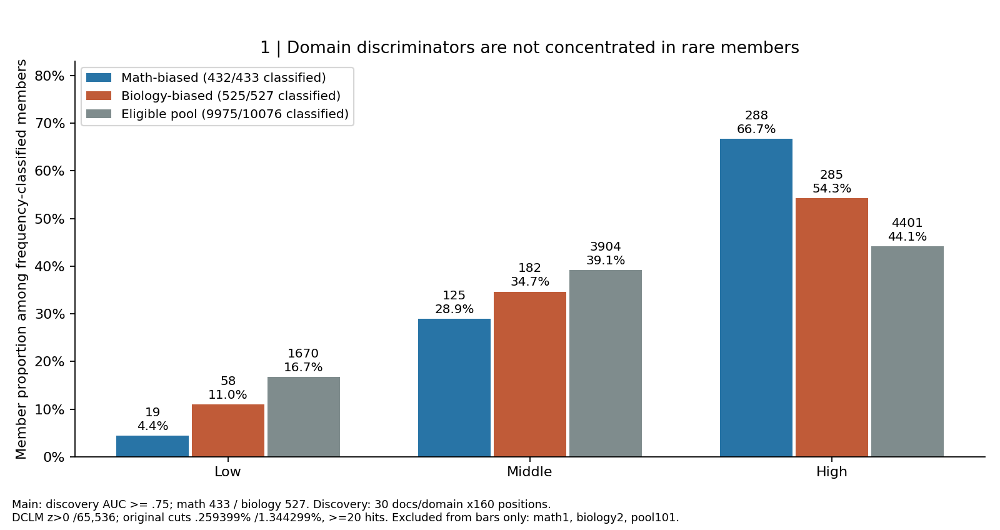
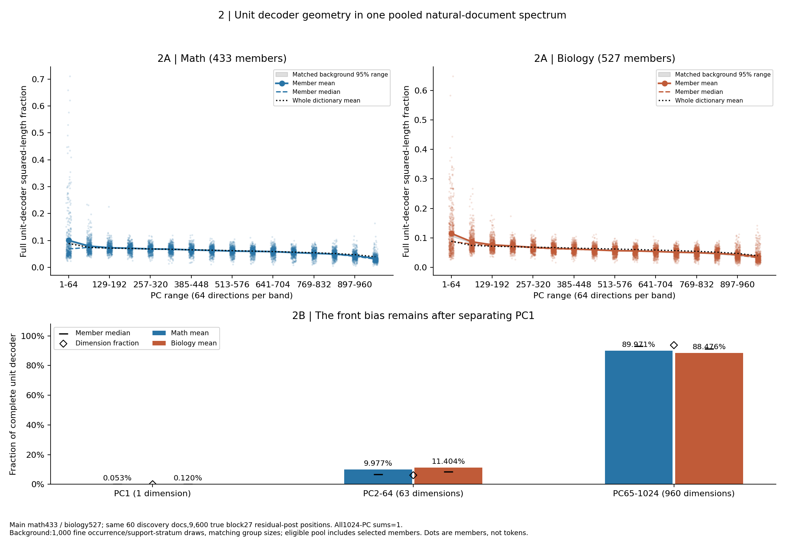
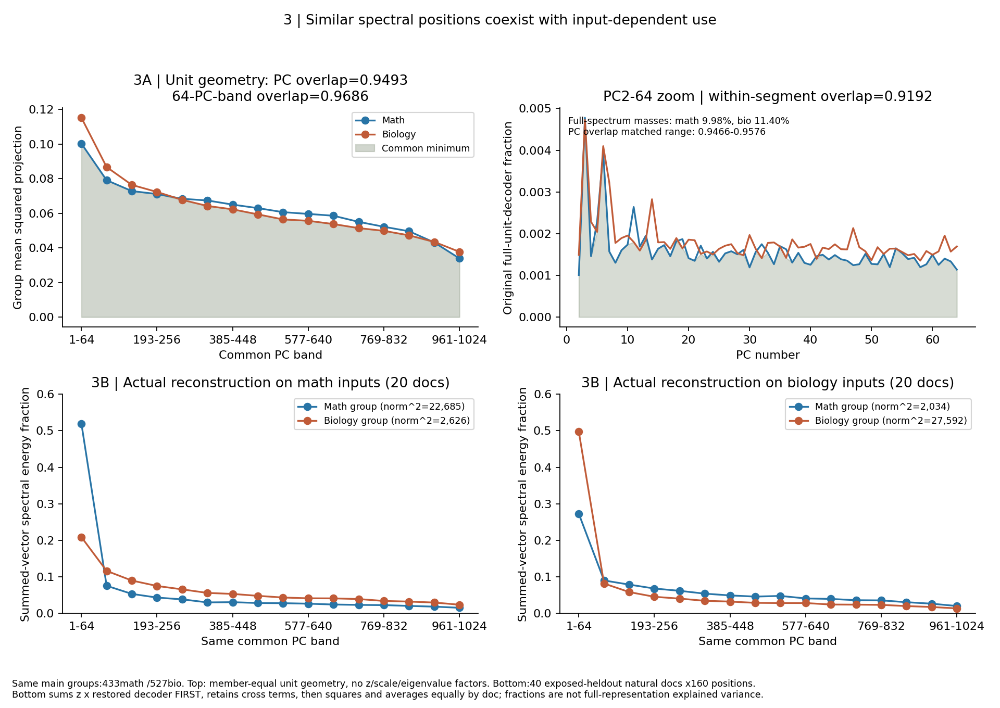
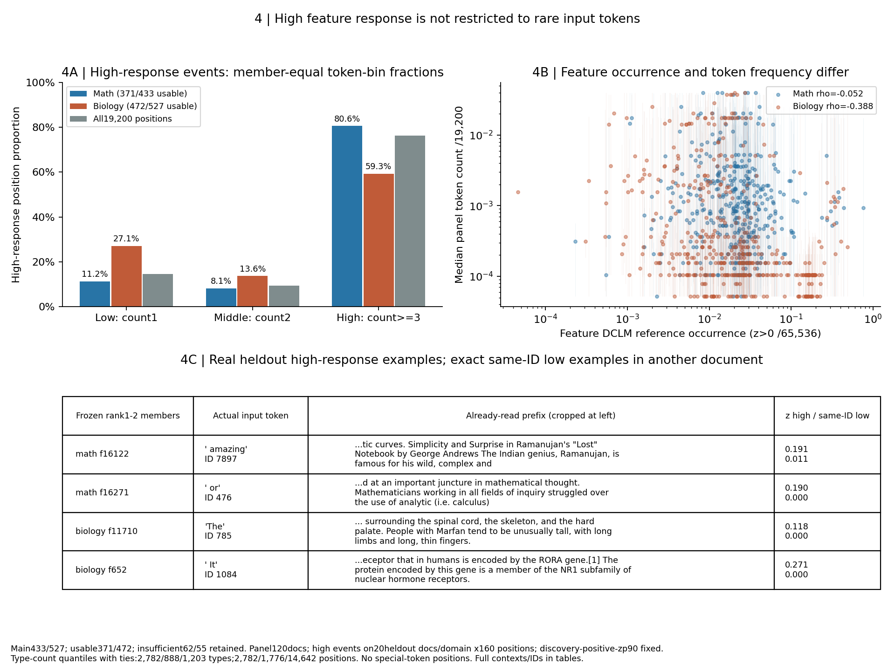
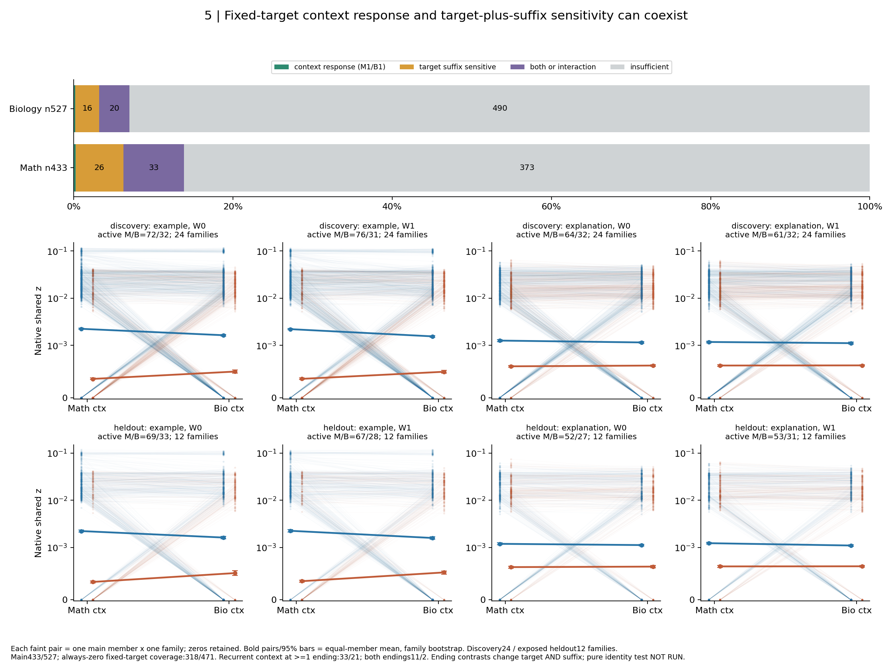

# R10：领域区分成员的频率、共同谱与真实响应

[English](summary.md) · [冻结协议](protocol_cn.md) · [详细证据](detailed_cn.md) · [定义与变更](definitions_cn.md) · [主名单](tables/master_members.csv)

目的：数学／生物文档中最能稳定区分两域的CrossCoder成员，在使用频率、共同表征谱以及词面／上下文响应上如何组织？三条待检验直觉是“较少出现者更能区分”“两域成员分占不同谱位置”“领域偏向体现跨措辞上下文”。竞争解释分别是高频成员的强度差、相近谱位置、领域词汇及格式或交互。以下认识更新是基于本批数据的AI解释，科研接受与问题关闭仍为Unknown。

后续[近单域与真实token补充](supplement_near_domain_tokens_cn.md)在本960名内另冻结31数学/24生物，交付频率和图A/B、全部token与匹配状态。它不替换本页主集合；人工对象语义标注仍待核查。[当前组会总稿](/data/250010109/Research_System/daily_research_reports/1031/meeting_report/meeting_brief_crosscoder_domain_members_cn.md)按认识更新组织全部结果。

## 如何选成员，以及这次修正了什么

用同一个A22原生14层共享z字典，完整16,384坐标起步。发现集每域30篇，每篇固定第32–191共160位置，对z取包含零的文档均值；不同文档等权。先要求至少一域有5篇激活，再算数学均值超过生物均值的配对概率，平局半次。按偏离0.5的程度和ID排序，冻结方向校正区分度≥0.75的全部成员：数学433，生物527，共960。两组ID因评分方向互斥，这是筛选定义，不是空间分离证据。0.75只表示约四分之三跨域文档对能排对，不是语义真理。

| 阶段 | 数学偏向 | 生物偏向 | 总数 |
|---|---:|---:|---:|
| 完整字典 | — | — | 16,384 |
| 发现集至少一次激活 | — | — | 13,997 |
| 支持合格 | 5,473 | 4,586 | 10,076，另有17个AUC=0.5无方向 |
| 主集合：AUC≥0.75 | 433 | 527 | 960 |
| 原留出区间下界>0.5 | 357 | 431 | 788 |

未合格者中2,387个发现集全零，3,921个虽激活但两域各自均不足5篇；这是支持不足，不是证明无信息。留出方向与发现一致为429/433、525/527；方向一致也不等于区间排除0.5。留出是已反复使用的数据，只能称探索性复核。960个成员全部保留，不换人。

新门槛允许领域单侧支持。例如数学排名前两位f16122、f16271的发现文档支持分别为30/3、30/1，原始AUC均为1，不在旧“两域均5篇”截取内；真实高响应也可能落在`and`、`or`等词上。这正是不能预先把领域区分成员解释为领域词条的原因。各坐标的支持、频率及五项状态在同一主表相连。

## 认识更新一：领域区分并不主要由少见成员承担；高复用成员也能区分这两域

**结果分析。** 在频率可判定成员中，数学低/中/高为19/125/288（分母432），生物为58/182/285（分母525）。高频比例66.7%/54.3%，高于支持合格池的44.1%；低频4.4%/11.0%，低于池的16.7%。主集合并没有低频富集。发生率是独立DCLM的z>0次数/65,536，主分组阈值0.259399%和1.344299%，至少20次。数学1、生物2、池101个支持不足，只从本图三组分母排除，仍保留主表。

**如何读图。** 对象为主集合433/527以及支持池10,076成员；筛选样本每域30篇。横轴为低/中/高feature发生率组，纵轴为成员比例；每根柱代表一组成员，柱上同时标人数与比例。先比较同颜色三柱，再在同频组比较领域柱与灰色背景。图中高频是本字典相对分组，不表示在多数token上激活；也不是谱的前部。

**竞争解释与边界。** 原分组下Top16两域以中频最多；扩大到主集合则高频最多，所以“中频最多”依赖排名截断。Top16/64/128、AUC0.70/0.80均保存，不能用16人的组成代表960人。log等宽分组下中频83.3%/65.0%，但低频仍低于池背景；“低频没有富集”的方向保留，具体组名的多数会改变。筛选本身偏向稳定文档响应，对极罕见区分信息的覆盖有限，不能推断整个字典或所有知识皆由高频承担。

## 认识更新二：领域响应偏向不同，并不要求占据分开的谱位置；相近朝向下，实际使用仍随输入改变

**图2结果分析。** 共同谱来自两域发现集60篇×160位置=9,600个真实block27 residual-post向量，以一个共同均值中心化。每域、每文档、每位置等权；不先按域去均值。完整1024PC满秩，decoder先单位化，逐PC内积平方合计1。旧R04谱经原h协方差审计正好满足此定义，因此固定复用；R07用的也是同一谱，不能再称独立稳健性证据。

数学/生物PC1–64均值10.03%/11.52%，中位数6.84%/8.79%。匹配背景均值95%参照区间9.11–10.21%/10.59–11.76%。A01匹配了实际发生次数半octave区间（同层最多相差√2倍）、总支持篇数和最大域支持篇数各5篇区间以及组规模；两组均值均落在细匹配参照内，特殊前偏未建立。原粗频组匹配参照为8.09–9.33%/9.24–10.62%，会让前偏看起来更特殊，故保留为旧版方法对照；参照池含入选成员，平均约40.0%/40.5%的抽样成员也属于主集合，因此是条件字典比较，不是独立空假设或选择重采样区间。

PC1仅占完整单位长度的0.053%/0.120%，PC2–64占9.98%/11.40%，后者的维数参照为63/1024=6.15%。前偏不是由PC1主导。数学约55.0%、生物74.0%的成员前64份额超过64/1024；均值高于中位数说明尾部仍在抬均值，不能称所有成员都有同等前偏。去掉前偏最高10%后均值7.40%/9.48%，该值是附加描述，不是重新筛选。

**如何读图2。** 对象始终为433/527成员和相同9,600个发现位置。上方横轴是16个64-PC谱段，纵轴是完整单位decoder平方长度份额。淡点是成员，实线为均值、虚线中位数、灰带为匹配字典参照、黑点线为全字典。先读均值和灰带，再看淡点与中位数是否支持“多数”。下方分成1/63/960维，菱形是维数比例；不能直接比较不同维数段的绝对总份额来判断富集。这里是几何朝向，不是知识量或实际贡献。

**图3结果分析。** 两组逐PC平均平方分布重合0.9493，每64PC合并后0.9686。匹配参照的逐PC范围为0.9466–0.9576，观测位于其中；原粗匹配为0.9508–0.9610，仅作方法对照。没有证据说这两组“比匹配字典更重合”。PC2–64原始全谱质量分别9.98%/11.40%，在该段内各自归一化后的重合0.9192，不能把0.9192当全谱份额。两组实际decoder子空间秩433/527，trace/min-rank重合0.5314；逐对绝对余弦均值0.0251。这些对象与0.9493不是同一种“重合”。

在40篇原留出自然文本上，先对组内所有z×尺度还原decoder求向量和，再投影平方，保留交叉项。数学组在数学/生物输入上的前64能量份额51.93%/27.27%；生物组在数学/生物输入上为20.88%/49.70%。对应总平均平方范数分别22,684.6/2,034.1、2,625.8/27,591.6，均远离零，不是小分母制造的比例。它们描述组重构向量自身的能量，不能称完整h的方差解释率。

**如何读图3。** 上排沿用图2的单位几何量：横轴共同PC或谱段，纵轴组内成员等权平均平方投影，阴影是两组较小份额。右上只放大PC2–64，曲线仍以完整单位长度为分母。下排换成实际贡献量，横轴同谱段，纵轴是组向量平方能量归一化份额；左/右固定数学/生物输入，各20文档×160位置，蓝/橙分别为433/527成员组。先在同输入图内比较两组，再跨输入比较同一颜色，避免把成员与输入差别混为一谈。

**竞争解释与边界。** 单位几何谱位置相近，与实际使用方式不同可以同时成立。谱平方分布隐藏符号和方向组合，不能推出功能或学习方向相同。平均谱分布会随组规模变平：Top16/64/128逐PC重合0.7652/0.8797/0.9110，不能把主集合0.9493当排名规模不变的量。AUC0.70/0.80为0.9593/0.9295，仍显示大量谱位置重合。共同谱由这两域本身构成；领域差异被它容纳不算独立验证，真正独立自然谱稳健性尚缺。

## 认识更新三：领域偏向不等于词汇专属或纯token身份；上下文与词面／后缀关联可以并存，但当前覆盖很有限

**图4结果分析。** token频率改为本批120文档的19,200分析位置，同tokenizer按ID计数。类型计数分位点落在1/2次，同频不拆，因此低/中/高类型数2,782/888/1,203，位置数2,782/1,776/14,642；本批没有特殊token。子词、标点均保留。高响应阈值来自每成员发现集正z第90百分位，在留出严格超过它；371/433数学、472/527生物满足量化/事件支持，另62/55保留为不足。

数学高响应位置的低/中/高token频率组份额为11.2%/8.1%/80.6%；生物27.1%/13.6%/59.3%，先按成员统计再等权平均。全部位置背景为14.5%/9.25%/76.3%。故数学更偏本批高计数token，生物相对背景更多低计数token，但都不能说只响应罕见词。支持成员的高响应不同token ID中位数17/20，前5种ID占比中位数45%/40%，既跨词又有集中性。feature参考发生率与高响应token计数中位数的Spearman相关为−0.052/−0.388；不能据此说两组存在统一的稳定正相关。

**如何读图4。** 左上横轴是本批token ID计数低/中/高组，纵轴是每成员高响应位置比例的成员等权均值；灰柱是全部有效位置背景，分母与类型数不同。右上每点为一个有支持主名单成员，横轴独立DCLM feature发生率，纵轴其高响应位置token在本语料出现比例的中位数，细线为10–90分位范围，两轴为对数；本批计数均正，未把未见当零。下方实例固定取发现排名前两位/域，显示真实输入token和已读前文，数值分别为高响应与另一文档同ID低响应。完整前三名实例及全部成员的高/普通/同ID低例子均在执行表中。字符串`and`等不能被词义直接判断为该feature语义。

**图5结果分析。** 现有384条件=48家族×2域×2措辞×2目标+后缀；发现/开发/原留出为24/12/12家族。example目标ID3110、explanation为16148，各域配对的目标token和位置都一致，跨家族目标索引30–38。数学33、生物21个在至少一个固定目标上跨措辞并跨发现/原留出复现上下文方向；其中11/2个跨两个目标都符合。词面+后缀复现59/35，交互26/19，其中仅22/12个的复现上下文方向也与自然文本领域偏向一致；其余11/9个在受控条件下方向反过来，更不能泛称同一种领域语义。这些标签可以重叠，均为逐成员点式探索区间，未做多成员确认性发现。

按互斥汇总口径：仅当前上下文响应1/1；词面+后缀敏感26/16；两者或交互33/20；不足373/490。此处“仅”只指本次标签，不证明没有另一种效应。所有划分始终不激活318/471，共789个，应判覆盖不足。高区分文档筛选从未排除领域词汇、来源或格式；固定token后的上下文响应可以削弱纯身份解释，却不能排除前文术语与主题。

**如何读图5。** 上条为960成员的互斥描述标签人数/比例；紫色包含交互，不能直接当全部上下文成员。下方按目标词和措辞分列，发现/原留出分行。横轴为数学/生物前文，纵轴为原生z，0.001以下线性、以上对数。每条淡线连接一个成员×家族在两域的实际值；所有零计入，粗线及区间是成员等权均值和家族重采样。每格标题给有激活支持的成员数；两组颜色始终蓝数学/橙生物。读配对强度变化，不要求由有变无。

**尚未回答。** 纯粹固定前文只换目标词的B缺失。example/explanation同时换了后缀，不能当identity证明。[最小NOT RUN方案](missing_evidence.md)复用48条E0，再补48条同前缀explanation输入；预计1728有效token、256填充实现为12288模型token位置，实际耗时Unknown，当前新增前向0。需另行确认才执行，不能用现有结果填补该结论。

## 冻结敏感性：哪些认识随截取改变

| 集合 | 数学/生物数 | 原频率最多组M/B | 前64均值超细匹配95%参照M/B | 逐PC重合 |
|---|---:|---|---|---:|
| main | 433/527 | high/high | False/False | 0.9493 |
| top16 | 16/16 | middle/middle | False/False | 0.7652 |
| top64 | 64/64 | middle/middle | True/True | 0.8797 |
| top128 | 128/128 | high/middle | True/True | 0.9110 |
| auc0.70 | 852/894 | high/high | False/False | 0.9593 |
| auc0.80 | 188/266 | high/high | True/True | 0.9295 |

主门槛0.75与0.70的两组前偏均未超过细匹配参照，0.80以及Top64/128则超过，Top16没有超过。因此“特殊谱前偏”依赖筛选强度，不能统一推广给全部领域区分成员，也不是确认性多阈值检验。主集合0.70/0.75/0.80的低频比例都低于池；生物Top16/128的低频比例18.75%略高于池16.74%，样本小且只是描述，不能称所有排名截断均低频耗减。主要谱位置大量重合，但数值随成员数而变。

## 五项问题的直接结论

1. feature参考频率：全主集合高频最多且相对池更多；低频未富集，“中频最多”随TopK/分组规则改变。
2. decoder谱位置：温和前偏主要在PC2–64，非PC1主导；均值在细匹配参照内，特殊性未建立，且受长尾影响。
3. 谱分布重合：逐PC0.9493、分段0.9686；不高于匹配参照。实际贡献能量随输入变化，几何与使用要分开。
4. 真实token：高响应跨多个token，数学/生物的语料内频率组成不同；尚无统一稳定的feature频率→token频率联系证据。
5. 上下文/词面：少数有跨措辞上下文响应，多数目标覆盖不足；纯身份判断尚未回答。

## 交付与完成边界

已有测量是R04文本、z、真实h与DCLM计数，R07/R08受控文本及目标z，R09 decoder尺度。本轮新增的是全字典筛选、离线统计、匹配参照、贡献求和、token统计、成套图表及审计；模型前向0、训练0、距离扩展0。5009项数值/契约断言及3000项A01细匹配核对通过，投影完整和误差约1.1e−15。9张精选图中仅5组主图，其他放附录。未覆盖旧结果，未提交或推送；科学接受Unknown，按范围完成后停止。
