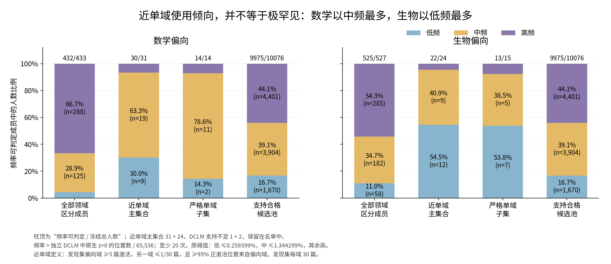
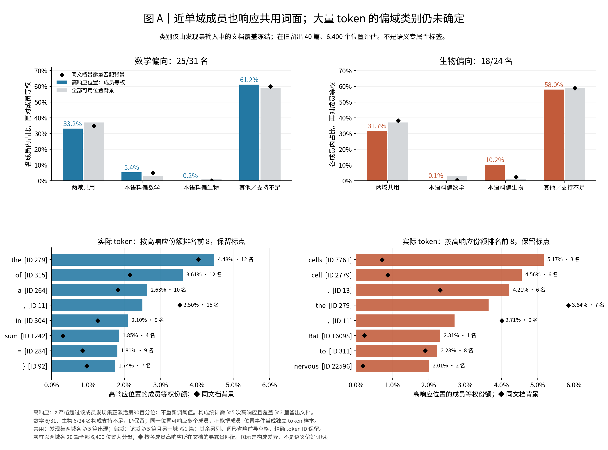
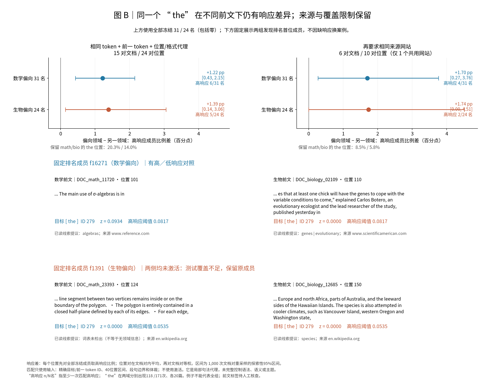

# Near-single-domain members: actual tokens, context matching and frequency

[中文](supplement_near_domain_tokens_cn.md) · [Parent R10 Summary](summary.md) · [Member table](figure_variants/near_single_domain_20261030/near95_members.csv)

## Belief update

**Discrimination, near-single-domain use and lexical exclusivity are different properties. Near-single-domain members occupy lower reference-frequency ranges more often than the full discriminator list, yet also respond on shared token surfaces. Some same-token responses remain associated with different preceding contexts. The present evidence cannot establish whether vocabulary, format or domain semantics is the principal cause across the group.**

This revises the intuition that almost single-domain use must mean responses exclusively to domain terms. The comparisons are observational, the previously exposed heldout is exploratory, and scientific acceptance/closure remain Unknown.

## Fixed objects and selection

The unchanged A22 native 14-layer shared-z dictionary, original gate, block27 interface and R04 token indices32–191 are reused. R10 screened all16,384 coordinates: either domain must have≥5active discovery documents, and oriented document-mean-z pairwise AUC must be≥.75. Document means include zeros; documents and domains have equal weights. The parent main list remains433math/527biology, with30/10/20discovery/development/old-heldout documents per domain.

Within this960-member list, discovery-only rules were frozen before inspecting new plots or heldout outcomes. Strict single-domain requires≥5preferred-domain active documents and zero opposite-domain active documents:14math/15biology. The primary near-single-domain subset requires≥5preferred documents,≤1/30opposite documents, and≥95%of positive token positions in the preferred domain:31math/24biology. No member is replaced.

Heldout applies≥5preferred documents,≤1/20opposite documents and≥95%preferred positive positions.19/31math and21/24biology retain the near rule;8/14math and13/15biology retain strictness. These subsets are separate checks, not replacement populations. First-ranked math member f16271 fails the heldout opposite-document cap yet remains in the main plots and examples. Zero opposite activations across20documents still permits a13.9%one-sided95%upper document-probability bound under an IID-document assumption. This is panel selectivity, not global exclusive knowledge. Share90/95/99%and document-cap sensitivities are saved without modifying the main gate.

## Analysis1: reference feature frequency

Native z>0 counts over65,536independent DCLM positions define feature frequency. The original lower-inclusive cuts are.002593994140625and.0134429931640625;≥20hits are needed for classification. Math30/31classified members have9low/19middle/2high; biology22/24have12/9/1. The three insufficient-reference members remain listed. Classified median rates are.400%/.217%. In contrast, high-frequency members constitute66.7%/54.3%of the complete parent list. The near-single-domain condition thus changes composition; it does not justify calling all55rare.

Read x as named populations, y as the proportion of classified members, segment labels as counts and fractions, and column-top numbers as classified/frozen totals. Log-width sensitivity changes near math to17low/13middle/0high and biology to17/5/0. Exact majority-bin names depend on the rule. Frequency is neither activation strength nor spectral location.

## Analysis2: real token composition with fair input backgrounds

High response strictly exceeds each member's original discovery-positive p90. Composition requires≥5heldout high events across≥2documents:25/31math and18/24biology qualify; six per group remain in the master table with insufficient-composition status. Normalize within each feature, then average features equally. Retain punctuation, subwords, exact IDs, case and leading-space distinctions.

Categories are frozen from discovery INPUT document coverage independently of activation: shared in≥5documents/domain; associated with a domain if present in≥5of its documents and≤1opposite document; all remaining tokens are other/low-support. Evaluate on40old-heldout documents,6,400positions. Gray bars use all available positions. Black diamonds additionally match each feature's high-event document exposure, preventing document choice from masquerading as token preference.

Shared-token high shares are33.2%math/31.7%biology; own-domain-associated shares5.4%/10.2%; other/low-support61.2%/58.0%. Do not fill the unresolved majority with semantic labels or claim that most events are shared. Shared-token input background is37.0%overall and34.9%/38.2%document matched. Math-associated share5.4%versus5.1%matched background is small; biology-associated10.2%versus2.4%shows a panel composition shift, not a confirmed semantic preference.

The lower panels show the first eight tokens ranked by actual member-equal high share, retaining punctuation. Math includes` the`279(4.48%),` of`315(3.61%),` a`264(2.63%),comma,` in`,`sum`,` =`,`}`. Biology includes` cells`7761(5.17%,3/18members),` cell`2779(4.56%,6/18),period,` the`279(3.64%,7/18),comma,` Bat`, `to`, `nervous`. ` Bat`comes from one member/one document; it is retained without a group-level semantic interpretation. Biology's`the`share is below its input background. Complete per-member token IDs, spellings, high-document coverage and corpus counts/rates are saved, including no-high status rows for all55members.

An appendix uses R10 within-panel token-type count quantiles1and2, preserving ties: count1/count2/count≥3. High-response count≥3shares are82.4%/71.8%, versus77.1%of all available heldout positions. Type counts and position counts are stated separately. This token-frequency measure is distinct from independent DCLM FEATURE frequency. Full-word spellings are retrospective readability, never causal explanations of a subword position: e.g.`ph`can be part of`macrophage`, and parent-list`oper`can occur in`isoperimetry`.

## Analysis3: identical token, matched preceding environment

All34discovery-shared exact IDs with≥5heldout documents/domain enter matching; unmatched cells remain explicit. Match exact target and preceding token IDs, genre,40-position bin and sentence/paragraph boundary. Maximize the number of independent document pairs, then position coverage; each document enters at most one pair per ID/level and positions are not reused. Within pairs minimize position distance without activation. A second level also requires exact source host. These are local syntax proxies, not full syntactic or semantic matching.

Eighteen IDs have any local match, five have≥5document pairs; source matching leaves11with any match and two with≥5pairs. The preselected example target is user-requested` the`ID279, also most frequent shared discovery token:118math/171biology heldout occurrences across20documents/domain. At each position, average high indicators over ALL31/24frozen members, including zeros; average matched occurrences within document pairs, then document pairs equally. Bootstrap1,000independent document pairs for pointwise exploratory95%intervals.

Local matching yields15document pairs/24position pairs. Preferred-minus-other high-member-fraction differences are+1.22percentage points[.43,2.15]math and+1.39[.14,3.06]biology. Only6/31and5/24members have any matched high response; native-positive support is19/31and11/24. Source matching leaves6document pairs/10position pairs from one shared host, differences+1.70[.27,3.76]and+1.74[0,4.51], high support4/31and2/24. Local coverage retains20.3%/14.0%of math/biology the positions; source matching8.5%/5.8%. Source explanation remains live. Other sufficiently paired IDs`1`,` a`,` and`,` The`have intervals touching zero for both groups. No multi-token or all-member replication claim is made.

Read top-panel x as preferred-minus-other difference in percentage points; points/lines are equal-document-pair means/intervals. Right adds source matching and substantial coverage loss. Bottom examples use first discovery-ranked near member/domain, fixedID279, highest preferred native-z matched occurrence and its assigned opposite control, without replacing inactive members. f16271responds z=.0934above threshold.0817after`...The main use of σ-algebras is in`, versus0after a biology prefix. Fixed f1391is0on both matched prefixes and is explicitly insufficient coverage. Examples illustrate; all pairs drive inference.

Current token identity alone does not explain all observed responses. Nevertheless, preceding terminology, topic, format and source still vary together. These data do not prove domain-object binding, semantic function or the principal cause across all55members.

## Activation-blind prefix proposals and separate posthoc descriptions

All6,400heldout inputs for annotation contain only randomized case IDs and40already-read tokens before the target. No activation, future text, source or domain field is passed to the rule proposal. Five categories, evidence cues, mixed flags and counterexamples are saved. Human verification remains PENDING.

Version1incorrectly treated absence of finite terminology-lexicon hits as positive evidence of generic narration. It is preserved. Separatev2requires an explicit generic-discourse cue or downgrades to undetermined:2,923term/object cues,1,011relation cues,406format cues,93generic cues and1,967undetermined. These are unreviewed proposals, not semantic prevalence estimates; relation markers need not instantiate reasoning. Main conclusions do not use these proportions. The visible`polygon`prefix missed the original lexicon, while low-response`species`shows that terminology need not imply activation.

Later noun phrases and referents are a separate posthoc question. Four exact the/The IDs have333heldout positions; primaryID279has289and223distinct following-first-word types. Of289occurrences,211following-first-word occurrences were unseen in discovery's corresponding structure and48had≤2single-domain document support. `set`was discovery-math-only yet appears in biology heldout. These lexical descriptions are not validated noun phrases or referent labels. All55×289=15,895near-the rows retain prior text, native z, thresholds, separately named future preview and blank human noun-phrase/referent fields. **The domain specificity of the referents remains unanswered.** Missing labels are neither a null result nor a reason to invent a forward experiment.

## Geometry appendix and completion

For these exact31/24members, the unchanged pooled1024PCunit-decoder geometry gives PC overlap.8303and64-PC-binned overlap.9562. Same-size occurrence/support-matched reference95%range is.8203–.8459: the observed PC overlap is inside. Math/biology first64means20.36%/17.10%, medians13.36%/15.73%; math mean exceeds its matched12.50–17.35%reference, biology is inside13.51–20.25%. Strict14/15overlaps.7472/.9013are separate descriptions without a newly matched comparison. Group-size changes preclude reading the difference from parent960overlap.9493as special separation. These are unit directions, not actual reconstruction energy; no55-member contribution-energy calculation was made.

Three main figures and three appendices, raw distributions, per-member top10, mismatched/support states, all34IDmatches, bootstrap arrays, actual spellings, opposite-domain counterexamples and hashes are saved under the execution presentation directories.18audit categories pass. No forward, training or PCA fit occurred. Previously observed38navigation issues remain separate from numerical validity; no Graph or scientific state was changed.

Reproduce with local spectral-hier Python and the scripts in order: analyze_token_context.py, analyze_near_single_domain.py, token_word_readability.py, match_and_annotate_contexts.py, prefix_annotation_v2.py, near_token_details.py, plot_near_domain_evidence.py, audit_near_domain_evidence.py. Registered parent caches and exact frozen configurations are required. Outputs go only to new presentation subdirectories; old R04/R07/R08/R09and parentR10results remain unchanged. Stop after completing cache-supported work; no new model experiment was started.

[Latest pooled simple figures add an all-cached-strict16descriptive subset and native-positive token views;they do not replace this page's discovery-frozen results.](figure_variants/pooled_simple_20261030/README.md)
