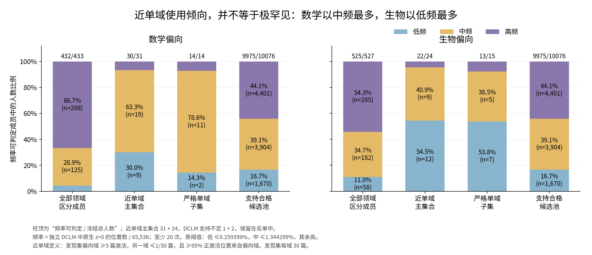
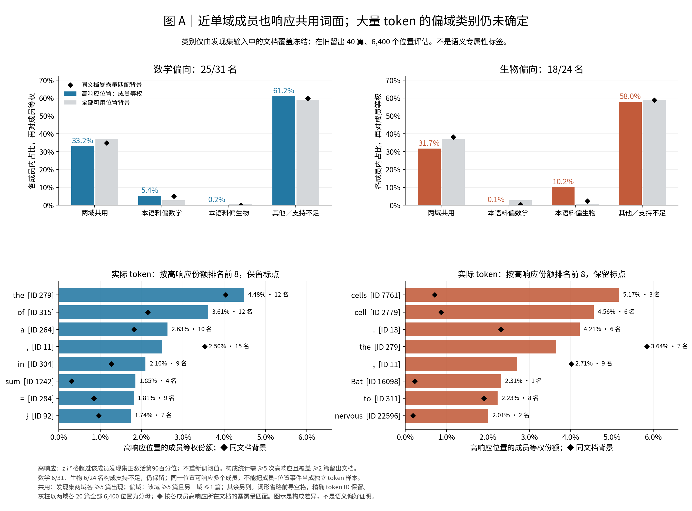
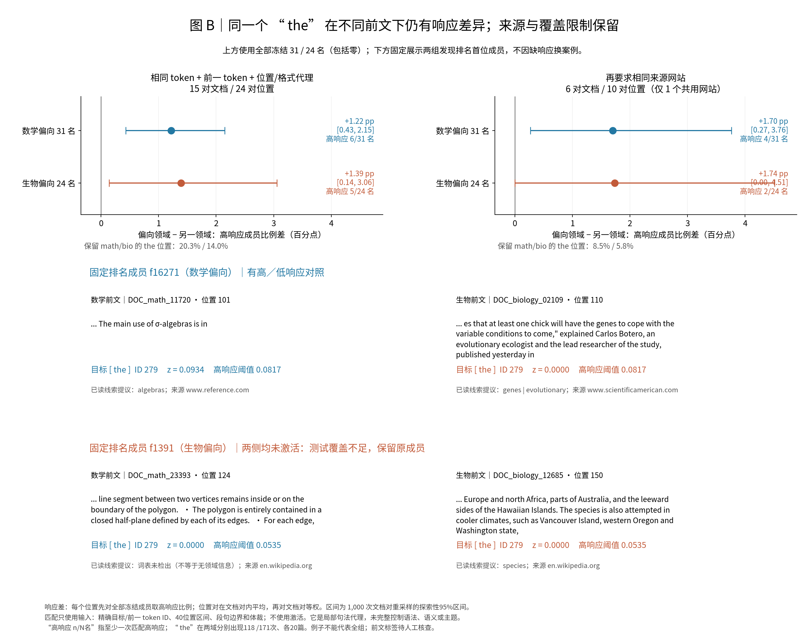

# 近单域成员：真实 token、同词面上下文与频率补充

[English](supplement_near_domain_tokens.md) · [完整 R10 结果](summary_cn.md) · [组会总稿](/data/250010109/Research_System/daily_research_reports/1031/meeting_report/meeting_brief_crosscoder_domain_members_cn.md) · [逐成员主表](figure_variants/near_single_domain_20261030/near95_members.csv)

## 认识更新

**领域区分能力、近单域使用和词面专属性是三个不同层次。近单域成员比完整区分名单更多落在较低参考频率，但仍会响应两域共用词面；固定同一词面后，部分响应仍与不同前文相关。当前证据不足以判定整组主要编码领域词汇、格式还是领域语义，更不能据此称为领域专有知识。**

这修正了“几乎只在一个领域激活，就应只响应那个领域的术语”的直觉。可见前文、来源和格式仍是共同变化的因素。以下为缓存支持的观察分析；已反复查看的留出只作探索性复核，科研接受与问题关闭仍为 Unknown。

## 目的、对象与冻结规则

本补充要区分两个解释：近单域响应主要随特定词面出现；或者相同词面在不同前文下也能有稳定强度差。使用原 A22 原生联合编码、共享 z 和门控。没有修改字典、训练模型或新增前向。

父集合为 R10 冻结的数学433／生物527名。它从全字典16,384坐标出发，先要求发现集中至少一个领域有5篇激活，再按包含零的文档平均 z 计算跨域排序概率，方向校正后至少0.75。每域发现30篇，开发10篇，旧留出20篇；每篇固定 token 索引32–191，共160位置。不同文档等权。

本轮仅在这960名内部增加预先记录的描述性截取，名单由发现集冻结，不查看留出、token图或谱图来换人：

| 集合 | 发现规则 | 数学 | 生物 | 旧留出复核 |
|---|---|---:|---:|---|
| 父集合 | 原 R10 支持与 AUC 规则 | 433 | 527 | 原结果保留 |
| 严格单域 | 偏向域≥5篇激活；另一域0篇激活 | 14 | 15 | 8/14、13/15仍满足严格规则 |
| **近单域主集合** | 偏向域≥5篇；另一域≤1/30篇；≥95%正激活位置来自偏向域 | **31** | **24** | **19/31、21/24**仍满足近单域规则 |

留出复核要求偏向域≥5篇、另一域≤1/20篇、偏向域正激活份额≥95%。原55名全部保留；复核40名是另列子集，不能替换55名。首位数学成员f16271在留出另一域有2篇激活，因此不通过近单域复核，但仍保留在主图和例子中。近单域是本批语料内的描述：即使另一域20篇零出现，独立同分布文档假设下，其激活文档概率的单侧95%上界仍约13.9%，不能称全语料绝不使用。

90%／95%／99%正激活份额与不同异域文档上限的全部截取保留在 [敏感性表](figure_variants/near_single_domain_20261030/selection_sensitivity.csv)。它们不改变主规则。

## 结果分析一：近单域成员更多处于低中频，仍不能统称罕见成员

**对象与分母。** DCLM参考频率是该成员在独立65,536位置上原生 z>0 的比例，与激活强度、token频率和谱位置均不同。至少20次才分组。原切点为0.259399414%和1.344299316%，边界归较低组。近单域数学30/31、生物22/24名可判定；1+2名支持不足留在表中，不强行算低频。

**实际结果。** 数学低／中／高为9/19/2，占30.0%/63.3%/6.7%；生物12/9/1，占54.5%/40.9%/4.5%。完整父集合高频为66.7%/54.3%，因此“区分能力”与“几乎单域使用”确实对应不同组成。近单域可判定成员的参考频率中位数为0.400%/0.217%；这些值不等于语义专属性。按原规则严格单域数学以中频最多，生物以低频最多。

**如何读图。** 横轴为父集合、近单域、严格子集和支持池；纵轴为频率可判定成员中的人数比例。每段同时标人数与比例，柱顶为可判定数／冻结总数。先看同领域不同集合，再比较领域。该图的高低只表示参考发生率。

**修正与边界。** 原分组下数学“中频最多”成立；改用 R09 log等宽切点0.451726%／6.686506%，近单域数学17低/13中/0高，生物17低/5中/0高。具体低中名称依分组，不能宣称一个命名对所有规则都稳定。支持门槛会漏掉极少出现但潜在有信息的成员。

## 结果分析二：哪些真实 token 响应，是否超出输入本来就有的组成？

**计算。** 每个成员沿用其发现集正激活第90百分位阈值，留出严格超过阈值算高响应。不使用输出词表解码。先在每个成员内部算高响应位置组成，再对成员等权。构成至少需5次高响应、2篇留出文档；数学25/31、生物18/24名满足，各6名仅从构成分母排除，仍保留主表。标点、子词和特殊ID都保留，不合并大小写或前导空格。

token类别只看发现集输入文档覆盖，与 feature 激活无关：两域各≥5篇为“两域共用”；某域≥5篇且另一域≤1篇为“本语料偏域”；其余为“其他／支持不足”。这不是常见／罕见频率分组，也不是人工语义分类。类别发现冻结，40篇旧留出6,400位置评估。灰柱为这全部可用位置，黑菱形另按各成员高响应所在文档暴露量匹配，以避免只因文档不同而误判偏好。

| 高响应构成（成员等权） | 数学25名 | 生物18名 |
|---|---:|---:|
| 两域共用 | 33.2% | 31.7% |
| 本语料偏数学 | 5.4% | 0.1% |
| 本语料偏生物 | 0.2% | 10.2% |
| 其他／支持不足 | 61.2% | 58.0% |

不能把约六成未归类者补写成“领域词”，也不能说“多数是共用词”。两域共用在全部位置背景为37.0%，同文档匹配为34.9%/38.2%；它们在高响应位置出现，并不意味着对共用词富集。数学偏数学类别5.4%对同文档5.1%，差异很小；生物偏生物10.2%对同文档2.4%，显示本批语料的组成偏移，但没有由此进行语义或显著性认定。

**实际是什么词。** 数学前列含 ` the`（279，4.48%）、` of`（315，3.61%）、` a`（264，2.63%）、逗号、` in`，也有 `sum`、` =`、`}`。生物前列含 ` cells`（7761，5.17%）、` cell`（2779，4.56%）、句点、` the`（279，3.64%）、逗号等。`cells`这项由3/18成员贡献，不能说18名都响应。排名第6的 ` Bat`（16098）由1名、1篇文档贡献；保留这个例子，不赋予整组含义。下图黑菱形还显示生物组 `the` 输入本来更多，它的高响应份额反而较背景低。

**如何读图A。** 上排横轴是发现集冻结的四类token，纵轴是成员等权位置比例。先比较彩柱与同类灰柱，再看黑菱形是否改变判断。下排按实际高响应份额列前8个ID，条旁标份额与响应成员数；黑菱形为同文档背景。词形仅为便于阅读省略前导空格；精确ID不变。

**语料内token频率。** 附录另按全120篇19,200位置中各ID计数的类型分位点1、2分为出现1次／2次／≥3次，同频并列不拆组。[频率图](figure_variants/near_single_domain_20261030/appendix_token_frequency.png)给出类型数与位置数。高响应位置中≥3次token的份额为数学82.4%、生物71.8%；全部可用位置背景77.1%。这描述本批词面常见程度，不能替代图1独立 DCLM 的 feature 频率。

每名成员的前10 token、完整token分布、ID、可读词形、高响应文档覆盖、全批token次数／19,200和留出次数／6,400均已保存。[前10表](figure_variants/near_single_domain_20261030/per_member_token_top10.csv)包含无高响应者的状态行。子词完整拼写属于事后可读性：例如生物组 `ph`（759）来自 `macrophage`；父集合里的 `oper` 可来自 `isoperimetry`。不能从成员偏向或一个子词直接推断词义。

## 结果分析三：同一个token在相近环境中，是否仍随前文改变响应？

**匹配设计。** 对发现集确认共用、且留出两域各至少5篇出现的34个精确ID，均尝试匹配，不按结果挑ID。只用输入：目标ID、前一token ID完全相同，体裁相同、40位置区间相同、句／段边界类型相同。先最大化独立文档对数，再最大化匹配位置数；同一ID/匹配层级中每篇文档只进一对，位置不复用。来源控制再要求网站host相同。前一ID和边界是局部句法代理，不是完整句法匹配。

自然匹配中18个ID有位置对，5个有≥5文档对；加来源后11个有位置对，2个有≥5文档对。无匹配者显式记支持不足，不当作零效应。主图固定使用用户指定且发现集最常见的共用词 ` the`，ID279；其留出数学118、生物171位置，各20篇。

**读数。** 每个位置先算全冻结组内超过原阈值的成员比例，保留所有零；再在文档对内平均配对差，最后文档对等权。正值表示偏向领域高响应更多。区间按独立文档对重采样1,000次，是点式探索性95%区间，不是盲测或多重校正后的确认。

| ` the`匹配层级 | 文档对／位置对 | 数学组偏向域−另一域 | 生物组偏向域−另一域 |
|---|---:|---:|---:|
| token、位置、格式代理 | 15／24 | +1.22百分点 [0.43, 2.15] | +1.39百分点 [0.14, 3.06] |
| 再匹配来源网站 | 6／10 | +1.70百分点 [0.27, 3.76] | +1.74百分点 [0.00, 4.51] |

第一行仅6/31数学成员、5/24生物成员出现过匹配高响应；原生正激活支持为19/31、11/24。来源控制仅4/31、2/24高响应。不可把组均值写成所有55名各自复现。主匹配保留原两域the位置的20.3%/14.0%；来源控制仅8.5%/5.8%，且只有一个共用网站。其他4个≥5文档对ID（`1`、` a`、` and`、` The`）的组区间均触及零；主图不能替代全表。

**真实例子与反例。** 预定展示两组发现排名首位f16271和f1391，固定ID279，再在匹配池按偏向域最高原生z及其已分配对照取例；这一步只为示意，不参与统计。f16271在已读 `...The main use of σ-algebras is in` 后的 ` the`为z=0.0934，阈值0.0817；另一篇生物前文后的同ID为0。f1391在两篇匹配前文后的同ID都为0，故标测试覆盖不足，不换成员、不判纯词面。

**如何读图B。** 上排横轴为偏向域减另一域的高响应成员比例差，纵轴两组；圆点是文档对均值，线是区间，零线表示未观察到平均差。右图额外控制来源，同时损失大量覆盖。下排是同一成员两种前文，方括号是完全相同的目标token；线索均在目标之前，后文未进入激活解释。

**能判断什么。** 这些样本削弱“当前token身份单独决定全部响应”的解释，支持有限的前文关联。前文术语、主题、格式、来源与领域仍共同变化；不能把差异全部归因于领域语义，更不能判断整组的主要成因。来源相同也不等于来源风格已被充分控制。

## 可见前文标注与事后对象：完成部分与缺口

已生成6,400个激活盲的前文窗口：只含随机case ID与目标前40个已读token，不含目标、未来文字、来源标签或激活强弱。五类规则为“领域术语或对象／领域关系或推理／通用叙述／格式引用／无法判断”。独立保存规则、证据词、混合线索与反例；人工核查列为空，状态 **PENDING**。

初版把“术语词表没命中”当成通用叙述，产生0个无法判断。审计认为该推断不成立，故保留v1并另记v2修订：通用叙述需明确通用话语提示，否则降为无法判断。v2为2,923术语对象提示、1,011关系提示、406格式提示、93通用提示、1,967无法判断。这些只是规则提议，不是人工语义结果，主结论不使用这些比例。规则中的关系词并不保证实际存在推理。图B的 `polygon` 前文就未命中原术语词表，是漏检反例；低响应前文也会有 `species`，因此有术语也不保证激活。

`the`指代什么须分两层：

1. **当时可见信息**：仅用上述前文，人工核查领域线索与可能的前指对象；目前可报告自然上下文关联，不能报告“指代领域对象的比例”。
2. **事后描述**：保存 `the` 后面的原始文字、后续词与待填名词短语／对象标签，严格不用于解释当时激活。四种the/The精确ID在留出共333位置，主ID279有289位置、223种后续首词；其中211次对应的后续首词未在发现集同结构出现，48次仅单域≤2篇支持。把这些直接判为领域对象会过度解释。后续词 `set` 在发现集只见数学，但也出现在生物留出，是“本批偏域不等于专有”的反例。

现有缓存已支持逐位置核查表：所有55名×289个主the位置共15,895行，包含前文、z、固定阈值、后文单列和空白人工对象栏。[执行目录](/data/250010109/MoE_Router/experiments/20261026_natural_language_feature_response/R10_domain_member_atlas_20261030/presentation_variants/near_single_domain_20261030)中的 `near_the_all_occurrences.csv` 保留全量。**“the所指对象是否强领域特殊”尚未回答**，缺的是可靠的语义标注，不能把缺标注写成不特殊，也无需伪称需要模型前向才能解决。

## 与谱分析的关系

[本名单谱图](figure_variants/near_single_domain_20261030/appendix_near_geometry.png)沿用同一共同1024PC与单位decoder量，不乘z、范数或特征值。31/24名逐PC重合0.8303，每64PC分段0.9562；相同规模、频率及支持量匹配背景逐PC95%范围0.8203–0.8459，观测在其中。数学/生物前64均值20.36%/17.10%，中位数13.36%/15.73%。数学均值高于匹配参照12.50–17.35%，生物落在13.51–20.25%内；数学均值与中位数差也提示少数成员影响。

严格14/15名逐PC重合0.7472、分段0.9013，仅另列描述；未为它新增匹配几何结论。不能把不同规模的0.8303与父集合0.9493直接解释为“近单域更分离”。本图为几何朝向，不是实际贡献能量；没有新算55名组重构能量，也不借用960名实际贡献冒充55名结果。

## 完成状态、复现与原始证据

既有材料：R04文本／原生激活／DCLM计数，R10完整逐位置z、冻结p90、PCA和单位decoder投影。本轮新增：近单域冻结截取、严格与阈值敏感性、参考文档重采样、真实token覆盖与构成、精确ID文档配对、前文盲提议及事后描述表、6张有主次图。模型前向0、训练0、新PCA0。

主图为参考频率、A、B；其他3张放附录。全表保留所有55名，无支持或留出未复现者不换人。18类缓存与分母审计通过；来源、人工标注与已暴露留出边界保留。导航检查仍有原先38项问题，其中派生research-map条目待维护，不影响本轮数值；没有自动编辑旧Graph或关闭问题。

执行原始表位于上方目录；父集合token审计另在同级 `token_context_audit_20261030`。近单域每成员全token分布1,325行、前10展示及缺支持状态433行；精确词形拼写、异域正激活反例、所有34ID无匹配状态、配对文档值及重采样权重均保存。

复现入口为本目录 `scripts/analyze_token_context.py` → `analyze_near_single_domain.py` → `token_word_readability.py` → `match_and_annotate_contexts.py` → `prefix_annotation_v2.py` → `near_token_details.py` → `plot_near_domain_evidence.py` → `audit_near_domain_evidence.py`，使用 `/root/anaconda3/envs/spectral-hier/bin/python`。输入由资产ID及源哈希约束；冻结配置不一致会拒绝运行。脚本向上述新增执行目录写出派生统计，不覆盖R04/R07/R08/R09或原R10结果。无新增模型实验方案被执行。缓存可支持工作完成后停止。

[最新合并简图：追加全缓存严格16名与原生激活token统计；这是另列描述性口径，不替换本页发现集冻结结果。](figure_variants/pooled_simple_20261030/README_cn.md)
