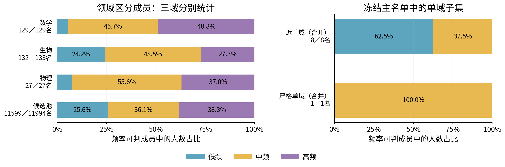
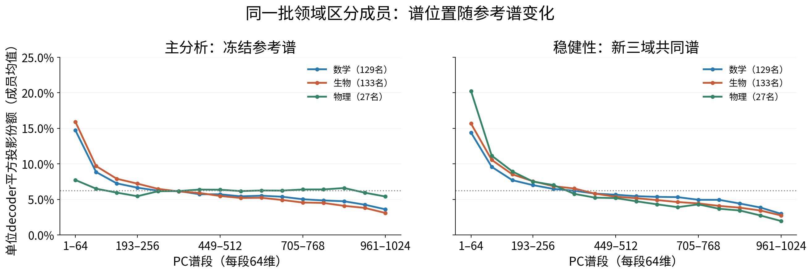
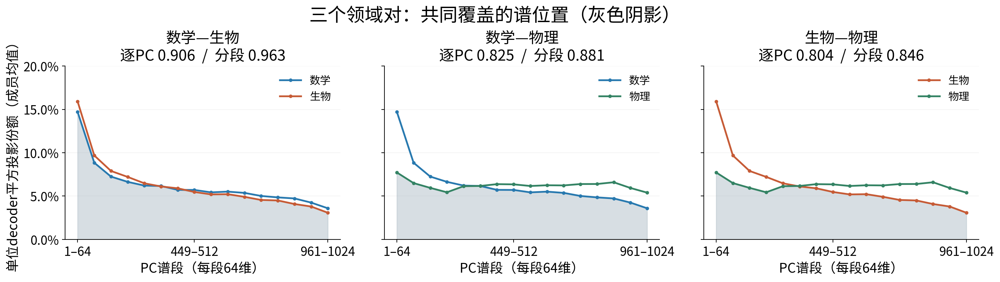
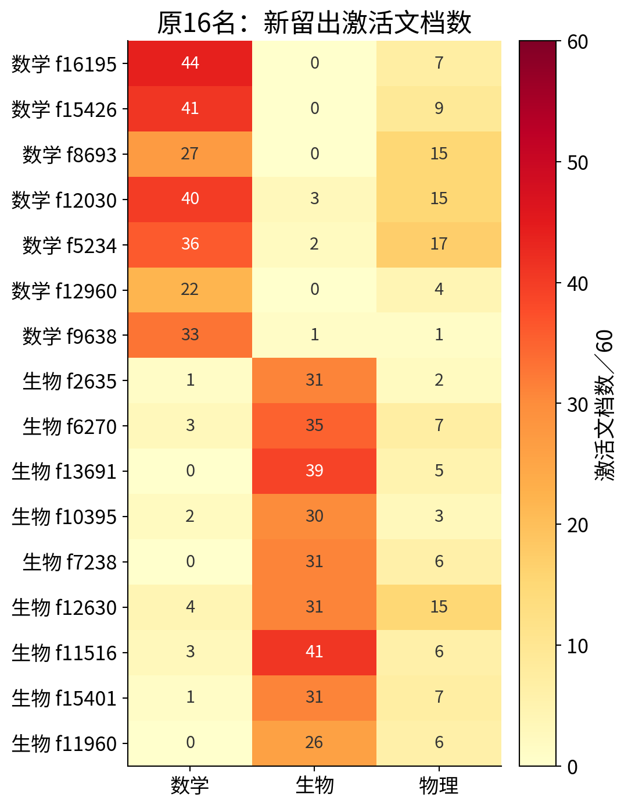
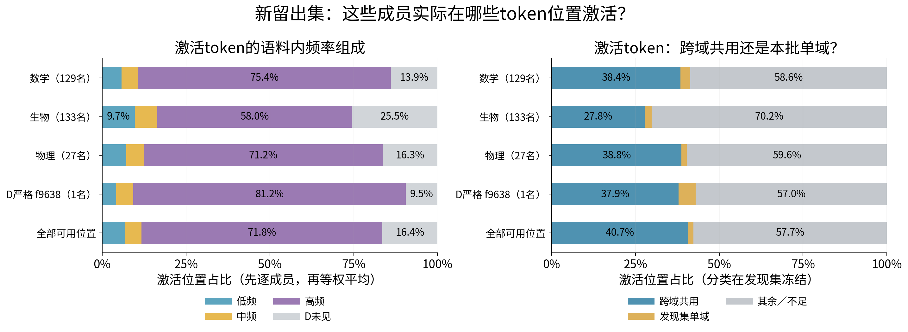
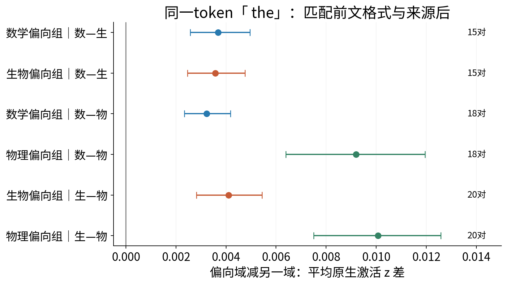

# R11 A02：数学、生物、物理三域结果

[English](summary_A02.md) · [完整过程](detailed_A02_cn.md) · [定义与分组](definitions_A02_cn.md) · [三域数据资格](provenance/A02_qualified_data_cn.md) · [复现及全部表](reproduce_A02.md)

**本轮450篇新文档的三域实验与有界统计已完成。原两域直觉没有得到完整复核。** 下列“认识更新”是依据实测作出的AI解释，供研究者审阅；科研接受、机制判断与问题关闭仍为Unknown。旧R04–R10及R11 A01原样保留。

总问题：最能区分三个领域文本的固定A22成员，在出现频率与共同表征谱中如何分布？原直觉分别是高频成员更常承担区分、近单域成员较少出现、不同偏向组共享较多谱位置。竞争解释是来源、词汇、公式、有限覆盖及选择规则造成这些模式。

本轮沿用Qwen3-0.6B-Base和A22原生14层联合编码、共享激活z与原门控。几何使用最后block27的decoder；没有训练。每域150个新文档家族，发现60、开发30、留出60；每域留出分熟悉平台新文档30和新平台30。每篇分析token索引32–191，共72,000位置。发现集选人，开发不换人，留出仅复核。

| 阶段 | 数学 | 生物 | 物理 | 合计 |
|---|---:|---:|---:|---:|
| 发现／开发／留出文档 |60/30/60|60/30/60|60/30/60|450|
| 全字典 |—|—|—|16,384|
| 至少一篇发现文档激活 |—|—|—|14,873|
| 至少一域≥5篇发现支持的候选 |—|—|—|11,994|
| 发现主集合 |129|133|27|289|
| 其中近单域 |2|5|1|8|
| 其中严格单域（发现阶段） |1|0|0|1|
| 主集合在H仍S≥0.75 |48/129|76/133|22/27|146/289|
| 发现严格成员在H仍严格 |0/1|0/0|0/0|0/1|

三域分数S是“偏向域对另外两域的两个文档AUC中的较小值”；AUC为随机各取一篇，前者平均z更大概率，平局计半。文档平均包含160位置的零。主集合要求偏向域≥5篇发现支持且S≥0.75，全部冻结。严格要求两个对手领域的发现支持均为零；近单域要求每个对手至多3/60篇且偏向域占≥95%正激活位置。没有为了补人数降低门槛。

## 认识更新一：领域区分能力不能由出现频率单独概括，高频富集依领域与截取规则而异

这修正了“领域区分成员普遍高频”的外推，也保留了“低频成员并非区分的唯一来源”。在频率可判定成员中，三个主集合都以中高频为多数；只有数学的高频比例高于候选池。

| 对象 | 低频：人数／占比 | 中频：人数／占比 | 高频：人数／占比 | 可判定／全部 |
|---|---:|---:|---:|---:|
| 数学偏向 |7 / 5.4%|59 / 45.7%|63 / 48.8%|129/129|
| 生物偏向 |32 / 24.2%|64 / 48.5%|36 / 27.3%|132/133|
| 物理偏向 |2 / 7.4%|15 / 55.6%|10 / 37.0%|27/27|
| 支持合格池 |2,967 / 25.6%|4,192 / 36.1%|4,440 / 38.3%|11,599/11,994|
| 近单域：三域合并 |5 / 62.5%|3 / 37.5%|0 / 0%|8/8|
| 严格单域：发现冻结 |0 / 0%|1 / 100%|0 / 0%|1/1|

频率是独立DCLM的65,536个位置中z>0比例；不是强度，也不是PC谱位置。至少20次才分组；原切点0.2593994%与1.3442993%，边界归较低组。生物1名、池395名参考不足，另表保留。近单域仅2/5/1名，数学和物理均不足预定每域≥5名，因此“近单域频率更低”的总体检验F2无法判断。唯一严格成员f9638为中频，不能代表严格单域总体。

**读图：** 左图每行是一个冻结领域组或候选池，横轴为该行频率可判成员的人数占比，三种颜色为低／中／高频；行旁是可判／全部人数。右图合并三域，分母为8名近单域和1名发现严格成员。比较紫色长度与池，才能判断相对富集。它不是token数统计。

三域等权的高频比例差F1为−0.56个百分点，98.333%选择重采样区间[−3.43,+13.63]个百分点，跨零。Top16/64/128和S=0.70/0.80的趋势有变化，不能称截取无关。尤其物理Top64/128含S<0.75成员，不能叫64/128个可靠成员。原log等宽切点仅为敏感性，未替换主图。

## 认识更新二：领域偏向可以不同，谱位置仍有大量重合；前偏程度依领域对与参考谱而异

这修正了“偏向不同就应占据分离谱区”的直觉。同时，“普遍位于谱前端”需要收窄：冻结参考谱下物理组的前段比例明显弱于数学、生物，换到新三域共同谱后才明显增大。

每个decoder先单位化，在同一套1024个正交PC上取内积平方，每名全谱和为1。下图每点是64个PC的份额之和，再对成员等权平均。这个量是固定方向的平方长度，**不能解释为这些成员真实激活能量较高**。

| 对象 | 固定参考谱前64：均值／中位数 | 新三域共同谱前64：均值／中位数 |
|---|---:|---:|
| 数学129名 |14.71% / 8.52%|14.39% / 8.40%|
| 生物133名 |15.91% / 14.00%|15.66% / 13.45%|
| 物理27名 |7.72% / 6.15%|20.23% / 17.61%|

**读图：** 横轴从大方差PC排到小方差PC；纵轴为每64维占完整单位decoder平方长度的比例。左右使用完全相同的289名成员、相同0–25%纵轴，只换参考基。灰虚线6.25%是64/1024维的均匀参照。先看各组第一点，再看左右变化；物理由7.72%变20.23%，说明谱基选择会改变前偏描述。R10是预先固定的主谱，新三域D共同均值PCA是辅助谱，不能事后交换主次；R07与R10实际为同一谱，不能称独立稳健性。

固定谱前三组前64均值对应匹配背景95%参照为[12.48%,14.15%]、[14.32%,16.17%]、[7.95%,12.91%]。因此只有数学均值略高于此参照，物理反而低。物理中位数6.15%低于6.25%维数参照；均值前偏不能写成每名或多数均前偏。PC1均值仅0.076%、0.147%、0.028%，主要前段份额来自PC2–64。全谱后960维仍占85.29%、84.09%、92.28%，所以“前段相对富集”也不表示大部分长度都在前64。[均值／中位数／匹配背景图](figures_A02/appendix_geometry_background.png)保留完整对照。

两组各自成员等权平均的逐PC平方分布，重合系数为逐PC较小份额求和。0表示分布不重合，1表示分布相同。

| 领域对 | 主谱逐PC重合 | 每64PC合并重合 | 同规模／频率／支持匹配中位数 | 新三域谱逐PC重合 |
|---|---:|---:|---:|---:|
| 数学—生物 |0.906|0.963|0.913|0.901|
| 数学—物理 |0.825|0.881|0.859|0.825|
| 生物—物理 |0.804|0.846|0.844|0.841|

**读图：** 每小图是一个领域对；横轴共同64PC谱段，纵轴成员平均投影份额，两条曲线分别对应两个领域，灰色是逐段较小份额。灰色覆盖表示分段重合；标题同时给出更严格的逐PC重合，不能用分段较高数字替代它。三个领域对都保留，数学—生物重合最大。

重合描述成立，但并未高于字典匹配背景。预定综合几何指标G=0.00435，98.333%区间[−0.02027,0.03056]跨零，尚未确认“每对≥0.80且距离背景中位数不低超过0.05”能稳定满足。跨成员绝对余弦均值仅0.025–0.028，实际decoder子空间重合0.141–0.156：相似谱位置仍可对应不同方向与符号组合，不等于相同语义、功能或学习方向。

严格主集合仅数学f9638，生物／物理为空，三个领域对的严格组overlap全部为NA，不能画成零。其前64份额42.46%（主谱）、39.14%（新谱），是单成员描述；近单域2/5/1名的逐PC重合0.541/0.352/0.387只作小样本描述。

## 认识更新三：有限文本中的零响应不能固定为全局领域专有性，领域偏向与跨域复用可以并存

原两域16名严格成员，在每域60篇的新留出中**全部出现物理正激活**；其中12名达到物理≥5篇、≥2个平台的重复使用标准。0/16保持三域严格标签。原16的数学—生物偏向评分仍约0.683–0.867，失去零响应标签不等于失去偏向。

**读图：** 行为原7数学／9生物成员，编号前保留原领域标签。列是新数学、生物、物理；每格是60篇中z>0的文档数，不是token数。右列16行均大于零，直接提供旧“零物理响应”的反例。完整16人表同时保存激活次数、不同token ID数与主要词形。

本轮唯一发现严格成员数学f9638，在H的数学／生物／物理激活文档为33/1/1，正激活位置1,148/1/1。仍偏数学（H的S=0.769，点式95%区间[0.702,0.834]），但不再严格。两个异域反例完整保留：生物文本目标token「 P」（ID393），物理文本目标「gebra」（ID26083，前文在讨论d’Alembert算子和波方程）。弱正值也按既定z>0计入，未提高阈值消除反例。

### 证据4：激活位置对应的真实token与词频

以下使用H全部180篇、28,800有效位置，成员内先统计z>0位置比例，再成员等权；输入token类别及语料内词频在发现集固定。跨域共用指三域共用或恰两域共用，**不等于普通词的语义分类**；“发现集单域”也不等于领域专用术语。

**读图：** 左图横轴是激活位置中低／中／高频token及D未见token的组成，纵向按成员组；底行为H全部可用位置背景。右图改画共用／D单域／其余不足三类。颜色表示token类别，不表示feature频率。D词频按出现次数的类型分位数冻结：低=1次、中=2次、高≥3次；同频不拆。D分别有3,333/1,156/1,793类，占3,333/2,312/23,155位置。H未在D出现的token另标灰色，不能当低频或真实零概率。

三组高频token位置占75.4%/58.0%/71.2%，全位置背景71.8%；同激活文档暴露量匹配背景为75.1%/68.9%/71.6%。数学、物理的原始高比例接近暴露背景，不能直接叫特殊偏好。生物组对应更多D未见token，仍可能受样本词汇与来源影响。

f9638的H共有1,150次激活、35篇、434种ID。其中跨域共用63种（14.5%）／436位置（37.9%）；D单域14种（3.2%）／58位置（5.0%）；其余357种／656位置。两种分母分开，不能用类型占比替代位置占比。

| f9638主要输入token | ID | 激活次数 | 文档覆盖 | D语料内次数 | D分类 |
|---|---:|---:|---:|---:|---|
| 换行 |198|58|8|299|三域共用|
| ␠of |315|52|17|737|三域共用|
| ␠the |279|46|18|1,161|三域共用|
| , |11|27|13|996|三域共用|
| ␠a |264|23|11|503|三域共用|
| ␠prime |10250|13|7|11|发现集单域|

普通词、格式和领域词都可承载响应；这些例子不能单独判定成员编码了什么语义。新主集合及旧16的完整ID／词形／次数／文档／机会数，以及按固定p90阈值的敏感性均已另存。这里沿用户最新要求以z>0为主，p90不替代主图。

### 证据5：同一token在不同前文中的响应

**读图：** 固定ID279「␠the」，还匹配前一个token ID、文体、40位置区间、句段边界、仅由已读前文决定的公式标记及来源平台。纵轴区分成员组与领域对；横轴是该组在偏向域减对手域的平均原生z差；点为成员等权均值，线为独立文档对重采样95%区间。数—生15对／18位置，数—物18对／24位置，生—物20对／26位置。六个组级差均为正，约0.0032–0.0101。

这削弱了“只要目标token相同，响应就完全相同”的解释，支持固定词面后的自然语境关联。不同前文的术语、主题、句法仍有差别，不能命名为纯领域语义。各图保留所有冻结成员；对应有匹配激活支持分别为数学73/129、生物63/133；数—物数学78/129、物理20/27；生—物生物75/133、物理22/27。其余成员在该匹配面板上是覆盖不足，不能判identity。

预定排名成员和预定文档对的实例全部保留，包括f14394两边都为零的例子；未按留出高低挑漂亮案例。只用目标前文解释即时读出，后续11token独立保存为事后描述。前文类别尚未经独立人工核查，未补造语义比例；纯目标词替换B与物理跨措辞受控对照未执行。长／短程依赖也尚未回答。

## 独立留出与五项结论

H_same、H_new分别每域30篇，必须各自通过；不能合并救回。数学在新平台H的S中位数0.678，只有24.0%成员达到0.75，未过至少50%门槛；熟悉平台则67.4%。生物在两层通过（66.9%/51.9%），物理通过（77.8%/85.2%）。保留数学全部129名，不换人。因此“三域描述整体得到复核”的预定判据未满足。

1. **频率：** 主集合多为中高频，但高频相对富集不具三域一致性；近／严格单域总体频率判断因人数不足尚未回答。
2. **谱位置：** 数学、生物平均前偏；物理的前偏强度明显依参考谱，不能普遍化或称真实激活能量。
3. **谱重合：** 主集合三对逐PC重合0.906/0.825/0.804，未超过匹配背景；综合稳定性区间跨零。严格组跨域重合尚未回答。
4. **输入token：** 多种词面和格式均承载激活；共用与本批单域类别及其机会背景已量化，未建立领域术语的语义专有性。
5. **上下文：** 固定「the」并匹配来源格式后仍有组级差异，支持自然语境关联；纯identity、纯语义与长程机制均未确立。

在D已见token上计算激活位置token频率中位数，成员与token频率的描述性Spearman相关为0.133/-0.337/0.081（数学/生物/物理，n=129/132/27）。生物方向与另两域不同，因此没有建立统一稳定联系；未知token仍单列。见[散点附录](figures_A02/appendix_feature_token_frequency.png)。

### 固定高响应阈值敏感性

新成员的D正值p90阈值下，H满足≥5次／2篇者数学129/129、生物132/133、物理27/27。高频token位置比例75.83%/57.43%/72.49%，与z>0主图大致接近；生物1名不足保留。旧16使用旧p90而非新阈值，7数学／9生物均有可用高响应支持。这是同缓存的预定辅助统计，不构成第二次独立复现。

## 交付与停止

研究调用450＋工程12＝462/462；四个旧样本z重放误差均0；8个隔离试读通过。没有训练、干预或新字典。3,000次发现文档选择重采样、1,000次匹配背景、300次Monte Carlo核查完成；所有352个冻结文件哈希复核一致。完整原始统计、289名逐成员主表、旧新映射、频率变更、16名新token表和脚本见复现入口。实验和报告已完成；新增实验及方法设计未执行。
