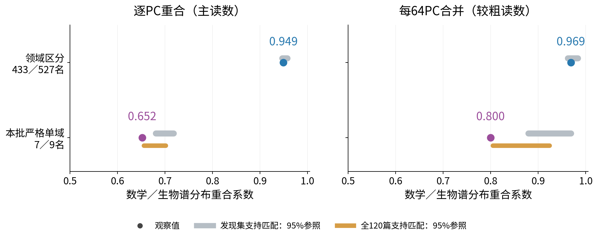
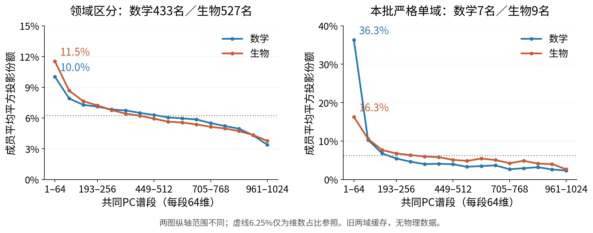

# R11阶段结果：区分成员与本批严格单域成员的谱位置

[English](summary.md) · [详细记录](detailed_cn.md) · [原拟议方案](protocol_cn.md) · [本次执行范围](execution_authorization_A01.md)

**已完成旧数学／生物缓存的补统计；三域独立复核尚未运行。新增模型前向0，训练0。** 下列认识更新是AI依据测量提出的解释，研究者的科学接受与问题闭合仍为Unknown。

## 认识更新一：领域区分与谱位置分离不是同一件事；但整体名单的高重合也不能推广到严格单域子集

我们问：能区分数学与生物的成员，是不是占据不同的共同表征谱位置？沿用同一个A22 CrossCoder、同一个block27 decoder、同一个共同PCA基，分别比较原960名区分成员和原16名本批严格单域成员。没有重选案例。

**结果分析。** 原区分成员的数学／生物逐PC重合为**0.949**，位于同规模、参考发生率和发现文档支持量匹配的字典参照范围0.947–0.958内。本批严格单域7／9名的逐PC重合为**0.652**；两种支持匹配下参照范围分别为0.680–0.718和0.656–0.702。后一比较仅比下界低0.00347，且参照频繁包含原成员，不能包装成稳定而强烈的特殊几何分离。两份名单规模不同，不能只比较0.949和0.652就证明单域性造成分离。

**如何读图。** 横轴为重合系数，理论范围0–1，图中放大0.5–1；越靠右表示两组平均平方投影的分布越相似。纵轴两行是不同的冻结名单，433／527与7／9分别是数学／生物人数。圆点是观察值，灰条和橙条是1,000次条件匹配抽样的中央95%范围，**不是文档置信区间**。左图逐PC为主读数；右图每64PC合并。合并后的0.969和0.800更高，因为它会掩盖段内差异，不能替代左图。

**修正的直觉。** “领域偏向不同，谱位置就分开”在整体名单上未获支持；“不同领域成员普遍高度重合”又过于宽泛，严格单域子集不呈现同样高的重合。谱分布相似也不等于方向或功能相同。

## 认识更新二：严格单域子集的谱前偏有领域差异；是否超出字典背景取决于支持匹配

**结果分析。** 两份名单的组平均都在PC1–64段最高。严格单域数学组更突出，生物组较分散。这里的“前”指方差从大到小排列的PC，**不指feature发生频率**。

**如何读图。** 横轴为共同PCA的16个等宽谱段，每段64维。纵轴为单位decoder平方长度在该段的份额，对每组成员等权平均；每条均值曲线全谱合计100%。蓝线数学，橙线生物。两图纵轴范围不同，比较数值时读刻度；虚线6.25%=64/1024，只是维数占比参照，不是经验字典背景。PCA来自原60篇发现文档×160位置=9,600个真实block27位置，以一个共同均值中心化；没有使用物理文本，也没有新拟合PCA。

| 冻结集合 | 数学／生物人数 | 数学PC1–64均值／中位数 | 生物PC1–64均值／中位数 |
|---|---:|---:|---:|
| 领域区分主集合 | 433／527 | 10.03%／6.84% | 11.52%／8.79% |
| 本批严格单域 | 7／9 | 36.33%／42.46% | 16.30%／16.56% |

严格数学7名全部高于6.25%维数参照，严格生物为7/9；整体数学238/433、生物390/527。说明严格数学的前部占比不是仅一名极端成员抬高，但维数参照不能证明超出真实字典背景。[逐成员表](evidence/member_spectrum.csv)和[16名热图](evidence/appendix_strict16_members.png)保留所有反例。

第一方向不是这次前偏的主要来源：严格数学PC1仅0.206%，PC2–64为36.12%；严格生物分别0.069%和16.23%。前64维不是全部平方长度的多数：即使严格数学均值36.33%，其余960维仍占63.67%。

| PC1–64份额的匹配核查 | 数学观察值／参照95%范围 | 生物观察值／参照95%范围 |
|---|---:|---:|
| 整体成员：发现支持匹配 | 10.03%／9.11%–10.21% | 11.52%／10.59%–11.76% |
| 严格16：发现支持匹配 | 36.33%／16.58%–28.77% | 16.30%／12.49%–24.60% |
| 严格16：全120篇分域支持匹配，事后敏感性 | 36.33%／25.84%–36.33% | 16.30%／15.79%–19.60% |

更强的支持匹配下，严格数学观察值到达参照上界，不能说仍超出范围。这一参照的数学／生物成员抽取中，65.4%／81.2%来自原严格名单，部分分层只有1–3个候选；背景缺少足够独立变化。整体两域各自均值均在对应参照内；合并960名为10.8498%，略超过合并参照上界10.8251%，仅0.0248个百分点。保留这点偏移，不据此泛化为整体具有特殊谱位置。

**修正的直觉。** 不能将“严格单域”统一理解成相同的前部几何；也不能把“前部比维数占比高”直接说成“比字典特别”。来源、词面、激活稀疏性和文档支持仍是竞争解释。

## 对象、口径与本轮新增内容

- 全字典16,384坐标；发现集至少一个领域≥5篇文档激活的候选10,076。主集合采用包含零的文档平均z与跨域配对概率，方向校正后≥0.75，得到433／527名。名单仍由发现集冻结。
- 本批严格16名是其中数学7名、生物9名：在全部120篇旧文档中，另一领域60篇×160=9,600位置均未观察到z>0。该定义用到开发与旧留出，是探索性描述，不是新盲测，不证明全语料领域专有。
- 数学：f16195、f15426、f8693、f12030、f5234、f12960、f9638。生物：f2635、f6270、f13691、f10395、f7238、f12630、f11516、f15401、f11960。
- 几何量为单位decoder与各PC内积的平方；不乘z、decoder范数或特征值。**本轮这两图不回答真实文本中的激活／重构能量。** 原始方向的跨域绝对余弦均值0.0247，也说明谱分布和方向相同是不同对象；没有据此认定功能。
- 已有：R10名单、PCA、投影缓存与整体匹配参照。本轮新增：严格16的完整谱统计、1,000次原规则匹配、全120篇支持匹配敏感性、原始方向／子空间核查、两张简图及逐成员表。匹配检查6,000项通过，投影直接重算最大误差8.33e-17，全谱和为1。

## 三域续接的当前缺口

已扫描现有原始档案全部59,812篇；扩大主题词预筛后有2,537个候选文档家族，暂标数学327、生物1,890、物理337。可多域暂标，人数不可相加。这些是内容复核前的候选，**不是合格450篇实验数据**。

按当前临时标签，数学离散／逻辑14篇、分析24篇，物理热／统计16篇、材料18篇，均未达到每主题25篇；物理全新来源且跨域平台可用的问答候选仅2篇，少于新来源留出要求7篇。标签尚需复核，这不证明没有相关文本，但当前清单未能证明满足配额。M2D2物理档案已定位，但原论文／家族边界尚未核验，不能把行当独立文档。

因此：物理前向、原16名三域测试、新三域统一筛选、三域共同谱与独立留出统计均为**NOT RUN**。保持原来源、主题和划分规则，先补齐合格数据；不降配额凑数。[数据资格记录](data_gate_cn.md)给出具体缺口。运行授权已记录，科学解释与方案是否修改仍由研究者决定。

复现入口与完整原始统计见[Detailed](detailed_cn.md)。本次阶段统计完成；三域研究问题未闭合。
