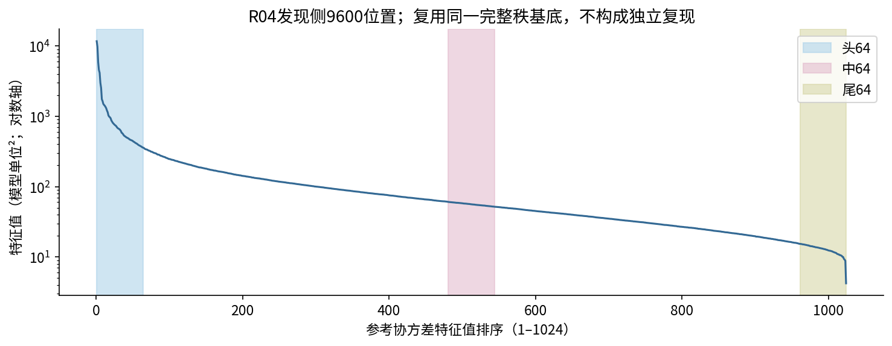

# R13 详细记录：累积谱投影与原生解码

状态：全部主测量 DONE_EXPLORATORY；数值与数据检查 PASS；语义层级／机制判断／问题闭合 Unknown。Optional generation 为 NOT RUN OPTIONAL。主问题、协议与结论归属 A15_27_05，不改写 R12。

## 目的、可区分问题与假设

在固定原生输出头下，检查按方差加回方向会恢复哪些下一token预测。必须区分：目标NLL改善、接近原模型、参考token频率、表面格式和语义关系。先常见／格式后内容是假设；mean-only偏置、维数／能量、词频与读出头对齐、数值误差及输入模板都是竞争解释。图和数据支持界限见[摘要](summary_cn.md)。

## 模型与准确接口

官方 Qwen3-0.6B-Base，权重SHA256 `cd2a512003e2f9f3cd3c32a9c3573f820bb28c940f73c57b1ddaa983d9223eba`；1024隐藏维、28 block。hook是索引27 block输出，pre-final-global-RMSNorm；输出头与输入embedding绑定。原生norm epsilon=1e-6。BF16 eval/inference_mode，SDPA，全部参数requires_grad=False，没有优化器、训练或分类器。

R12的数组B存于PC坐标；原生坐标必须Q=V B。相同1024×64形状不代表同一坐标系。执行前查出并修正错误适配，旧错误设置保存为invalid_predecode_coordinate_selectors，没有产出有效条件结果。

## 谱的来源、定义与数值

源拟合代码：`R04_domain_usage_20261027/domain_discriminability_spectrum_20261028/real_spectrum_A01/spectrum.py`，原始CC_common_basis.npz；R10、R12继续复用。60篇发现文档，每篇160个位置(32..191)，训练矩阵9600×1024。一个池化均值，协方差为XᵀX/(9600−1)，无额外RMS归一化／列标准化。V、mu与源数组逐元素相同。

1024个特征值全部为正：最大11685.4942，最小4.21358；数值秩1024，谱熵有效维度281.92（两个“有效秩”定义不可混称）。正交最大误差3.42e−15。924/1023相邻相对eigengap<1%；64／480／544／960边界相对间隙约0.00510／0.00466／0.00121／0.00523。此轮解释固定子空间，不给单根PC命名语义。尾部不是样本不足的零空间。

对任意预定列集合Q，采用：

$$h_Q=\mu+Q Q^T(h-\mu),\qquad q_Q=\operatorname{softmax}(W\,\operatorname{RMSNorm}_{native}(h_Q)).$$

真恒等直接使用h；全PC重建独立计算，并不因为拟合得到全部PC就默认恒等。嵌套k为1/4/16/64/128/256/512/768/1024；头／中／尾索引1–64／481–544／961–1024，头＋中／尾为128维；另有前128与固定随机参照。三个64维随机来自精确R12数组，三个头＋随机新增与头正交，种子1034/1035/1036。

正交投影使理想欧氏重建误差随嵌套k不增，这是数学性质；经RMSNorm和输出头后的KL、NLL、熵没有相同单调保证。不是新机制发现。全向量正标量缩放大体被RMSNorm消除，本轮各条件epsilon/均方最大5.29e−8；未进行额外范数匹配或温度校准。保留分量相对均值的缩放会改变角度，不等于全向量尺度控制。

## 数据与因果目标

主面板：R12 H/the全部37篇（数学19、生物18），每篇原固定位置，输入ID均为279。t位置的h已经读到x_t，预测目标是x_(t+1)，绝不把当前the本身当后继标签。源原生CausalLM loss实现使用labels[...,1:]，与该口径一致。32..191为有效分析区，pad位不进入面板。

数学090的t=191，旧192-token缓存不含后继。按原collect_byjus_clean.py清理冻结HTML，校验raw/source_text哈希和前192 ID完全匹配，恢复ID34259（` summ`，后续原文拼作summation）。没有丢掉该文档，也没有从模型猜目标。原文后续仅为拼写说明，不进入模型可见前文。

补充：原R11 H180篇，排除五篇指定错例，每篇在32..190中抽4个不同位置，避开主面板位置；seed20261101，175篇700位置。数学59、生物56、物理60篇；两个面板共享32篇，合计180物理文档。全部父文档已暴露，不称新确认集。固定规则先抽样后看原生输出。

与原PCA发现侧的规范文档家族和规范化URL无重合。有来源文本哈希的部分也无交集；95篇未保留该字段，因此未宣称全语料内容去重或完全独立来源。平台／标题／格式可能影响结果。按领域与共享32篇文档的描述性分层保存在stratified_metrics.csv。

## 重缓存、smoke与失败记录

首任务pt-tcuu1t2m在模型前向前因镜像FlashAttention与挂载PyTorch ABI冲突而失败。本进程禁用不使用的FlashAttention／视觉／音频可选依赖，保留SDPA，不修改共享包或权重。第二任务pt-ev9c0mz8停在过严的全PC输入逐位相等检查：562/754688个原零值变成<=1.50e−13，FP64误差6.82e−13。保留失败，改用直接原生输出检查，原FP64限1e−8及重放阈值不变。

第三任务pt-kz3udzv0首次smoke中，旧缓存相对h差1.03–1.61%，292的NLL差0.1153超过预设0.05。另一个裁短tensor的因果对照差0.0588，改变了BF16 kernel形状。该smoke标FAILED，正式条件没有放行。

A4在同一任务内恢复：冻结相同权重／hook／token文本，重新提取全部180篇，每篇固定1×256、前192 mask有效，分篇落盘。新缓存重放全同；因果对照也保持1×256，遮掉并置零t之后的ID，避免换矩阵形状。三篇的缓存h、NLL差及因果前文NLL差均为0。原model完整返回logits与单行head GEMM最大差0.0625，为记录的BF16批形状差；所有实验条件的p_full与q使用同一批形状的原生norm/head，保持比较口径。

全部737位置的全PC与真恒等logits／NLL差均为0；输入cast仍非逐位相等这一事实没有隐藏。详细源在provenance/03_implementation_numerics.json及03_legacy_cache_REPLAY_FAILED.json。

## 概率、频率与区间

NLL=−log q(y)，KL=Σp_full(log p_full−log q)，熵=−Σq log q，单位nat。原模型首选一致率与前十恢复率测保真；前十恢复为两个候选集合交集大小/10。真实目标排名等于严格更高logit的ID数+1。并列首选统一取最小ID。

BF16并列造成torch.topk(10)/(20)顺序不一致，首次恒等一致率出现假缺口。原始chunk不变；CPU按概率降序／ID升序更正。全部15477个输出的第20候选概率严格低于第10，保存前20足以完整覆盖前十并列边界；top1最多3个并列，修正可精确复算，不需重跑GPU。NLL/KL/概率未变。更正前验证失败记录与表格在provenance/pre_tie_fix。

频率来自已登记DCLM global01首个TRAIN bin的前4194304个uint32 ID，切片哈希见manifest。alpha0.5，只在非特殊有效词表归一；padding与特殊ID概率另列。期望log频率对非特殊概率质量条件归一。按参考ID频率分为最高1%、后9%、后40%、末50%，同频按ID排序；不把词片段次数当词的完整语义频率，也不当Qwen实际预训练暴露。原bin生成revision仍Unknown。

每篇先平均，再跨篇平均，配对文档bootstrap2000次、seed20261102、95%百分位区间。是描述性逐点区间，不是多重比较家族置信带。自然面板每篇4位置不当4个独立文档。参考频率／格式分组掩码输出前固定；按原模型首选分层的恢复曲线与直接新增参照差在看输出后补作，全部样本参与，不筛选阈值，不称确认检验。

## 全条件数值（原始表的可读展开）

### 37篇the

|条件|维数|训练参考方差|目标NLL|KL|熵|首选一致率|前十恢复率|期望log频率|格式质量|

|---|---:|---:|---:|---:|---:|---:|---:|---:|---:|

|identity|1024|100.00%|2.4708|0.0000|2.9999|100.00%|100.00%|-10.3044|2.00%|

|mean_only|0|0.00%|12.7944|9.5244|3.1043|0.00%|1.62%|-4.8889|55.52%|

|k1|1|7.56%|13.6770|10.3619|2.9049|0.00%|2.70%|-4.8359|60.84%|

|k4|4|20.62%|11.4844|8.2504|3.1434|0.00%|4.05%|-5.2928|40.87%|

|k16|16|35.14%|8.1930|5.0802|5.0519|5.41%|7.57%|-7.7690|27.38%|

|k64|64|53.07%|6.1963|3.1797|5.5153|10.81%|17.84%|-9.3031|14.78%|

|k128|128|64.00%|5.3368|2.4562|5.1947|18.92%|32.43%|-9.5068|11.47%|

|k256|256|76.50%|4.1883|1.4699|4.6260|32.43%|43.51%|-9.5730|9.27%|

|k512|512|89.87%|3.4049|0.6063|3.8029|56.76%|63.51%|-10.0320|3.43%|

|k768|768|96.72%|2.9078|0.2329|3.2604|59.46%|74.05%|-10.2595|1.74%|

|k1024|1024|100.00%|2.4708|0.0000|2.9999|100.00%|100.00%|-10.3044|2.00%|

|middle|64|2.32%|12.0729|8.8309|3.2490|0.00%|2.97%|-4.9671|52.86%|

|tail|64|0.53%|12.5959|9.4290|3.1199|0.00%|2.43%|-4.9313|55.67%|

|head_middle|128|55.39%|5.7387|2.7488|5.3913|18.92%|19.73%|-9.3570|13.53%|

|head_tail|128|53.59%|6.0418|3.1215|5.4471|10.81%|20.81%|-9.2591|15.42%|

|random1031|64|6.17%|11.6013|8.4754|3.2497|0.00%|2.43%|-5.0944|53.64%|

|random1032|64|6.50%|11.5382|8.2823|3.3252|0.00%|3.24%|-5.2355|53.02%|

|random1033|64|6.33%|11.0877|8.0661|3.6478|0.00%|1.62%|-5.2909|45.87%|

|head_random1034|128|56.24%|5.8234|2.8143|5.4261|18.92%|22.97%|-9.3864|13.48%|

|head_random1035|128|56.21%|5.6894|2.7033|5.5760|18.92%|21.62%|-9.4773|12.98%|

|head_random1036|128|56.18%|6.1044|2.9990|5.2755|13.51%|21.08%|-9.2114|16.79%|

### 175篇自然位置

|条件|维数|训练参考方差|目标NLL|KL|熵|首选一致率|前十恢复率|期望log频率|格式质量|

|---|---:|---:|---:|---:|---:|---:|---:|---:|---:|

|identity|1024|100.00%|2.3418|0.0000|2.2724|100.00%|100.00%|-8.0063|13.65%|

|mean_only|0|0.00%|10.3770|8.0082|3.1043|0.14%|14.84%|-4.8889|55.52%|

|k1|1|7.56%|10.5938|8.2299|3.3452|2.43%|15.10%|-5.0602|51.81%|

|k4|4|20.62%|9.3299|6.9709|3.0704|8.14%|19.46%|-5.0175|48.25%|

|k16|16|35.14%|7.4357|5.1193|3.1722|12.00%|27.04%|-5.5068|37.47%|

|k64|64|53.07%|5.9006|3.6119|3.0540|23.00%|35.64%|-5.9448|25.64%|

|k128|128|64.00%|4.9767|2.6495|3.0214|29.86%|42.77%|-6.2600|22.31%|

|k256|256|76.50%|3.9137|1.5932|2.9550|40.86%|52.86%|-6.6487|19.30%|

|k512|512|89.87%|2.8973|0.5969|2.6724|61.43%|68.23%|-7.2697|15.47%|

|k768|768|96.72%|2.4901|0.1586|2.4429|78.86%|80.77%|-7.7339|13.89%|

|k1024|1024|100.00%|2.3418|0.0000|2.2724|100.00%|100.00%|-8.0063|13.65%|

|middle|64|2.32%|9.8237|7.4548|3.2217|2.43%|15.40%|-4.9729|53.29%|

|tail|64|0.53%|10.2087|7.8292|3.1326|2.14%|15.37%|-4.9280|55.31%|

|head_middle|128|55.39%|5.4735|3.1786|3.1111|24.57%|37.37%|-6.0503|24.74%|

|head_tail|128|53.59%|5.7492|3.4497|3.0218|23.86%|36.24%|-5.9353|25.88%|

|random1031|64|6.17%|9.2669|6.9226|3.2764|2.57%|16.59%|-5.0371|52.28%|

|random1032|64|6.50%|9.2407|6.8710|3.2223|3.00%|16.56%|-5.0282|51.78%|

|random1033|64|6.33%|9.2556|6.9169|3.3099|4.14%|16.56%|-5.0418|51.09%|

|head_random1034|128|56.24%|5.4484|3.1480|3.1065|25.00%|37.70%|-6.0560|24.63%|

|head_random1035|128|56.21%|5.4494|3.1340|3.1310|25.57%|37.79%|-6.0599|24.77%|

|head_random1036|128|56.18%|5.4294|3.1260|3.1328|24.86%|37.70%|-6.0867|24.49%|

## 真实文本与反例核查

固定7篇（五个指定案例＋每域1个种子普通样例）和按k256−k64 NLL极值选择的事后样例分开。原始表给完整已见前文，另列后续拼写说明。12个验证案例由固定哈希、每域4篇、排除全部固定7篇文档选出；这些阅读不构成有外部语义标注的统计。见text_cases_cn.md和unselected_text_validation.json。

具体观察和不同度量分离见summary_cn.md。词频恢复倾向不能改写为外部粗细类别排序；对象词cell可以在64维出现，而常见关系词same仍可能需要较多方向。原模型自己的首选与真实后继也可能不同。

## 资源、存储与可复算

用户授权最多两张既有5090 spot。现有登记最小档5090-2-spot，实际计算CUDA_VISIBLE_DEVICES=0，一张卡工作；没有使用H100或修改任何正式训练。成功路径180次重提取＋6次smoke，总85.29s，峰值已分配显存1387869184 bytes（约1.39GB）。第三任务此前旧缓存诊断额外6次变换器前向，合计新变换器前向192次；原R11的462次历史账本未修改。85秒不包括排队、前两次失败和同任务等待修复，不冒称总资源租用时长。

全量执行根：`/data/250010109/MoE_Router/experiments/20261026_natural_language_feature_response/R13_20261101_native_spectral_decoding`。每篇h27在data/native_h27_fresh；选中向量在data/fresh_h.npy，绑定元数据在data/native_positions.jsonl；原采样元数据及旧h保留。全部raw top20概率及逐位置指标在analysis/raw_outputs.jsonl、position_metrics.csv；原始GPU chunk保持不变。输出不保存N×条件×全词表张量。

CPU复算顺序：scripts/analyze.py → recovery_groups.py → validate.py → render.py。均不重新训练或调用模型。GPU重跑需保留已执行A4合同与冻结源；当前protocol包含输出后A5/A6，历史协议的精确字节保存在provenance/protocol_executed_A4.md，原GPU freeze不被改写成事后协议。完整代码与manifest保留；不在此目录原地覆盖已完成结果。

可选贪心生成未运行：主测量已足以回答本轮的概率恢复与其边界，不用额外生成文本替代数值。

## 覆盖与下一决策

资产／测点／谱审计、固定数据及目标、21条件、737位置、三组主图、等维／保留方差、配对区间、旧缓存失败及新重放、固定与反例文本、原始表、三轮审计全部DONE_EXPLORATORY或DONE_VALID；生成NOT RUN OPTIONAL。coverage_ledger.csv记录所有行。无模型／分类器／字典训练。

科学结论边界与唯一AI下一步见Summary；研究者机制判断和闭题Unknown。只建议频率匹配的对象／关系最小对照，不在本轮继续执行新问题。
