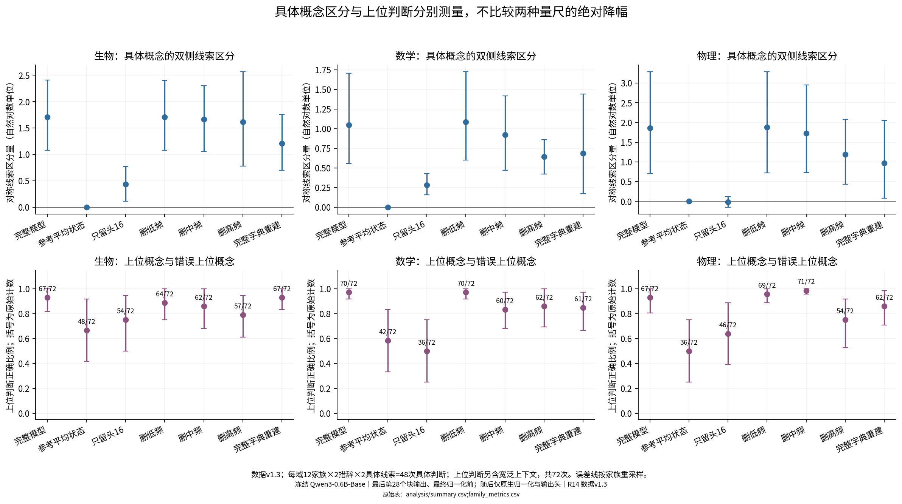
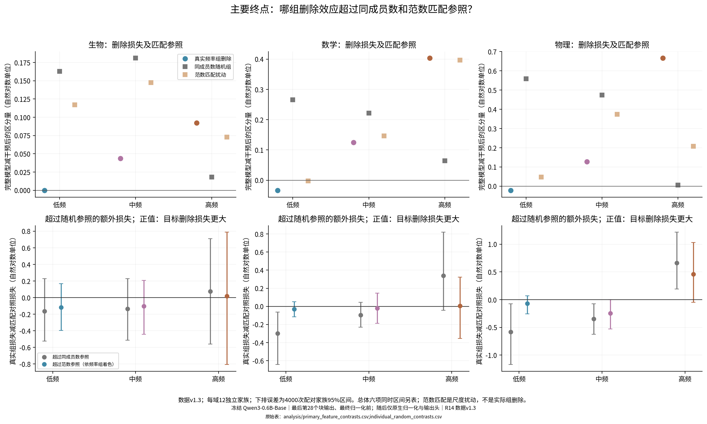
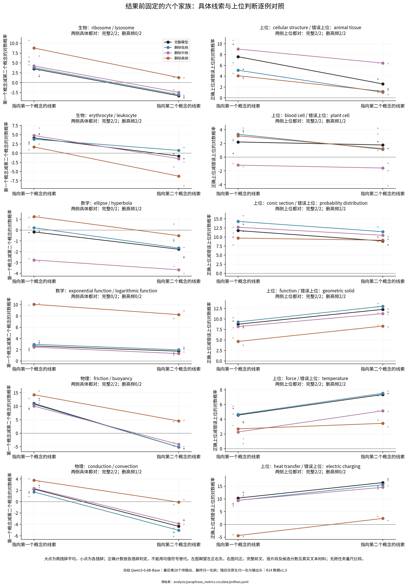
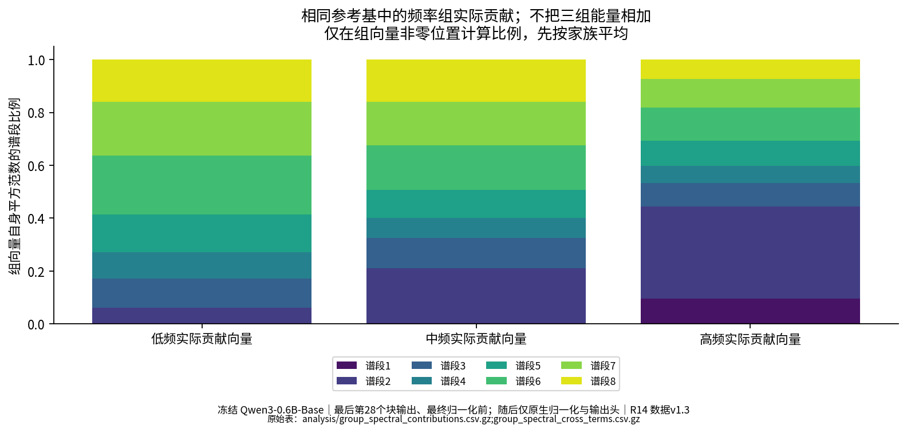

# SAE-mediated Model

## 1102

### 目的

本轮固定生物、数学、物理的具体概念配对，检查从冻结模型的最后内部状态扣掉高／中／低参考频率成员组的贡献后，模型还能否根据前文线索区分两个同层概念。重要性只限这些题目、这个字典和这次即时删除，不给成员组作全局排名。

主比较是删除造成的线索区分损失，是否超过同成员数随机组和逐位置扰动范数匹配。上位概念判断与整体预测分布另报，不把不同任务的绝对下降相减命名为“细语义专属”。

**实际版本：数据1.3；初始冻结协议加A1–A11修订；同一官方Qwen3-0.6B-Base、A22和旧谱基；最终为现有CPU两线程、BF16前向与原生输出头，GPU使用0。** 5090任务未分配设备后停止，未占用H100。环境改变已在任何正式评分前通过三域新文本检查，完整记录见[修订](amendments.md)和[独立复算](provenance/independent_reaggregation.json)。

线索区分分数，指两种指向相反概念的前文，让“候选甲减候选乙”的完整答案对数概率差拉开多少（取差的一半）。它衡量线索引起的相对偏好变化，不等于答对率。删除损失是完整模型分数减去删除后的分数。

### 结论

**本轮尚未建立高／中／低激活频率的稳定语义分工。高频组删除的平均影响较大，但超过范数匹配对照的额外损失尚不确定，上位判断和整体预测也同时受损。这里的“重要性”只限定于当前36个评估家族和最后层的即时贡献删除。** 以下是实测后AI的有边界认识更新；研究者科学接受与问题关闭仍为Unknown。

1. **“删得更多”不能直接更新为“更难替代”。** 原先的读出只能说明信息可被取出。本轮从真实表征扣除组贡献、保留残差后，高频组使平均线索分数由1.539降至1.152；低／中频分别为1.558／1.441。高频超过同成员数随机组的平均损失为0.358，点式95%区间[0.049,0.675]，但六个主比较的同时区间为[-0.031,0.778]；超过范数匹配扰动仅0.161，95%区间[-0.172,0.499]。三个领域的范数匹配额外损失区间也都跨零。高频组上位判断204/216→173/216，整体预测分布偏离4.658，而其范数匹配对照为1.558–1.861。因而当前保留“高频组有较大即时输出影响”的观察，收窄“有任务特异且更难替代的贡献”为尚未建立。低／中频负结果不等于没有信息：它们在各域全部12家族、全部72个首答案位置都有响应；冗余、抵消、小效应和检验能力不足仍未分开。

2. **线索响应、最终选对概念和重建保留必须分开。** 完整模型具体判断为102/144，但72组双侧配对只有31组两侧都对，只有10/36家族在两措辞的四个具体判断上全对。固定的核糖体／溶酶体第一措辞中，高频删除把线索分数4.123提高至4.720，却把溶酶体前文的“核糖体减溶酶体”从-2.823推到+1.319，造成新错；宽泛候选偏好同时由+0.643移到+5.371。这里线索拉开的幅度与候选偏置是不同量。偏置能解释这种正确性变化，不能单独解释主线索分数的损失，因为后者已抵消宽泛基线。数学固定家族还包括完整模型本来就选错的情况。CrossCoder线性求和重建的平均线索分数为0.956、具体正确89/144，低于真实表征的1.539、102/144；0.956/1.539不是“信息保留率”。因此旧线性读出的保留比例不能直接移用到本轮原生输出，成员解释也不能吞掉残差和字典失真。

**审计更正会改变局部判断。** 数据1.2的20个前缀直接写出上位名称，现已按文字规则全部更正为1.3，并保留旧版本。高频相对同人数控制的同时区间下界从+0.025变为-0.031，原版的这个局部阳性判断不能沿用；两版的范数匹配主判据都未通过。另修正了成员反例导出：全零响应成员不能叫“高响应反例”，原规则找不到合格非零成员时明确记未找到，不另调阈值找故事。

**唯一优先的未决问题（AI建议，未运行）：在整体预测损伤相近的对照下，高频组是否仍有额外的具体线索区分损失？** 这将区分任务线索贡献与广泛预测破坏；本轮不继续增加模型、层、训练或实验条件。

### 实验分析

阅读分三层：①行为与因素对照：同一前文扣掉什么，候选答案如何改变；②表征与谱位置：这些实际组向量落在哪些固定方向；③功能干预与测量质量：原生输出是否可信。旧读出只证明信息可被取出，本轮删除只证明此反事实下输出怎样改变，概念与线索由下面的配对文本外部定义；三层不相互替代。

#### 先明确对象与分母

模型读完一段前文，在最后第28个块、最终归一化之前，产生1024个数。修改这个向量后，只经过一次原生最终归一化和冻结输出头。A22字典同时读取14个选定块（零起点1、3、…、27），给每个成员一个共享响应系数。本轮只扣掉这些成员在最后块的解码向量之和，保留原始重建残差、偏置和其余成员贡献。

频率是独立参考DCLM的65,536个位置中该成员系数大于零的次数：低频20–170次（4469名），中频171–881次（4437名），高频至少882次（4451名）。另有2278名参考支持不足、749名零出现成员；它们保留在完整状态与重建中，不能将本轮低频组泛称为所有最稀有成员。参考语料的独立文档数未恢复，记为未知。

48个概念家族，每域4开发、12评估；288前缀中72开发、216评估。每家族有宽泛、指向第一个概念、指向第二个概念三种前文，各两种措辞。统计先平均同家族两措辞，再平均每域12家族，总体三域等权。因此独立评估单位是36个家族。每域具体候选判断48次，上位判断72次，双侧都对的措辞配对24组。题目为结果前编写的实际模型输入，语义审核由AI完成，不冒称人类盲标或随机自然语料抽样。

候选完整答案统一带一个前导空格和结束句号，评分包括句号、不含结束符。所有候选文字片段都评分并施加同一条件。文字片段编号只是词表地址；不能把某一个子词概率当完整概念概率。

“参考平均状态”是旧数学／生物60篇、9,600个位置的1024项平均。谱保留先从当前向量减去它，保留指定正交方向，再将它加回一次。只用平均状态会抹去当前前文的偏离，不是平均预测，也不是新训练。CrossCoder另有其训练参考的14层中心及整体向量尺度，二者不是同一均值；组删除不再次加减这些中心。

#### 总体与逐领域：先给原始数值
| 领域     | 条件       |   独立家族 | 具体判断正确/总数   | 两侧都对/配对数   | 上位判断正确/总数   |   线索区分分数 |   完整减该条件 |
|:-------|:---------|-------:|:------------|:-----------|:------------|---------:|---------:|
| 生物     | 完整模型     |     12 | 35/48       | 11/24      | 67/72       |  1.70878 |  0.00000 |
| 生物     | 只用参考平均状态 |     12 | 24/48       | 0/24       | 48/72       |  0.00000 |  1.70878 |
| 生物     | 删除低频     |     12 | 33/48       | 10/24      | 64/72       |  1.70916 | -0.00038 |
| 生物     | 删除中频     |     12 | 37/48       | 13/24      | 62/72       |  1.66502 |  0.04376 |
| 生物     | 删除高频     |     12 | 31/48       | 8/24       | 57/72       |  1.61663 |  0.09215 |
| 生物     | 线性求和重建   |     12 | 30/48       | 7/24       | 67/72       |  1.20646 |  0.50232 |
| 数学     | 完整模型     |     12 | 32/48       | 9/24       | 70/72       |  1.05011 |  0.00000 |
| 数学     | 只用参考平均状态 |     12 | 24/48       | 0/24       | 42/72       |  0.00000 |  1.05011 |
| 数学     | 删除低频     |     12 | 32/48       | 9/24       | 70/72       |  1.08409 | -0.03398 |
| 数学     | 删除中频     |     12 | 34/48       | 10/24      | 60/72       |  0.92524 |  0.12488 |
| 数学     | 删除高频     |     12 | 33/48       | 9/24       | 62/72       |  0.64685 |  0.40327 |
| 数学     | 线性求和重建   |     12 | 28/48       | 6/24       | 61/72       |  0.68776 |  0.36235 |
| 物理     | 完整模型     |     12 | 35/48       | 11/24      | 67/72       |  1.85916 |  0.00000 |
| 物理     | 只用参考平均状态 |     12 | 24/48       | 0/24       | 36/72       |  0.00000 |  1.85916 |
| 物理     | 删除低频     |     12 | 34/48       | 10/24      | 69/72       |  1.88197 | -0.02281 |
| 物理     | 删除中频     |     12 | 31/48       | 9/24       | 71/72       |  1.73150 |  0.12766 |
| 物理     | 删除高频     |     12 | 27/48       | 6/24       | 54/72       |  1.19283 |  0.66633 |
| 物理     | 线性求和重建   |     12 | 31/48       | 7/24       | 62/72       |  0.97371 |  0.88545 |
| 三域等权总体 | 完整模型     |     36 | 102/144     | 31/72      | 204/216     |  1.53935 |  0.00000 |
| 三域等权总体 | 只用参考平均状态 |     36 | 72/144      | 0/72       | 126/216     |  0.00000 |  1.53935 |
| 三域等权总体 | 删除低频     |     36 | 99/144      | 29/72      | 203/216     |  1.55841 | -0.01905 |
| 三域等权总体 | 删除中频     |     36 | 102/144     | 32/72      | 193/216     |  1.44059 |  0.09877 |
| 三域等权总体 | 删除高频     |     36 | 91/144      | 23/72      | 173/216     |  1.15210 |  0.38725 |
| 三域等权总体 | 线性求和重建   |     36 | 89/144      | 20/72      | 190/216     |  0.95598 |  0.58337 |

区分分数以自然对数为单位，具体定义和手算如下。完整模型本身失败的家族全部保留，不能将任意分数下降都当作原本正确能力的丢失。上位候选的基线难度、词频、长度和具体任务不同，单列分数与正确数。

图1实际测量同一批家族在完整状态、平均状态、谱头、删除组和重建下的候选判断。上下两行是不同量尺。参考平均状态检查答案词面偏好；它不能排除题目知识、模板和上位任务过易的解释。图中的误差是家族重采样，不是216个独立前缀。

#### 主要终点：超过哪些匹配参照，超过多少
| 频率组   | 对照类型     | 领域     |   目标删除损失 |   对照平均损失 |   超过对照的损失 |    95%下界 |    95%上界 |   同时区间下界 |   同时区间上界 |   正差家族数 |   家族数 |
|:------|:---------|:-------|---------:|---------:|----------:|---------:|---------:|---------:|---------:|--------:|------:|
| 低频    | 同成员数随机均值 | 三域等权总体 | -0.01905 |  0.32924 |  -0.34830 | -0.60418 | -0.11386 | -0.69571 | -0.04348 |      11 |    36 |
| 低频    | 范数匹配扰动均值 | 三域等权总体 | -0.01905 |  0.05411 |  -0.07317 | -0.19088 |  0.03568 | -0.22264 |  0.08227 |      18 |    36 |
| 中频    | 同成员数随机均值 | 三域等权总体 |  0.09877 |  0.29213 |  -0.19336 | -0.35902 | -0.03286 | -0.41465 |  0.02247 |      12 |    36 |
| 中频    | 范数匹配扰动均值 | 三域等权总体 |  0.09877 |  0.22284 |  -0.12408 | -0.28661 |  0.02401 | -0.33420 |  0.06899 |      16 |    36 |
| 高频    | 同成员数随机均值 | 三域等权总体 |  0.38725 |  0.02934 |   0.35791 |  0.04883 |  0.67521 | -0.03074 |  0.77797 |      21 |    36 |
| 高频    | 范数匹配扰动均值 | 三域等权总体 |  0.38725 |  0.22579 |   0.16146 | -0.17163 |  0.49873 | -0.29935 |  0.63047 |      21 |    36 |

上表同时区间只针对三组×两类控制的六个总体主比较。正额外损失表示目标组删除比对应三个随机控制的平均更伤害区分；它不是全字典全局排名，也不是所有可能随机组的总体检验。每个随机种子的单独结果完整保留。
| 频率组   | 对照类型     | 领域   |   目标删除损失 |   对照平均损失 |   超过对照的损失 |    95%下界 |    95%上界 |   正差家族数 |   家族数 |
|:------|:---------|:-----|---------:|---------:|----------:|---------:|---------:|--------:|------:|
| 低频    | 同成员数随机均值 | 生物   | -0.00038 |  0.16289 |  -0.16326 | -0.52348 |  0.22689 |       5 |    12 |
| 低频    | 同成员数随机均值 | 数学   | -0.03398 |  0.26567 |  -0.29965 | -0.64368 | -0.06417 |       2 |    12 |
| 低频    | 同成员数随机均值 | 物理   | -0.02281 |  0.55917 |  -0.58198 | -1.17187 | -0.07418 |       4 |    12 |
| 低频    | 范数匹配扰动均值 | 生物   | -0.00038 |  0.11712 |  -0.11750 | -0.39681 |  0.16739 |       6 |    12 |
| 低频    | 范数匹配扰动均值 | 数学   | -0.03398 | -0.00240 |  -0.03158 | -0.11648 |  0.05272 |       6 |    12 |
| 低频    | 范数匹配扰动均值 | 物理   | -0.02281 |  0.04761 |  -0.07041 | -0.25898 |  0.06727 |       6 |    12 |
| 中频    | 同成员数随机均值 | 生物   |  0.04376 |  0.18097 |  -0.13721 | -0.51568 |  0.22911 |       5 |    12 |
| 中频    | 同成员数随机均值 | 数学   |  0.12488 |  0.22187 |  -0.09699 | -0.23070 |  0.04645 |       4 |    12 |
| 中频    | 同成员数随机均值 | 物理   |  0.12766 |  0.47355 |  -0.34589 | -0.62487 | -0.07428 |       3 |    12 |
| 中频    | 范数匹配扰动均值 | 生物   |  0.04376 |  0.14759 |  -0.10383 | -0.44381 |  0.20824 |       7 |    12 |
| 中频    | 范数匹配扰动均值 | 数学   |  0.12488 |  0.14654 |  -0.02166 | -0.18871 |  0.14772 |       6 |    12 |
| 中频    | 范数匹配扰动均值 | 物理   |  0.12766 |  0.37439 |  -0.24673 | -0.52657 |  0.00177 |       3 |    12 |
| 高频    | 同成员数随机均值 | 生物   |  0.09215 |  0.01822 |   0.07393 | -0.56001 |  0.71128 |       5 |    12 |
| 高频    | 同成员数随机均值 | 数学   |  0.40327 |  0.06450 |   0.33877 | -0.04324 |  0.81974 |       7 |    12 |
| 高频    | 同成员数随机均值 | 物理   |  0.66633 |  0.00531 |   0.66102 |  0.19013 |  1.21586 |       9 |    12 |
| 高频    | 范数匹配扰动均值 | 生物   |  0.09215 |  0.07296 |   0.01920 | -0.80812 |  0.78785 |       7 |    12 |
| 高频    | 范数匹配扰动均值 | 数学   |  0.40327 |  0.39658 |   0.00668 | -0.35495 |  0.32467 |       7 |    12 |
| 高频    | 范数匹配扰动均值 | 物理   |  0.66633 |  0.20784 |   0.45849 | -0.04792 |  1.03116 |       7 |    12 |

图3上排给出真正删除、随机同成员数删除和范数匹配扰动的原始损失，下排才是目标超过控制的配对差和区间。灰色控制排除成员数差；范数控制检查向量大小，却仍未匹配扰动方向、分布外程度或全部预测损伤。频率组删除无效也不能证明没有可读信息或没有冗余。

整体预测变化、候选负对数概率与上位分数分别报告：
| 条件     |   线索区分量 |   正确减错误上位分数 |   上位正确数 |   与完整预测分布差异 |   正确完整候选负对数概率 |   输出分散程度 |   参考常见片段质量 |   空白标点质量 |   特殊片段质量 |   未分配词表行质量 |   要求的扰动范数 |    实际扰动范数 |
|:-------|--------:|------------:|--------:|------------:|--------------:|---------:|-----------:|---------:|---------:|-----------:|----------:|----------:|
| 完整模型   | 1.53935 |     7.04217 |     204 |     0.00000 |      13.35011 |  4.09718 |    0.51309 |  0.13158 |  0.00001 |    0.00000 |   0.00000 |   0.00000 |
| 参考平均状态 | 0.00000 |     1.57325 |     126 |     7.10990 |      36.52497 |  3.10433 |    0.98340 |  0.55525 |  0.00077 |    0.00000 | 396.52290 | 396.54728 |
| 线性求和重建 | 0.95598 |     6.42548 |     190 |     0.65938 |      19.78461 |  3.95358 |    0.52948 |  0.08351 |  0.00000 |    0.00000 | 206.51942 | 206.51845 |
| 删除低频组  | 1.55841 |     6.42821 |     203 |     0.14411 |      14.62306 |  3.87999 |    0.55883 |  0.13708 |  0.00001 |    0.00000 |  61.69224 |  61.70698 |
| 删除中频组  | 1.44059 |     6.58546 |     193 |     0.49823 |      17.25679 |  4.47973 |    0.55354 |  0.07244 |  0.00001 |    0.00000 | 166.29387 | 166.29699 |
| 删除高频组  | 1.15210 |     4.37230 |     173 |     4.65797 |      18.76636 |  4.84030 |    0.62063 |  0.24834 |  0.00003 |    0.00000 | 310.61640 | 310.61224 |

“与完整预测分布差异”使用完整分布加权的对数概率差，零表示相同、越大偏离越大；“输出分散程度”是输出熵，越大越分散。这里的概率质量是相应词表片段的概率之和，不是样本计数。
“候选负对数概率”是这套合成概念题的正确完整候选评分，不是自然语料困惑度。与完整分布的相对熵只在第一个答案预测位置计算，此时答案尚未进入前文；后续片段只用于完整候选似然。输出词频来自旧独立4,194,304个DCLM token，使用加0.5平滑，与成员激活频率是不同量；原始分词构建版本仍未知，不能当Qwen实际训练曝光。

#### 逐领域的错误交换与家族差异
| 条件    | 领域   |   纠正原错 |   引入新错 |   保持正确 |   保持错误 |
|:------|:-----|-------:|-------:|-------:|-------:|
| 删除高频组 | 生物   |      5 |      9 |     26 |      8 |
| 删除高频组 | 数学   |      5 |      4 |     28 |     11 |
| 删除高频组 | 物理   |      5 |     13 |     22 |      8 |
| 删除低频组 | 生物   |      4 |      6 |     29 |      9 |
| 删除低频组 | 数学   |      2 |      2 |     30 |     14 |
| 删除低频组 | 物理   |      2 |      3 |     32 |     11 |
| 删除中频组 | 生物   |      7 |      5 |     30 |      6 |
| 删除中频组 | 数学   |      6 |      4 |     28 |     10 |
| 删除中频组 | 物理   |      5 |      9 |     26 |      8 |

高频删除在生物纠正5次、引入9次新错；数学纠正5次、引入4次新错；物理纠正5次、引入13次新错。因此不能说它在所有领域都以相同方式降低正确率。上位判断的交换另存原表，不用两个任务的绝对错误增量比较细语义专属性。
| 领域          | 结果后诊断     | 家族             | 具体概念对                                       |     完整分数 |   删除高频后 |    完整减删除 |
|:------------|:----------|:---------------|:--------------------------------------------|---------:|--------:|---------:|
| biology     | 最大损失      | biology_10     | mutualism / parasitism                      |  2.50860 | 0.33670 |  2.17191 |
| biology     | 最大改善／最小损失 | biology_06     | erythrocyte / leukocyte                     |  2.45626 | 3.96394 | -1.50768 |
| mathematics | 最大损失      | mathematics_15 | rotation / reflection                       |  4.12106 | 1.01722 |  3.10385 |
| mathematics | 最大改善／最小损失 | mathematics_06 | exponential function / logarithmic function |  0.46504 | 0.91653 | -0.45149 |
| physics     | 最大损失      | physics_05     | friction / buoyancy                         |  8.07570 | 4.86878 |  3.20692 |
| physics     | 最大改善／最小损失 | physics_11     | transverse wave / longitudinal wave         | -0.28444 | 0.06095 | -0.34538 |

上表为结果后按高频删除的家族线索分数损失选择的诊断极值；正文六个固定家族未更换。物理最大损失来自摩擦／浮力，数学来自旋转／反射，生物来自互利／寄生；完整36家族均在原表中，没有移除反向家族。

#### 一组完整原始分数和手算
固定首例：核糖体／溶酶体，上位为细胞结构，错误上位为动物组织。
| 前文类别   |   候选甲对数概率 |   候选乙对数概率 |    甲减乙分数 |   正确上位对数概率 |   错误上位对数概率 |   正确减错误上位分数 |
|:-------|----------:|----------:|---------:|-----------:|-----------:|------------:|
| broad  | -13.35401 | -13.99673 |  0.64272 |  -14.38521 |  -23.69462 |     9.30941 |
| A      | -12.78033 | -18.20315 |  5.42282 |  -19.11716 |  -29.00809 |     9.89093 |
| B      | -15.20564 | -12.38257 | -2.82307 |  -19.53887 |  -23.02479 |     3.48592 |

先将每个完整候选的各片段对数概率相加，再计算“核糖体减溶酶体”。宽泛偏好为0.642722；核糖体线索后为5.422816；溶酶体线索后为-2.823071。因此第一侧增益=5.422816−(0.642722)=4.780094；第二侧增益=0.642722−(-2.823071)=3.465793；对称线索区分=(4.780094+3.465793)/2=4.122943。宽泛偏好在最后一步抵消，不能说这个最终分数单独证明了宽泛基线的作用。

#### 固定自然语言案例、反例与成员响应

图4每域选05、06两个家族，是结果前固定的六例。大点为两措辞平均，淡色小点为各措辞，标题另给逐措辞正确计数，避免平均值掩盖一对一错。左侧横跨两种线索，正确模式为第一点正、第二点负；右侧上位差应分别为正。完整前文、中译、候选完整拼写及分词、逐片段概率和所有关键分数见[逐例精读](casebook_cn.md)。最大改善、最大恶化和最接近无变化另标结果后诊断选择，未冒充代表性样本。成员按预先规则选取响应差最大的两名及响应大但线索差小的反例，不据此命名成员功能。

具体两侧原本都对、上位两侧也对时，删除后出现具体错误且上位两侧仍对的配对计数（分母是符合前提的措辞配对，不是全部家族）：
| 领域   | 条件    |     删除损失 |   具体正确比例损失 |   上位正确比例损失 |   原本双侧具体与上位均对的配对数 |   具体新错但上位保留的配对数 |
|:-----|:------|---------:|-----------:|-----------:|------------------:|----------------:|
| 生物   | 删除高频组 |  0.09215 |    0.08333 |    0.13889 |          11.00000 |         5.00000 |
| 生物   | 删除低频组 | -0.00038 |    0.04167 |    0.04167 |          11.00000 |         3.00000 |
| 生物   | 删除中频组 |  0.04376 |   -0.04167 |    0.06944 |          11.00000 |         1.00000 |
| 数学   | 删除高频组 |  0.40327 |   -0.02083 |    0.11111 |           8.00000 |         2.00000 |
| 数学   | 删除低频组 | -0.03398 |    0.00000 |    0.00000 |           8.00000 |         2.00000 |
| 数学   | 删除中频组 |  0.12488 |   -0.04167 |    0.13889 |           8.00000 |         2.00000 |
| 物理   | 删除高频组 |  0.66633 |    0.16667 |    0.18056 |          10.00000 |         2.00000 |
| 物理   | 删除低频组 | -0.02281 |    0.02083 |   -0.02778 |          10.00000 |         2.00000 |
| 物理   | 删除中频组 |  0.12766 |    0.08333 |   -0.05556 |          10.00000 |         4.00000 |

这项计数是配对错误模式，不能用不同任务绝对降幅推断细语义专属性。若上位任务有词面先验或接近天花板，保持上位正确的证据也必须收窄。

三域所有频率组在全部72个首答案位置都有响应。每位置平均激活的成员数，低频约8.6–15.7、中频62.6–70.9、高频270.0–319.1；组成员数相近不代表实际扰动相近。正响应系数的条件均值约为低频0.028–0.043、中频0.027–0.028、高频0.022；系数尺度不能跨成员直接当重要性，实际贡献还依赖各解码向量及相互抵消。
| 领域   | 频率组   |   members |   正差家族数 |   nonzero_first_positions |   first_answer_positions |   mean_active_members_per_position |   conditional_positive_coefficient_mean |   mean_actual_group_vector_norm |
|:-----|:------|----------:|--------:|--------------------------:|-------------------------:|-----------------------------------:|----------------------------------------:|--------------------------------:|
| 生物   | 低频    |      4469 |      12 |                        72 |                       72 |                           15.66667 |                                 0.04286 |                       118.66146 |
| 生物   | 中频    |      4437 |      12 |                        72 |                       72 |                           62.59722 |                                 0.02760 |                       156.25505 |
| 生物   | 高频    |      4451 |      12 |                        72 |                       72 |                          270.04167 |                                 0.02192 |                       303.60052 |
| 数学   | 低频    |      4469 |      12 |                        72 |                       72 |                            8.63889 |                                 0.02846 |                        28.72834 |
| 数学   | 中频    |      4437 |      12 |                        72 |                       72 |                           69.40278 |                                 0.02693 |                       167.66389 |
| 数学   | 高频    |      4451 |      12 |                        72 |                       72 |                          319.08333 |                                 0.02186 |                       320.83585 |
| 物理   | 低频    |      4469 |      12 |                        72 |                       72 |                            8.91667 |                                 0.03132 |                        37.68690 |
| 物理   | 中频    |      4437 |      12 |                        72 |                       72 |                           70.90278 |                                 0.02814 |                       174.96266 |
| 物理   | 高频    |      4451 |      12 |                        72 |                       72 |                          299.80556 |                                 0.02197 |                       307.41281 |

同一个预定低频成员5691在核糖体线索、溶酶体线索和宽泛前文的第一措辞系数分别约0.124、0.274、0.231，独立参考仅出现60/65536次。它说明参考低频并不等于本次弱响应，也不能凭响应直接叫“某概念专属”。整组删除同时改变有无和幅值贡献，不能据此裁决旧幅值机制。

#### 与谱位置的联系（次要结果）

上图先用当前响应系数求出整个组的实际向量，再投影到同一个旧参考谱。只在组向量非零位置计算组自身的比例，先按家族平均。成员方向不正交，三组平方范数不能相加当作原始表征能量；完整交叉项与抵消原表单列。低／中／高频没有被定义成谱头／中／尾。

完整的累计保留、单段保留与移除、头16追加、同秩随机、同总维谱头延长和范数匹配见[谱条件图](figures/02_spectral_conditions_secondary.png)及[全部条件](evidence/conditions.json)。这些曲线联系谱位置，不为每条曲线另造研究主题。前16维为1.5625%、前64维为6.25%的维数，方差比例另见谱来源审计。参考谱来自旧数学30篇、生物30篇，不含物理；谱复用不构成独立复现。

#### 匹配、精度、失败与结论边界

头16的平均线索分数为0.236；追加谱段256–511（256维）后为0.777，同总维的头272为0.935，三个正交随机追加均值0.754。追加相对随机均值的配对差约0.023，不能把正增量直接命名为中段独有细语义；其完整区间见谱匹配表。头16也在核糖体／溶酶体、木质部／韧皮部、素数／合数各一个预定措辞中把两侧都判对，但另一个措辞不全对，这是局部具体概念可用的反例，不建立普遍排序。上位判断在前768维为208/216，完整状态204/216，也不能假定正确率必然单调。
| comparison                           | target      | controls                                                                |   difference |    95%下界 |    95%上界 |
|:-------------------------------------|:------------|:------------------------------------------------------------------------|-------------:|---------:|---------:|
| append_vs_equal_total_head_extension | keep_head64 | keep_head64                                                             |      0.00000 |  0.00000 |  0.00000 |
| append_vs_random_mean                | keep_head64 | random_append_B3_s11021|random_append_B3_s11022|random_append_B3_s11023 |      0.08159 | -0.08347 |  0.25428 |
| append_vs_equal_total_head_extension | append_B4   | head_extension_B4                                                       |     -0.04921 | -0.21783 |  0.10451 |
| append_vs_random_mean                | append_B4   | random_append_B4_s11021|random_append_B4_s11022|random_append_B4_s11023 |      0.13770 |  0.01259 |  0.27369 |
| append_vs_equal_total_head_extension | append_B5   | head_extension_B5                                                       |     -0.10125 | -0.30130 |  0.07835 |
| append_vs_random_mean                | append_B5   | random_append_B5_s11021|random_append_B5_s11022|random_append_B5_s11023 |      0.11904 | -0.06945 |  0.33069 |
| append_vs_equal_total_head_extension | append_B6   | head_extension_B6                                                       |     -0.15809 | -0.42716 |  0.09731 |
| append_vs_random_mean                | append_B6   | random_append_B6_s11021|random_append_B6_s11022|random_append_B6_s11023 |      0.02308 | -0.13427 |  0.19363 |
| append_vs_equal_total_head_extension | append_B7   | head_extension_B6                                                       |     -0.25376 | -0.55436 |  0.02190 |
| append_vs_random_mean                | append_B7   | random_append_B6_s11021|random_append_B6_s11022|random_append_B6_s11023 |     -0.07260 | -0.21098 |  0.07552 |
| append_vs_equal_total_head_extension | append_B8   | head_extension_B6                                                       |     -0.31956 | -0.66293 | -0.00698 |
| append_vs_random_mean                | append_B8   | random_append_B6_s11021|random_append_B6_s11022|random_append_B6_s11023 |     -0.13840 | -0.33092 |  0.06142 |

上表为完整交付的次要匹配比较，区间为点式95%，不作新的多重检验阳性结论。

完整答案长度匹配子集与逐片段平均评分均保留，主结果仍是原始序列求和。子集由分词长度事前确定，不按模型答对筛选。
| 条件    | 长度子集     | 领域   |   家族数 |   线索区分量 |   按候选片段均分后的区分量 |   具体判断正确比例 |   正确减错误上位分数 |   上位判断正确比例 |
|:------|:---------|:-----|------:|--------:|---------------:|-----------:|------------:|-----------:|
| 删除高频组 | 具体候选长度相同 | 生物   |     9 | 1.60442 |        0.50185 |    0.61111 |     3.37338 |    0.77778 |
| 删除高频组 | 具体候选长度相同 | 数学   |     8 | 0.64633 |        0.23258 |    0.75000 |     4.90464 |    0.79167 |
| 删除高频组 | 具体候选长度相同 | 物理   |     6 | 1.16476 |        0.51650 |    0.58333 |     7.23689 |    0.88889 |
| 删除高频组 | 上位候选长度相同 | 生物   |     9 | 1.84348 |        0.55983 |    0.63889 |     3.58671 |    0.83333 |
| 删除高频组 | 上位候选长度相同 | 数学   |     5 | 0.44993 |        0.15324 |    0.60000 |     5.39040 |    1.00000 |
| 删除高频组 | 上位候选长度相同 | 物理   |     8 | 1.31800 |        0.46887 |    0.62500 |     3.02574 |    0.70833 |
| 删除低频组 | 具体候选长度相同 | 生物   |     9 | 1.82022 |        0.55738 |    0.69444 |     4.90545 |    0.87037 |
| 删除低频组 | 具体候选长度相同 | 数学   |     8 | 1.36394 |        0.52843 |    0.68750 |     6.88443 |    0.95833 |
| 删除低频组 | 具体候选长度相同 | 物理   |     6 | 1.78065 |        0.75333 |    0.70833 |     7.78829 |    0.97222 |
| 删除低频组 | 上位候选长度相同 | 生物   |     9 | 1.92099 |        0.55153 |    0.66667 |     5.17633 |    0.92593 |
| 删除低频组 | 上位候选长度相同 | 数学   |     5 | 0.72306 |        0.23956 |    0.50000 |     7.04261 |    1.00000 |
| 删除低频组 | 上位候选长度相同 | 物理   |     8 | 2.01324 |        0.69012 |    0.71875 |     7.22137 |    0.95833 |
| 删除中频组 | 具体候选长度相同 | 生物   |     9 | 1.53851 |        0.46768 |    0.77778 |     6.88190 |    0.88889 |
| 删除中频组 | 具体候选长度相同 | 数学   |     8 | 1.26376 |        0.46603 |    0.78125 |     6.75202 |    0.77083 |
| 删除中频组 | 具体候选长度相同 | 物理   |     6 | 1.56877 |        0.65098 |    0.58333 |     6.98299 |    1.00000 |
| 删除中频组 | 上位候选长度相同 | 生物   |     9 | 1.99397 |        0.58962 |    0.83333 |     6.62523 |    0.90741 |
| 删除中频组 | 上位候选长度相同 | 数学   |     5 | 0.60411 |        0.18469 |    0.70000 |     5.45686 |    0.83333 |
| 删除中频组 | 上位候选长度相同 | 物理   |     8 | 1.75719 |        0.60872 |    0.65625 |     6.88729 |    1.00000 |
| 完整模型  | 具体候选长度相同 | 生物   |     9 | 1.69348 |        0.51638 |    0.72222 |     7.24629 |    0.90741 |
| 完整模型  | 具体候选长度相同 | 数学   |     8 | 1.34566 |        0.52049 |    0.75000 |     7.15691 |    0.95833 |
| 完整模型  | 具体候选长度相同 | 物理   |     6 | 1.75941 |        0.74873 |    0.79167 |     8.24225 |    0.97222 |
| 完整模型  | 上位候选长度相同 | 生物   |     9 | 2.07464 |        0.60702 |    0.80556 |     7.01589 |    0.98148 |
| 完整模型  | 上位候选长度相同 | 数学   |     5 | 0.70434 |        0.22400 |    0.55000 |     7.39209 |    1.00000 |
| 完整模型  | 上位候选长度相同 | 物理   |     8 | 1.99579 |        0.69756 |    0.71875 |     7.05158 |    0.91667 |

范数匹配实际进入BF16状态后的偏差与零扰动检查：
| 条件                             | target                |   positions |   intended_norm_max_abs_difference |   actual_relative_norm_difference_mean |   actual_relative_norm_difference_max |   target_actual_zero_positions |   control_actual_zero_positions |   target_intended_nonzero_but_actual_zero |
|:-------------------------------|:----------------------|------------:|-----------------------------------:|---------------------------------------:|--------------------------------------:|-------------------------------:|--------------------------------:|------------------------------------------:|
| feature_normmatch_low_11021    | feature_delete_low    |        2640 |                            0.00000 |                                0.00306 |                               0.09397 |                              5 |                               5 |                                         0 |
| feature_normmatch_low_11022    | feature_delete_low    |        2640 |                            0.00000 |                                0.00325 |                               0.11594 |                              5 |                               5 |                                         0 |
| feature_normmatch_low_11023    | feature_delete_low    |        2640 |                            0.00000 |                                0.00213 |                               0.04231 |                              5 |                               5 |                                         0 |
| feature_normmatch_middle_11021 | feature_delete_middle |        2640 |                            0.00000 |                                0.00123 |                               0.00764 |                              0 |                               0 |                                         0 |
| feature_normmatch_middle_11022 | feature_delete_middle |        2640 |                            0.00000 |                                0.00131 |                               0.00661 |                              0 |                               0 |                                         0 |
| feature_normmatch_middle_11023 | feature_delete_middle |        2640 |                            0.00000 |                                0.00140 |                               0.00837 |                              0 |                               0 |                                         0 |
| feature_normmatch_high_11021   | feature_delete_high   |        2640 |                            0.00000 |                                0.00022 |                               0.00111 |                              0 |                               0 |                                         0 |
| feature_normmatch_high_11022   | feature_delete_high   |        2640 |                            0.00000 |                                0.00021 |                               0.00097 |                              0 |                               0 |                                         0 |
| feature_normmatch_high_11023   | feature_delete_high   |        2640 |                            0.00000 |                                0.00022 |                               0.00091 |                              0 |                               0 |                                         0 |

独立脚本从原始位置分数重新汇总了167个条件×36评估家族、全部六项主对照及其区间；最大主数值误差1.78e-15。无干预、全部方向、空组、缓存、因果与原生输出头检查均有记录，不用摘要自证。CPU不是5090跨设备逐值复现；所有本轮比较均在同一CPU精度路径完成。

执行：167个独立条件，另19个代数相同条件别名；288前缀，2640唯一评分位置；CPU初版正式路径1130.6秒，数据纠正追加285.0秒，另有开发检查约55秒；累计约24.5分钟。没有优化器、可训练参数更新或新模型／字典训练，GPU0。数据1.2的全部167条件与上位名称暴露问题完整保留，20前缀、80分支、166评分位置按文字规则更正，未按模型成功筛选。原生BF16字典解码与FP32线性求和的小差异在开发检查中单列，不拿总体重建好替代任务区分保留。

证据边界：两种全局模板不等于跨模板复现；AI语义审核不等于人类盲标。12家族/域的区间较宽，全对时经验重采样区间可能退化，不表示总体精度已知。三随机种子只覆盖这三组控制；删组不是唯一编码机制、不是幅值与有无机制裁决，也不能从候选似然推出自由生成连贯性。所有完整模型失败与无效/负结果保留。

#### 原始材料与复算入口

- [冻结数据与候选](/data/250010109/MoE_Router/experiments/20261026_natural_language_feature_response/R14_20261102_concept_specificity_v1/data/prefixes.jsonl)
- [完整逐片段评分](/data/250010109/MoE_Router/experiments/20261026_natural_language_feature_response/R14_20261102_concept_specificity_v1/analysis/candidate_token_logprob.csv.gz)
- [完整候选序列评分](/data/250010109/MoE_Router/experiments/20261026_natural_language_feature_response/R14_20261102_concept_specificity_v1/analysis/candidate_sequence_scores.csv.gz)
- [全部家族分数](/data/250010109/MoE_Router/experiments/20261026_natural_language_feature_response/R14_20261102_concept_specificity_v1/analysis/family_metrics.csv)
- [主要匹配对照](/data/250010109/MoE_Router/experiments/20261026_natural_language_feature_response/R14_20261102_concept_specificity_v1/analysis/primary_feature_contrasts.csv)
- [三个随机组分别比较](/data/250010109/MoE_Router/experiments/20261026_natural_language_feature_response/R14_20261102_concept_specificity_v1/analysis/individual_random_contrasts.csv)
- [所有配对谱／删除对比](/data/250010109/MoE_Router/experiments/20261026_natural_language_feature_response/R14_20261102_concept_specificity_v1/analysis/all_paired_contrasts.csv)
- [所有成员支持与参考频率](/data/250010109/MoE_Router/experiments/20261026_natural_language_feature_response/R14_20261102_concept_specificity_v1/analysis/all_feature_support.csv)
- [原始组谱向量及交叉项](/data/250010109/MoE_Router/experiments/20261026_natural_language_feature_response/R14_20261102_concept_specificity_v1/analysis/group_spectral_contributions.csv.gz)
- [代码、环境与运行说明](reproduce.md)
- [最初冻结协议](provenance/protocol_frozen_v1.md)与[逐项修订](amendments.md)
