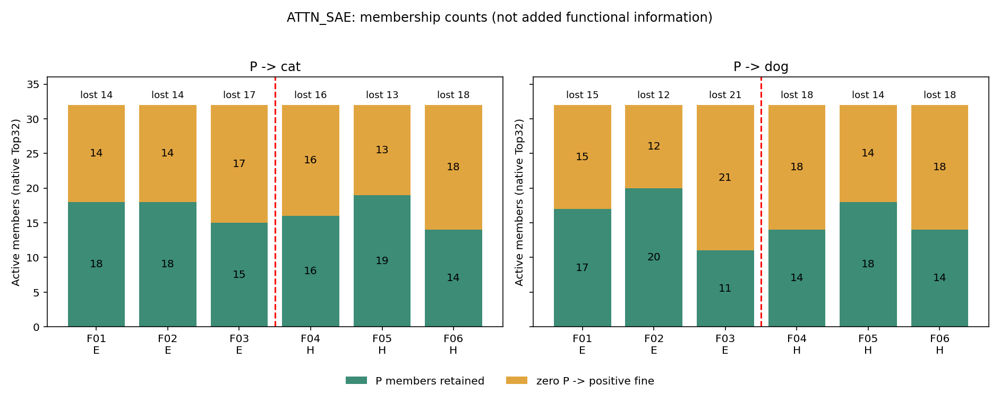
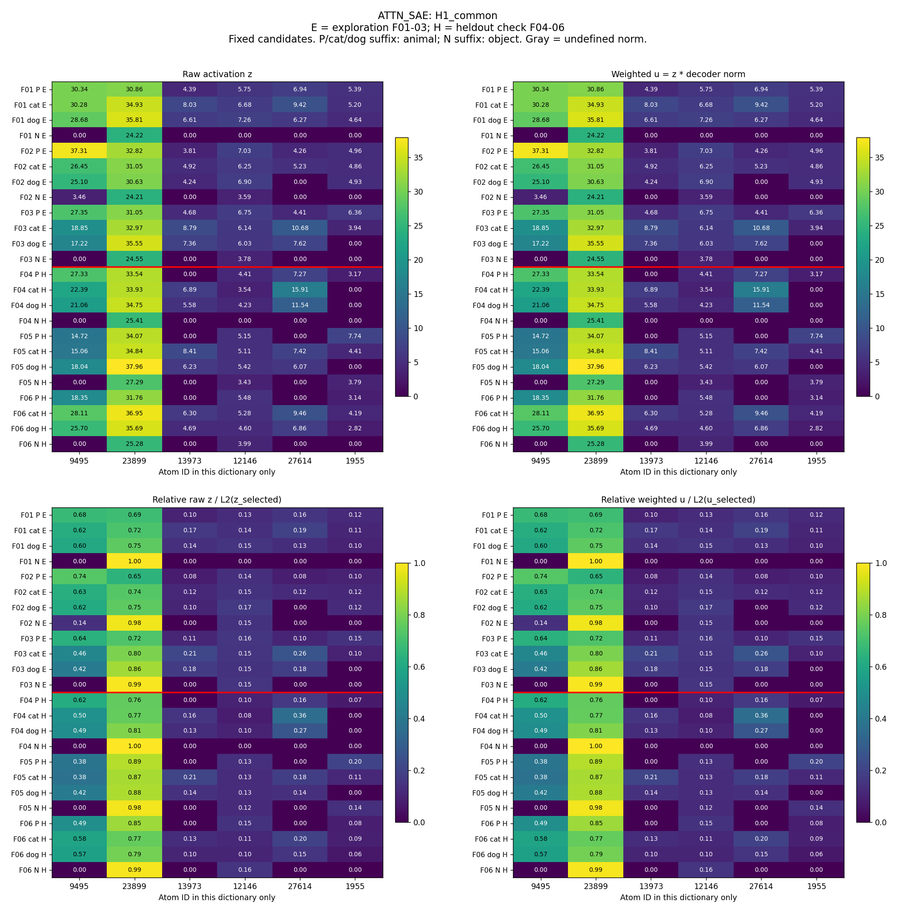
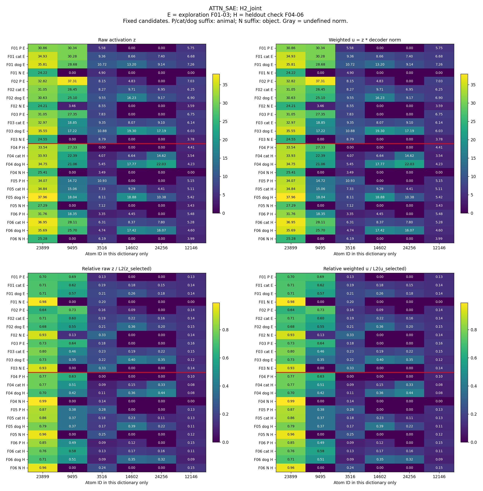
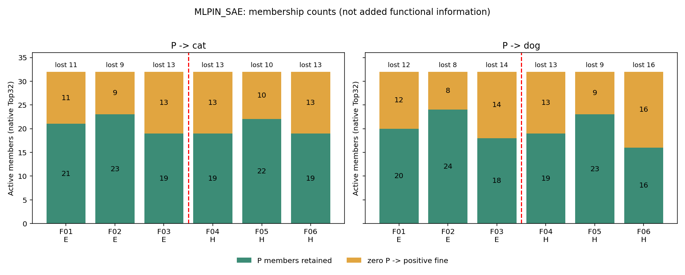
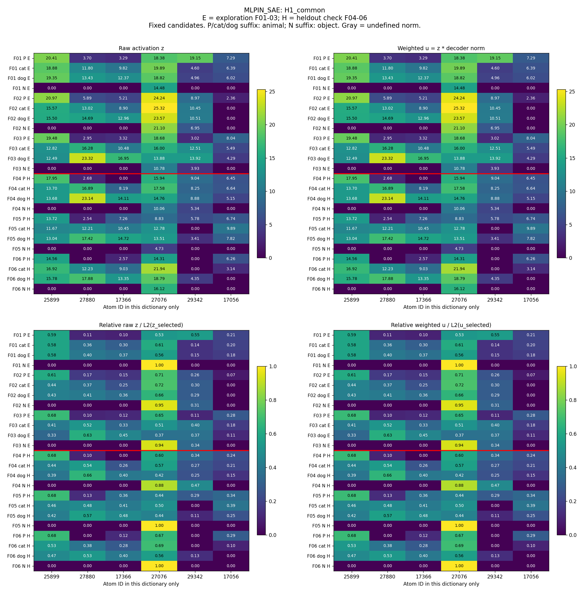
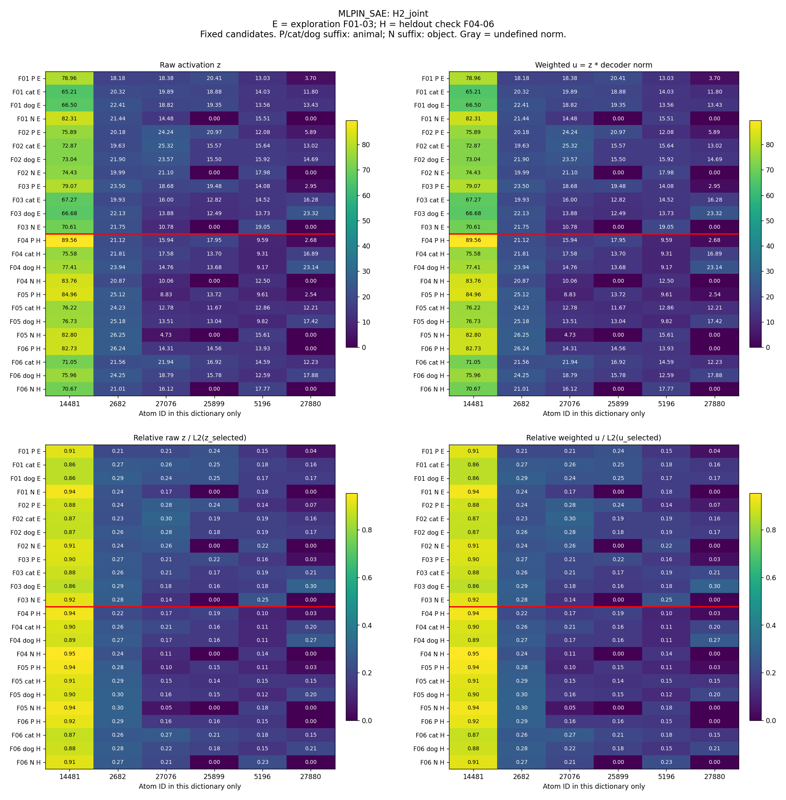

# S03：动物到猫／狗的共同成员、成员变化与相对强弱

本轮完成24条、两套冻结SAE的描述性探索，候选只来自F01–F03，F04–F06只作固定候选检查。原H1／H2的额外信息与功能作用尚未验证，科学接受及下一步决定等待共同审阅。


本轮最直接的认识更新是：粗细文本的关系在这里表现为**部分成员保留、另一些成员换入换出，同时固定共同列表内比例也发生变化**。不是细类简单包含P的全部活跃成员。每条均为Top32，因此新增数与消失数相同；这个等式来自固定稀疏预算，本身不是概念规律。

| 接口 | 共同候选在3个检查家族均满足 | 猫新增候选均满足 | 狗新增候选均满足 | H2方向在3对均同向 |
| --- | --- | --- | --- | --- |
| ATTN_SAE | 3/6个候选 | 2/6个候选 | 2/6个候选 | 3/6个候选 |
| MLPIN_SAE | 1/6个候选 | 2/6个候选 | 1/6个候选 | 3/6个候选 |

“均满足”只是便于阅读的3/3计数，不是新增筛选门槛；所有6个候选的0/3、1/3和2/3结果都在后文，未保留漂亮结果来替换失败者。H2两个接口各有3/6候选方向在三个检查家族均保持，也各有反向。固定列表支持相同均6/6对，全字典支持相同均0/6对。原H1/H2额外信息仍未验证。

本次事实按三条路径阅读：①行为与条件：沿用S02的12/12猫狗续写结果，没有重测或筛掉文本；②表征组织：在同一末尾token分别观察两套原生SAE，下面报告共同／新增／相对强弱；③功能与质量：本轮没有功能干预或probe，原编码等价、hook不改模型及数据冻结检查见核验记录。

## 1. 目的

把“animal→cat/dog”缩成可逐条人工核对的6个家族，先确定现有SAE坐标里实际发生了哪些组合变化。原子只指字典坐标，不预设唯一语义。

## 2. 假设

H1原命题包括共同成员复用及新增成员提供额外细节信息。本轮只检验共同／新增的出现和复现。H2原命题要求成员身份和总幅值受控后的额外细类信息。本轮只描述固定列表上的比例方向，支持集与原始幅值另列。两种变化可以同时出现。

## 3. 实验

6家族×P／猫／狗／N四条件，共24条。P明确animal但猫狗未知；N明确chair。S02原12条前文和分数完整保留。P正文以object指代对象、以animal表类别；N末句用“The object is a”，其余沿用“The animal is a”。这是为保证语法语义自洽而保留的实际差异。没有只改类别词的严格P/N对照，后缀本身可以引起差异。

同一冻结Qwen3-0.6B Base/tokenizer；全体在最后可见token ` a`（ID264）处取样，不含答案；同家族四条件连绝对索引也相同。ATTN_SAE读取block27的o_proj输出、残差相加前；MLPIN_SAE读取block27实际MLP输入，已经过残差相加及post_attention_layernorm。两者分别用自己的30000维字典，原规则ReLU-Top32，无额外输入归一化或减decoder偏置。它们不是MLP输入输出的因果对照。

原始激活z、自己的decoder列范数d、加权响应u=z×d同时保存。u度量单个解码方向的幅值；方向非正交，不能把它当作对模型输出的语义贡献。相对值是在固定列表内分别做z或u的L2归一化，零范数不可定义。两套字典当前decoder范数都很接近1，原始与加权图接近是正常的。

候选规则在运行前写定，见[协议](protocol_cn.md)。探索覆盖至少2/3，最多每组6个。共同候选须P／猫／狗均正且相对N更强；新增候选须P为0、相应细类为正；H2按猫狗共同覆盖、共同强度排序，不按差异挑最漂亮的成员。候选和H2探索方向冻结后才读取保留家族。

## 4. 分析

表中的“3/3”是3个家族均出现，不是统计显著。每个ID在保留家族中的表现都报告，未据此重选。完整[24条文本与token](data_casebook_cn.md)、[成员转换数值](results/member_transition_values.csv)、[覆盖计数](results/pattern_coverage.csv)可核对。

### Attention输出SAE：H1

共同候选的完整条件（共同为正且相对N更强）覆盖：

| 本字典ID | 探索 | 保留检查 |
| --- | --- | --- |
| 9495 | 3/3 | 3/3 |
| 23899 | 3/3 | 3/3 |
| 13973 | 3/3 | 0/3 |
| 12146 | 3/3 | 3/3 |
| 27614 | 2/3 | 1/3 |
| 1955 | 2/3 | 1/3 |

细类新增（P=0、细类>0）的逐候选覆盖：

| 条件 | 探索 | 保留检查 |
| --- | --- | --- |
| cat | #22344 3/3, #24256 3/3, #4586 3/3, #15833 3/3, #14602 2/3, #18691 2/3 | #22344 3/3, #24256 3/3, #4586 2/3, #15833 1/3, #14602 2/3, #18691 1/3 |
| dog | #24256 3/3, #18691 3/3, #4586 3/3, #13711 3/3, #15833 3/3, #14602 2/3 | #24256 3/3, #18691 0/3, #4586 2/3, #13711 3/3, #15833 0/3, #14602 2/3 |

猫狗新增列表相交5个：`[4586, 14602, 15833, 18691, 24256]`。这些候选在探索中同时相对P新增，不能仅凭入选名称解释成猫／狗专属特征。

每家族的真实成员变化（保留／新增／消失，各自分母完整列在原表；每条原生支持数均32）：

| 家族／分组 | P／猫／狗共同 / P | P→猫 保留/新增/消失 | P→狗 保留/新增/消失 |
| --- | --- | --- | --- |
| F01 探索 | 14/32 | 18/14/14 | 17/15/15 |
| F02 探索 | 16/32 | 18/14/14 | 20/12/12 |
| F03 探索 | 9/32 | 15/17/17 | 11/21/21 |
| F04 保留 | 14/32 | 16/16/16 | 14/18/18 |
| F05 保留 | 17/32 | 19/13/13 | 18/14/14 |
| F06 保留 | 12/32 | 14/18/18 | 14/18/18 |



绿为P中已有并保留到细类的成员，黄为P中0→细类正，柱上标P中消失数；横轴前三为探索、后三为检查。新增数量不是新增辨别信息。



共同候选按探索顺序固定。四图依次给原始z、加权u和各自固定列表L2归一化值；数值写在格内，红线分开探索与保留，颜色尺度各图独立，灰色为不可定义。N后缀含object差异仍在。

### Attention输出SAE：H2

探索平均相对加权差的正号指cat较强，负号指dog较强。下面是每个固定方向的逐家族一致数：

| 本字典ID | 冻结方向 | 探索同向 | 保留同向 |
| --- | --- | --- | --- |
| 23899 | 1 | 3/3 | 3/3 |
| 9495 | 1 | 3/3 | 2/3 |
| 3516 | -1 | 2/3 | 1/3 |
| 14602 | -1 | 3/3 | 3/3 |
| 24256 | -1 | 3/3 | 3/3 |
| 12146 | 1 | 1/3 | 2/3 |

成员身份和原幅值另列，不能用归一化替代这些事实：

| 家族 | 全字典支持完全相同 | 固定6成员支持相同 | 猫/狗固定列表原加权L2 | 同向成员/有方向成员 |
| --- | --- | --- | --- | --- |
| F01 | False | True | 48.98064 / 50.30267 | 5/6 |
| F02 | False | True | 43.74859 / 45.32674 | 5/6 |
| F03 | False | True | 41.41829 / 48.80956 | 5/6 |
| F04 | False | True | 44.04449 / 49.99418 | 5/6 |
| F05 | False | True | 40.33054 / 48.22391 | 4/6 |
| F06 | False | True | 48.51535 / 50.39741 | 5/6 |

全字典支持完全相同0/6对；选定列表内支持相同6/6对。只对后者可说观察的是同一固定列表内的比例，不能据此声称整套字典身份已受控。H2零范数样本0/24。



四图与H1图使用相同读法。原始总幅度在上表保留，方向只取自探索，不因检查的反向结果修改。完整原始比例、cat/dog比值及每对方向见[H2逐对表](results/ATTN_SAE/H2_directions.csv)。

[F01完整四条全文、全部成员数值和每个保留家族](ATTN_SAE/casebook_cn.md) · [全部未复现模式](results/ATTN_SAE/pattern_failures.csv)。

### MLP输入SAE：H1

共同候选的完整条件（共同为正且相对N更强）覆盖：

| 本字典ID | 探索 | 保留检查 |
| --- | --- | --- |
| 25899 | 3/3 | 3/3 |
| 27880 | 3/3 | 2/3 |
| 17366 | 3/3 | 2/3 |
| 27076 | 3/3 | 2/3 |
| 29342 | 2/3 | 1/3 |
| 17056 | 2/3 | 2/3 |

细类新增（P=0、细类>0）的逐候选覆盖：

| 条件 | 探索 | 保留检查 |
| --- | --- | --- |
| cat | #22958 3/3, #1292 3/3, #20989 3/3, #1560 3/3, #17874 2/3, #14536 2/3 | #22958 3/3, #1292 2/3, #20989 1/3, #1560 3/3, #17874 2/3, #14536 0/3 |
| dog | #1292 3/3, #20989 3/3, #21533 3/3, #14536 2/3, #1560 2/3, #17893 2/3 | #1292 1/3, #20989 1/3, #21533 2/3, #14536 0/3, #1560 3/3, #17893 2/3 |

猫狗新增列表相交4个：`[1292, 1560, 14536, 20989]`。这些候选在探索中同时相对P新增，不能仅凭入选名称解释成猫／狗专属特征。

每家族的真实成员变化（保留／新增／消失，各自分母完整列在原表；每条原生支持数均32）：

| 家族／分组 | P／猫／狗共同 / P | P→猫 保留/新增/消失 | P→狗 保留/新增/消失 |
| --- | --- | --- | --- |
| F01 探索 | 19/32 | 21/11/11 | 20/12/12 |
| F02 探索 | 22/32 | 23/9/9 | 24/8/8 |
| F03 探索 | 18/32 | 19/13/13 | 18/14/14 |
| F04 保留 | 17/32 | 19/13/13 | 19/13/13 |
| F05 保留 | 20/32 | 22/10/10 | 23/9/9 |
| F06 保留 | 15/32 | 19/13/13 | 16/16/16 |



绿为P中已有并保留到细类的成员，黄为P中0→细类正，柱上标P中消失数；横轴前三为探索、后三为检查。新增数量不是新增辨别信息。



共同候选按探索顺序固定。四图依次给原始z、加权u和各自固定列表L2归一化值；数值写在格内，红线分开探索与保留，颜色尺度各图独立，灰色为不可定义。N后缀含object差异仍在。

### MLP输入SAE：H2

探索平均相对加权差的正号指cat较强，负号指dog较强。下面是每个固定方向的逐家族一致数：

| 本字典ID | 冻结方向 | 探索同向 | 保留同向 |
| --- | --- | --- | --- |
| 14481 | 1 | 3/3 | 2/3 |
| 2682 | -1 | 3/3 | 3/3 |
| 27076 | 1 | 3/3 | 2/3 |
| 25899 | 1 | 2/3 | 2/3 |
| 5196 | 1 | 2/3 | 3/3 |
| 27880 | -1 | 3/3 | 3/3 |

成员身份和原幅值另列，不能用归一化替代这些事实：

| 家族 | 全字典支持完全相同 | 固定6成员支持相同 | 猫/狗固定列表原加权L2 | 同向成员/有方向成员 |
| --- | --- | --- | --- | --- |
| F01 | False | True | 75.85114 / 77.57203 | 5/6 |
| F02 | False | True | 83.62448 / 84.13482 | 5/6 |
| F03 | False | True | 76.28034 / 77.56536 | 6/6 |
| F04 | False | True | 84.00443 / 87.11767 | 6/6 |
| F05 | False | True | 83.73405 / 85.28535 | 4/6 |
| F06 | False | True | 81.50410 / 86.25045 | 5/6 |

全字典支持完全相同0/6对；选定列表内支持相同6/6对。只对后者可说观察的是同一固定列表内的比例，不能据此声称整套字典身份已受控。H2零范数样本0/24。



四图与H1图使用相同读法。原始总幅度在上表保留，方向只取自探索，不因检查的反向结果修改。完整原始比例、cat/dog比值及每对方向见[H2逐对表](results/MLPIN_SAE/H2_directions.csv)。

[F01完整四条全文、全部成员数值和每个保留家族](MLPIN_SAE/casebook_cn.md) · [全部未复现模式](results/MLPIN_SAE/pattern_failures.csv)。


### 用F01把实际数值连起来

四条完整前文如下。它们与后文数字一一对应；猫狗两条沿用S02原件。

```text
This object is an animal.
The animal is a
```

```text
This animal is a cat.
The animal is a
```

```text
This animal is a dog.
The animal is a
```

```text
This object is a chair.
The object is a
```


**ATTN_SAE：**

#9495，固定列表H1_common：

| 条件 | z | decoder范数 | u | 该列表q_weighted | preactivation |
| --- | --- | --- | --- | --- | --- |
| P | 30.342440 | 1.000000 | 30.342440 | 0.677993 | 30.342440 |
| cat | 30.277794 | 1.000000 | 30.277794 | 0.623015 | 30.277794 |
| dog | 28.684868 | 1.000000 | 28.684868 | 0.603129 | 28.684868 |
| N | 0.000000 | 1.000000 | 0.000000 | 0.000000 | 0.679426 |

#22344，固定列表H1_added_cat：

| 条件 | z | decoder范数 | u | 该列表q_weighted | preactivation |
| --- | --- | --- | --- | --- | --- |
| P | 0.000000 | 1.000000 | 0.000000 | 未定义该量 | 2.313256 |
| cat | 11.523227 | 1.000000 | 11.523223 | 未定义该量 | 11.523227 |
| dog | 4.663494 | 1.000000 | 4.663492 | 未定义该量 | 4.663494 |
| N | 0.000000 | 1.000000 | 0.000000 | 未定义该量 | 0.268451 |

#23899，固定列表H2：

| 条件 | z | decoder范数 | u | 该列表q_weighted | preactivation |
| --- | --- | --- | --- | --- | --- |
| P | 30.863066 | 1.000000 | 30.863069 | 0.701177 | 30.863066 |
| cat | 34.930103 | 1.000000 | 34.930107 | 0.713141 | 34.930103 |
| dog | 35.805733 | 1.000000 | 35.805737 | 0.711806 | 35.805733 |
| N | 24.215054 | 1.000000 | 24.215056 | 0.980097 | 24.215054 |

共同候选#9495在P／猫／狗为正而N为0；但N的preactivation=0.679426仍为正，最终未进入Top32。新增候选#22344在P的preactivation=2.313256也为正而最终z=0，猫为11.523227，狗也为4.663494；它是原SAE规则下的支持新增，不是从编码器完全无响应变为有响应，也不是猫独占。H2的#23899在猫的原始z=34.930103低于狗35.805733，而固定6成员内q=0.713141高于狗0.711806，说明“原始更大”与“列表内占比更大”是不同事实。

该接口H2在保留家族的**全部**反向或零向例：

| 家族 | ID | 冻结方向 | cat z | dog z | cat q | dog q |
| --- | --- | --- | --- | --- | --- | --- |
| F04 | 12146 | 1 | 3.538746 | 4.230478 | 0.080345 | 0.084619 |
| F05 | 9495 | 1 | 15.063180 | 18.043213 | 0.373493 | 0.374155 |
| F05 | 3516 | -1 | 7.334889 | 8.106777 | 0.181869 | 0.168107 |
| F06 | 3516 | -1 | 6.313676 | 4.743106 | 0.130138 | 0.094114 |


**MLPIN_SAE：**

#25899，固定列表H1_common：

| 条件 | z | decoder范数 | u | 该列表q_weighted | preactivation |
| --- | --- | --- | --- | --- | --- |
| P | 20.408159 | 1.000000 | 20.408158 | 0.589482 | 20.408159 |
| cat | 18.879515 | 1.000000 | 18.879514 | 0.582658 | 18.879515 |
| dog | 19.352499 | 1.000000 | 19.352498 | 0.577504 | 19.352499 |
| N | 0.000000 | 1.000000 | 0.000000 | 0.000000 | 0.240688 |

#22958，固定列表H1_added_cat：

| 条件 | z | decoder范数 | u | 该列表q_weighted | preactivation |
| --- | --- | --- | --- | --- | --- |
| P | 0.000000 | 1.000000 | 0.000000 | 未定义该量 | -0.405374 |
| cat | 6.376107 | 1.000000 | 6.376110 | 未定义该量 | 6.376107 |
| dog | 0.000000 | 1.000000 | 0.000000 | 未定义该量 | 1.518781 |
| N | 0.000000 | 1.000000 | 0.000000 | 未定义该量 | -0.129949 |

#2682，固定列表H2：

| 条件 | z | decoder范数 | u | 该列表q_weighted | preactivation |
| --- | --- | --- | --- | --- | --- |
| P | 18.176922 | 1.000000 | 18.176926 | 0.209847 | 18.176922 |
| cat | 20.324385 | 1.000000 | 20.324390 | 0.267951 | 20.324385 |
| dog | 22.410387 | 1.000000 | 22.410392 | 0.288898 | 22.410387 |
| N | 21.440348 | 1.000000 | 21.440353 | 0.244571 | 21.440348 |

共同候选#25899在前三条件均正、N为0；新增候选#22958在F01只有猫进入Top32，狗preactivation=1.518781仍未入选，不能只凭这个例子赋予唯一猫语义。H2的#2682猫／狗原始z=20.324385/22.410387，相对q=0.267951/0.288898，探索冻结方向为dog较强；该方向在3个检查家族均相同。正文仍明确出现cat/dog，复制解释未排除。

该接口H2在保留家族的**全部**反向或零向例：

| 家族 | ID | 冻结方向 | cat z | dog z | cat q | dog q |
| --- | --- | --- | --- | --- | --- | --- |
| F05 | 27076 | 1 | 12.779110 | 13.508006 | 0.152615 | 0.158386 |
| F05 | 25899 | 1 | 11.669848 | 13.041909 | 0.139368 | 0.152921 |
| F06 | 14481 | 1 | 71.050011 | 75.964867 | 0.871736 | 0.880748 |

H1反例见各接口casebook的末节，例如ATTN共同候选#13973在F04–F06的P都为0，而猫狗均正，故探索3/3、检查0/3。它不能继续称作跨这6种句式稳定的父类共同成员。全部H1失败保留在失败表。


## 5. 结论与认识更新

**H1：**本轮可以确认这些字典里存在P／细类共同激活、成员0→正、正→0及已有成员强弱变化；这些是不同的可观察事实，不能用“变强”替代“新增”。候选在保留家族的覆盖如上，失败候选均保留。较弱判断是部分响应组织可以随这批明确词语复现。新增是否提供额外细类信息仍未检验：没有同预算随机成员比较、固定读出或干预。共同对照受animal/object及后缀差异影响；cat/dog正文还有词面复述解释。

**H2：**在探索选出的固定列表上，可以直接检查同一成员的比例变化，并看哪些方向跨3个保留家族保持、哪些反向。选定列表身份相同的配对与全字典身份相同的配对是两件事。归一化去掉列表标量尺度，仍未控制其他成员、完整表征、所有总幅度或证明额外预测信息；也没有在概念不变时改变措辞的专门对照。

**认识更新：**当前可把“成员换入换出”和“固定列表内重新分配响应”拆成可逐条核对的现象，并用未参与选候选的家族看到各自的复现与失败；粗细概念是否通过这些变化获得额外信息，仍是下一次共同审阅要判断的问题。原H1／H2不作修订。

已排除的解释仅限记录范围：12条旧文本不是预测后筛选或改写，保留家族未用于选候选，单一家族的取样位置／目标token未变，hook未改变前向，SAE参数未训练。仍保留词面复制、固定后缀、object/animal指代差异、句式上下文、Top32竞争、字典局部坐标及重建误差。所有样本只覆盖6种短英文句式，N只有chair，不能概括非动物总体。字典重建相对L2误差见Detailed，较大误差进一步限制“完整概念”的解释。

**AI建议（未执行）：**先共同审阅完整F01与失败表，决定当前这些词面与后缀差异是否允许继续解释候选。保持概念的改写、同预算对照或受控干预都等待研究者决定。

本轮完成后停止。没有扩数据、H3／H4、CrossCoder、probe、消融、训练或后续实验。科学接受、机制判断及下一步决定为Unknown。

[协议](protocol_cn.md) · [完整24条与token](data_casebook_cn.md) · [Detailed](detailed_cn.md) · [原始数组](cache/) · [核验](evidence/verification.json)
