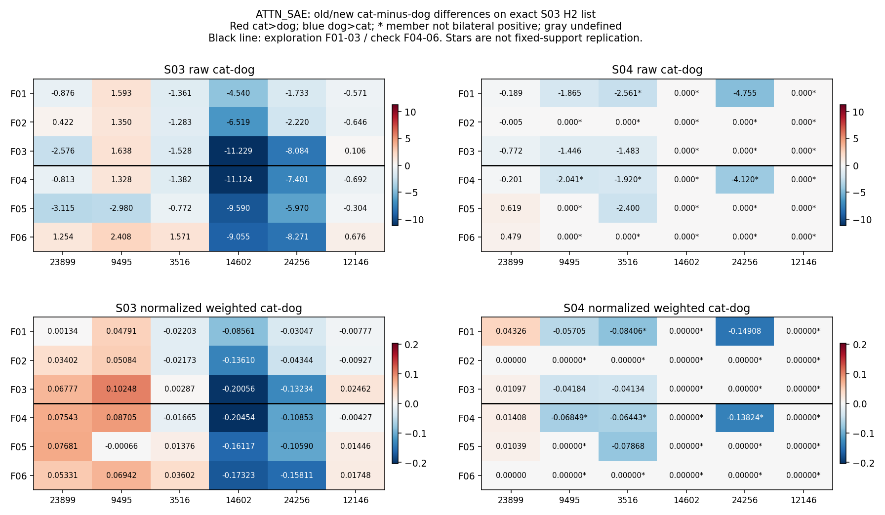

# ATTN_SAE：每个固定H2候选的旧新配对与方向

正差表示猫大于狗，负差表示狗大于猫。方向零阈值绝对值≤1e-8。先按每对原始/归一化值阅读，再看状态；成员未双侧激活仍有数值，但不算固定成员方向保持。原子未激活与列表零范数分开。

计数串顺序固定为**同向/反向/成员未双侧激活/零范数/零差/无参照方向**；每串总和3。相对旧配对的参照是该家族旧差；相对冻结探索的参照是S03探索平均方向，两者可能相反。按预定优先顺序先列零范数，再列未激活，再判断方向。

## #23899

| 家族 | 旧/新原始差Δz | 旧/新原始方向 | 旧/新归一化差Δq | 旧/新归一化方向 | 新猫/狗激活 | 新-旧配对状态 | 新-冻结探索状态 |
| --- | --- | --- | --- | --- | --- | --- | --- |
| F01 | -0.875629 / -0.189312 | − / − | 0.001335 / 0.043260 | + / + | 是 / 是 | same | same |
| F02 | 0.421917 / -0.005186 | + / − | 0.034020 / 0.000000 | + / 0 | 是 / 是 | zero_difference | zero_difference |
| F03 | -2.575886 / -0.772377 | − / − | 0.067766 / 0.010969 | + / + | 是 / 是 | same | same |
| F04 | -0.812931 / -0.200623 | − / − | 0.075431 / 0.014076 | + / + | 是 / 是 | same | same |
| F05 | -3.115265 / 0.619221 | − / + | 0.076806 / 0.010389 | + / + | 是 / 是 | same | same |
| F06 | 1.253540 / 0.478706 | + / + | 0.053313 / 0.000000 | + / 0 | 是 / 是 | zero_difference | zero_difference |

| 量 | 参照 | 探索3家族 | 保留3家族 |
| --- | --- | --- | --- |
| raw | old_pair | 2/1/0/0/0/0 | 2/1/0/0/0/0 |
| raw | S03_discovery | 3/0/0/0/0/0 | 1/2/0/0/0/0 |
| q_weighted | old_pair | 2/0/0/0/1/0 | 2/0/0/0/1/0 |
| q_weighted | S03_discovery | 2/0/0/0/1/0 | 2/0/0/0/1/0 |

## #9495

| 家族 | 旧/新原始差Δz | 旧/新原始方向 | 旧/新归一化差Δq | 旧/新归一化方向 | 新猫/狗激活 | 新-旧配对状态 | 新-冻结探索状态 |
| --- | --- | --- | --- | --- | --- | --- | --- |
| F01 | 1.592926 / -1.864967 | + / − | 0.047913 / -0.057049 | + / − | 是 / 是 | opposite | opposite |
| F02 | 1.350086 / 0.000000 | + / 0 | 0.050839 / 0.000000 | + / 0 | 否 / 否 | member_inactive | member_inactive |
| F03 | 1.637630 / -1.445642 | + / − | 0.102480 / -0.041837 | + / − | 是 / 是 | opposite | opposite |
| F04 | 1.327538 / -2.041281 | + / − | 0.087047 / -0.068494 | + / − | 否 / 是 | member_inactive | member_inactive |
| F05 | -2.980033 / 0.000000 | − / 0 | -0.000662 / 0.000000 | − / 0 | 否 / 否 | member_inactive | member_inactive |
| F06 | 2.408310 / 0.000000 | + / 0 | 0.069424 / 0.000000 | + / 0 | 否 / 否 | member_inactive | member_inactive |

| 量 | 参照 | 探索3家族 | 保留3家族 |
| --- | --- | --- | --- |
| raw | old_pair | 0/2/1/0/0/0 | 0/0/3/0/0/0 |
| raw | S03_discovery | 0/2/1/0/0/0 | 0/0/3/0/0/0 |
| q_weighted | old_pair | 0/2/1/0/0/0 | 0/0/3/0/0/0 |
| q_weighted | S03_discovery | 0/2/1/0/0/0 | 0/0/3/0/0/0 |

## #3516

| 家族 | 旧/新原始差Δz | 旧/新原始方向 | 旧/新归一化差Δq | 旧/新归一化方向 | 新猫/狗激活 | 新-旧配对状态 | 新-冻结探索状态 |
| --- | --- | --- | --- | --- | --- | --- | --- |
| F01 | -1.360757 / -2.561141 | − / − | -0.022027 / -0.084065 | − / − | 否 / 是 | member_inactive | member_inactive |
| F02 | -1.283154 / 0.000000 | − / 0 | -0.021727 / 0.000000 | − / 0 | 否 / 否 | member_inactive | member_inactive |
| F03 | -1.528457 / -1.482755 | − / − | 0.002868 / -0.041341 | + / − | 是 / 是 | opposite | same |
| F04 | -1.381994 / -1.920106 | − / − | -0.016649 / -0.064428 | − / − | 否 / 是 | member_inactive | member_inactive |
| F05 | -0.771888 / -2.399665 | − / − | 0.013762 / -0.078678 | + / − | 是 / 是 | opposite | same |
| F06 | 1.570570 / 0.000000 | + / 0 | 0.036024 / 0.000000 | + / 0 | 否 / 否 | member_inactive | member_inactive |

| 量 | 参照 | 探索3家族 | 保留3家族 |
| --- | --- | --- | --- |
| raw | old_pair | 1/0/2/0/0/0 | 1/0/2/0/0/0 |
| raw | S03_discovery | 1/0/2/0/0/0 | 1/0/2/0/0/0 |
| q_weighted | old_pair | 0/1/2/0/0/0 | 0/1/2/0/0/0 |
| q_weighted | S03_discovery | 1/0/2/0/0/0 | 1/0/2/0/0/0 |

## #14602

| 家族 | 旧/新原始差Δz | 旧/新原始方向 | 旧/新归一化差Δq | 旧/新归一化方向 | 新猫/狗激活 | 新-旧配对状态 | 新-冻结探索状态 |
| --- | --- | --- | --- | --- | --- | --- | --- |
| F01 | -4.540062 / 0.000000 | − / 0 | -0.085606 / 0.000000 | − / 0 | 否 / 否 | member_inactive | member_inactive |
| F02 | -6.519152 / 0.000000 | − / 0 | -0.136100 / 0.000000 | − / 0 | 否 / 否 | member_inactive | member_inactive |
| F03 | -11.229280 / 0.000000 | − / 0 | -0.200564 / 0.000000 | − / 0 | 否 / 否 | member_inactive | member_inactive |
| F04 | -11.123601 / 0.000000 | − / 0 | -0.204544 / 0.000000 | − / 0 | 否 / 否 | member_inactive | member_inactive |
| F05 | -9.590251 / 0.000000 | − / 0 | -0.161165 / 0.000000 | − / 0 | 否 / 否 | member_inactive | member_inactive |
| F06 | -9.054706 / 0.000000 | − / 0 | -0.173227 / 0.000000 | − / 0 | 否 / 否 | member_inactive | member_inactive |

| 量 | 参照 | 探索3家族 | 保留3家族 |
| --- | --- | --- | --- |
| raw | old_pair | 0/0/3/0/0/0 | 0/0/3/0/0/0 |
| raw | S03_discovery | 0/0/3/0/0/0 | 0/0/3/0/0/0 |
| q_weighted | old_pair | 0/0/3/0/0/0 | 0/0/3/0/0/0 |
| q_weighted | S03_discovery | 0/0/3/0/0/0 | 0/0/3/0/0/0 |

## #24256

| 家族 | 旧/新原始差Δz | 旧/新原始方向 | 旧/新归一化差Δq | 旧/新归一化方向 | 新猫/狗激活 | 新-旧配对状态 | 新-冻结探索状态 |
| --- | --- | --- | --- | --- | --- | --- | --- |
| F01 | -1.732545 / -4.754536 | − / − | -0.030470 / -0.149084 | − / − | 是 / 是 | same | same |
| F02 | -2.219712 / 0.000000 | − / 0 | -0.043442 / 0.000000 | − / 0 | 否 / 否 | member_inactive | member_inactive |
| F03 | -8.084138 / 0.000000 | − / 0 | -0.132340 / 0.000000 | − / 0 | 否 / 否 | member_inactive | member_inactive |
| F04 | -7.401486 / -4.119947 | − / − | -0.108533 / -0.138242 | − / − | 否 / 是 | member_inactive | member_inactive |
| F05 | -5.969630 / 0.000000 | − / 0 | -0.105898 / 0.000000 | − / 0 | 否 / 否 | member_inactive | member_inactive |
| F06 | -8.270555 / 0.000000 | − / 0 | -0.158105 / 0.000000 | − / 0 | 否 / 否 | member_inactive | member_inactive |

| 量 | 参照 | 探索3家族 | 保留3家族 |
| --- | --- | --- | --- |
| raw | old_pair | 1/0/2/0/0/0 | 0/0/3/0/0/0 |
| raw | S03_discovery | 1/0/2/0/0/0 | 0/0/3/0/0/0 |
| q_weighted | old_pair | 1/0/2/0/0/0 | 0/0/3/0/0/0 |
| q_weighted | S03_discovery | 1/0/2/0/0/0 | 0/0/3/0/0/0 |

## #12146

| 家族 | 旧/新原始差Δz | 旧/新原始方向 | 旧/新归一化差Δq | 旧/新归一化方向 | 新猫/狗激活 | 新-旧配对状态 | 新-冻结探索状态 |
| --- | --- | --- | --- | --- | --- | --- | --- |
| F01 | -0.571324 / 0.000000 | − / 0 | -0.007771 / 0.000000 | − / 0 | 否 / 否 | member_inactive | member_inactive |
| F02 | -0.645740 / 0.000000 | − / 0 | -0.009272 / 0.000000 | − / 0 | 否 / 否 | member_inactive | member_inactive |
| F03 | 0.106135 / 0.000000 | + / 0 | 0.024615 / 0.000000 | + / 0 | 否 / 否 | member_inactive | member_inactive |
| F04 | -0.691731 / 0.000000 | − / 0 | -0.004275 / 0.000000 | − / 0 | 否 / 否 | member_inactive | member_inactive |
| F05 | -0.303575 / 0.000000 | − / 0 | 0.014463 / 0.000000 | + / 0 | 否 / 否 | member_inactive | member_inactive |
| F06 | 0.675997 / 0.000000 | + / 0 | 0.017478 / 0.000000 | + / 0 | 否 / 否 | member_inactive | member_inactive |

| 量 | 参照 | 探索3家族 | 保留3家族 |
| --- | --- | --- | --- |
| raw | old_pair | 0/0/3/0/0/0 | 0/0/3/0/0/0 |
| raw | S03_discovery | 0/0/3/0/0/0 | 0/0/3/0/0/0 |
| q_weighted | old_pair | 0/0/3/0/0/0 | 0/0/3/0/0/0 |
| q_weighted | S03_discovery | 0/0/3/0/0/0 | 0/0/3/0/0/0 |

左旧右新，上为原始z差、下为同一固定6成员列表的加权归一化差，旧新同量共用颜色范围；红猫更大、蓝狗更大；星号表示该候选未双侧正激活，此数值不可算固定成员方向复现。黑线区分探索/检查。完整精度和两套原始范数见[72条配对总表](../results/all_H2_old_new_pairs.csv)。
