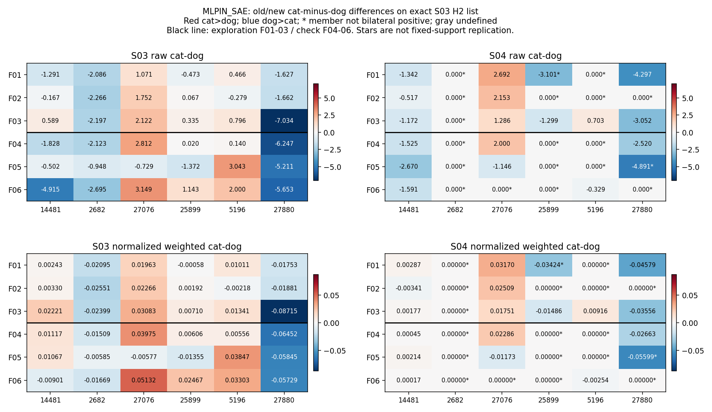

# MLPIN_SAE：每个固定H2候选的旧新配对与方向

正差表示猫大于狗，负差表示狗大于猫。方向零阈值绝对值≤1e-8。先按每对原始/归一化值阅读，再看状态；成员未双侧激活仍有数值，但不算固定成员方向保持。原子未激活与列表零范数分开。

计数串顺序固定为**同向/反向/成员未双侧激活/零范数/零差/无参照方向**；每串总和3。相对旧配对的参照是该家族旧差；相对冻结探索的参照是S03探索平均方向，两者可能相反。按预定优先顺序先列零范数，再列未激活，再判断方向。

## #14481

| 家族 | 旧/新原始差Δz | 旧/新原始方向 | 旧/新归一化差Δq | 旧/新归一化方向 | 新猫/狗激活 | 新-旧配对状态 | 新-冻结探索状态 |
| --- | --- | --- | --- | --- | --- | --- | --- |
| F01 | -1.291260 / -1.342216 | − / − | 0.002426 / 0.002873 | + / + | 是 / 是 | same | same |
| F02 | -0.167229 / -0.516617 | − / − | 0.003298 / -0.003407 | + / − | 是 / 是 | opposite | opposite |
| F03 | 0.589218 / -1.172241 | + / − | 0.022206 / 0.001766 | + / + | 是 / 是 | same | same |
| F04 | -1.827728 / -1.525063 | − / − | 0.011173 / 0.000448 | + / + | 是 / 是 | same | same |
| F05 | -0.502388 / -2.670158 | − / − | 0.010668 / 0.002140 | + / + | 是 / 是 | same | same |
| F06 | -4.914856 / -1.590828 | − / − | -0.009012 / 0.000170 | − / + | 是 / 是 | opposite | same |

| 量 | 参照 | 探索3家族 | 保留3家族 |
| --- | --- | --- | --- |
| raw | old_pair | 2/1/0/0/0/0 | 3/0/0/0/0/0 |
| raw | S03_discovery | 3/0/0/0/0/0 | 3/0/0/0/0/0 |
| q_weighted | old_pair | 2/1/0/0/0/0 | 2/1/0/0/0/0 |
| q_weighted | S03_discovery | 2/1/0/0/0/0 | 3/0/0/0/0/0 |

## #2682

| 家族 | 旧/新原始差Δz | 旧/新原始方向 | 旧/新归一化差Δq | 旧/新归一化方向 | 新猫/狗激活 | 新-旧配对状态 | 新-冻结探索状态 |
| --- | --- | --- | --- | --- | --- | --- | --- |
| F01 | -2.086002 / 0.000000 | − / 0 | -0.020947 / 0.000000 | − / 0 | 否 / 否 | member_inactive | member_inactive |
| F02 | -2.265760 / 0.000000 | − / 0 | -0.025506 / 0.000000 | − / 0 | 否 / 否 | member_inactive | member_inactive |
| F03 | -2.196537 / 0.000000 | − / 0 | -0.023990 / 0.000000 | − / 0 | 否 / 否 | member_inactive | member_inactive |
| F04 | -2.122736 / 0.000000 | − / 0 | -0.015087 / 0.000000 | − / 0 | 否 / 否 | member_inactive | member_inactive |
| F05 | -0.947920 / 0.000000 | − / 0 | -0.005850 / 0.000000 | − / 0 | 否 / 否 | member_inactive | member_inactive |
| F06 | -2.694710 / 0.000000 | − / 0 | -0.016688 / 0.000000 | − / 0 | 否 / 否 | member_inactive | member_inactive |

| 量 | 参照 | 探索3家族 | 保留3家族 |
| --- | --- | --- | --- |
| raw | old_pair | 0/0/3/0/0/0 | 0/0/3/0/0/0 |
| raw | S03_discovery | 0/0/3/0/0/0 | 0/0/3/0/0/0 |
| q_weighted | old_pair | 0/0/3/0/0/0 | 0/0/3/0/0/0 |
| q_weighted | S03_discovery | 0/0/3/0/0/0 | 0/0/3/0/0/0 |

## #27076

| 家族 | 旧/新原始差Δz | 旧/新原始方向 | 旧/新归一化差Δq | 旧/新归一化方向 | 新猫/狗激活 | 新-旧配对状态 | 新-冻结探索状态 |
| --- | --- | --- | --- | --- | --- | --- | --- |
| F01 | 1.071470 / 2.692075 | + / + | 0.019631 / 0.031699 | + / + | 是 / 是 | same | same |
| F02 | 1.752060 / 2.152567 | + / + | 0.022661 / 0.025095 | + / + | 是 / 是 | same | same |
| F03 | 2.121505 / 1.285713 | + / + | 0.030826 / 0.017505 | + / + | 是 / 是 | same | same |
| F04 | 2.811524 / 1.999592 | + / + | 0.039749 / 0.022862 | + / + | 是 / 是 | same | same |
| F05 | -0.728896 / -1.146120 | − / − | -0.005771 / -0.011728 | − / − | 是 / 是 | same | opposite |
| F06 | 3.148544 / 0.000000 | + / 0 | 0.051319 / 0.000000 | + / 0 | 否 / 否 | member_inactive | member_inactive |

| 量 | 参照 | 探索3家族 | 保留3家族 |
| --- | --- | --- | --- |
| raw | old_pair | 3/0/0/0/0/0 | 2/0/1/0/0/0 |
| raw | S03_discovery | 3/0/0/0/0/0 | 1/1/1/0/0/0 |
| q_weighted | old_pair | 3/0/0/0/0/0 | 2/0/1/0/0/0 |
| q_weighted | S03_discovery | 3/0/0/0/0/0 | 1/1/1/0/0/0 |

## #25899

| 家族 | 旧/新原始差Δz | 旧/新原始方向 | 旧/新归一化差Δq | 旧/新归一化方向 | 新猫/狗激活 | 新-旧配对状态 | 新-冻结探索状态 |
| --- | --- | --- | --- | --- | --- | --- | --- |
| F01 | -0.472984 / -3.101352 | − / − | -0.000576 / -0.034237 | − / − | 否 / 是 | member_inactive | member_inactive |
| F02 | 0.066815 / 0.000000 | + / 0 | 0.001923 / 0.000000 | + / 0 | 否 / 否 | member_inactive | member_inactive |
| F03 | 0.334625 / -1.299309 | + / − | 0.007099 / -0.014855 | + / − | 是 / 是 | opposite | opposite |
| F04 | 0.020229 / 0.000000 | + / 0 | 0.006058 / 0.000000 | + / 0 | 否 / 否 | member_inactive | member_inactive |
| F05 | -1.372061 / 0.000000 | − / 0 | -0.013553 / 0.000000 | − / 0 | 否 / 否 | member_inactive | member_inactive |
| F06 | 1.142615 / 0.000000 | + / 0 | 0.024674 / 0.000000 | + / 0 | 否 / 否 | member_inactive | member_inactive |

| 量 | 参照 | 探索3家族 | 保留3家族 |
| --- | --- | --- | --- |
| raw | old_pair | 0/1/2/0/0/0 | 0/0/3/0/0/0 |
| raw | S03_discovery | 1/0/2/0/0/0 | 0/0/3/0/0/0 |
| q_weighted | old_pair | 0/1/2/0/0/0 | 0/0/3/0/0/0 |
| q_weighted | S03_discovery | 0/1/2/0/0/0 | 0/0/3/0/0/0 |

## #5196

| 家族 | 旧/新原始差Δz | 旧/新原始方向 | 旧/新归一化差Δq | 旧/新归一化方向 | 新猫/狗激活 | 新-旧配对状态 | 新-冻结探索状态 |
| --- | --- | --- | --- | --- | --- | --- | --- |
| F01 | 0.465619 / 0.000000 | + / 0 | 0.010105 / 0.000000 | + / 0 | 否 / 否 | member_inactive | member_inactive |
| F02 | -0.278635 / 0.000000 | − / 0 | -0.002177 / 0.000000 | − / 0 | 否 / 否 | member_inactive | member_inactive |
| F03 | 0.795519 / 0.702805 | + / + | 0.013410 / 0.009165 | + / + | 是 / 是 | same | same |
| F04 | 0.139749 / 0.000000 | + / 0 | 0.005564 / 0.000000 | + / 0 | 否 / 否 | member_inactive | member_inactive |
| F05 | 3.042668 / 0.000000 | + / 0 | 0.038470 / 0.000000 | + / 0 | 否 / 否 | member_inactive | member_inactive |
| F06 | 1.999632 / -0.329223 | + / − | 0.033034 / -0.002538 | + / − | 是 / 是 | opposite | opposite |

| 量 | 参照 | 探索3家族 | 保留3家族 |
| --- | --- | --- | --- |
| raw | old_pair | 1/0/2/0/0/0 | 0/1/2/0/0/0 |
| raw | S03_discovery | 1/0/2/0/0/0 | 0/1/2/0/0/0 |
| q_weighted | old_pair | 1/0/2/0/0/0 | 0/1/2/0/0/0 |
| q_weighted | S03_discovery | 1/0/2/0/0/0 | 0/1/2/0/0/0 |

## #27880

| 家族 | 旧/新原始差Δz | 旧/新原始方向 | 旧/新归一化差Δq | 旧/新归一化方向 | 新猫/狗激活 | 新-旧配对状态 | 新-冻结探索状态 |
| --- | --- | --- | --- | --- | --- | --- | --- |
| F01 | -1.627449 / -4.296534 | − / − | -0.017528 / -0.045786 | − / − | 是 / 是 | same | same |
| F02 | -1.662125 / 0.000000 | − / 0 | -0.018811 / 0.000000 | − / 0 | 否 / 否 | member_inactive | member_inactive |
| F03 | -7.034245 / -3.052452 | − / − | -0.087152 / -0.035558 | − / − | 是 / 是 | same | same |
| F04 | -6.247131 / -2.519546 | − / − | -0.064524 / -0.026628 | − / − | 是 / 是 | same | same |
| F05 | -5.211483 / -4.890605 | − / − | -0.058454 / -0.055991 | − / − | 否 / 是 | member_inactive | member_inactive |
| F06 | -5.652987 / 0.000000 | − / 0 | -0.057286 / 0.000000 | − / 0 | 否 / 否 | member_inactive | member_inactive |

| 量 | 参照 | 探索3家族 | 保留3家族 |
| --- | --- | --- | --- |
| raw | old_pair | 2/0/1/0/0/0 | 1/0/2/0/0/0 |
| raw | S03_discovery | 2/0/1/0/0/0 | 1/0/2/0/0/0 |
| q_weighted | old_pair | 2/0/1/0/0/0 | 1/0/2/0/0/0 |
| q_weighted | S03_discovery | 2/0/1/0/0/0 | 1/0/2/0/0/0 |

左旧右新，上为原始z差、下为同一固定6成员列表的加权归一化差，旧新同量共用颜色范围；红猫更大、蓝狗更大；星号表示该候选未双侧正激活，此数值不可算固定成员方向复现。黑线区分探索/检查。完整精度和两套原始范数见[72条配对总表](../results/all_H2_old_new_pairs.csv)。
