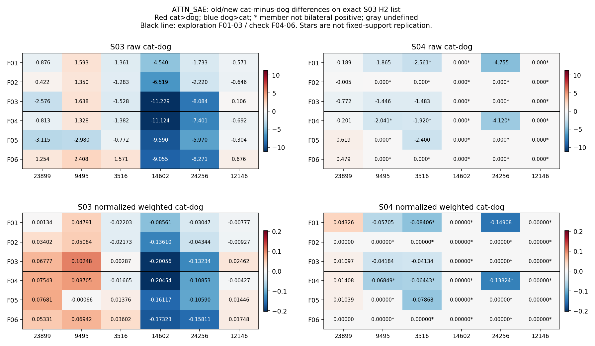
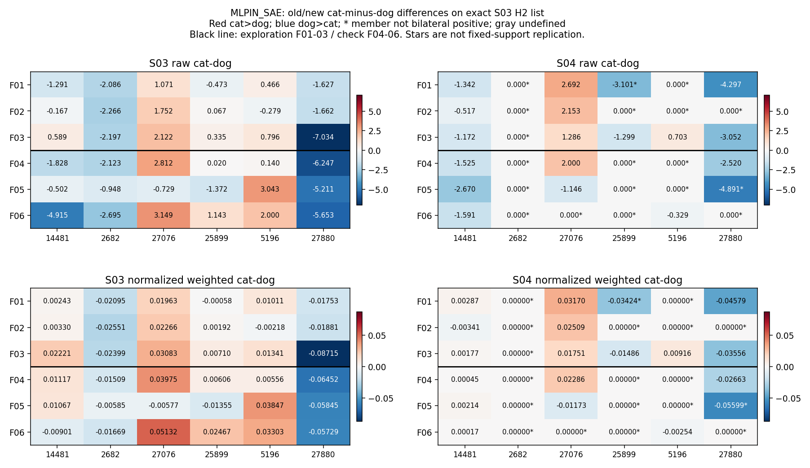
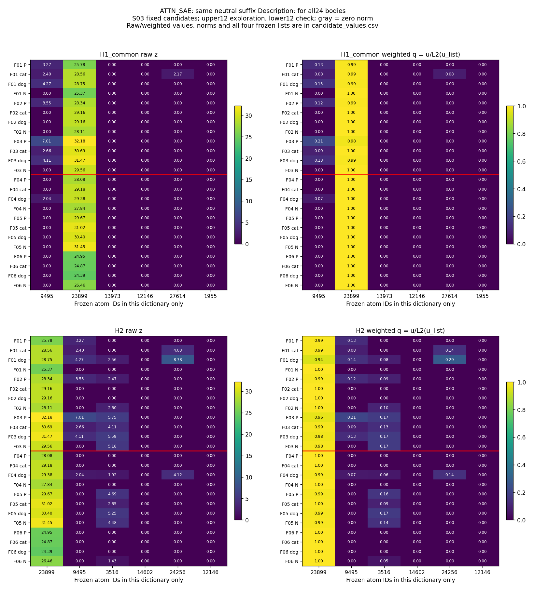
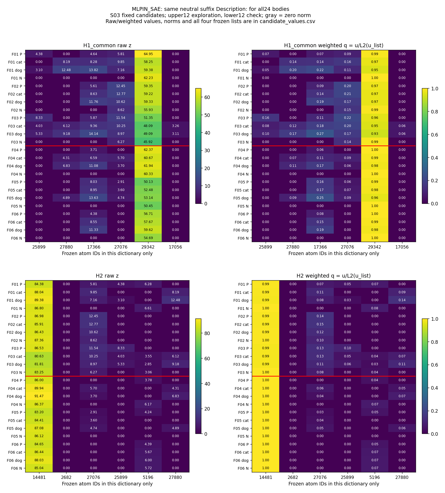

# S04：统一中性后缀后的行为与固定候选检查

**原模型猫6/6、狗6/6，6/6组随类别切换。原S03固定候选的响应对完整后缀语境敏感，多个成员不再进入Top32。** Attention #14602在12条猫狗前文均未激活；#3516只在F03/F05双侧激活，这两组相对各自旧归一化方向均反向。旧结果和候选原件保留，不重筛、不改H1/H2。

本次按三条路径阅读：①原生行为仍能区分明确猫狗；②两套SAE坐标中，旧成员及相对比例的保持范围明显收窄；③本轮没有干预或功能检验，编码、token、旧值重放与计数核验通过。科学接受和下一步决定等待共同审阅。

## 1. 目的

统一四条件的后缀，检查原S03响应模式在另一固定续写语境下是否保持，并确认原模型行为是否仍随明确类别变化。H1的额外成员信息、H2的身份/总幅值控制后额外信息仍是原命题，本步只检查固定候选的语境稳定性。

## 2. 假设与竞争解释

若原候选响应与这批正文的细类关联能跨后缀保持，应在新后缀的对应位置仍能观察到其激活和比例方向。反例包括成员消失、方向反转或零差。这是较弱检查，不等于证实或推翻原H1/H2功能命题。

原模型、两套SAE、24条正文、标签、6家族与候选顺序都不变。旧后缀“The animal is a”或“The object is a”变为统一的`Description:`，同时改变了完整任务框架、取样token和绝对位置。因而不能把旧新差异单独归因于animal、冒号或某一个词，也不能把SAE变化当作干预后模型仍正确的因果结果。

## 3. 实验

新后缀精确为换行+`Description:`，末尾无空格。24条均取最后的`:`，ID25；旧为` a`，ID264；同家族四条件新位置一致。正文全部是完整描述句，此标签式后缀可自然接在P、猫、狗和椅子后。ATTN为block27 o_proj输出、残差相加前，MLPIN为实际MLP输入、残差相加与post_attention_layernorm后；各用原ReLU-Top32规则，不额外归一化输入或减decoder偏置，不是MLP输入输出的因果对照。

每个原命名列表保持原坐标和长度：原始z，自己的decoder列范数d，加权u=z×d，以及z、u分别按列表L2归一化。零范数不可定义；不随成员消失重选列表。逐值见[全部候选旧新表](results/ATTN_SAE/candidate_values.csv)和[MLPIN表](results/MLPIN_SAE/candidate_values.csv)。

原生评分使用同一新前缀与完整候选` cat.`（[8251,13]）、` dog.`（[5562,13]），均2 token。总分含词与句号的条件自然对数概率，不校正先验/长度，不搜prompt。P只知animal，猫狗未知；N是chair，猫狗均不适用，二者只报偏好。

## 4. 分析

### 原模型：明确猫狗仍全部正确

| 家族 | 猫前文 S_cat / S_dog | 猫前文差/首选 | 狗前文 S_cat / S_dog | 狗前文差/首选 |
| --- | --- | --- | --- | --- |
| F01 | -10.419850 / -13.542589 | 3.122739 / cat | -13.493616 / -10.105226 | -3.388390 / dog |
| F02 | -12.323794 / -15.252581 | 2.928787 / cat | -14.897063 / -12.565580 | -2.331483 / dog |
| F03 | -8.345891 / -12.028937 | 3.683045 / cat | -11.877219 / -8.241102 | -3.636118 / dog |
| F04 | -10.723876 / -14.123079 | 3.399204 / cat | -13.914764 / -10.768164 | -3.146600 / dog |
| F05 | -10.062160 / -12.854758 | 2.792598 / cat | -13.029219 / -9.137681 | -3.891538 / dog |
| F06 | -10.365730 / -12.488303 | 2.122573 / cat | -13.532999 / -10.374863 | -3.158136 / dog |

猫6/6、狗6/6，配对均切换且两条都对6/6。明确猫狗没有错误例，不构造不存在的错误。P偏好猫1、狗5；N偏好猫6、狗0，它们不计入正确数。特别是椅子也被迫从猫狗选一个，说明本测试是二候选相对偏好，不是完整对象识别。

S02也是12/12，但使用另一前缀；这里只并列保留为不同语境历史参照，不把两次同样正确解释成某一个词无作用。完整24条前文、token、全部分数及P/N偏好见[数据与行为逐条记录](data_casebook_cn.md)。

### H2：方向、未激活与零范数分开

下面是**相对同家族旧归一化方向**的计数，每行18个“候选×家族”观察（6候选×3家族），不是18个独立样本。先排零范数与成员未双侧激活，再分同向、反向、零差。

| 接口 | 分组 | 同向 | 反向 | 成员未双侧激活 | 零范数 | 零差 |
| --- | --- | --- | --- | --- | --- | --- |
| ATTN_SAE | 探索 | 3 | 3 | 11 | 0 | 1 |
| ATTN_SAE | 保留 | 2 | 1 | 14 | 0 | 1 |
| MLPIN_SAE | 探索 | 8 | 2 | 8 | 0 | 0 |
| MLPIN_SAE | 保留 | 5 | 2 | 11 | 0 | 0 |

本轮两套H2列表均无零范数；但大量旧候选未双侧激活。新H2列表支持相同均4/6对，列表全部6成员均双侧激活均0/6对；全字典支持完全相同仍均0/6对。两侧支持相同也可能是同时失去某些成员，不能等同于原列表全员保持。

每个候选相对**旧配对**与相对**S03冻结探索方向**的探索/保留计数，以及原始差、归一化差和方向，分别见[Attention完整对照](ATTN_SAE/H2_comparison_cn.md)／[MLPIN完整对照](MLPIN_SAE/H2_comparison_cn.md)，原始计数见[固定口径CSV](results/H2_direction_counts.csv)。两种参照不混用。

#### ATTN_SAE：相对S03冻结探索方向

| ID | 探索：同/反/未激活/零范数/零差/无参照 | 保留：同/反/未激活/零范数/零差/无参照 |
| --- | --- | --- |
| 23899 | 2/0/0/0/1/0 | 2/0/0/0/1/0 |
| 9495 | 0/2/1/0/0/0 | 0/0/3/0/0/0 |
| 3516 | 1/0/2/0/0/0 | 1/0/2/0/0/0 |
| 14602 | 0/0/3/0/0/0 | 0/0/3/0/0/0 |
| 24256 | 1/0/2/0/0/0 | 0/0/3/0/0/0 |
| 12146 | 0/0/3/0/0/0 | 0/0/3/0/0/0 |

旧新同一量使用同一颜色范围，红猫较强、蓝狗较强；星号是未双侧激活，不算固定成员方向复现；黑线区分探索与检查。所有反向、消失及零差都保留。

#### MLPIN_SAE：相对S03冻结探索方向

| ID | 探索：同/反/未激活/零范数/零差/无参照 | 保留：同/反/未激活/零范数/零差/无参照 |
| --- | --- | --- |
| 14481 | 2/1/0/0/0/0 | 3/0/0/0/0/0 |
| 2682 | 0/0/3/0/0/0 | 0/0/3/0/0/0 |
| 27076 | 3/0/0/0/0/0 | 1/1/1/0/0/0 |
| 25899 | 0/1/2/0/0/0 | 0/0/3/0/0/0 |
| 5196 | 1/0/2/0/0/0 | 0/1/2/0/0/0 |
| 27880 | 2/0/1/0/0/0 | 1/0/2/0/0/0 |

旧新同一量使用同一颜色范围，红猫较强、蓝狗较强；星号是未双侧激活，不算固定成员方向复现；黑线区分探索与检查。所有反向、消失及零差都保留。

### 指定案例：#14602、#3516

这两个编号仅属于Attention字典。[指定案例全文与全部数值](focused_14602_3516_cn.md)保留6组完整旧新猫狗前文、z/u/q、Top32、preactivation和范数。

- **#14602：**旧猫减狗归一化差在六组均负；新猫狗的z/u/q全为0，未进入Top32，因列表其他成员仍正，q=0可定义。这是候选未激活，不是列表零范数，也不能叫“方向继续偏狗”。
- **#3516：**F03旧Δq=+0.002868399，新Δq=−0.041341155；F05旧Δq=+0.013762367，新Δq=−0.078677683。两组均双侧激活，故相对旧配对反向；S03冻结探索均值方向原本为负，故又与该平均方向同向。F01/F04仅狗侧激活，F02/F06两侧均不激活。未将这些失败排除后再宣称6/6稳定。
- **归一化退化的例子：**Attention #23899在F02新猫z=29.157364、狗z=29.162550，仍有原始差；但固定6成员只剩它在两侧激活，因此两边归一化均为1，差为0。列表归一化会丢掉这个幅值差，不等于模型失去类别区分。

### H1：共同模式与支持换入换出

旧共同候选在新保留家族的完整模式覆盖：

**ATTN_SAE**

| ID | 旧检查/3 | 新检查/3 |
| --- | --- | --- |
| 9495 | 3 | 0 |
| 23899 | 3 | 1 |
| 13973 | 0 | 0 |
| 12146 | 3 | 0 |
| 27614 | 1 | 0 |
| 1955 | 1 | 0 |

左为新原始z，右为该命名列表加权L2归一化值；上H1共同、下H2。红线分开探索/检查，灰为不可定义。加权原始u、decoder范数、其余H1新增列表与零范数均在逐候选表中，没有从图上删去失败后补选成员。

[该接口全部P/猫/狗/N支持、旧新变化与候选覆盖](ATTN_SAE/H1_comparison_cn.md) · [所有候选逐样本原始/相对数值](ATTN_SAE/candidate_casebook_cn.md)。

**MLPIN_SAE**

| ID | 旧检查/3 | 新检查/3 |
| --- | --- | --- |
| 25899 | 3 | 0 |
| 27880 | 2 | 0 |
| 17366 | 2 | 3 |
| 27076 | 2 | 1 |
| 29342 | 1 | 2 |
| 17056 | 2 | 0 |

左为新原始z，右为该命名列表加权L2归一化值；上H1共同、下H2。红线分开探索/检查，灰为不可定义。加权原始u、decoder范数、其余H1新增列表与零范数均在逐候选表中，没有从图上删去失败后补选成员。

[该接口全部P/猫/狗/N支持、旧新变化与候选覆盖](MLPIN_SAE/H1_comparison_cn.md) · [所有候选逐样本原始/相对数值](MLPIN_SAE/candidate_casebook_cn.md)。

P与N现在后缀完全相同，正文仍有animal/chair与冠词an/a差异。两个正文都用object指代，猫狗正文仍用animal并明确写cat/dog；词面与复述解释未排除。每条仍Top32，旧→新和P→细类的换入/换出只能说明原字典支持变化，不对应独立新语义。共同模式有消失也有保持，例如MLPIN #17366新检查3/3；本轮未据此改候选。

## 5. 结论与认识更新

**统一后缀后知道了什么：**明确猫狗的二候选偏好仍随正文改变，而S03挑出的许多末尾成员与比例模式不跨这次完整后缀变更保持。因此，原行为区分与某份固定SAE候选列表的语境稳定性要分开检验。现在多确定了这些候选可观察的适用语境边界，不能把旧列表直接当作普遍的粗细概念组成。

**H1：**观察到具体共同/新增模式随后缀保持或消失，只涉及当前字典支持；新增提供额外细类信息仍未验证。后缀统一消除了新P/N之间的尾部类别词差异，正文、目标token和语境仍限制解释。

**H2：**仍有保持及反向，但多数“未复现”首先卡在固定候选成员未激活，并非本轮H2列表零范数或原模型行为失败。Attention #14602全消失、#3516仅2/6配对可作双侧比例方向检查；两套列表全员双侧激活均0/6，故不能用本轮描述完成原H2的身份/总幅值控制及额外信息命题。部分H1新增列表确有零范数，表中如实记为不可定义。

六个已使用的短英文家族、明确的cat/dog词、单一chair非动物对照和强制二候选仍限制结论。词面复制、句式/任务框架、目标token差异及Top32竞争均未排除；没有做因果干预，不能推断这些原子是否被模型使用或可被删除。训练、probe、SVD、新类别、提示搜索及后续实验均未运行。原假设不改，下一步等待共同审阅。

[完整24条](data_casebook_cn.md) · [指定两原子全文](focused_14602_3516_cn.md) · [中文Detailed与质量检查](detailed_cn.md) · [冻结协议](protocol_cn.md) · [全部原始行为分数](results/behavior_raw.jsonl) · [原始表征数组](cache/new.npz)
