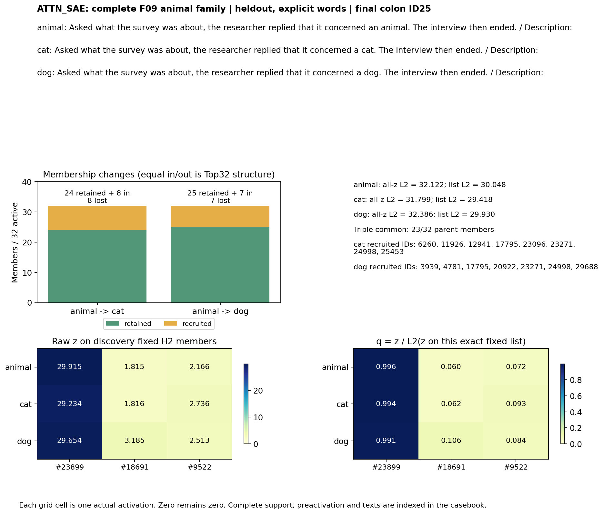
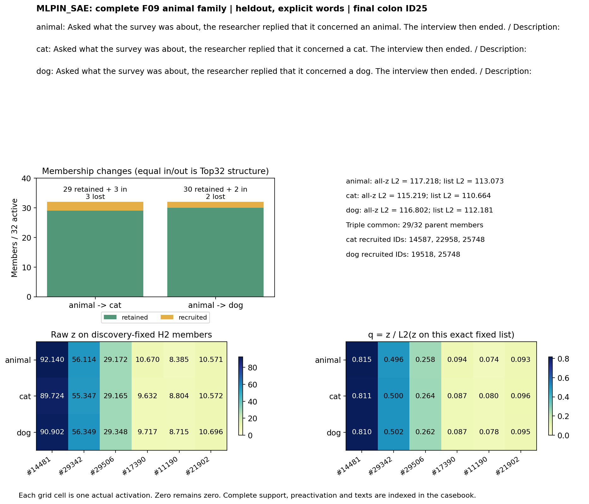
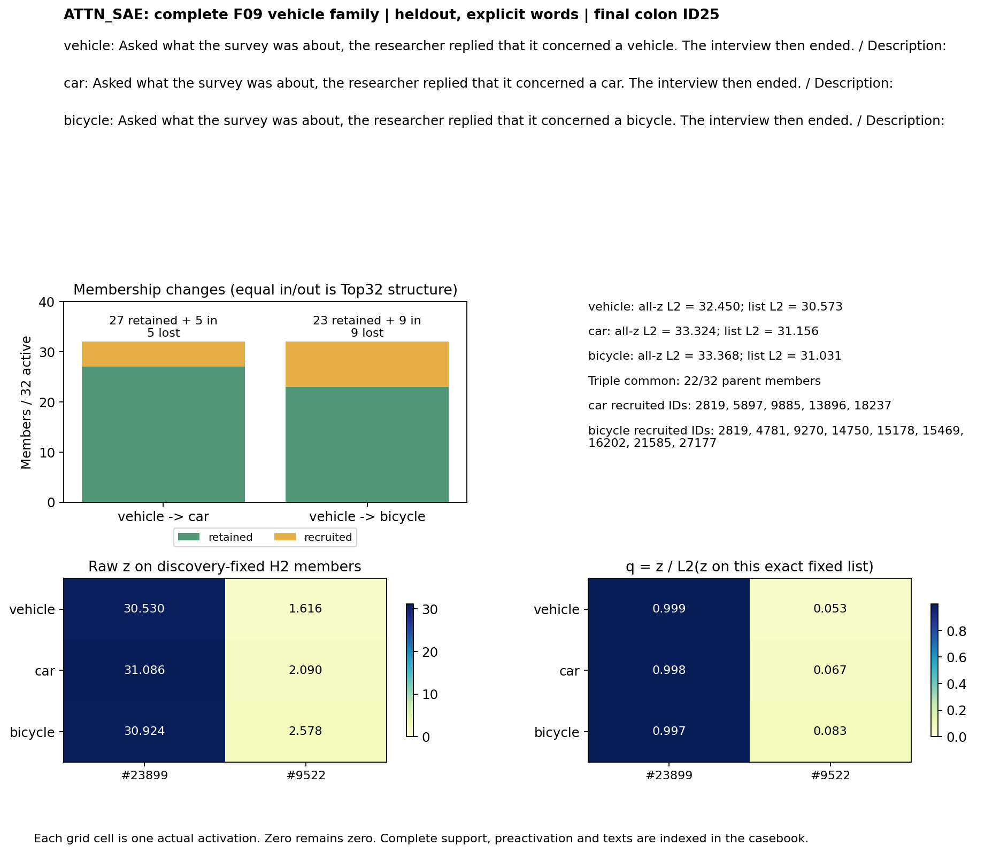
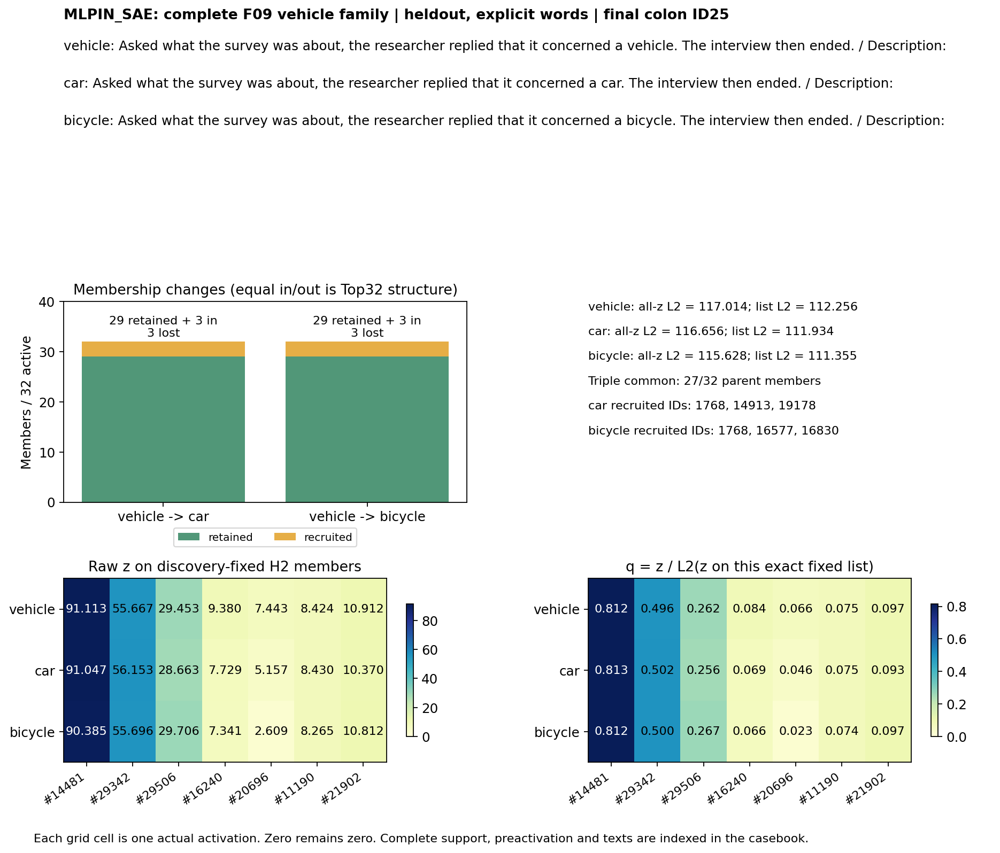
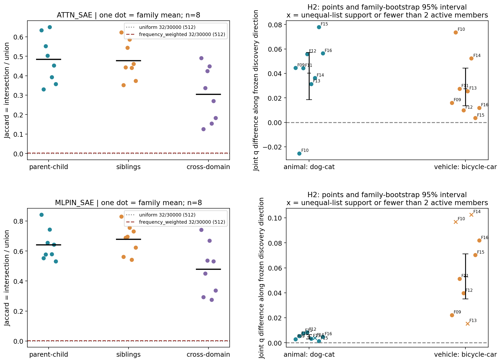
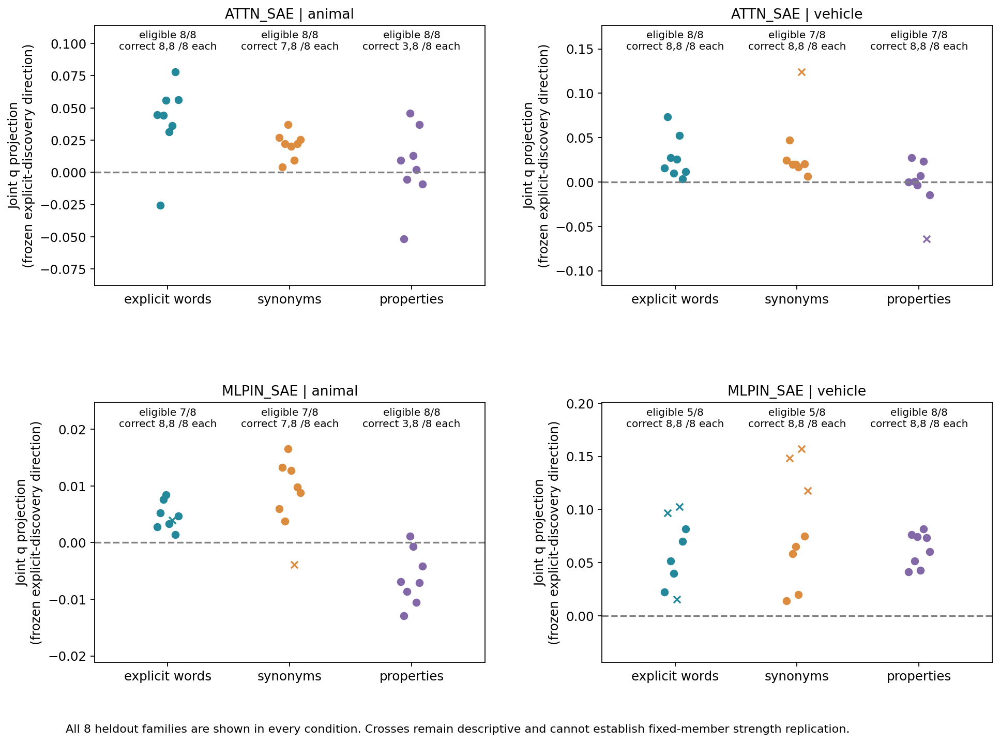
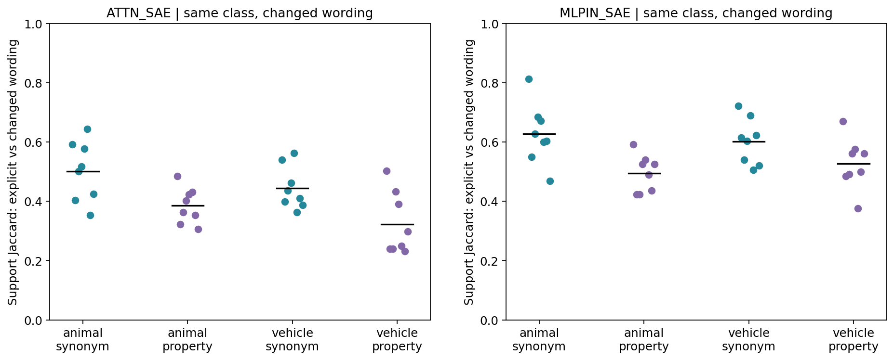

# Detailed：H1/H2完整实验与竞争解释

本轮按三条路径阅读：①原模型行为与措辞／家族控制；②SAE成员组合及联合强弱；③功能与质量。本轮未做功能干预；数值和来源检查检验测量可信性。按用户本次要求，以下同时给出原始观察和有边界的AI认识更新，科学接受／机制判断／关闭仍Unknown。

## 目的、模型与实际步骤

沿用同一official Qwen3-0.6B Base和原生Attention输出／MLP输入SAE。前者hook为block27.self_attn.o_proj残差相加前；后者是block27.mlp实际输入，经过残差相加和post_attention_layernorm。两字典各30000维、ReLU后Top32，不额外归一化。它们不是MLP前后因果对照，ID不对应。参数全部冻结；模型、SAE、router、分类读出和SVD均未训练或拟合。只拟合发现集联合差均值，冻结后投影留出。

固定16个独立撰写的上下文模板，每个大类16家族，两个域共享模板所以独立单位是16个模板簇。F01–08发现、F09–16留出。每模板8类别×显式／同义／属性3措辞=24条，合384条。先冻结文本／协议／哈希，再算显式发现64条并冻结候选；之后才推理其余320条。类别短语跨模板重复，不能声称全句级内容完全独立或模型训练未见。没有按结果删样本。

在统一Description:冒号取样。完整候选cat/dog/car/bicycle分别为[8251,13]、[5562,13]、[1803,13]、[34986,13]，均2token。对整串的条件对数概率求和，FP32 logsoftmax、FP64加总，无长度／先验校正。以每个细类每措辞8条为分母，父类／椅子／石头没有二选一正确标签。前向四个candidate lane都只取答案前冒号；前缀独立前向、候选lane和hook无改动检验证明没有读取未来答案。

代码复用：原生SAE loader和S04取样／完整候选评分适配到384条与四候选，新写组合分析。训练复用索引已读，训练设施不使用。CPU2线程、4×128、GPU0、云job无。实际耗时、PyTorch版本和首尾哈希在evidence/*_complete.json。

## 协议一致性和修订

科学分析体与数据在第一次响应前落盘，原始freeze保留。selection最终控制台打印曾因numpy整数序列化失败；此时selection和gate已完整保存，修复仅影响日志，未重筛。amendments.md保留前后代码和曝光状态。若另有计算／排版修复，其记录同处；不改变阈值、候选或数据。旧S02–S05哈希逐项复核。

## 行为和语义判断资格

| 措辞 | 类别 | 同父二选一/8 | 四选一/8 |
| --- | --- | --- | --- |
| explicit | cat | 8 | 8 |
| explicit | dog | 8 | 8 |
| explicit | car | 8 | 8 |
| explicit | bicycle | 8 | 8 |
| synonym | cat | 7 | 7 |
| synonym | dog | 8 | 8 |
| synonym | car | 8 | 8 |
| synonym | bicycle | 8 | 8 |
| property | cat | 3 | 3 |
| property | dog | 8 | 8 |
| property | car | 8 | 8 |
| property | bicycle | 8 | 8 |

每个“8”是留出家族数。每子类至少6/8才达到本轮语义资格；失败组仍描述表征。父类一般信息不足以指定子类。四选一提供跨域偏好补充，未作为主统计替代。具体错误和每token分数全部可审计。

## H1：共同成员与更替

逐对共同成员就是两个支持集合交集；三方共同是P、子1、子2三支持交集。发现固定列表是跨发现家族筛出的另一对象。主统计比较同域3对与跨域9对Jaccard，家族内六标签打乱保留每个真实稀疏向量、模板与总规模。均匀／频率加权随机支持只标出固定稀疏度和高频坐标带来的背景，不被当作独立语义标签参照。

| SAE | 大类 | 预测 | 估计 | 95%家族区间 | 可用/8 | Holm p |
| --- | --- | --- | --- | --- | --- | --- |
| ATTN_SAE | animal | H1 | 0.2212 | [0.1868, 0.2500] | 8 | 0.0020 |
| ATTN_SAE | animal | H2 | 0.0401 | [0.0186, 0.0572] | 8 | 0.0234 |
| ATTN_SAE | vehicle | H1 | 0.1341 | [0.0966, 0.1740] | 8 | 0.0020 |
| ATTN_SAE | vehicle | H2 | 0.0275 | [0.0136, 0.0444] | 8 | 0.0156 |
| MLPIN_SAE | animal | H1 | 0.1884 | [0.1508, 0.2254] | 8 | 0.0020 |
| MLPIN_SAE | animal | H2 | 0.0048 | [0.0031, 0.0065] | 7 | 0.0234 |
| MLPIN_SAE | vehicle | H1 | 0.1595 | [0.0884, 0.2416] | 8 | 0.0020 |
| MLPIN_SAE | vehicle | H2 | 0.0530 | [0.0350, 0.0711] | 5 | 0.0312 |

共同候选要求发现三方>=6/8，换入／换出候选>=4/8，按频率、幅度固定排序。下表完整列每个新候选在留出显式文本的事件数，包括0/8，不重新筛选；完整措辞细分见candidate_coverage.csv。频率分母为64条显式发现位置，是本面板使用频率，不是训练语料频率。

| SAE/大类 | 列表 | 留出各ID事件数/8 | 平均覆盖 | 匹配随机均值/有效组 |
| --- | --- | --- | --- | --- |
| ATTN_SAE/animal | H1_common | #9522:8/8; #17795:4/8; #18034:4/8; #18691:6/8; #23899:8/8 | 0.7500 | NA/0 |
| ATTN_SAE/animal | H2 | #9522:8/8; #18691:6/8; #23899:8/8 | 0.9167 | NA/0 |
| ATTN_SAE/animal | cat_loss | #5567:1/8; #9495:3/8; #27013:0/8 | 0.1667 | 0.0062/256 |
| ATTN_SAE/animal | cat_recruit | #28120:4/8 | 0.5000 | 0.0161/256 |
| ATTN_SAE/animal | dog_loss | #9495:2/8; #15178:1/8; #27013:0/8 | 0.1250 | 0.0334/256 |
| ATTN_SAE/animal | dog_recruit | #23896:3/8 | 0.3750 | 0.0098/256 |
| ATTN_SAE/vehicle | H1_common | #9522:8/8; #23899:8/8 | 1.0000 | NA/0 |
| ATTN_SAE/vehicle | H2 | #9522:8/8; #23899:8/8 | 1.0000 | NA/0 |
| ATTN_SAE/vehicle | bicycle_loss | #5567:4/8; #5897:6/8; #10899:5/8 | 0.6250 | 0.0396/256 |
| ATTN_SAE/vehicle | bicycle_recruit | #1081:7/8; #14503:3/8; #15178:2/8 | 0.5000 | 0.0270/256 |
| MLPIN_SAE/animal | H1_common | #861:7/8; #11190:8/8; #14481:8/8; #17366:7/8; #17390:8/8; #21902:6/8; #29342:8/8; #29506:8/8 | 0.9375 | NA/0 |
| MLPIN_SAE/animal | H2 | #11190:8/8; #14481:8/8; #17390:8/8; #21902:6/8; #29342:8/8; #29506:8/8 | 0.9583 | NA/0 |
| MLPIN_SAE/animal | cat_loss | #334:4/8; #11013:4/8; #24399:3/8; #25899:2/8 | 0.4062 | 0.0103/256 |
| MLPIN_SAE/animal | cat_recruit | #8856:1/8; #11234:0/8; #22958:8/8 | 0.3750 | 0.0477/256 |
| MLPIN_SAE/animal | dog_loss | #11013:3/8; #24399:4/8; #25899:2/8 | 0.3750 | 0.0049/256 |
| MLPIN_SAE/vehicle | H1_common | #11190:8/8; #14481:8/8; #16240:7/8; #17390:8/8; #20696:8/8; #21902:6/8; #29342:8/8; #29506:8/8 | 0.9531 | NA/0 |
| MLPIN_SAE/vehicle | H2 | #11190:8/8; #14481:8/8; #16240:7/8; #20696:8/8; #21902:6/8; #29342:8/8; #29506:8/8 | 0.9464 | NA/0 |
| MLPIN_SAE/vehicle | bicycle_loss | #5196:4/8; #8048:4/8; #19327:3/8; #20289:0/8 | 0.3438 | NA/0 |
| MLPIN_SAE/vehicle | bicycle_recruit | #16830:8/8; #18933:5/8; #22309:1/8 | 0.5833 | 0.0078/256 |
| MLPIN_SAE/vehicle | car_recruit | #19178:5/8 | 0.6250 | 0.0132/256 |

随机候选逐feature匹配发现活跃计数±2，256组，排除当前名单。若有效匹配0，比较不存在，不能把没有随机数据称为赢过随机。其余观察均值和随机区间在matched_candidate_baselines.csv；只作辅助，不能救回主检验。

## H2：同一成员的联合强弱

H2列表只选8发现家族P／两子类始终共同激活的成员，按平均z最多8个，不按兄弟差异挑成员。每文本q是该固定列表除其L2范数，原始z和整体L1／L2并列。兄弟差的发现均值单位向量固定后，留出差沿它投影；仅列表支持相同且至少2成员为正的配对进入主统计，至少6/8组才足够。其他完整列表差和动态配对共同成员差照样保存，但无固定成员语义资格。固定列表支持不等于全30000支持相同。

| SAE | 大类 | 措辞 | H1关系重叠差[区间] | H2联合强弱投影[区间] | H2可用/8 |
| --- | --- | --- | --- | --- | --- |
| ATTN_SAE | animal | explicit | 0.2212 [0.1868, 0.2500] | 0.0401 [0.0186, 0.0572] | 8 |
| ATTN_SAE | animal | synonym | 0.2031 [0.1790, 0.2294] | 0.0209 [0.0142, 0.0273] | 8 |
| ATTN_SAE | animal | property | 0.1362 [0.0947, 0.1730] | 0.0052 [-0.0158, 0.0239] | 8 |
| ATTN_SAE | vehicle | explicit | 0.1341 [0.0966, 0.1740] | 0.0275 [0.0136, 0.0444] | 8 |
| ATTN_SAE | vehicle | synonym | 0.0388 [0.0201, 0.0566] | 0.0221 [0.0148, 0.0317] | 7 |
| ATTN_SAE | vehicle | property | 0.1340 [0.0924, 0.1769] | 0.0057 [-0.0040, 0.0161] | 7 |
| MLPIN_SAE | animal | explicit | 0.1884 [0.1508, 0.2254] | 0.0048 [0.0031, 0.0065] | 7 |
| MLPIN_SAE | animal | synonym | 0.1975 [0.1762, 0.2205] | 0.0101 [0.0071, 0.0131] | 7 |
| MLPIN_SAE | animal | property | 0.1469 [0.1178, 0.1773] | -0.0062 [-0.0093, -0.0031] | 8 |
| MLPIN_SAE | vehicle | explicit | 0.1595 [0.0884, 0.2416] | 0.0530 [0.0350, 0.0711] | 5 |
| MLPIN_SAE | vehicle | synonym | 0.0546 [0.0222, 0.0888] | 0.0464 [0.0251, 0.0677] | 5 |
| MLPIN_SAE | vehicle | property | 0.1824 [0.1545, 0.2084] | 0.0626 [0.0522, 0.0730] | 8 |

多个成员的联合差向量、共同支持组合和发现选定4组成员间强弱顺序保存在joint_patterns.csv和rank_pairs.csv。强弱顺序比较的量为“子2内feature_b−feature_a”减“子1内同一差”，不把某个单独原子当成组合。随机H2列表也只用显式发现拟合方向，在相同留出条件上算投影，并报告每组可用样本数，见matched_joint_baselines.csv。

## 类别相同、措辞变化与家族配对

synonym替换为feline/canine/automobile/pedal cycle等；property改为meows/retractile claws、barks/wags tail、four wheels/engine/cabin、two wheels/pedals等，不出现六个目标类别词。它降低字面复制，仍包含语义强线索。父类nonhuman creature、conveyance和宽泛功能描述只是近似对照，不能单凭其成败归因抽象层级。不同家族共享类别短语，模板切换尚不是开放自然语料泛化。

同类别显式→改写支持Jaccard逐家族在wording_controls.csv；同模板内的语义换类、跨域和两负类对照在overlaps.csv。家族错配固定为后一家族循环配对，不重新拟合方向，见family_pairing_controls.csv。原始固定功能末尾token相同，但改写长度及绝对位置变化仍是竞争解释，不声称已单独排除。

## Top32、幅度和重构限制

| SAE | 大类 | 共同强弱% | 换入% | 换出% | 配对数 |
| --- | --- | --- | --- | --- | --- |
| ATTN_SAE | animal | 22.62 | 38.92 | 38.47 | 16 |
| ATTN_SAE | vehicle | 12.40 | 60.36 | 27.24 | 16 |
| MLPIN_SAE | animal | 34.14 | 32.95 | 32.90 | 16 |
| MLPIN_SAE | vehicle | 27.93 | 46.66 | 25.41 | 16 |

native preactivation是encoder线性输出，ReLU后只保留32个。零值可能是原始响应非正，也可能正但排名不够。preactivation_events.csv逐换入／换出列出两侧pre和32名门槛；row_metrics.csv给每文本被截断正响应数。decoder不是正交基，z坐标能量份额不是输出能量、语义份额或因果贡献。decoder范数接近1使尺度补充接近；scale_sensitivity.json报告最大差而不只选好看的尺度。重构相对L2误差为||h−decode(z)||/||h||，完整逐样本保存；差异可能包含字典捕获能力。

## 共享父类配对差的几何参照

直接计算30000维子1−P与子2−P余弦；保留共享父结构，枚举每个三文本家族6个角色重排。若真实余弦同样可由共享父及三点几何产生，就不能命名共同语义方向。shared_parent_geometry.csv报告实际值及该结构参照的范围和均值。SVD本轮不运行：无需用总体方差轴代替真正配对差。S05的分母核验见prior_audit.md和独立复算表。

## 反例、旧候选与图

[完整F09及每接口／大类固定规则反例](casebook_cn.md)保留原文、全部token、具体成员z/q、换入／换出ID和行为失败。旧S03候选另在old_S03_candidates.csv全量报告，新名单不冒充旧名单。按预选F09展示不意味F09最好；同向时也显示最弱例并明确没有负例满足规则。

所有图均使用本轮冻结数据。家族散点保留个体差异，置信区间是8个模板簇的4096次bootstrap百分位，不是所有语言总体置信。图中分母32／固定列表L2／8家族分别标出，实际图面已检查并保存figure_review。

## 裁决、竞争解释及仍不能说明的事

| SAE | 大类 | H | 显式条件 | 跨措辞 |
| --- | --- | --- | --- | --- |
| ATTN_SAE | animal | H1 | LOCAL_SUPPORT | INSUFFICIENT |
| ATTN_SAE | animal | H2 | LOCAL_SUPPORT | INSUFFICIENT |
| ATTN_SAE | vehicle | H1 | LOCAL_SUPPORT | SUPPORT_IN_THIS_PANEL |
| ATTN_SAE | vehicle | H2 | LOCAL_SUPPORT | NOT_SUPPORTED |
| MLPIN_SAE | animal | H1 | LOCAL_SUPPORT | INSUFFICIENT |
| MLPIN_SAE | animal | H2 | LOCAL_SUPPORT | INSUFFICIENT |
| MLPIN_SAE | vehicle | H1 | LOCAL_SUPPORT | SUPPORT_IN_THIS_PANEL |
| MLPIN_SAE | vehicle | H2 | INSUFFICIENT | INSUFFICIENT |

以上是AI按预登记操作标准的有限裁决。H1的局部关系重叠和具体成员事件分别理解；H2身份合格时才能讨论同成员强弱的候选复现。未复现不自动等于因果反证，资格或检验能力不足保留INSUFFICIENT。两大类差异首先是该模型／字典／措辞条件下的事实；目前没有功效匹配足以唯一归因“类别规律不同”。

词面复制／属性提示、模板残余、改写位置、固定Top32排序、全局规模和重构限制尚未完全排除；发现选择与留出哈希门排除了本轮直接按留出重筛，但小样本选择不确定仍在。H1/H2都不说明feature唯一语义、真实专家路由、功能必要性、训练收益或广泛自然语义层级。H3、H4、真实router训练NOT_RUN_BY_PROTOCOL，仍在parking lot。

AI机制直觉：相同字典中可能同时发生强度再分配和排序竞争。当前观察不足以判定模型内部实际采用哪种语义计算机制。科学接受、问题关闭和下一研究者决策Unknown。本轮任务完成后停止。

## 覆盖与可复现入口

资产核验、旧定义核验、384文本／token、行为、H1全支持、H2固定／动态组合、留出／改写、随机／打乱、重构／pre、反例、图、独立复算与小包均由evidence/coverage_ledger.csv登记最终状态。完整原始激活用稀疏CSR包含所有384×30000坐标零值信息；大缓存外留不等于丢样本。实际文件、大小和hash见output_manifest.json；包内容见PACKAGE_MANIFEST.json。

[复算说明](reproduce.md) · [冻结协议](protocol.md) · [原始输入](data/panel.jsonl)
