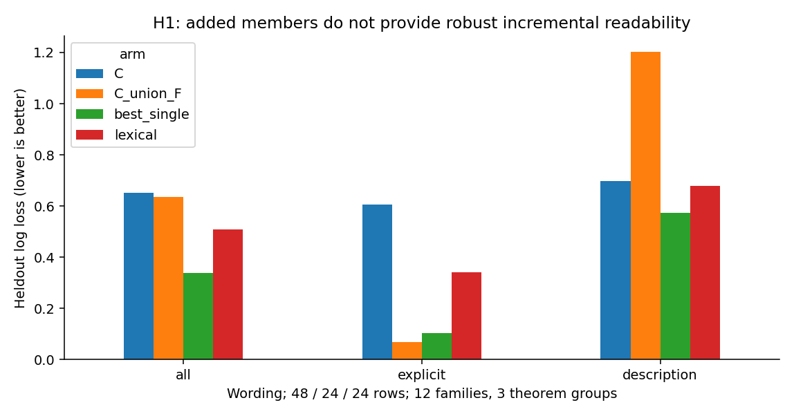
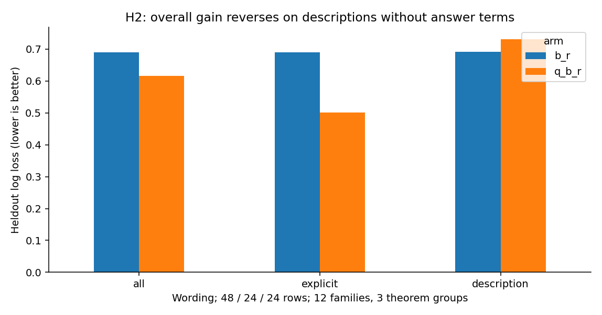
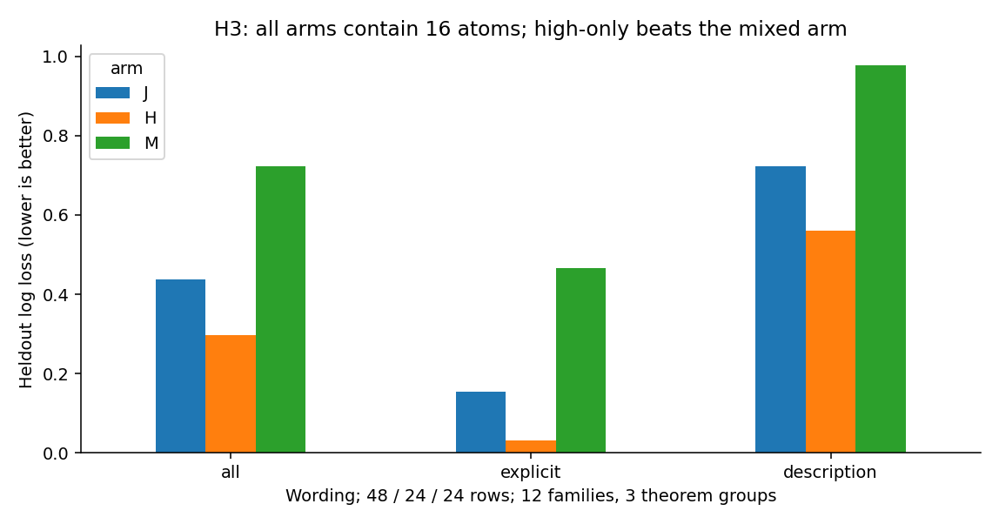
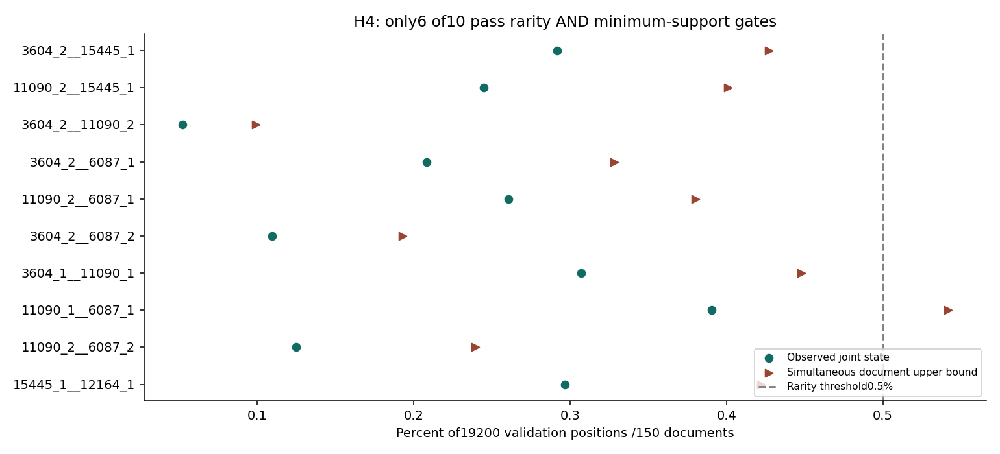

# Feature组合与自然语言关系：四路线认识更新

本轮完成 H1–H4 的冻结模型计算。**目前最稳妥的认识是：共同响应、额外活跃成员、相对强度和罕见配置是四种可区分的观察；它们还没有连成稳定的细粒度语义分解。** 跨措辞证据明显弱于显式术语证据。下表与全文均使用数学符号修订版，旧结果完整保留。本轮是已暴露留出的受限复核，科学接受与下一研究决策均为 `Unknown`。

## 目的

导师关心：更具体的文本内容，是否由共同 feature 与细节 feature 的组合表达？我们把这个问题拆成四个能分别失败的比较。真实 feature 未知；本轮用已训练 CrossCoder 的原子响应作为观测代理。分类读出用于检验响应中有什么可利用的信息，不能说明模型原生使用了这些原子，也不能说明稀有信息学习改善。

## 假设

| 路线／当前Anchor | 冻结正向假设 | 最强竞争解释 | 本轮执行分支 |
|---|---|---|---|
| [H1／15_27_06](H1/summary_cn.md) | 细概念保留共同响应，新增成员还提供额外辨别信息 | 术语／模板、单原子、候选截断 | `COMPLETED_INSUFFICIENT`：共同对应成立；完整新增增量未成立 |
| [H2／15_27_07](H2/summary_cn.md) | 控制成员活跃与整体幅值后，相对强度仍提供跨措辞增量 | 术语和整体幅值、少数家族驱动 | `COMPLETED_INSUFFICIENT`：混合面板为正；无术语描述反向 |
| [H3／15_27_08](H3/summary_cn.md) | 同成员预算下，跨频率组同时优于高频组与中低频组 | 高频组已足够，混入其他组稀释预算 | `COMPLETED_NOT_SUPPORTED`：未胜过高频组 |
| [H4／15_27_09](H4/summary_cn.md) | 常见单状态组成的稀有配置有稳定内容对应，且超出加性及匹配配置 | 普通概率乘积、语境覆盖不足、一般额外维度 | `COMPLETED_INSUFFICIENT`：6个验证稀有；目标内容不足；无配置通过双增量门槛 |

这些是协议结果分支，不是研究者的科学接受或问题关闭。

## 实验

固定官方 Qwen3-0.6B-Base（28个块、宽度1024）与 A22 CrossCoder（联合读取1、3、…、27层，16384个共享原子）。本轮没有更新底模或字典。对每条文本，在统一后缀 `Summary:` 的最后一个 token、答案生成之前读取响应。我们没有生成答案，也没有测原生数学答题正确率。

构造384条材料：48个矩阵证书家族×粗方阵／可逆／奇异×显式术语／描述两措辞，共288条；加96条非矩阵数学对照。粗方阵的可逆性为未知，不进入二分类。24／12／12家族整组划为发现／开发／留出；相关证书又合成6／3／3个定理组，禁止跨划分。主读出留出只有48条细标签材料，即12家族、3定理组。无术语描述为24条，其中 `singular value` 这样的技术短语另外标记；它没有直接给出答案标签。

自然频率复用 R15 的600篇网页、76800个位置。只用300篇发现文档的38400个位置定义频率组和状态边界；另150／150篇供开发／验证。这是关键词筛过的既有网页，不代表自然语言总体，也不是新的独立语料。全部轻量逻辑回归均在CPU拟合，共用五档正则网格，发现集标准化、开发集选正则。实际使用CPU两线程、GPU 0张，无远程作业。完整划分、数学定义、核验和偏差见 [Detailed](detailed_cn.md)；原文、ID和 token 见[固定案例](casebook_cn.md)与[数据指南](dataset_guide.md)。

## 分析

### H1：共同对应清楚，新增成员的必要性没有建立

共同集合 C 有8个原子。三种矩阵条件相对非矩阵文本的平均标准化差分别为 **1.7526、1.6369、1.6427**，99%家族同时区间分别为[1.6596,1.8558]、[1.4928,1.7756]、[1.5064,1.7710]。两种措辞、每个留出家族的差都为正。这支持当前材料中的共同响应，但对照同时改变数学对象与词面，不能直接给 C 命名为“方阵语义feature”。

细节候选 F 有8个，均不在 C 中，也不在共同排序前16／32名；留出确有122次粗→细的0→正转变（384个条件—原子配对中的122次），同时有34次正→0。**候选额外与实际新活跃均可观察，但增量可读性是另一项检验。** C 的留出对数损失为0.6518，C∪F为0.6355，改善0.0162，99%区间[−0.6696,0.4872]；相对 C加8个频率／文档覆盖匹配随机原子，改善0.0098，[−0.6503,0.4723]。全部20个随机种子匹配完成。

显式术语版 C∪F 的损失仅0.0673；描述版却为 **1.2038**，高于 C 的0.6985。发现集选出的单原子7803整体损失为 **0.3382**，低于16原子联合。正确率给出另一面：联合40／48、单原子42／48；损失惩罚了描述版的过度自信错误，因此不能只看联合正确率增加。

### H2：强度含有混合面板信号，跨措辞解释需要收缩

每个原子的原响应记为 z；乘末层decoder列范数得到幅度 u。用8个 C 原子的非零指示 b 和向量长度 r 作基线，再加入单位方向 q，检验相对强度的条件增量。主损失由 **0.6903降至0.6164**，改善 **0.0738**，95%家族区间 **[0.0100,0.1298]**。按仅3个定理组重采样，区间变为 **[−0.0107,0.1738]**。

措辞拆开后，显式版改善0.1884；描述版为 **−0.0407**（0.6909→0.7317）。额外控制全字典活跃数与范数仍未修复描述版：0.6818→0.8145。17／24个留出文本对在 C 内有相同活跃支持，涉及10家族；其中描述版仅7对、7家族，冻结模型平均改善 **−0.0604**，家族区间[−0.2255,0.0968]。这保留了“同支持下强弱会变”的事实，削弱“强弱稳定编码可逆性”的解释。

### H3：本次固定预算支持高频组，未支持跨频率双优势

自然发现集中，原子至少活跃20位置并覆盖5文档才入池。按活跃次数整组划频率：低频少于127，中频127–578，高频至少579；可用成员数分别4059、4051、4067。频率是原子响应频率，不是概念频率。

每臂16个成员。混合 J=8高+4中+4低；H=16高；M=8中+8低。留出损失分别 **J 0.4383、H 0.2970、M 0.7222**。J相对H改善 **−0.1413**，97.5%同时家族区间 **[−0.2708,−0.0199]**；相对M改善 **+0.2839**，[+0.2164,+0.3559]。归一化后排序不变。J的描述版0.7218仍弱于H的0.5613。

因此应修正“跨频率本身带来优势”的预期。当前目标和选取规则下，高频成员已含较强辨别信号。结果没有排除某个特定中低频成员有用，也没有检验长期学习或稀有概念收益。

### H4：稀有配置存在；稀有语义与独特交互仍未证实

从发现数据冻结8个高频候选、20对、80种非零状态配置，29种通过发现门槛，选10种验证。弱／强边界仅取自然发现正值75分位。验证时 **6／10** 同时满足单状态常见、联合稀有、置信上界及最少位置／文档支持。

例：原子3604强+15445弱，在19200验证位置中出现 **56次、35文档，0.2917%**，文档重采样同时上界 **0.4271%**，低于0.5%门槛。两单状态频率分别 **1.4427%、18.4531%**；乘积 **0.2662%**，实测／乘积 **1.0956**。这个例子的联合稀有性接近普通概率乘积，不能直接称为特殊交互。

自然语境匹配得到 **208对**，每个配置内部两侧文档互不重复；另91条配置命中文本无合格匹配，仍保留。文本先去掉响应信息，再由保守规则自动标注，并非独立人工盲标。匹配双方各208段中，可逆／奇异目标标签均为 **0**；配置侧9段、对照侧15段为无法确定的矩阵语境，其余为非目标。独立按验证文档抽取一段可见前缀，150段中141非目标、9未定、0细标签。这里首先缺的是目标内容覆盖，不能把零命中说成配置没有语义。

语义构造面板上，有1个配置优于加性基线的同时区间下界略大于零，但它对匹配配置的改善区间仍跨零；**没有配置同时通过两个增量门槛**。另1个配置的20个匹配配置对照全部匹配失败，未补造比较。完整阴性与失败见 [H4 Summary](H4/summary_cn.md)。

## 结论：认识更新、假设修正与AI建议

1. **保留共同对应，拆开组合的三个层次。** 文本共享内容、原子共同活跃、新增维度改善读出，不能互相替代。H1当前只稳住第一层观察与部分新增活跃事实。
2. **把“组合”从成员清单改成有条件的响应模式假设。** H2提示相对强度值得研究，但措辞方向不稳定；需要解释它怎样跨表达保持，而不是只证明强度能变。
3. **收缩跨频率普遍优势。** H3应改为“特定目标是否需要某些中低频成员提供条件互补”，不能预设频率混合优于高频。
4. **把稀有性、内容对应、独特配置增量分开。** H4已经测到部分稀有配置；后两层还缺证据。原子高频与语义高频之间也没有得到等价关系。

**AI建议的下一优先问题：在不出现答案术语、尽量保持词面与长度相同的成对文本中，仅改变数学关系，固定响应模式能否继续沿同一语义方向变化？** 这个问题直接针对本轮最强反例，并且先检查真实文本与响应，再决定是否值得配置搜索或因果实验。若继续 H4，先验证目标自然内容是否足够，而非先扩大配置搜索。以上是建议，研究者的取舍、最强机制解释与新执行授权仍待确认。

两项重要修复已经进入[修订记录](amendments.md)：首轮19条描述未显式定义 n，已补定义并全部重跑；H4匹配已排除所有配置命中文档作为对照，并加可见前缀长度限制。两项均发生在看过首轮目标结果之后，所以本轮不能当作全新确认。旧版的H1增量曾更强，修复后不再成立；报告使用修正版，不混用两版。

[四路线完整记录](detailed_cn.md) · [真实文本／原子反例](casebook_cn.md) · [可复算数据入口](dataset_guide.md) · [选用图表来源](payload_manifest.json)
