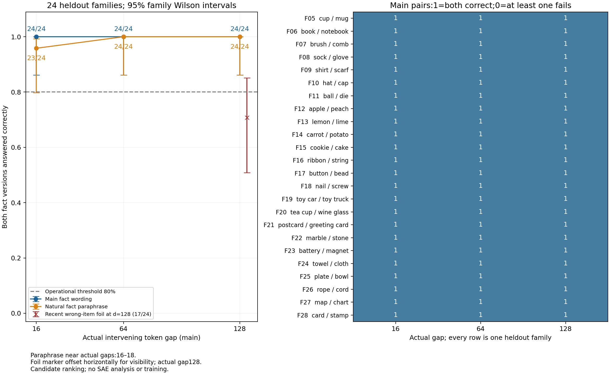

# Near and far object facts: first behavior round

The frozen model correctly switches candidates with explicit near and far object facts in the main records; reliability falls when a competing object fact is introduced nearby. Main heldout paired success: d16:24/24, d64:24/24, d128:24/24. Numerical80%threshold satisfied at [16, 64, 128]; the frozen uncertainty rule clearly clears the bounded behavior gate at [16, 64, 128]. These are complete-sequence candidate rankings for constructed English records, not unrestricted generation or general memory. No SAE, training or activation intervention ran. The researcher owns the next decision after reviewing raw data.

Reading paths:1behavior and factor controls;2representations/layer organization NOT RUN;3functional intervention NOT RUN, measurement quality audited separately. The complete [Chinese Summary](summary_cn.md), [Detailed](detailed.md), [all families](families_cn.md) and [full original cases](cases_selected_cn.md) preserve the same observations and boundaries.

Purpose: verify the behavioral prerequisite before studying SAE combinations. A feature changing at a fixed token does not establish successful downstream fact use; R09's distance response is a different observable. Frozen official Qwen3-0.6B Base, original tokenizer/native output head,28layers/hidden1024,FP32CPU2threads. Four smoke families precede24heldout families,24pairs/six heldout template strata. Main paired prefixes change only one object; question bytes are identical, candidates absent from question/filler. Prefix320tokens,p319; gap=p-e-1 excludes both endpoints, taking the item's LAST token. Exact main16/64/128=e302/254/190. Same filler inventory and token multiset move around the fact; absolute fact position/order co-vary with distance.

Hypothesis: both A and B fact versions select their respective correct candidates. Fixed prior is a rival; neutral-item baseline measures it. Natural fact paraphrase and recent wrong-item foil bound wording and nearest-copying alternatives. Score the complete leading-space noun phrase plus period by summing teacher-forced token logprobs. All within-pair lengths match (25 two-token,3 three-token pairs). Equal lengths do not eliminate lexical priors. Gold is the literal noun phrase stated in the fact; overlapping categories such as cup/mug or book/notebook make this a stated-word recall test rather than a claim that unrestricted descriptions have only one semantically valid answer. Ties fail; family is the analysis unit. Main data:

| actual gap | families | accuracy (prompts) | paired correct/24 | paired rate [95% Wilson] | mean correct margin [95% family CI],nat | point>=80% | evidence eligibility |
|---|---|---|---|---|---|---|---|
| 16 | 24 | 48/48 (100.0%) | 24 | 100.0% [86.2%,100.0%] | 6.0340 [5.2871,6.8575] | True | CLEARS_BOUNDED_BEHAVIOR_GATE |
| 64 | 24 | 48/48 (100.0%) | 24 | 100.0% [86.2%,100.0%] | 6.1722 [5.3768,7.0365] | True | CLEARS_BOUNDED_BEHAVIOR_GATE |
| 128 | 24 | 48/48 (100.0%) | 24 | 100.0% [86.2%,100.0%] | 6.4454 [5.6700,7.2753] | True | CLEARS_BOUNDED_BEHAVIOR_GATE |

Left: paired correctness and95%familyWilson interval; numbers are successful families/24. Orange is a separate fact paraphrase, near actual16–18; foil is separately shown at128. Right: every heldout family's0/1main outcome, never averaged away. Mean margin intervals use10000paired-family resamples; template-cluster sensitivity remains in the CSV. Constructed families are not random natural-language samples.

No-identifiable-fact preference:

| 名义槽位d | 无事实时偏A/24 | 偏B/24 | A减B平均分差,nat |
|---|---|---|---|
| 16 | 18 | 6 | 0.8845 |
| 64 | 18 | 6 | 0.9296 |
| 128 | 18 | 6 | 0.9476 |

Natural paraphrase is a predeclared separate condition. Its filler inventory may also differ from main, so between-mode performance changes cannot be assigned to wording alone; actual near gaps16–18 remain explicit:

| planned gap | actual range | paired correct/24 | correct prompts/48 | mean margin,nat |
|---|---|---|---|---|
| 16 | 16–18 | 23 | 47 | 5.4992 |
| 64 | 64–64 | 24 | 48 | 5.8085 |
| 128 | 128–128 | 24 | 48 | 6.1387 |

Recent wrong-item foil at128: paired17/24; accuracy85.4%; mean correct margin1.8637nat. Both target and opposite foil change across A/B, so this is diagnostic rather than a single-fact causal treatment. Main item-only scoring changes1/72pair labels versus complete scoring. All token scores retained.

The sole changed pair is F28 card/stamp at64. Under the stamp fact, item-only card/stamp scores are−9.556379/−9.757874; adding period scores−3.940424/−3.508816 yields full totals−13.496803/−13.266689 and changes preference to stamp. Item-only paired successes are24/24,23/24,24/24 at16/64/128. The frozen full-answer verdict is preserved, but it cannot all be assigned to the answer-start token's object-word readout. The complete sensitivity example is retained.

All three main accuracies are at ceiling. This establishes no failures crossing the candidate-decision boundary in this panel, not a universal distance-decay law. The mean128-minus16margin increase of0.411nat cannot establish that farther context is better, because absolute fact position and filler order also change.

Interpretation: a correct paired switch shows that changed fact content controls candidate ordering in that condition; a one-sided success can reflect prior. Wording/foil failures limit the usable condition. They are compatible with copying, binding or interference explanations and do not select an internal mechanism. This round can describe bounded factual behavior, not universal memory, arbitrary relation understanding, feature semantics or router usefulness.

The80%point gate and uncertainty sufficiency are separate. A Wilson interval crossing80%means insufficient stable eligibility; an upper bound below80%means the current task fails; lower bound above80%with full coverage clears this bounded gate. These are first-round operational decisions, not a universal ability criterion or SAE permission. Complete raw inputs/scores/config/code are indexed in[artifacts](artifacts.md); independent arithmetic/token checks are reproducible. Execution is complete and STOPPED for researcher discussion. Scientific acceptance/closure and further execution remainUnknown.
