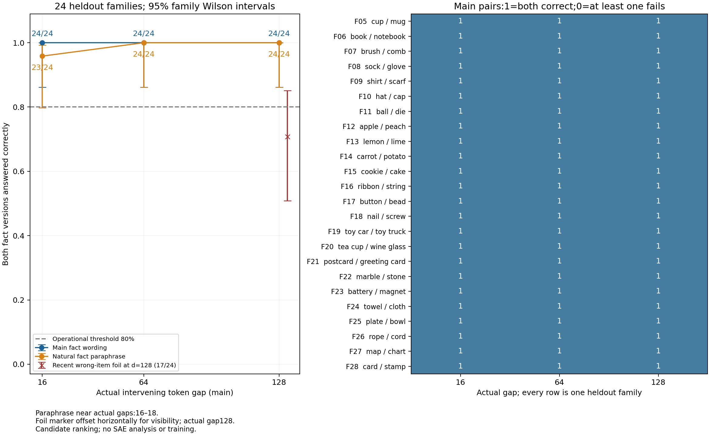

# 近处与远处物品事实：首轮行为结果

模型在没有竞争物品的受控文本中，能随近处或远处的明示物品事实正确切换候选；近处加入另一容器的竞争物品时可靠性下降。主条件成对正确切换为d16:24/24, d64:24/24, d128:24/24。数值80%门槛满足的距离：[16, 64, 128]；按预定不确定性分支清楚跨过本轮行为关卡的距离：[16, 64, 128]。 这是本轮构造英语任务的候选选择结果；是否进入下一步由研究者共同审阅决定，未自动执行SAE分析。

阅读路径：①行为与因素对照，见下表和[全部24家族](families_cn.md)；②表征与层组织，本轮NOT RUN；③功能干预，本轮NOT RUN，质量由token、完整评分和原始数值复核支持。正文给决定性数值；[详细方法](detailed_cn.md)、[完整成功／失败原文](cases_selected_cn.md)和执行侧完整casebook保留审计细节。

## 目的、模型和待检验行为

最终研究方向是不同距离的SAE组合。先确认模型确实随物品事实正确改变答案，才有相应行为可供之后研究。固定token的feature随上下文变化，只是表征响应，不能替代这项行为证据。旧R09测的是前一种对象。本轮不加载任何SAE。

复用官方Qwen3-0.6B Base、原tokenizer及原生前向／输出头，28层、隐藏维1024。28个英语家族中4个只做smoke，24个留出覆盖24个物品对、六类模板，每模板4家族。局部提问不列出选项。A/B配对只替换关键事实里的物品。答案前的前缀一律320token，最后位置p=319。

证据位置e取关键物品短语的最后一个token。距离d=p-e-1，只数两端之间的token。因此主条件d=16/64/128对应e=302/254/190，全部实测一致。移动同一批完整填充句，保持同一家族／模式的总长、提问和token多重集合。事实绝对位置和相对填充顺序同时变化；不能把差异全归于抽象距离。

行为假设是两个事实版本都选对；竞争解释包括固定候选先验、熟悉措辞与复制最近物品。完整候选为前导空格＋物品短语＋句号，分数逐token条件概率取自然对数后相加。所有配对长度一致，25对为2token、3对为3token。两边全对才记1，平分失败。常识或固定先验本身不能让同一对A/B都正确。正确标签是事实中实际写出的物品名称；cup/mug、book/notebook等有概念包含，因此本轮更直接测指定词面事实回忆，不把它写成开放描述中只有一个合理答案。

## 原始数据：主条件

| actual gap | families | accuracy (prompts) | paired correct/24 | paired rate [95% Wilson] | mean correct margin [95% family CI],nat | point>=80% | evidence eligibility |
|---|---|---|---|---|---|---|---|
| 16 | 24 | 48/48 (100.0%) | 24 | 100.0% [86.2%,100.0%] | 6.0340 [5.2871,6.8575] | True | CLEARS_BOUNDED_BEHAVIOR_GATE |
| 64 | 24 | 48/48 (100.0%) | 24 | 100.0% [86.2%,100.0%] | 6.1722 [5.3768,7.0365] | True | CLEARS_BOUNDED_BEHAVIOR_GATE |
| 128 | 24 | 48/48 (100.0%) | 24 | 100.0% [86.2%,100.0%] | 6.4454 [5.6700,7.2753] | True | CLEARS_BOUNDED_BEHAVIOR_GATE |

正确率分母为48条A/B提示，但区间和统计以24家族为单位；它们不是48个独立样本。切换率用95%Wilson家族区间；平均分差是每家族两侧正确减错误后等权平均，区间为10000次家族重采样。六模板聚类敏感性另存在distance_summary.csv，不能把24个构造家族等同于自然语言随机总体。

左图横轴为主条件实际间隔、纵轴为两个版本都答对的家族比例，误差线为家族Wilson区间；标明成功数／24。橙线为独立自然事实改写，近距实际16–18；红叉为128的近处错误物品诱饵，位置微移只为可见性。右图每行保留一个家族、每列一个主距离，1为两侧均正确，0为至少一侧失败。它不展示SAE或因果机制。

## 候选先验、自然改写和近处错误物品

无确定事实基线用object／small object代替可识别物品；没有正确答案，不计算其准确率。以下只显示候选先验偏好。主指标仍依据原始完整总分，不经基线校正。

| 名义槽位d | 无事实时偏A/24 | 偏B/24 | A减B平均分差,nat |
|---|---|---|---|
| 16 | 18 | 6 | 0.8845 |
| 64 | 18 | 6 | 0.9296 |
| 128 | 18 | 6 | 0.9476 |

长度匹配排除了本轮“一个候选多token”的明显差异，未排除词汇先验。删除句号后重新按物品部分评分，主留出72个家族×距离配对中1个配对的成功标签改变；详见family_pairs.csv。三组多token物品的逐token分数全部保留。

这一个不一致是F28的card／stamp、d64。stamp事实下，物品词分数为card −9.556379、stamp −9.757874，单看物品词偏card；加入各自句号条件分数−3.940424／−3.508816后，完整总分为−13.496803／−13.266689，转而偏stamp。于是去句号的主成对正确数为d16=24/24、d64=23/24、d128=24/24。原协议的含句号判定保持；这项敏感性说明完整候选成功不能全部归到答案前那个位置的物品首token读出。[完整敏感性原文](cases_selected_cn.md)保留两侧全部token分数。

自然改写预先固定，不按结果迭代。它与主条件的填充库存可能不同，因此若表现改变，不能单独归因于措辞；实际近距16–18也须一起保留：

| planned gap | actual range | paired correct/24 | correct prompts/48 | mean margin,nat |
|---|---|---|---|---|
| 16 | 16–18 | 23 | 47 | 5.4992 |
| 64 | 64–64 | 24 | 48 | 5.8085 |
| 128 | 128–128 | 24 | 48 | 6.1387 |

128条件的近处另一容器错误物品诱饵：成对正确17/24，准确率85.4%，平均正确边际1.8637 nat。其A/B同时交换目标与诱饵，作为竞争诊断单列，不称为纯距离效应或单事实因果估计。[完整反例](cases_selected_cn.md)给出真实前文与原始分数。失败可与最近复制、容器绑定或干扰敏感性相容，当前诊断不能独自确定唯一原因。

## 可能原因与认识边界

主任务三个距离的正确率都到顶，因此只能说本面板没有出现跨过判定界线的主任务失败，不能据此估计普遍距离衰减。d128的平均边际比d16高约0.411 nat，也不能解释为越远越好：事实绝对位置与填充顺序同时改变。

原始A/B两侧和无事实先验必须一起看：一侧总是高分，可能来自词先验；两侧正确切换则说明当前事实改变参与了本任务的候选排序。若自然改写或诱饵比主任务弱，认识须限定在原措辞和干扰条件。本文只给这些可检验的可能原因，不把现象升级为内部机制。

可以得出的认识是当前冻结模型在这些明确任务条件下的事实利用程度及各距离是否达到首轮操作门槛。不能据这几个距离判断普遍长程能力，也不能从行为曲线推断哪个SAE成员负责存储、检索或组合。词面复制、对象绑定、词先验和填充顺序没有被全部识别。

门槛是研究者给定的80%点估计，证据资格按事先记录的保守区间分支另报。只在区间下界高于80%且覆盖完整时标为清楚通过；区间跨80%为证据不足；上界低于80%为当前任务未通过。附加结果不能挽救主指标。即使某个距离数值达标，也没有自动进入SAE。

## 位置与停止

[锚点](anchor_cn.md) · [冻结协议](protocol_cn.md) · [逐家族数据](families_cn.md) · [完整原文及原始候选分数](cases_selected_cn.md) · [实际产物索引](artifacts.md)。原始token／输出分数、脚本、配置在/data/250010109/MoE_Router/experiments/20261104_near_far_object_fact_use/R01_behavior；对话记忆在/data/250010109/Research_System/.research/memory/conversations/1104-长短程依赖分析/memory.md。

本轮已在完整行为交付处停止。科学接受、机制判断、是否以及如何进入下一步保持Unknown，等待研究者讨论。
