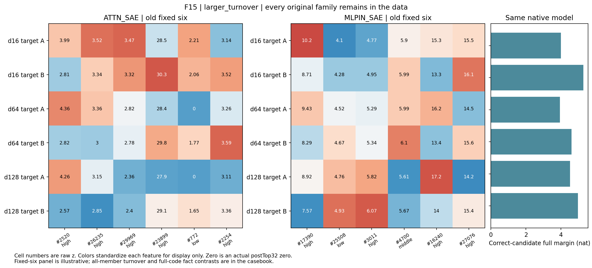

# F15：cookie/cake

选择角色：larger_turnover。这是平均成员更替最多的一族，事实差异幅度却没有随之缩小。成员名单变化与A/B差异保留可以同时出现，不能把每次换入换出都叫作遗忘。

| 字典 | 共同/32 | 换入/换出 | 原始差异比 | 相对差异比 | 差方向cos |
|---|---|---|---|---|---|
| ATTN_SAE | 24.0000 | 8.0000 | 1.0999 | 1.1532 | 0.6644 |
| MLPIN_SAE | 25.5000 | 6.5000 | 1.0971 | 1.1145 | 0.7363 |

原始完整候选在三个距离均成对正确。全部原文、token位置、逐候选分数、成员并集、逐成员频率与三档强度保存在[完整原始案例](F15.md)。

