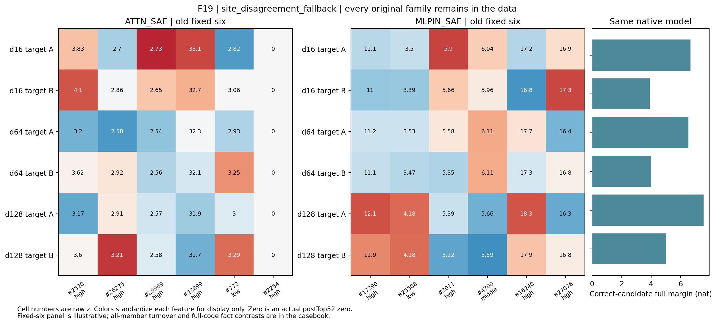

# F19：toy car/toy truck

选择角色：site_disagreement_fallback。同一文本族在Attention与MLP输入呈相反变化：前者的相对差异约降到0.79，后者约升到1.89，回答却始终正确。这个反例说明，一个字典中的距离比值不能直接作为模型总体事实信息量；本轮也未检验两个接口的机制差异。

| 字典 | 共同/32 | 换入/换出 | 原始差异比 | 相对差异比 | 差方向cos |
|---|---|---|---|---|---|
| ATTN_SAE | 24.5000 | 7.5000 | 0.7600 | 0.7892 | 0.2974 |
| MLPIN_SAE | 26.0000 | 6.0000 | 1.8333 | 1.8891 | 0.6613 |

原始完整候选在三个距离均成对正确。全部原文、token位置、逐候选分数、成员并集、逐成员频率与三档强度保存在[完整原始案例](F19.md)。

