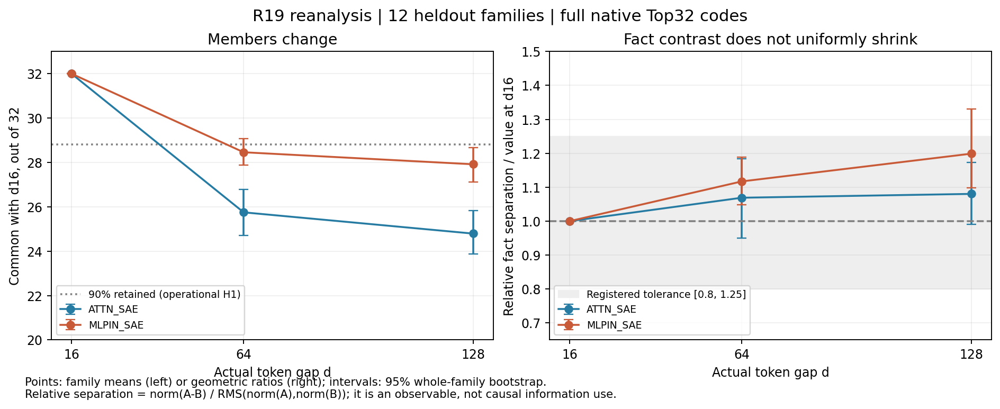

# R20：成员会更替，码中的事实差异没有平均衰减

**在本任务的16–128 token区间，结果更符合“成员重组、事实差异幅度保留”，而不是统一衰减。共同成员的相对搭配很相似，但成员名单和A/B差异方向仍会改变。** 这里描述的是两套固定SAE的码，不把范数直接称为模型记忆量。

本轮按三个分析路径展开：①行为与因素对照：核验原候选排序并检查填充/位置；②表征与层次组织：分别测成员、强度及事实差异的幅度/方向；③功能干预与测量质量：功能干预未按本轮范围运行，已完成原生编码、重构与数值质量审计。

## 原先的可能与实际观察

原先保留三种可能：组合基本稳定；成员更替但两事实仍可区分；事实相关差异减弱。R19的六成员方向相似不足以区分这些情况，因此本轮复用全部144条主任务，检查两个字典各30000维的完整Top32码，保留所有12个原留出家族；12个发现家族只作探索。旧留出已经暴露，本轮不称全新确认。

模型为冻结Qwen3-0.6B Base。Attention取第28层o_proj输出，MLP输入取同层残差与归一化后的实际输入，各30000成员、ReLU后Top32，ID不跨字典相认。原文本固定320token，回答前冒号p319/tokenID25；物品最后token位置e302/254/190，对应排除两端的d=p−e−1=16/64/128。

| 字典 | 16→128共同/32 | 平均换入=换出 | 原始事实差异范数比 | 整体码尺度比 | 相对事实差异比 | 完整事实差方向cos |
|---|---|---|---|---|---|---|
| ATTN_SAE | 24.7917 | 7.2083 | 1.0456 | 0.9679 | 1.0803 | 0.5978 |
| MLPIN_SAE | 27.9167 | 4.0833 | 1.1839 | 0.9874 | 1.1989 | 0.7307 |

“相对事实差异”先计算同族A/B激活之差的范数，再除以两条码长度的均方根。这样可区分事实差异本身与整体激活增益：Attention原始差异约1.046倍，码总体尺度约0.968倍，归一后约1.080倍；MLP原始差异约1.184倍，整体尺度0.987倍，归一后1.199倍。归一化没有被用来隐藏整体变弱。

左图显示相对d16还共同使用多少成员，右图显示相对事实差异的比值；两图是不同对象，不能从换人直接推导信息减少。区间以整家族重采样，两事实先在族内平均。d16的32和1是参考定义。

## 成员、强度与差异方向怎样一起变化

16→128平均换入/换出Attention7.21个、MLP4.08个，但仍共同使用24.79与27.92个。固定32预算必然令换入数等于换出数，不作为发现。三个配对的全部族分布、真实ID和原始强度均保留。

共同成员原始范数约为近距的0.9675/0.9876，方向cos为0.9976/0.9987：它们整体略弱，搭配仍很相似。这个大向量稳定，并不等于A/B之间那一小段差异稳定。完整Top32的原始事实差方向cos仅0.5978/0.7307；按每条码先单位化再做A/B差，也为0.5929/0.7260。

固定六成员保留实际零、纳入全部12族后，相应单位化事实差方向cos是0.9427/0.9614。旧严格子样本的0.9678（6族）/0.9713（11族）已精确复现，但它们不能代表完整码，更不能证明幅度不变。

约88%/83%的换入换出实例位于预定阈值附近口径（低排名或激活≤1.25倍cutoff），约99%的换入成员此前已有正的、阈值下编码响应。解除Top32截断仅作测量诊断时，事实差方向cos提高到0.8833/0.9080。因此，名单更替既包括强度变化，也受排名截断影响；不能直接称作新语义出现或旧语义消失。

## 高频、中频、低频各怎样参与

在三个主距离的72个留出位置中，Attention高/中/低组分别出现136/50/18个成员，低频覆盖70位置、12族；MLP为63/30/25个，三组均覆盖72位置、12族。零参考和支持不足单列，不并入低频。频率来自旧独立自然参考300文档/38400位置，不是词频、训练曝光或谱位置。

Attention的高频换入最多，但其4.33个与按自然频率机会期待的4.43个接近；不能只据人数宣布其更容易进入。MLP低频平均换入0.708个，自然参考/发现任务机会分别约0.321/0.402，但家族区间跨零，仍不足以确认特殊偏好。共同成员、换入换出的数量/比例、强度、基数、排名匹配与真实ID详见[频率分析](frequency_cn.md)。

## 补充实验：模式是否依赖旧填充或位置

旧结果为缓存重算；新执行228个对照前向条件，其中192条新文本、36条相同文本的位置索引变体。四条smoke已并入，另有六条旧文本校准；没有重复扩样调模板。

| 字典 | 条件 | N | 相对事实差异128/16 | 95%家族区间 |
|---|---|---|---|---|
| ATTN_SAE | reverse | 12 | 1.1228 | [1.0358, 1.2112] |
| ATTN_SAE | content | 12 | 1.1040 | [1.0496, 1.1625] |
| ATTN_SAE | fixed_e | 12 | 1.0793 | [1.0173, 1.1468] |
| MLPIN_SAE | reverse | 12 | 1.1378 | [1.0667, 1.2269] |
| MLPIN_SAE | content | 12 | 1.1183 | [1.0643, 1.1836] |
| MLPIN_SAE | fixed_e | 12 | 1.1366 | [1.0812, 1.1926] |

反转填充及替换同token长度办公填充都保留320长度、e/p、最终提问；固定e190时，回答p为207/255/319，分别对应d16/64/128，远距24条直接复用旧数据。上表各条件均为相同12族。三组都未出现平均差异减弱，但替换内容也改变了重复和词汇，不能当作单一领域因果实验。

另一组六族同文position IDs整体+64，成员全部32/32保持，最大候选总分差仅约3.9×10⁻⁵nat；它检验编码索引平移，不等于在可见文本里增加64token。事实位置e、回答位置p和d满足一个等式，无法三者全独立；对照缩小了解释范围，没有识别普适的纯距离效应。

原主任务三个距离仍各12/12成对正确，平均完整候选分差6.4209/6.6187/6.8925nat。原d64仅物品词评分是11/12，完整答案含句号才12/12，该敏感性没有抹掉。新反转填充d16为11/12，其余反转距离及办公/固定e条件均12/12。失败为F28/stamp，分差−0.084757nat，全文保留。近处失败而远处成功也提示填充顺序值得控制，不能按距离单调解释。

## 四个案例与反例

[F11 ball/die](cases/F11_cn.md)成员相对保留最多，却是总体均值下的轻微差异减弱例；[F15 cookie/cake](cases/F15_cn.md)更替最多，差异幅度仍保留；[F27 map/chart](cases/F27_cn.md)两字典接近稳定但方向不完全一致；[F19 toy car/toy truck](cases/F19_cn.md)Attention相对差异约0.79倍、MLP约1.89倍，回答均正确。选择规则事先固定，四族都展示A/B、三个距离的全文、成员与候选评分；没有删除其他家族或选择最漂亮的例子。[案例入口](casebook_cn.md)同时保留新增的F28失败。

## 操作假设判定与认识更新

H1是“至少90%成员保留”，H2是“相对事实差异比落入[0.8,1.25]”，H3是“该比至少下降20%”。容差是本轮AI预先固定的工作口径，不是普适能力标准；正的方向cos也不替代幅度判定。

| 字典 | 操作假设 | 家族N | 估计 | 95%家族区间 | Holm p | 判定 |
|---|---|---|---|---|---|---|
| ATTN_SAE | H1 | 12 | 0.7747 | [0.7461, 0.8073] | 1.0000 | 未支持 |
| ATTN_SAE | H2 | 12 | 1.0803 | [0.9899, 1.1725] | 0.0146 | 支持 |
| ATTN_SAE | H3 | 12 | 1.0803 | [0.9899, 1.1725] | 1.0000 | 未支持 |
| MLPIN_SAE | H1 | 12 | 0.8724 | [0.8477, 0.8961] | 1.0000 | 未支持 |
| MLPIN_SAE | H2 | 12 | 1.1989 | [1.0976, 1.3307] | 1.0000 | 证据不足 |
| MLPIN_SAE | H3 | 12 | 1.1989 | [1.0976, 1.3307] | 1.0000 | 未支持 |

MLP的H2证据不足来自增长区间上界超过1.25，不是出现衰减。Attention支持容差内保持，也不等于精确相等。H3针对至少20%的家族平均下降未获支持，不排除局部家族减弱。模板六组敏感性、全部家族、其他距离对和原始分数见[数值附录](numeric_evidence.md)。

认识更新是：在这个任务窗口内，模型成功利用事实时，回答处的码可以通过成员更替和强弱微调来变化；这些变化没有表现为统一的事实差异幅度损失。完整事实差的方向会重组，截断和所选成员范围都会影响我们看到的“稳定性”。

模板相关性敏感性也需保留：按六个模板均值和64种符号互换，Attention的H2原始p=0.03125、Holm p=0.1875，转为证据不足；MLP亦不足。家族主判定按原协议保持，但不能把该保持结论称为跨独立模板确认。

## 解释边界与唯一下一问

两套SAE对真实输入A/B差的重构相对误差中位数约0.994/0.984，明显高于普通逐位置重构误差。这限制了强解释：这里的码范数不是模型事实信息总量；观察到差异和答对，也不证明这些成员因果支撑答案。未截断码仅作诊断，不当作另一个训练好的字典。共享模板、已暴露留出、参考语料有限和16–128局部窗口同样保留。

**AI建议唯一继续追问：这些随距离重组但未平均衰减的事实差异，哪些真正被答案读取？** 本轮不设计或运行相应干预，也不训练router，科学接受仍待共同审阅。

|覆盖|状态|证据|
|---|---|---|
|旧数据、成员/强度/事实差、频率机会、四案例|DONE_VALID（发现侧探索单列）|逐族/逐成员表、原文、原生编码重放|
|228补充前向、行为参照、测量质量|DONE_VALID|固定协议、全部结果及失败、数值与重构审计|
|主/审计图、方法/代码/配置、短讲与可复算数据|DONE_VALID|[完整位置清单](artifacts_cn.md)|

本轮完成并停止；不把执行完成当作科学接受或后续执行授权。
