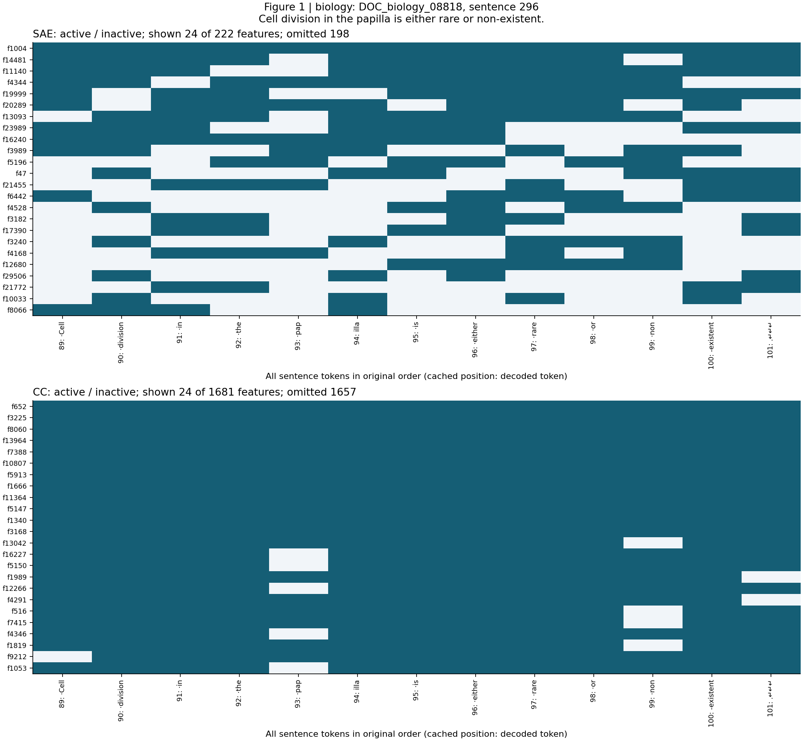
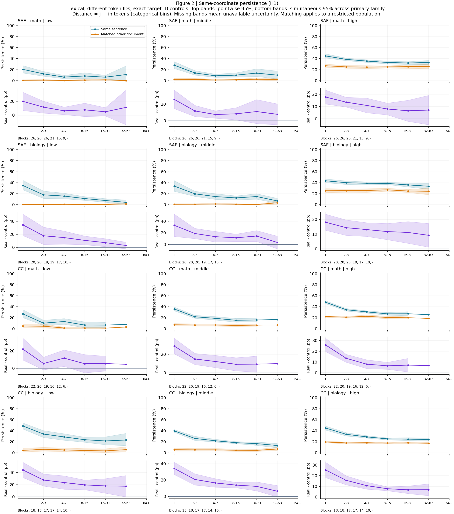
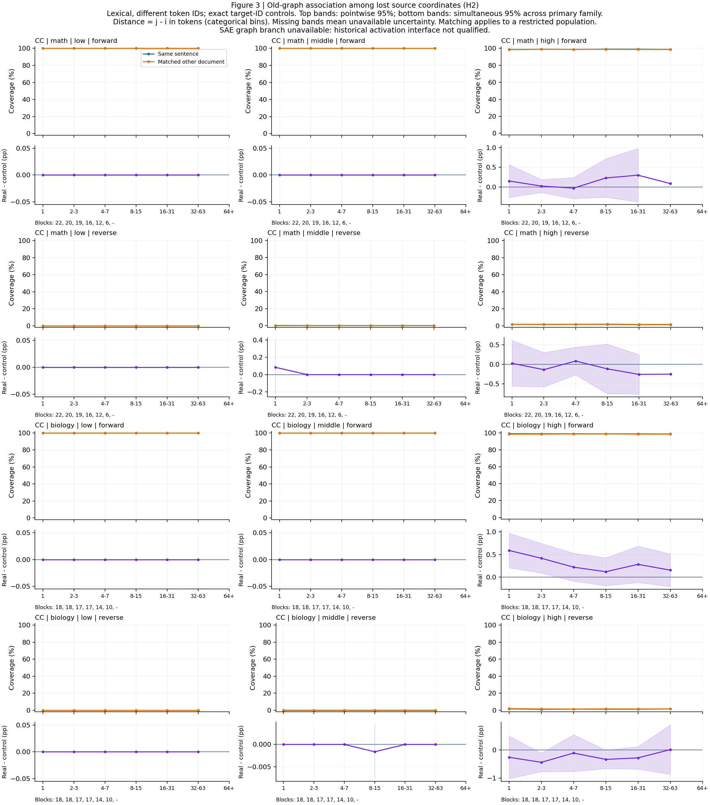

# Detailed：A15_28 R01 句内缓存分析

[结论与认识更新](summary_cn.md) · [冻结 Protocol](protocol_cn.md) · [输入与旧图资格](preflight_cn.md)。本记录拥有完整证据路径；论文式最终报告与问题关闭均未创建。

## 已完成什么、证据能回答什么

509 个完整句段、13,573 个缓存 token、215,981 个句内前后位置对已完成统计。两套字典 H1、CrossCoder 正反向 H2、匹配覆盖、文档块区间、保边际与保度数随机基线、三类图及固定规则选例均已完成。SAE H2 因接口不兼容保留受阻。

H1 的 70 个主条件有正的同时匹配区间，其中 41 个还超过保边际随机基线；41 个由 SAE 高频 15 个、CC 中频 12 个和高频 14 个构成，31 个属于不同 token ID。H2 仅生物高频距离 1、2–3 的条件性正向匹配差值通过同时区间，但两个都没有超过保度数基线。因此**有界同坐标延续获得支持；稳定源集合上的关联替换未建立**。低频组的一些随机样本产生空源分母，依约整格随机包络不可用，不能用高频或全频结果补救它们。[336 项完整主表](evidence/primary_336_final.csv)与[非重复词面随机基线表](evidence/primary_nonrepeat_nulls.csv)逐格区分这些情况。

本轮比较路径只有三类：词面／领域／活跃数量控制；原生表征组织与坐标统计；测量可信度检查。行为预测或层间独立激活未测，功能干预未运行。用户明确要求先结论再分析，故 Summary 已合并给出标明边界的 AI 解读；研究者机制判断与关闭仍为 Unknown。

## 实际对象与计算

SAE 为 E16、30,000 坐标、block27 MLP 输入的 FP32 原生 ReLU Top32。CC 为 A22、16,384 坐标、blocks 1,3,…,27 residual-post 的共享 z；复用原生产者的 BF16、TRAIN 中心化／RMS 与 gate，不重跑编码。正激活定义活跃，坐标编号在两个字典间不通用。分析无可训练参数、梯度、优化器、损失或新增前向。

对前位置活跃集合，H1 是后位置仍活跃的成员数除以前成员数。H2 正向先去掉后面仍活跃的前成员，再统计其中多少成员至少有一条旧边通向后活跃集合；反向使用逆边。每个源成员最多计一次，不按边条数加权。空分母是 NA。低／中／高频只限制源集合，沿用独立 DCLM 的 65,536 位置参考与至少 20 次支持规则；不足支持另列。频率是参考语料的出现率，不是概念抽象程度。

旧图使用不可修改的 raw_edges.npz、passV=True，共 206,136 条 A→u 边、16,384 节点含孤立点。箭头原义是同 token 的非对称共现：两端频数≥200、共同数≥20、P(B|A)≥0.8、P(A|B)≤0.5、nB≥2nA。频率翻倍约束使原图无环，不构成语义层级。DeltaP/lift 不是旧图准入条件。SAE 历史图的精度、筛选及 selected-index 计数接口未与当前正激活接口等价，未强行替换。

## 文本、冻结与匹配覆盖

来源为 R04 的数学／生物各 60 篇、每篇 192 token。原 discovery/development/heldout 标签保留，但均已暴露；不是新确认集。重新核对八项登记输入访问，全部文本与缓存 token ID 精确一致。787 个候选段经逐条文本审阅，排除截断片段、标题／列表／书目信息，修正缩写、引文附着句号与明确标题边界，得到数学 260、生物 249 句，来自 117 文档。未认证原文起点的首句保守排除；不是断言其原句不完整。[文本冻结](provenance/text_freeze.json)记录时间与 hash；完整文本和每项接受／排除理由见执行侧 data。

所有 i<j 的同句位置对进入候选，距离为 j−i。每领域原 60 文档按原文 hash 排序、固定种子打乱成 30 对；只能用固定伙伴供给对照。T1 匹配后目标 token ID、句内相对位置十分位、前缀位置四分位和 L0 比值 [0.8,1.25]；按 L0 差、相对位置差、绝对位置差、固定 SHA256 解平局。T2 仅在 T1 不可用时匹配词面类别与同／异 ID 状态，单列，不能声称控制确切词面。窄 L0 敏感性只筛选原 T1 的 [0.9,1.1]，不重匹配。

SAE 全类别 T1=10,225、T2=147,301、无匹配=58,455；CC 为 7,602、117,792、90,587。T1 损失中，全库其他文档无该 ID 为 60,719 对；全库有但固定伙伴没有为 97,789；位置层不合为 47,248；CC 另有 L0 不合 2,623。不能把固定伙伴造成的损失写成全语料没有同词。

主关注的词面、不同 ID 条件中，SAE T1=3,529/161,251，CC=2,383/161,251。它们只有 263／171 个不同真实目标位置、250／166 个不同对照目标位置；某对照目标被复用最多 89 次。前五个目标词占约 84%，主题和句法角色也未精确匹配。数值 token、空白、标点、其他、同 ID、低支持组、T2、窄 L0 均保留在完整表中，不能用于挽救失败的主比较。[覆盖与 L0 表](evidence/matching_coverage.csv)；[词面／体裁／网站组成](evidence/lexical_support.json)。

## 聚合、不确定性与随机基线

两条件使用相同有效位置对 mask。先对每句内各对等权，再对每源文档的句子等权，再对固定两文档块中有贡献的文档等权，最后对文档块等权。一个块只有一篇有贡献时照实记录。token 对不作为独立样本。源数加权不是主估计量。

每领域重采样全部 30 个原文档块，5,000 次，同一抽样索引跨字典／指标／距离复用。固定 336 项主族；125 项能按规则计算非退化同时区间。最大绝对标准化误差的 95% 分位为 3.668338。少于两块、零／无穷标准误或任一次抽样失去全部贡献的格子不计算规定区间；不删坏抽样或重抽。图中原始两线为逐格区间，差值带为主族同时区间。64+ 仍有 274 个词面非重复候选对，但无 T1 匹配。CC 数学 32–63 的 6 个贡献块在部分重采样中全部缺席，因此区间依约不可用。

保边际基线按字典／领域对二值位置×坐标矩阵作 checkerboard switch，严格保持每位置 L0 和每坐标总次数。图基线作有向双边交换，保持每节点入度、出度及边数；允许随机图有环，保留节点身份与其频率，不保留原条件概率、端点频率配对或 DAG 结构。每组两条独立链，每链 burn-in 为 5×边数次尝试，之后每 ceil(边数/10) 次尝试保留一份，共 199+199=398 份。所有实际 draw 都验证边际／度数。

| 随机作业 | 抽样数 | 两链接受率范围 | burn-in 后原边重合 | 秒 |
| --- | ---: | ---: | ---: | ---: |
| graph | 398 | 0.069–0.069 | 0.745–0.746 | 383 |
| incidence_CC_0 | 398 | 0.672–0.672 | 0.178–0.178 | 272 |
| incidence_CC_1 | 398 | 0.663–0.663 | 0.184–0.185 | 283 |
| incidence_SAE_0 | 398 | 0.731–0.731 | 0.147–0.148 | 136 |
| incidence_SAE_1 | 398 | 0.748–0.748 | 0.137–0.137 | 146 |

共 1,990 份抽样，五组均通过预定接受率、重合下降与链均值差异规则。这不证明充分混合；若干探针 lag-1 相关较高，完整链诊断已保存，包络不是精确置换 p 值。强于背景的解释要求观测差值严格超过相应 97.5% 包络。若任一次随机 draw 让观察 mask 中的源或消失分母为空，整格包络记不可用，绝不删对、重匹配或补零。[随机作业汇总](evidence/null_jobs.csv)；执行侧 results/nulls 保存每次读数、失效对数和完整探针。

## 为什么 H2 需要分母诊断

生物高频、距离 1 的真实／对照覆盖为 99.0099%／98.4203%，差值 +0.5895 个百分点，同时区间 [0.2069,0.9722]。距离 2–3 为 +0.4173，[0.0907,0.7439]。这些是不同消失集合上的条件读数。

同一批源成员在真实端保留得更多，真实和对照的消失集合便不同。距离 1 时平均源成员 226.12，真实消失 125.00、对照消失 181.20、共同消失 114.16。把两组都限定到共同消失集合，两组覆盖都为 99.5542%，差值恰为零；全部源集合两组同为 93.3986%。在所有 2,383 个主关注位置对的可定义频率组上，正向共同源及全部源差值均为零。

保度数随机图的 97.5% 差值包络分别等于上述两个观察差值，故不满足严格超过基线。终审修复了两种等价聚合路径产生的约 10⁻¹⁸ 浮点差异：观察和随机值统一使用相同冻结权重算子再比较；没有改阈值、抽样、mask 或统计规则。[修正记录](provenance/aggregation_consistency_fix.md)。因此本轮可以报告条件覆盖的小差异，但不能据此认定稳定源成员发生关联替换。反向主比较没有正支持；生物高频 2–3、8–15 的同时区间在零以下，也不能解释为模型遗忘。

## 三类图与真实例子

图一使用所有句子 token；每字典最多 24 行，按出现位置数、原生 z 总和、feature ID 排序。[生物热图](figures/figure1_biology.png)中，SAE f1004 在 13 个位置都活跃；CC 有 12 个全句活跃坐标。这些坐标没有自动获得细胞／分裂语义标签。大量只出现一次的成员未在头 24 行中展示。[组织计数](evidence/case_organization.json)、[每 token 省略数](evidence/selected_cases.json)防止把省略读成不激活。

图二横轴距离档、纵轴延续百分比，下部为真实减对照百分点。分频图显示近处额外重复，远处更小但未必消失。短句不提供远距对，不能将曲线变化归因于距离本身；“近显著、远不显著”也不等于近远差异显著。

图三正反方向各自统计，分母为已经消失的源成员；前向近饱和而差值小，逆向原始覆盖低。旧图方向的巨大不对称来自旧图规则，不能比较后就命名层级。背景解释见上一节。

[句子真实边示意](figures/figure3_sentence_edges.png)按位置和 feature 字典序取前 8 条，共 680 个符合条件的“所展示坐标之间”的跨位置边实例，省略 672；还省略未进入热图的坐标。这不是全图边总数。图中 f4346 在 `Cell` 活跃、在 `pap` 消失，却能连到后处的若干公共坐标；这些目标此前也已出现，所以连线不证明一个新概念取代旧概念。

完整数学／生物原句与最弱例在 [Summary](summary_cn.md#两个真实例子与一个弱例)。例子按冻结极值规则挑选，分别只有 5／3／4 对，且每句共享目标；无个例推断区间。数学支持例、biology 条件覆盖最大例，以及最弱可用例均按规则保留，不换成更漂亮的句子。严格三项均非正反例未找到。

## 合同、差异、证据路径与完整交付

| 项目 | 实际完成与限制 | 证据／资格 |
| --- | --- | --- |
| 授权与冻结 | 用户 2026-10-28 明确启动缓存分析；文本、匹配、代码、config 在数值计算前冻结 | [freeze](provenance/outcome_freeze.json)；Protocol 末尾 activation |
| 数据／确认集 | 原 120 篇暴露文本；117 篇有合格句段，无新确认集 | [input hashes](provenance/input_file_hashes.json)、text_freeze；DONE_EXPLORATORY |
| H1 | 两字典原生值、匹配、区间与随机边际完成 | primary_336_final、执行侧 pair_metrics／weights；DONE_EXPLORATORY |
| CC H2 | 固定旧图正反向、两种源分母、共同源与两类 null 完成 | composition_diagnostic、null 表；DONE_EXPLORATORY，替换解释未建立 |
| SAE H2 | 原历史接口未合格；未临时重建图 | preflight；BLOCKED |
| 极值例／严格反例 | 两个例子与最弱例完成；严格三项非正反例未找到 | selected_cases、全部候选评分；DONE_EXPLORATORY |
| 实施校准 | 4,900 项合成直接集合核对、32 对/字典真实复核共 2,560 项、全部匹配合同与冻结 hash 通过 | [audit](provenance/results_audit.json)、reference_metric_check；PASS |
| 工程修正 | numba 类型编译修复发生在结果前；冷 JIT 小样本估时改为同规模热运行估时；最终同算子比较修正浮点假超额 | runtime_smoke、aggregation_consistency_fix；规则未变 |
| 额外执行 | 无训练、无重聚类、无新增模型前向、无干预，无提交／发布 | 本地 CPU，≤4 worker，运行资源与清单；边界保持 |

结果解释的完整路径是：原生 CSR → 冻结文本／token／匹配 → pair_metrics → sentence_metrics → document_metrics → blocks → weights 和 5,000 次 bootstrap → 336 主表 → 同算子 null 比较 → 有界结论。完整 pair 数值及失效 mask 可重算每一行；逐句和逐文档 CSV 不是独立副本的科学判断。

**执行目录：** `/data/250010109/MoE_Router/experiments/20261028_sentence_feature_continuation/R01_cached_sentence_pairs`。其中 data 保存文本审阅、token、文档块与逐对匹配；results 保存 pair／sentence／document／block 数值、全 6,736 项主／诊断条件、所有抽样、选例评分；figures 保存图与绘图源；code 保存完整脚本；provenance 保存访问、freeze、校准、终审与运行日志。[执行侧完整目录](/data/250010109/MoE_Router/experiments/20261028_sentence_feature_continuation/R01_cached_sentence_pairs)。

[源码副本](code/)保留可复现代码；统计代码 `core.py`、`build_matches.py`、`analyze_cached_pairs.py`、`run_nulls.py` 的冻结 hash 已复核。后续绘图和报告代码不改变这些源。原路径重跑需使用新的输出目录，不能覆盖 freeze。参数和随机流见 [config](code/config.json)。精确复现顺序：prepare_sentence_pairs → freeze_text → build_matches → benchmark → analyze_cached_pairs → run_nulls 的五个作业 → finalize_evidence → render_figures → support_diagnostics → audit_results。环境为 Python 3.10、NumPy/SciPy/Numba/Matplotlib 的当前本地安装，精确版本见 artifact_manifest。

选入项目的图、CSV、脚本和小来源清单由 payload_manifest 列出；原激活、全部抽样与逐对数组留在执行侧。结果资产仅登记实际输出。唯一下一决定由研究者做：是否选一个仍可信的限定模式做新的上下文替换设计。机制接受与问题关闭保持 Unknown。

[Artifact manifest](artifact_manifest.json) · [Selected evidence payload manifest](selected_evidence_payload_manifest.json) · [Registered output access](provenance/output_access.json) · [Local execution certificate](provenance/execution_certificate.md) · [Delivery checks](provenance/delivery_checks.json).
