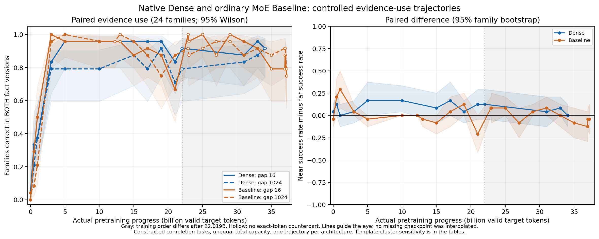

# Native Dense and Baseline checkpoint evidence use

The two trajectories show different near/far patterns. At 3B valid pretraining tokens, Dense succeeds in both fact versions for 20/18/19 of 24 families at gaps 16/256/1024; ordinary MoE Baseline gives 24/23/23. Dense retains a near/far gap at several later states and its far success falls from 21/24 at 15B to 19/24 at 17B. The experiment measures constructed candidate-ranking behavior. Scientific acceptance and mechanism judgment remain Unknown.

Analysis paths: (1) behavior and factor controls are measured; (2) representations and layerwise organization are NOT RUN; (3) functional interventions are NOT RUN, while hash, native strict-load, CE, token and freeze checks support measurement quality.

## Meeting purpose and inputs

The teacher questions monotone distance decay and asks why classification could improve learning efficiency at matched active cost. The senior points in the current request motivate matched short-range controls and separating general ability, domain knowledge and particular facts. The independent latest evening raw senior transcript was not found; those points rely on the user account and attached summary. The October 27 original context-sensitivity discussion was read in full and is not substituted for the latest transcript. Prior fixed official 28-layer Qwen experiments moved evidence; they did not measure acquisition in these native eight-layer models. [Source scope](prior_context.md).

All 37 distinct actual states are strictly loaded: 14 Dense and 23 Baseline, including initialization and real recovery states. Three identical-state-hash Dense aliases are retained without duplicate inference. Ten missing paths remain in the ledger; the 19B state is recovered from an archive and actually evaluated, leaving nine missing state identities in the bounded roots. Actual loadable endpoints are 34.076363264B and 37.221773824B, which need not be the last log update. Dense has 281,431,040 total/active parameters; ordinary MoE has 507,988,992 total and 281,496,576 conventional active parameters. Both have eight layers, width 1024 and 2048-token context, with the same tokenizer and DCLM view. Active matrix size is close, total capacity and realized compute are different. Data order matches only through 22.018691584B. The same AdamW settings, global valid-token batch and audited LR history do not remove the later sampler difference.

Existing Dense temporal CrossCoder binds 1/5/15/31B, all eight layers; its saved 624,947,200-position dictionary state is separate from model pretraining. Existing MoE SAE binds the 33B last router input only and trained on 1,000,001,536 raw activation positions. Official Qwen and S7 dictionaries bind other models. No dictionary is loaded or trained.

## Frozen task, metric and curve

There are 24 main content families nested in six templates, eight families each for object, color and destination. Prefix length is 1152; gaps 16/256/1024 span 0.78/12.5/50 percent of the actual context limit. A/B replace only the decisive value. Both must rank the respective correct candidate above its competitor; ties fail. Preserve question, candidates, answer position and the per-family main filler token multiset. Evidence position and filler ordering still change. Every candidate has one lexical token plus a period; sum both conditional log probabilities in nats and retain lexical-only and no-period sensitivity. Accuracy refers to candidate ranking, not unconstrained generation.

Each state has 384 fixed prompts, including no-effective-evidence, wrong-entity, reversed-filler and fixed-gap shifted-answer-position controls. There are no correct labels for ineffective-evidence conditions. Statistics use families, Wilson intervals and 10,000 paired family bootstrap draws, with six-template cluster sensitivity. Shared templates and a single training trajectory limit inference. Training-pattern exposure is unknown. [Dataset guide](dataset_guide.md).

Left: paired success, Dense/ordinary MoE by color and near/far by line style; shading is family Wilson uncertainty. Right: within-family near-minus-far success and paired bootstrap uncertainty. Hollow markers have no actual equal-token counterpart. Gray indicates different training order after 22.019B. Segments guide the eye and do not create interpolated checkpoints. [Figure data](data/main_figure_data.csv).

The complete real-token comparison and threshold-sensitivity tables are in [Detailed](detailed.md) and the Chinese report. First sampled 60/80/90 percent crossings and persistence at the next observed point are descriptive sensitivity only; they do not establish an exact emergence time. At 33B, Dense gives [23, 22, 21] and Baseline [22, 23, 22] successes out of 24 at gaps 16/256/1024. No regression or failed family is removed.

## Boundaries and next decision

These are one-fact retrieval/completion tasks. Counterfactual switching guards a fixed lexical prior but does not by itself identify entity binding, multiple-fact composition or arbitrary long-document understanding. Wrong-entity evidence may still influence output through lexical copying. Position/filler competition, unknown exposure, unequal capacity, later data order and one trajectory per architecture remain live limits. Maximum MoE smoke native-CE discrepancy is about 0.026 nat, within the predeclared 0.03 tolerance; small margins require numerical and punctuation sensitivity. Full execution used 22.1 minutes on the existing H100 MIG slice, processing 33,701,376 duplicated-prefix input tokens and scoring 56,832 answer tokens. Training updates: zero.

AI proposal: keep actual evidence distance and counterfactual use as separate axes, and call the present task distant fact retrieval. Do not define long-range information by failure or slow learning. Add target-relation specificity before making a stronger dependency claim; represent information type and composition depth separately. Any later data revision is a new frozen panel, not a rewrite of this one. Candidate follow-up states are Dense 1/3B for early gains and 5/10/15/17B for persistent far failures and reversal, with Baseline 1/3B as a contemporaneous reference. Existing Dense CrossCoder covers only 1/5/15/31B; MoE SAE only 33B. The researcher reviews the factual behavior and definition before choosing a representation tool. No further analysis or training starts automatically.

For the 80 percent descriptive threshold, both Baseline crossings are observed at3B, bounding the crossing in(1,3]B without resolving the order inside that interval. Dense near first crosses at3B and far at15B, then far falls below80percent at17B; at60percent both Dense crossings are at3B. There are reverse-distance cases: Baseline21B has16/24near and21/24far, and the latest Dense state has22/24at both. At33B, wrong-entity distant evidence still favors its carried A word in21/24Dense and19/24Baseline cases, versus15/24and13/24neutral preferences. This does not prove binding failure: the current irrelevant diagnostic has only A and no gold answer. It leaves lexical copying insufficiently excluded. The proposed narrower name is distant lexical fact retrieval; a later simultaneous target/competitor panel should test selective changes of target value or query entity.

Coverage: all 37 unique states and controls DONE_EXPLORATORY; ten missing paths and three aliases retained; selected figure, raw scores, code/config/cost delivered; new SAE/CrossCoder/router/LM training NOT RUN. Scientific interpretation remains Unknown.

[Training assets, optimizer/data provenance and comparison limits](training_assets.md) · [训练资产和预算边界](training_assets_cn.md).

Numerical supplement:24states/122selected small-margin prompts were rescored inFP32;11choices and11state/gap family counts change. First sampled60/80/90percent crossings and Dense5/10/15/17Bkey comparisons remain under this subset sensitivity. Latest Dense34.076B22/22in primary BF16 becomes21/22in the subset. The figure remains registered BF16. This is not a completeFP32trajectory. [Full numerical audit](numerical_audit.md).

Cost clarification: primary serialized input counts exclude right padding. Physical primary forward positions are36,429,312, including2,727,936padding positions. Recorded smoke/full/precision stages total26.0minutes; CPU preparation/reporting is not separately timed and this is not whole-GPU billing. [Costs](/data/250010109/MoE_Router/experiments/20261105_checkpoint_evidence_use/audit/overall_cost.json).
