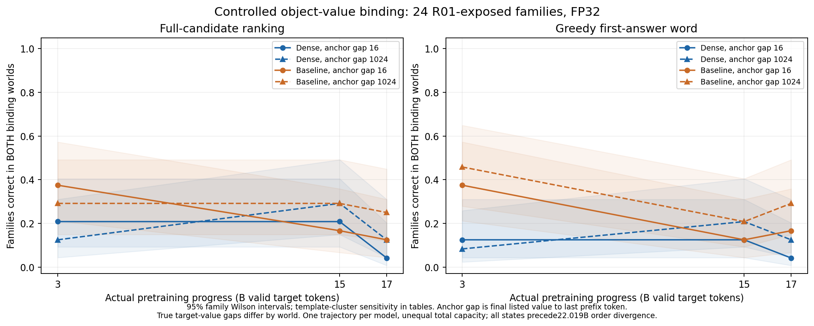

# 长短程关系定义与最小绑定验证

**新对照中，近程也有大量失败，不能把当前结果概括为“远程关系更难学”。** 候选成对成功仅1–9/24；但交换绑定后，候选偏好多数向正确方向移动，说明并非完全没有关系敏感性。R01的较高单事实调用成绩仍不足以确证稳定的对象关系选择。

本轮三条分析路径：①行为与因素对照，已完成；②表征与层间组织，NOT RUN；③功能干预，NOT RUN，数值／身份与测量质量核查通过。科学接受与机制判断仍为Unknown，以下认识更新标为AI建议。

## 定义：距离、关系任务与能力层次

短程／长程先按实际token距离描述输入任务，不能用答错或学习慢来定义。前缀1152token，末读取位置p1151预测首答案位置1152；gap=p−e−1，排除两端。R01的e是唯一正确值末token。R02两个世界固定key/spoon的位置，交换box/bag，仍查box；e取最后列出的spoon末token，锚点gap16／1024，但正确值在另一世界更早。实测正确值gap近16–24、远1024–1032。完整关系块长10–16token，每行同时记录块跨度、值长度、绝对位置和最终预测位置。[完整定义与四层例子](definitions_cn.md)。

R01实际测单答案词调用的候选排序。R02测竞争事实中的对象—属性选择，允许复制对应词；它虽有两条事实，却不需要连接两跳关系。独立跨表述泛化、多事实组合都未验证。输入距离、训练中每条知识的曝光、词频、SAE频率分别定义；本轮不把长程等同长尾。

AI建议将组合定义分成三项记录：证据距离、需要完成的关系任务、反事实使用的行为证据；另标注能力层次。距离定义先于表现，成对答错不把远程样本变成“非长程信息”。当前先保留R01为词面事实调用，R02为一跳关系选择，正式术语由研究者决定。

## 核验与冻结设计

从37个R01原始分数文件重新校验hash、重算成对成功和位置，没有直接照抄摘要。原近／远值末token确为1134／126，读取位置1151。六个选定state.pt均重新完整SHA、native strict load与标量计数核查：两模型实际3B／15B／17B，分别11446／57224／64854步，严格匹配，无插值。[资产与基建](assets_and_data_cn.md)。

Dense总／常规激活参数281431040；普通MoE总507988992、常规激活281496576。总容量不等，激活矩阵规模接近不等于实耗FLOP相等。各模型只有一条训练轨迹；家族区间不代表种子间不确定性。历史训练顺序仅核实对齐至22.018691584B；本轮六点均在此前，但单轨迹与容量限制仍在。

冻结24个R01已见家族、六模板，两个绑定世界、近远两组：每状态96、合计576前缀；另6旧工程家族做48前缀smoke，不算独立新确认。两世界仅两个对象token互换，词袋、值次数／顺序／位置、问题和其余字节不变。近远移动整个关系块并移动1008个填充token，总长和token多重集合保持，绝对位置和竞争仍不完全隔离。无新家族确认。[协议](protocol_cn.md)在第一条新模型分数之前冻结。

完整候选为前导空格＋词语＋句号，均2token；FP32原生前向，关闭TF32，逐token条件log概率求和。两世界各自正确分差都>0才记家族成功，平分失败。另保存只计首词／去句号／长度平均分。生成是无候选约束greedy，最多8新token，首句标点／EOS停止；只评首词（可有一个开头the/a/an），不在后文搜索正确词。候选排序、首词候选排序和生成分别报告。

## 全部模型与进度的行为结果

下表均以24家族为分母，要求同家族两个世界都正确。候选与生成不是同一指标。

| 模型 | 真实预训练B token | 候选近 /24 | 候选远 /24 | 生成近 /24 | 生成远 /24 |
|---|---|---|---|---|---|
| Dense | 3.0 | 5 | 3 | 3 | 2 |
| Dense | 15.0 | 5 | 7 | 3 | 5 |
| Dense | 17.0 | 1 | 3 | 1 | 3 |
| Baseline | 3.0 | 9 | 7 | 9 | 11 |
| Baseline | 15.0 | 4 | 7 | 3 | 5 |
| Baseline | 17.0 | 3 | 6 | 4 | 7 |

横轴只画实际3／15／17B点，线段仅引导视线；颜色区分两条模型轨迹，实线／圆点与虚线／三角区分锚点gap16／1024。左为完整候选成对成功，右为greedy首答案词成对成功，阴影为24家族95%Wilson区间。图中没有把家族区间当种子区间。[图源](data/figure_data.csv)。

六个近减远的候选成功率差区间都触及或跨过0。15B、17B多组远程点反而较高，但这不证明远程更有利：位置／填充、读出格式和家族不确定性仍在。没有事后更换80%门槛；本轮本来就不使用80%作通过或筛样规则。[全部区间、家族、类型与反例](detailed_cn.md)。

## 分数响应与“都答对”要分开

令A世界对候选A相对B的偏好为dA，B世界同一A−B偏好为dB；绑定翻转响应Δ=dA−dB。Δ>0表示分数朝新绑定要求的方向移动，但一侧仍可能因强先验而答错，不能替代两侧都正确。

例如Baseline15B远程24/24家族的Δ>0，平均Δ1.552nat，却只有7/24家族两侧完整候选都正确。Dense17B近程平均Δ0.127nat、家族区间跨0，成对仅1/24。各状态原始两侧分差、Δ、区间与每个失败均保留。Baseline3B远程生成11/24高于受限候选7/24并非同一评分矛盾：生成可先输出the，再选择名词；主候选直接从词开始。原始生成和严格固定解析规则见[案例](cases_cn.md)。

## 与R01的认识更新

原BF16原始分数重算还确认：80%首次采样达标，Dense近3B／远15B，Baseline均3B；60／90%敏感性和全部回落仍保留，见[资产指南](assets_and_data_cn.md)。

额外在同一次加载中，用FP32对相同六状态的576个旧前缀只做候选参照，输出仍在R02，R01字节不变。参照的12个模型×进度×距离成对计数与原R01对应点相同。例如Dense15B近程旧23/24、新5/24；Baseline3B远程旧23/24、新7/24。全12条件均有14–22个“旧对、新错”家族。

**AI建议的读法：** 旧结果先保留为较简单的词面事实调用；新对照提供部分绑定敏感性与局部成功案例，但近程基线本身低，暂不能把失败主要定位为远距离关系使用，也不能由此宣布模型完全没有关系能力。新任务多了竞争事实，填充和正确值距离也不同，所以差距不能证明R01实际只用了某一种简单策略。固定查询对象还与实体词汇先验耦合，本轮没有交叉查询另一个对象；成功也不自动证明一般query使用。

## 边界、成本与停止

本轮没有新的独立家族、独立改写确认、训练种子重复、多跳组合或feature分析。采用旧家族探索、单轨迹、受控英语续写与固定首词解析，不能推出架构因果或一般长程语义能力。当前结果对应“近程也弱”的分支；更合理的下一项AI建议是先共同审读完整成功／失败例及答案格式，再由你决定是否冻结交叉查询对象或新表述面板。现在不启动这些扩展。

完整阶段275.6秒，smoke71.5秒，记录阶段合计约5.8分钟；现有H100 MIG3g.40gb，peak allocated约2.797GiB，无新作业。完成576绑定前缀＋576旧任务候选参照，生成1375个token。CPU准备／写报告未单独计时，阶段耗时不是整卡账单。[完整成本](/data/250010109/MoE_Router/experiments/20261105_checkpoint_evidence_use_r02_relation_binding/audit/cost.json)。权重、R01结果均保持，训练更新0。

本轮只完成Prompt2关系定义与验证，不替另一项Base学生知识学习任务判断能否启动。是否扩大、如何接SAE与曝光×距离设计，等待研究者决定。
