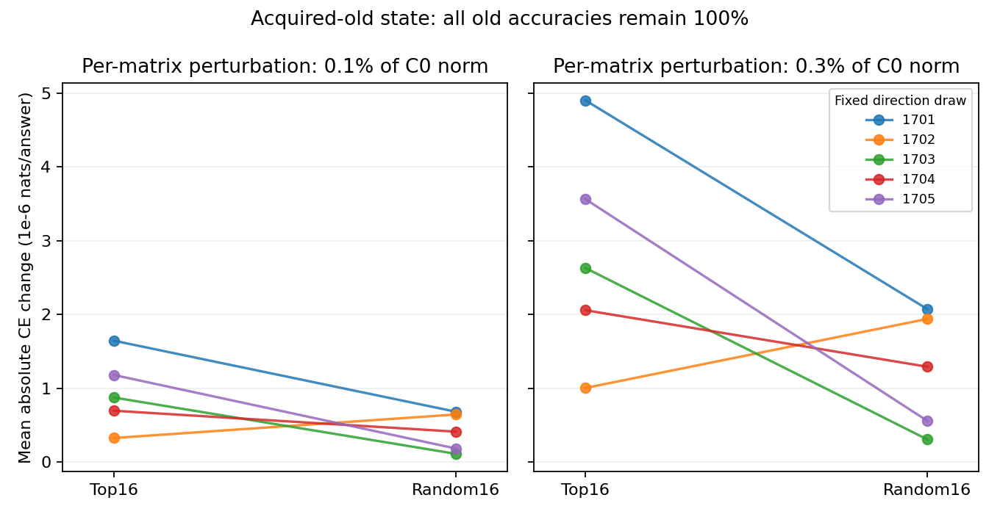
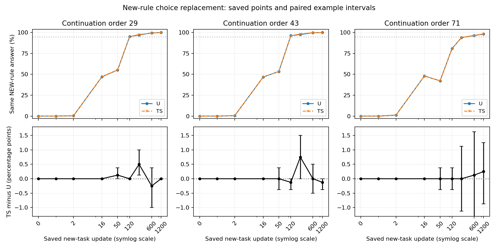

# A localization: candidate sensitivity and rule overwrite

The bounded round is complete. At the acquired-old state, perturbing C changes old-answer probabilities about 2.3 times as much as matched random perturbations on average. Only 4/5 direction draws favor C at each dose, and old accuracy remains 100% in all 40 interventions. Saved evaluations show no sustained delay of same-new-rule answers under protection. **AI proposal: do not immediately replace the candidate; first specify the old-mode function and conditional use to preserve.** Necessity for old-rule correctness and cross-task reuse remain unresolved. Researcher judgment and the next scientific decision remain Unknown.

[Protocol](protocol.md) · [Full evidence](detailed.md) · [Artifact manifest](artifact_manifest.json). This supplement preserves the [original 1200-update A utility audit](../a_stage_audit.md).

## Does C relate to the old function at the starting state?

The acquired-old Qwen3-0.6B Base answers mode one with command 甲 selecting the first list word and 乙 selecting the last; mode two reverses these rules. C uses 16 paired singular rank-one atoms from each of four complete layer-27 attention matrices: 64 parameter coordinates in total. A parameter direction does not itself identify a separately invoked input computation.

We reversibly perturb either C or a random matched set in memory, using 0.1% and 0.3% of each matrix's initial C norm, five fixed coefficient draws, and both signs. Controls match rank-one structure, coefficients, and per-matrix displacement norm. No optimizer or training is used.

Cross entropy (CE) is minus the natural logarithm of the correct answer's probability. Primary sensitivity is the mean absolute per-answer CE change, averaged over both signs and five draws. Its unit below is **10^-6 nats per answer**; absolute change measures sensitivity rather than damage.

| Dose / initial C norm | C sensitivity | Random sensitivity | Conditional 95% interval for C minus random | Mean ratio | Draws favoring C |
| --- | ---: | ---: | ---: | ---: | ---: |
| 0.1% | 0.947 | 0.410 | [0.084, 1.330] | 2.31 | 4/5 |
| 0.3% | 2.832 | 1.236 | [0.251, 3.825] | 2.29 | 4/5 |

Sources: [primary statistics](tables/probe_pooled_2.csv), [all ten paired draws](tables/probe_contrasts_10.csv). Intervals resample paired word groups conditional on one parent model and five fixed draws. They exclude parent-model variation. Draw 1702 favors random at both doses; five draws are not five acquired models or 4000 independent answers.

For the real old-mode input with command 甲 and list “狗 猫 蓝”, one C perturbation lowers the correct-word probability from 68.802% to 68.610%; the prediction stays “狗”. This illustrates probability sensitivity without accuracy loss. The example was selected post hoc as the largest sensitive answer and contributes about 63% of summed C sensitivity. The primary analysis retains every answer; concentration details are in [Detailed](detailed.md#concentration-and-a-real-example).

Each line pairs one C and random draw. Draw 1702 slopes downward. The vertical axis is absolute CE change, not accuracy loss.

## Does protection alter the overwrite trajectory?

U continues training without direction protection. TS attenuates C-coordinate displacements during updates. We read nine existing evaluations for each arm and continuation-order seed 29, 43, and 71, pairing the two modes of the same command/list into 800 pairs per point. This process analysis uses no new forward evaluation.

At the starting state, **799/800 pairs already choose the old-rule answer in both modes**. Agreement alone therefore cannot mark new-rule overwrite. The relevant category is both modes choosing the new-rule answer.

| Continuation-order seed | First nonzero same-new: U/TS | First saved ≥50%: U/TS | First saved ≥95%: U/TS |
| --- | ---: | ---: | ---: |
| 29 | 2/2 | 50/50 | 120/120 |
| 43 | 2/2 | 50/50 | 120/120 |
| 71 | 2/2 | 120/120 | 600/600 |

Sources: [all 54 points, old/new accuracy and CE](tables/process_54.csv), [27 paired contrasts and intervals](tables/process_contrasts_27.csv), [landmarks](tables/process_first_points_6.csv). The 50% and 95% landmarks are post-hoc descriptions, not the original new-learning qualification gate. First nonzero is localized to update 2 because updates 0, 1, and 2 are observed. Other landmark times refer only to saved points. The largest absolute saved-point TS-minus-U contrast is 0.75 percentage points, without a sustained direction. Seed 71 falls from 48% at update 16 to 42.125% at 50, so coverage is not monotone.

For the real matched command-甲 list “黄 红 鸟”, U and TS under seed 29 answer “黄” in both modes at update 0 and “鸟” in both modes at update 16. This is a switch of default rule. The starting state had not mastered both conditional rules.

The upper row shows coverage out of 800 pairs; the lower row shows TS minus U with paired example intervals. Connecting lines do not measure unsaved steps, and close curves do not establish equivalence at every update.

## Candidate decision boundary

The observed local probability sensitivity does not establish necessity for old-rule correctness. TS endpoint C net displacement is 0.0171%–0.0366% of its initial norm, versus 0.179%–0.500% for U; these are net endpoint displacements, not cumulative path lengths or a functional-preservation guarantee. See [48 saved-state records](tables/C_coordinate_stability_48.csv).

The premise “C is important and its function is stable” has therefore not been fully established. No result here requires immediately choosing another set of large singular directions. The AI proposal is to discuss which old-mode input/output behavior must remain while new learning proceeds, and how conditional use should be checked. Old-specific, generic, and cross-task-reused functions remain unresolved. No alternative candidate or new training was run.

One reserved H100 job, `pt-j1zvgh90`, succeeded with 40 interventions, one baseline, and zero training updates. The primary endpoint remains update 1200. No best-checkpoint substitution or broader research-question closure was performed.
