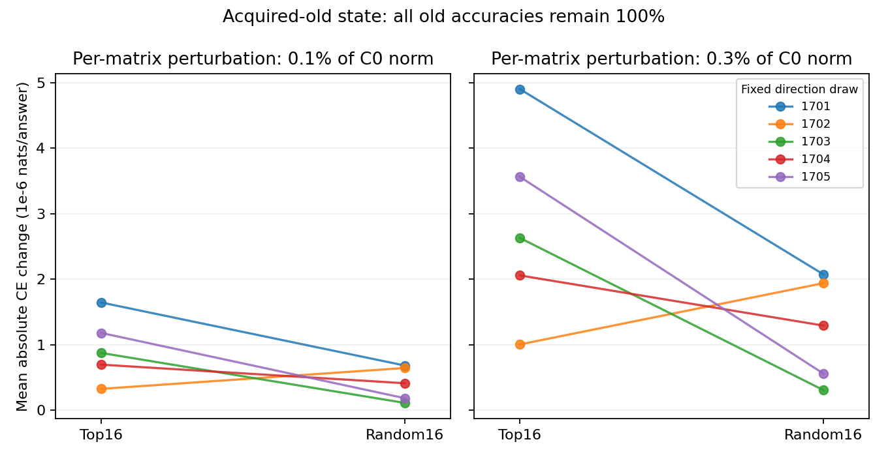
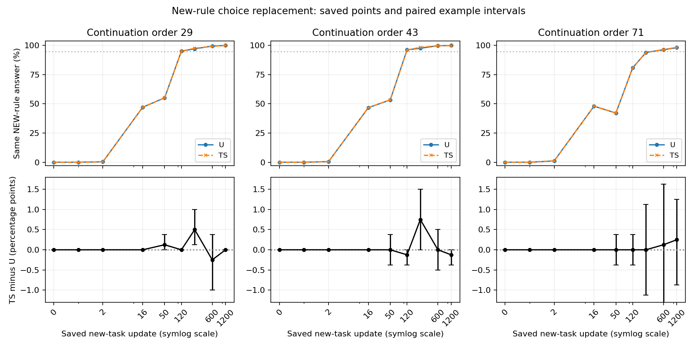

# A阶段：候选敏感性与规则覆盖定位

本轮已完成。起点候选方向对旧题**输出概率**的平均影响约为匹配随机方向的2.3倍，但两档幅度都只有4/5次方向抽样更敏感，40次干预的旧题准确率全部为100%。已有保存点中，保护组没有持续延后“旧、新模式同答新规则”的发展。**AI建议：目前不直接换候选；先明确要保持的旧模式功能与条件调用。**“C是维持旧规则所必需的方向”和“跨任务共同方向”仍未得到证明。研究者最终判断与下一项科学决定保持Unknown。

[执行方案](protocol_cn.md) · [完整记录与复核入口](detailed_cn.md) · [产物及原始记录清单](artifact_manifest.json)。本轮是一项补充定位，不改写[原A阶段1200步效用审计](../a_stage_audit_cn.md)的判断。

## 起点：候选与旧功能有什么联系？

沿用已经学完旧任务的Qwen3-0.6B Base。旧规则是模式一中“甲选首词、乙选末词”；新规则在模式二反过来。候选C来自第27层四个注意力权重矩阵的完整起点权重，每个矩阵取前16个配对奇异方向，共64个参数系数。这里的“方向”指怎样改参数，不是某个输入独立调用的功能。

本轮只在内存中给C或随机对照加同样长度的小扰动，再恢复原值。两档长度为每个矩阵C起点长度的0.1%和0.3%。每档各用5次固定方向抽样，并测正负两边。随机对照有同样16个正交秩一方向、同样系数、同样每矩阵位移长度。其余参数、模型起点和题目不变。

交叉熵（cross entropy，CE）等于正确答案概率的负对数：越低，模型给正确答案的概率越高。主指标先对每道题取“扰动后CE减起点CE”的绝对值，再平均；它衡量概率改变多少，正负改变都算，不能直接读成性能损伤。下表为800道旧题、正负干预与5次抽样的平均，单位为**百万分之一nat/答案**。nat使用自然对数。

| 扰动长度/C起点长度 | C敏感性 | 随机敏感性 | C减随机的条件95%区间 | 平均比值 | C更敏感的抽样数 |
| --- | ---: | ---: | ---: | ---: | ---: |
| 0.1% | 0.947 | 0.410 | [0.084, 1.330] | 2.31 | 4/5 |
| 0.3% | 2.832 | 1.236 | [0.251, 3.825] | 2.29 | 4/5 |

来源：[完整主指标](tables/probe_pooled_2.csv)、[全部10对抽样](tables/probe_contrasts_10.csv)。区间按词组配对抽样，固定这一个旧模型和这五次方向，不包含其他模型起点的不确定性。种子1702两档均为随机方向更敏感；不能把平均差当作五次一致支持。800题也不是乘五后得到4000道独立题。

真实样本`dev/old/甲/11-10-2`的列表是“狗 猫 蓝”，旧规则应选“狗”。在一次C正向扰动中，正确词概率从68.802%降到68.610%，输出仍是“狗”。这就是“概率敏感，但准确率没变”。这个用于解释的样本是事后选出的最大敏感样本；约63%的C总敏感量集中在这一题。完整保留800题的主结果，额外浓度检查见[完整记录](detailed_cn.md#敏感量集中在哪里)。

每条线连接同次抽样的C与随机结果；向上表示C更敏感，1702向下。纵轴是绝对CE变化，不是准确率下降。

## 过程：保护是否延缓了规则覆盖？

U是不施加方向保护的后续训练；TS是在更新中压低C方向位移的保护组。这里读取它们已经保存的9个评价点和3个训练顺序种子29、43、71，不新增训练或过程前向。每点把同列表、同口令的旧/新模式组成800对。

起点已出现**799/800对同答旧规则**。所以单看“两种模式给同一个答案”会把起点也误叫成覆盖。真正要跟踪的是两种模式都给出**新规则**答案的比例。

| 原后续训练顺序种子 | 首次出现同答新规则：U/TS | 首个保存点达到50%：U/TS | 首个保存点达到95%：U/TS |
| --- | ---: | ---: | ---: |
| 29 | 2/2步 | 50/50步 | 120/120步 |
| 43 | 2/2步 | 50/50步 | 120/120步 |
| 71 | 2/2步 | 120/120步 | 600/600步 |

来源：[全部54点与旧/新准确率、CE](tables/process_54.csv)、[27个配对差与区间](tables/process_contrasts_27.csv)、[首次保存点](tables/process_first_points_6.csv)。50%与95%是本轮事后描述标记，不是原新任务学习达标门槛。2步是逐步保存的首次非零点；其他两个时间只定位到保存点，不能定位未保存步骤。全部保存点中TS减U的同答新规则比例差最多为0.75个百分点，且方向不持续一致。种子71还在16到50步由48%回落到42.125%，过程不单调。

真实成对输入只差“模式一/二”，口令甲，列表“黄 红 鸟”。种子29的U与TS在0步都对两种模式答“黄”，16步都对两种模式答“鸟”。这展示默认规则由旧转新的现象；模型并没有在起点同时掌握两种条件规则后又丢失其中一种。

上排画800对中的新规则同答率，下排画TS减U及题目配对区间。线连接保存点，不能替代未保存过程；曲线接近也不证明两组在所有步骤等效。

## 这如何影响下一步选择？

C有局部概率敏感信号；“旧规则正确性依赖C”仍证据不足。TS在1200步的C净位移为C起点长度的0.0171%—0.0366%，U为0.179%—0.500%；这是终点净位移，不是逐步累计长度，也不保证输入到输出功能保持。见[48条保存状态记录](tables/C_coordinate_stability_48.csv)。

因此，用户提出的第三步中的“C确实重要且功能已稳定”尚未完全成立。目前也没有证据要求直接换成另一批大奇异方向。AI建议下一次讨论先明确：在新学习继续时，哪些旧模式输入必须继续产生旧规则答案，以及如何检查这种条件调用。旧任务专用方向、一般计算方向与跨任务复用仍待区分；本轮没有运行候选替换或新训练。

执行使用1张H100 reserve，作业`pt-j1zvgh90`已成功；完成40次干预和1次起点评价，训练更新为0。原主终点仍为1200步，本轮没有挑选最优检查点或关闭整个研究问题。
