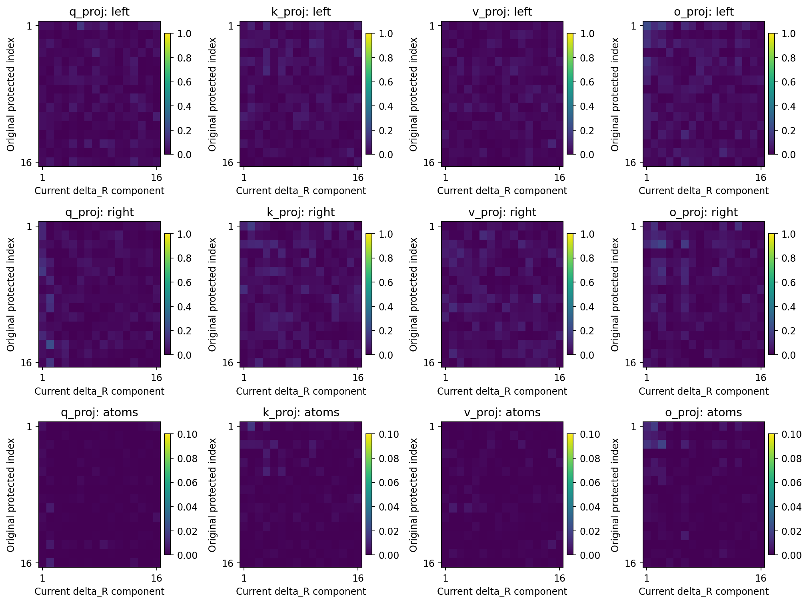

# Frozen residual diagnosis: complete evidence record

[Summary](summary.md) · [Protocol](protocol.md) · [Recognition update](recognition_update.md). The R05 Anchor remains the scientific owner. This supplement does not change Focus/Anchor state or the original utility criterion. Factual reporting is complete; scientific acceptance and the next design decision remain Unknown.

## Execution and conformance

The current user authorized this bounded frozen diagnosis, including completion without intermediate review. No training, new architecture, original-result edits, or additional stage was run. H1–H3, five beta doses, 50% component weakening, five random seeds, rank tolerance, and the descriptive 5% spectral screen were fixed in the Protocol before execution.

Job `pt-hfmdpfra` used one `h100-1-reserved` allocation and `shphd-lite-0911`. It was created on 2026-10-23 at 03:32:39 UTC, started at 03:33:21, and succeeded at 03:40:02. Program time was 387.72 seconds; peak allocated GPU memory was 2,749,863,936 bytes. Runtime was PyTorch 2.3.0a0+6ddf5cf85e.nv24.04, CUDA 12.4, NVIDIA H100 80GB HBM3. Complete spectral decompositions use CPU FP64; native forwards and input-moment products use the allocated GPU. Existing runtime qualification was reused; no new standalone training Smoke is claimed.

All target and random constructions for all six endpoints were sealed before any new forward. Selection read endpoint weights and original projectors, without opening data, caches, or evaluation answers. `freeze_before_new_forward.json` binds factors, source, config, Protocol, retained implementation, and endpoint hashes. The source SHA256 is `8d9dc754e6e5d60e3d83e0a39f5fefa749baf9ba99d29fcb7046f194632ee029`. Aggregation code was bound when no intervention readout existed, although some spectral outputs already existed. There were no retries, exclusions, adjusted doses, changed seeds, or trained checkpoints.

Coverage is 54 reused trajectory evaluations, 216 matrix spectral rows, 432 fixed-input rows, 12 endpoint-O rows, and 66 intervention conditions. Of the latter, 59 require new forwards and seven reuse existing results: six original endpoints and TS29 restore_R. The previous seven C/R interventions and small-C sensitivity probe are cited, not repeated. TS29 beta-zero uses the same retained FP32 functional expression, but historical mixed weights were not saved separately; bytewise comparison of that mixed state is therefore unavailable. This limits that reused row, not the other 59 fresh intervention evaluations.

## Model, data, and mathematical objects

Qwen3-0.6B Base loads the acquired-old four-matrix adapter. Layer-27 Q/K/V/O matrices have shapes 2048×1024, 1024×1024, 1024×1024, and 1024×2048, totaling 6,291,456 parameters. Old mode maps command 甲 to FIRST and 乙 to LAST; new visible mode reverses these choices. DEV has 800 answers per mode, two panels of 400 each, and 200 answers per command/panel cell. It was exposed by previous evaluation and is not fresh confirmation data. Prediction and cross entropy use the entire vocabulary of 151,936 token IDs. Native last-block attention/MLP and final prediction are recomputed using the qualified frozen-prefix cache.

For each complete acquired-old matrix W0, the original projector selects 16 paired rank-one atoms Bi=ui viᵀ. It is not an SVD of the acquisition parameter increment. The Frobenius inner product sums elementwise products. Define P(X)=Σi〈Bi,X〉F Bi, Ct=P(Wt), Rt=Wt−Ct, delta_C=Ct−C0, and delta_R=Rt−R0. These are 64 coefficients across four matrices, not all cross terms of a 16×16 left/right product space. TS attenuates rather than freezes C. R contains preexisting R0; only delta_R is the added residual update. The [original A audit](../a_stage_audit.md) owns per-update paths, squared sums, and net displacement. Those distinct quantities are not replaced or recomputed here.

## Parameter complement is not an input/output nullspace

Ideal coefficient orthogonality uiᵀ delta_R vi=0 does not imply delta_R vi=0 or uiᵀ delta_R=0. Across 216 matrix rows, maximum relative P(delta_R) leakage is 1.55e−9 and P(R) leakage is 5.96e−9. In TS29 endpoint Q, the maximum selected diagonal coefficient is 1.47e−11, while ‖delta_R V0‖F=0.841197, ‖U0ᵀ delta_R‖F=0.318959, and ‖U0ᵀ delta_R V0‖F=0.094495. These are measured from real weights.

For delta_R=Σj sj aj bjᵀ, the inner product of one new singular atom with Bi is (uiᵀaj)(viᵀbj). Whole-matrix orthogonality constrains the weighted sum over j, allowing cancellation. Left-vector, right-vector, and rank-one-matrix inner products are different measurements. `direction_inner_products.npz` retains all signed 16×16 arrays for R and delta_R. A zero delta_R has an undefined singular subspace. Plots use absolute values; signs of individual singular vectors are arbitrary. Across the 24 endpoints, the maximum absolute atom inner product is 0.00416 for R and 0.06143 for delta_R.

Columns are matrices; rows are output-vector, input-vector, and atom inner products. Original directions index heatmap rows; delta_R components index columns. The first two scales run from zero to one, and atom scales from zero to 0.1. Dark cells are not exact zeros. This example illustrates the definitions; all cases remain in the source arrays and [matrix table](tables/aligned_spectra_behavior_216.csv).

## Spectra and saved-point timing

Spectral norm is maximum amplification of a unit input. Frobenius norm is the square root of all squared entries. C and delta_C norms use exact 16-dimensional cores; W, R, and delta_R use complete FP64 SVD. Singular values from different matrices are never added. Subspace overlap is the mean squared principal cosine, with the minimum also retained. Top-32 overlaps and the 16/17 boundary gap are reported. The minimum gap relative to sigma1 is 0.0006625, so truncation-boundary sensitivity remains even when numbered-vector matching is avoided. An overlap loss is not a fraction of deleted function.

All six trajectories have roughly 48%–51% old accuracy at update 16, with maximum sigma1 changes of 0.083%–0.154% and top-16 overlap losses of 1.09%–1.69%. The first saved point meeting the descriptive 5% screen is 600 for U/TS29/43, 50 for U71, and 240 for TS71. Only updates 0, 1, 2, 16, 50, 120, 240, 600, and 1200 are observed; no interpolation or monotonicity is assumed. At 1200, maximum sigma1 changes are 0.932%, 0.796%, 0.728%, 0.649%, 4.590%, and 2.512%; overlap losses are 6.804%, 6.344%, 5.942%, 6.134%, 9.889%, and 10.280%, ordered U29, TS29, U43, TS43, U71, TS71. Maximum relative L2 change of the full singular-value spectrum is 0.884%.

Later rotation exists, but marked rotation is not an observed prerequisite of early forgetting. This ordering does not identify a unique cause. R0 already has substantial amplification. For TS29 Q, R0 spectral norm is 2.936921, endpoint R is 3.151147, and delta_R is 1.818904; these are different objects. C and R norms cannot be added to obtain the spectral norm of W. [All aligned spectra and behavior](tables/aligned_spectra_behavior_216.csv) retain every matrix and saved point.

## Fixed actual inputs and final behavior

Each mode contributes 800 answers and 16,320 valid token positions. Capture the actual projection inputs x at W0 and compute G=mean(xxᵀ). RMS output-vector length is L(A)=sqrt(trace(AGAᵀ)). Compare delta_C, delta_R, their sum, and W0 using exactly the same G. Variable-length examples are weighted by valid token positions. This is not answer accuracy or a final-loss decomposition. Parameter orthogonality does not imply output orthogonality, so output lengths are not summed.

Q/K/V share fixed layer inputs because only the final attention projections change. O receives the attention output, which changes with Q/K/V. Primary O comparisons fix the W0 input; secondary comparisons fix the actual endpoint O input for both components. At update 16, TS delta_R output ratios are 9.53%–22.56%, although per-matrix net parameter changes are only 2.06%–2.67%. TS endpoint delta_R ratios are 19.26%–38.87%. [All 432 local measurements](tables/fixed_inputs_432.csv) retain both modes and every order/arm/time.

[Endpoint actual-O-input ratios](tables/endpoint_O_outputs_12.csv) are 25.13%–30.64% for TS delta_R and 0.00854%–0.05548% for delta_C. Their denominator is W0 acting on the endpoint O input, not the old model's own O output. Q/K changes still pass head normalization, rotary encoding, dot products, and softmax. Full-model evaluations execute those nonlinear steps. Necessary input-capture forwards match the existing predictions and CE exactly; no separate duplicate evaluator was run.

## All residual doses

The ideal intervention is Wbeta=Ct+R0+beta delta_R. Actual execution uses the retained FP32 functional expression Wt−(1−beta)[Wt−W0−P32(Wt−W0)]. FP64 decomposition and actual FP32 addition are recorded separately. Beta one reuses the six original endpoints; TS29 beta zero reuses restore_R from that same expression. The remaining 23 dose states are fresh forwards. All [30 dose rows](tables/intervention_behavior_66.csv) retain old/new accuracy, CE, and new-endpoint selection.

TS29 old/new accuracies at beta 0, 0.25, 0.5, 0.75, and 1 are 100%/0%, 93.125%/26.5%, 46.25%/56.625%, 1%/99.75%, and 0%/100%. None of the five tested doses has both means at least 95% in any of the six cases. This does not rule out every continuous dose or another method. These are off-trajectory interventions, not training times. Beta zero nearly returns to W0 and also removes new learning; old recovery does not locate spectral dominance. The prior seven restoration results remain cited from the original audit.

For the previously fixed real paired example, command 甲 and list “黄 红 鸟”, TS29 beta 0.25 answers 黄 in both modes, with old/new CE 0.0000572/3.320843. Beta 0.5 answers 鸟 in both modes, with old/new CE 7.608168/0.0000759. The endpoint also answers 鸟. Targeted 50% weakening still answers 鸟 for this example: it is a retained non-recovered case, rather than a selected success story.

## Targeted components and matched random controls

Select S16(delta_R) from endpoint weights alone. To preserve C, weaken D=(I−P)S16 by 50%. Removing raw S16 alone could change C because tail components can cancel its selected-coordinate projection. The complement projection can raise rank to 32. Every target and control here has numerical rank 32 at the predeclared relative 1e−8 core threshold. FP32 addition creates small rounding tails, so rank refers to the construction before addition; actual norm and selected-coordinate leakage are audited separately.

Five random controls use independent orthonormal frames, the same 16 source singular coefficients, the same complement projection, and per-matrix scaling. All 120 rank/norm matches pass; the largest relative actual-norm mismatch is 3.06e−9, below 0.1% tolerance. [All 66 conditions](tables/intervention_behavior_66.csv) retain each random result; [264 geometry rows](tables/intervention_geometry_264.csv) retain perturbation lengths, leakage, and spectral changes.

Targeted old recovery exceeds every random draw, but new accuracy falls. TS old/new target accuracies are 45.5%/59.375%, 37.375%/67.125%, and 23.25%/76.375% for orders 29/43/71. Corresponding random means are 0%/100%, 0.025%/99.875%, and 0.575%/98.725%. U shows the same directional pattern. TS29 target-minus-random differences are +45.5 old percentage points, conditional 95% interval [44.125,46.750], and −40.625 new points, interval [−42.375,−38.750]. [All six contrasts and intervals](tables/specificity_6.csv) include CE and individual-random ranges. One percentage point is eight answers out of 800.

These components come from delta_R, not the newly largest directions of complete W. The intervention identifies functional structure in learned updates, but does not independently manipulate spectral rank, removal of learned information, and whole-W subspace change. It can strengthen H1's functional-structure link without proving spectral mediation.

Intervals use 2000 paired unordered-group resamples: 200 groups per panel, two commands together, common target/control samples, and equal panel weighting. Old/new modes are matched by command and list. Intervals condition on one parent, each continuation order, and five fixed random draws. These draws are not acquired-model replicates. Exploratory matrix/time/dose comparisons have no multiplicity correction.

## Evidence ledger and hypothesis update

| Question | Evidence | Status | Claim boundary |
| --- | --- | --- | --- |
| Parameter complement | 216 projection-error rows and measured selected-input/output action | DONE_VALID | Not an input/output nullspace |
| Geometry before forgetting | 54 readouts aligned with 216 matrix decompositions | DONE_EXPLORATORY | Early behavior precedes the screen; no causal identification |
| Actual-input effect | 432 primary and 12 endpoint-O rows; seven captures | DONE_VALID | Local linear effects do not replace final loss |
| Residual dose | 30 states: 23 new and seven reused | DONE_EXPLORATORY | Old recovery trades away new learning |
| Component specificity | Six targets, 30 randoms, 120 rank/norm matches | DONE_EXPLORATORY | Structured residual influence, not whole-W spectral mediation |
| Contextual use, update restriction, or I/O preservation | No execution | NOT_RUN | No automatic selection or run authorization |

H1 receives partial support for later rotation and targeted residual specificity, while marked whole-weight rearrangement as a necessary or main explanation of early turnover is weakened. H2 is supported within this scope: small net parameter changes with little full-spectrum change can produce substantial actual-input and behavioral effects. H3 remains live, with partial support for constraint-coverage limitations; candidate irrelevance and the complete set of old-critical directions remain unresolved. Generic sensitivity, old-specific updates, conditional-use changes, and multi-matrix coordination may coexist. Internal deletion or direct callability of old computation at the endpoint remains Unknown; parameter restoration does not establish endpoint callability.

The [recognition update](recognition_update.md) fixes these bounded conclusions for later discussion. Future comparisons should specify the old-mode input/output function before testing contextual residual use, restrictions on functionally identified updates, and old-I/O preservation. Parameter isolation has not been shown necessary. The original 1200-update utility judgment is unchanged, and the broader research question is not closed.

## Reproduction and artifacts

The [manifest](artifact_manifest.json) binds source/config, current strict access for 16 input IDs, 54 checkpoint identities, original and intervention readouts, spectra/inner products/factors, job/freeze receipts, and figures. All 54 checkpoint hashes match the registered identities; 1904 saved-artifact checks pass. The output is an analysis asset, not a trained model. The original A archive and prior localization results retain their hashes. All four figures were opened and visually checked. Math was checked against source and numerics; rendered verification is not claimed.

CPU recomputation uses `python analyze.py`, `python verify.py`, and `python plot.py` on saved outputs. Verification does not load a model. Completed `diagnose.py` includes forwards and a duplicate guard and should not be rerun for reading. Execution root: `/data/250010109/MoE_Router/experiments/20261023_autonomous_retention/analysis/A_residual_spectral_20261023`. Two earlier unrelated navigation findings remain; no repository-wide PASS is claimed.
