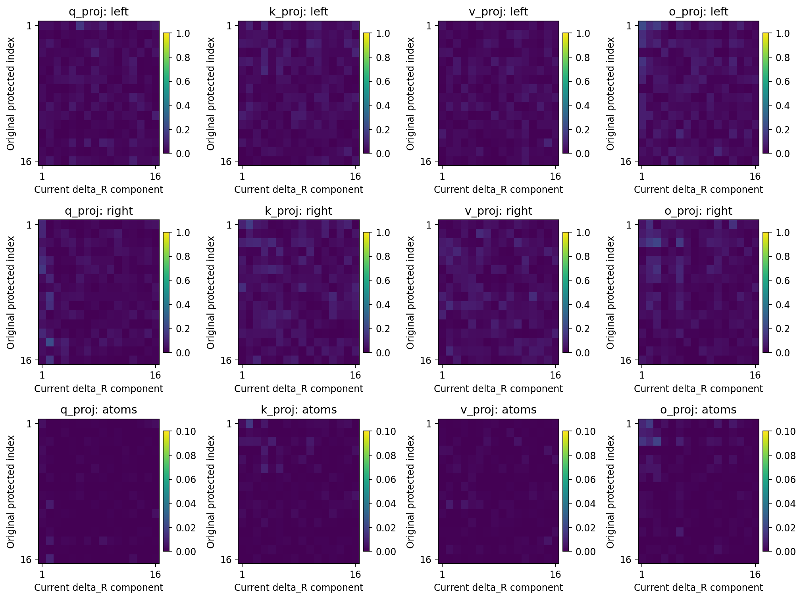

# A阶段残差冻结诊断：完整记录

[概要与三条分析路径](summary_cn.md) · [原方案](protocol_cn.md) · [固定认识更新](recognition_update_cn.md)。科学所有者为R05原Anchor，本补充不更改Anchor/Focus科学状态。原问题、条件规则、数据与模型均未变。本轮主链为谱、固定输入功能、干预特异性；三种竞争解释允许并存。

## 符合性先于解释

| 检查项 | 实际情况与资格 |
| --- | --- |
| 授权与边界 | 当前用户明确授权本轮冻结诊断；不训练、不扩展其他阶段、不改写原结果 |
| 方向选择 | H1—H3、β五档、50%削弱、五个随机种子及5%筛查在取本轮结果前写入方案 |
| 方向/源码冻结 | 全部6个终点的靶向与随机构造在任何新前向前封存；权重选择阶段不读缓存、数据或评价答案 |
| 聚合代码 | 在干预读出为0份时封存；当时已有部分谱结果，明确不冒充所有分析源码均在取数前封存 |
| 执行数 | 54份原评价；216矩阵谱行；432固定输入行；12终点O输入行；66干预条件，其中59新前向、7复用 |
| 复用内容 | 6个β1原终点；TS29 β0用旧restore_R；旧恢复C/R七项与小幅C敏感性检查仅引用 |
| β0复用边界 | TS29按同一保留FP32 functional恢复表达式复用；历史没有单独保存混合权重，不能声称已逐字节对比其权重 |
| 匹配控制 | 源16分量在原P补空间重投影后秩32；随机同构造，120项秩/实际长度配对均通过 |
| 缺失与改动 | 未删条件、未改幅度/秩阈值/种子；没有新训练检查点；未测未保存步骤或全新TEST |
| 主终点 | 1200步，不用剂量/中途检查点替换原效用结论 |

本轮没有独立新训练Smoke；沿用已经通过的H100原生前向与缓存资格，并在实际输入捕获中核对原评价。一次单卡H100 reserve作业`pt-hfmdpfra`，镜像shphd-lite-0911，于2026-10-23 03:32:39 UTC创建、03:33:21启动、03:40:02成功结束。程序387.72秒，峰值显存分配2,749,863,936字节。执行环境PyTorch2.3.0a0+6ddf5cf85e.nv24.04、CUDA12.4、NVIDIA H10080GB HBM3。谱分解为CPU FP64，模型及输入矩计算使用该作业GPU；不把CPU谱分解声称为GPU计算。

程序在取数据前封存`intervention_factors.pt`、源码、配置、英文Protocol、原实现和六个终点SHA。源码固定为8d9dc754e6e5d60e3d83e0a39f5fefa749baf9ba99d29fcb7046f194632ee029；冻结UTC与全部哈希见`freeze_before_new_forward.json`。后续分析源码另在`analysis_source_before_results.json`封存。无自动重试、失败条件替换或结果筛选。

## 系统与对象

Qwen3-0.6B Base加载已学旧任务的四矩阵适配器。层27的Q查询、K键、V值、O输出矩阵形状分别2048×1024、1024×1024、1024×1024、1024×2048，合计6,291,456参数。此前后续训练仅更新它们，本轮参数只在内存改动，结束逐字节恢复，无优化器/反向传播/训练更新。

每题输入包含模式、甲/乙口令、三个不同词。旧模式甲选首、乙选末；新模式甲选末、乙选首。DEV是此前已暴露的开发评价集，旧/新各800题，不是独立TEST。每种模式有未见词序和未见词组合两面板，各400题；口令×面板每格200。全词表151,936个token编号参与最大值预测和交叉熵，不把候选限制为三个列表词或20词池。缓存只省去冻结前27块的重复计算，实际重算末块原生注意力/MLP及最终预测。

固定P使用每张完整W0的前16个左右奇异向量配对成矩阵Bi=ui vi^T；它没有分解旧任务参数增量。Frobenius内积〈A,B〉F为对应元素乘积求和；P(X)=Σi〈Bi,X〉FBi。四矩阵合计64个标量系数，既不是16×16全部交叉项，也不是输入/输出子空间整体保护。Ct=P(Wt)，Rt=Wt−Ct；ΔCt=Ct−C0，ΔRt=Rt−R0。每步全更新也分成两部分，TS衰减非零，C没有完全冻结。原逐步路径、位移平方和与净位移审计直接引用[原A补证](../a_stage_audit_cn.md)，本轮不把保存点净位移替换累计路径。

## 补方向与奇异方向为何不是同一个正交命题

在理想正交P下，〈Bi,ΔRt〉F=ui^TΔRt vi=0。保持这些系数只限制16个“同编号输入到同编号输出”的标量；不能推出ΔRt vi=0，也不能推出ui^TΔRt=0。跨编号输出、输入空间外输出及其组合仍允许改变。实测216行中‖P(ΔR)‖F/‖ΔR‖F最大1.55×10^-9，P(R)相对误差最大5.96×10^-9，均是浮点近似的参数正交。

若ΔR的奇异分解为Σj sj aj bj^T，那么固定Bi与单个新秩一方向的内积为(ui^Taj)(vi^Tbj)。全ΔR的正交条件只要求Σj sj(ui^Taj)(vi^Tbj)≈0；各项可以非零并相消。左右向量的内积、秩一矩阵的内积、整个矩阵的投影是三个不同量。

TS29 Q终点中：最大固定对角系数1.47×10^-11；‖ΔRV0‖F=0.841197，‖U0^TΔR‖F=0.318959，‖U0^TΔRV0‖F=0.094495。这是真实权重测量，不是代数玩具例子。对原输入的输出和原输出方向上的变化都明确非零。

[216条谱/行为表](tables/aligned_spectra_behavior_216.csv)保留每个矩阵的上述量。`direction_inner_products.npz`保留全部保存点R与ΔR的16×16左右/秩一内积。零ΔR的奇异方向未定义，写为缺失而非任意夹角。SVD向量存在符号不唯一，图用内积绝对值，原数组保留有符号值。其余24个终点的R单个秩一内积最大0.00416，ΔR为0.06143，均不等于每个方向严格正交。

每列一个矩阵；三行是输出向量、输入向量、秩一矩阵方向的内积绝对值。行是原方向，列是ΔR主要方向。前两排色轴0到1，最后一排0到0.1；紫色不能机械读成精确零。单个端点用于解释，结论依赖全部保存点和匹配干预。

## 谱与时间：完整数字的含义

谱范数是最大奇异值，代表该矩阵对最有利单位输入的放大倍数。Frobenius范数是全部元素平方和开根号，反映整体参数长度。Ct/ΔCt用16维低秩核心计算精确范数；Wt、Rt、ΔRt用64位完整SVD。每张矩阵独立报告，未把不同矩阵的奇异值相加。

输入/输出子空间重合分别取原空间与当前空间的主夹角余弦平方平均，并保留最小值；1完全重合、0正交。另比较前32空间、报告16/17边界间隔；最小相对间隔0.0006625。边界靠近时，子空间比编号向量稳定，但固定截断本身仍有边界敏感性；因此不能把6%平均重合损失读成6%旧功能被删。全奇异谱最大相对L2变化0.884%，也不能据此宣布功能不变。

TS29的谱范数示例：

| 矩阵 | C0谱范数 | R0谱范数 | Ct谱范数 | Rt谱范数 | ΔCt谱范数 | ΔRt谱范数 |
| --- | --- | --- | --- | --- | --- | --- |
| Q | 7.011608 | 2.936921 | 7.010533 | 3.151147 | 0.001284 | 1.818904 |
| K | 5.150942 | 1.977651 | 5.149941 | 1.989493 | 0.001001 | 0.888668 |
| V | 2.601196 | 1.972570 | 2.601102 | 1.996454 | 0.000889 | 0.645371 |
| O | 3.416359 | 2.282584 | 3.417061 | 2.293444 | 0.001778 | 0.908698 |

R0本来已经具有这些放大能力；终点R的全部强度不能归因于新学习。ΔR谱范数也不能与C谱范数相加后当作Wt谱范数。

[54点筛查表](tables/saved_point_screen_54.csv)显示：所有六条轨迹到16步旧准确率约48%—51%，此时最大的完整权重σ1变化0.083%—0.154%，平均子空间重合损失1.09%—1.69%。预设5%筛查首次保存点：U29/TS29/U43/TS43均600步，U71为50步，TS71为240步。仅在已保存0/1/2/16/50/120/240/600/1200步作判断；不能把首次保存点当作真实连续跨越时间，也不假定变化单调。新规则覆盖前次已发现有回退，直接复用，不重新选节点。

1200步六组最大σ1相对变化分别0.932%、0.796%、0.728%、0.649%、4.590%、2.512%；最大子空间损失6.804%、6.344%、5.942%、6.134%、9.889%、10.280%，顺序为U29、TS29、U43、TS43、U71、TS71。后期旋转存在；明显旋转不是早期遗忘的必要前置事实。先后关系不识别唯一原因。

## 实际投影输入：线性效果与最终损失分开

每模式800题、16,320个有效token位置。对每个投影捕获W0前向实际输入x，并用二阶矩G=mean(xx^T)计算输出均方根长度L(A)=sqrt(trace(AGA^T))。对同一G分别代入ΔC、ΔR、ΔC+ΔR、W0，故L(ΔR)/L(W0)是同输入的相对线性输出变化。输入长度不同的题按有效token位置加权；这里不是800题的准确率平均，也不提供假设性损失分解。参数C/R正交不要求它们产生的输出正交，因此保留合成结果，不把输出长度相加。

Q/K/V收到相同的层输入；终点变化仅在最后注意力层，早期层缓存与输入归一化权重冻结，所以它们的输入不随四矩阵更新改变。O收到注意力计算输出，随Q/K/V变化；主结果固定W0的O输入以隔离矩阵效应，次要结果在六个终点另用实际O输入固定后比较两部分。

TS29终点固定起点输入的相对输出变化：

| 矩阵 | ΔC旧/新输出相对W0 | ΔR旧/新输出相对W0 |
| --- | --- | --- |
| Q | 0.01208% / 0.01194% | 25.906% / 26.137% |
| K | 0.01591% / 0.01580% | 23.429% / 23.905% |
| V | 0.00388% / 0.00402% | 28.715% / 28.839% |
| O | 0.02617% / 0.02615% | 20.323% / 20.686% |

[432条主记录](tables/fixed_inputs_432.csv)包含全部顺序/组别/时间/模式。TS第16步ΔR相对输出9.53%—22.56%，当时每矩阵参数净位移只有W0长度的2.06%—2.67%；更新在实际数据输入方向上的作用可以比整体参数长度比例更大。此处“敏感”是直接测量，具体输入结构为何放大仍未分解。

[12条终点实际O输入记录](tables/endpoint_O_outputs_12.csv)显示TS ΔR为25.13%—30.64%，ΔC为0.00854%—0.05548%；该分母是同一终点O输入经过W0矩阵的输出，不是从头运行旧模型得到的O输出。Q/K还需经过每头归一化、旋转位置编码、点积与softmax注意力；最终损失使用完整原生计算，不能由局部长度推出。输入捕获同时与已有评价比对；起点及六终点的预测全部相同、CE最大差均为0（原始回执保留），不另重复跑一遍评价。

## 全部剂量结果：固定C只改变新增ΔR

理想公式Wβ=Ct+R0+βΔRt。实际沿用原functional FP32表达式Wβ=Wt−(1−β)[Wt−W0−P32(Wt−W0)]，保持原历史恢复操作身份；64位谱/分解与实际FP32加法分开记录。C在舍入精度内保持，原权重没有保存为新模型。β1复用已有终点，TS29 β0复用原restore_R；其他23个新剂量状态才前向。

| 顺序 | 组 | β | 旧准确率% | 新准确率% | 旧CE | 新CE |
| --- | --- | --- | --- | --- | --- | --- |
| 29 | U | 0 | 100.000 | 0.000 | 0.000692 | 16.045234 |
| 29 | U | 0.25 | 92.250 | 27.500 | 0.343806 | 6.170579 |
| 29 | U | 0.5 | 46.750 | 57.000 | 4.448605 | 1.860519 |
| 29 | U | 0.75 | 1.500 | 99.250 | 9.653650 | 0.027947 |
| 29 | U | 1 | 0.000 | 100.000 | 15.079923 | 0.000192 |
| 29 | TS | 0 | 100.000 | 0.000 | 0.000691 | 16.038378 |
| 29 | TS | 0.25 | 93.125 | 26.500 | 0.303260 | 6.309800 |
| 29 | TS | 0.5 | 46.250 | 56.625 | 4.530415 | 1.867435 |
| 29 | TS | 0.75 | 1.000 | 99.750 | 10.173292 | 0.021604 |
| 29 | TS | 1 | 0.000 | 100.000 | 16.007463 | 0.000190 |
| 43 | U | 0 | 100.000 | 0.000 | 0.000693 | 16.038537 |
| 43 | U | 0.25 | 94.875 | 24.875 | 0.274666 | 8.534831 |
| 43 | U | 0.5 | 46.875 | 56.750 | 4.299275 | 1.989707 |
| 43 | U | 0.75 | 3.000 | 98.875 | 10.153208 | 0.031223 |
| 43 | U | 1 | 0.000 | 100.000 | 15.916420 | 0.000382 |
| 43 | TS | 0 | 100.000 | 0.000 | 0.000691 | 16.037432 |
| 43 | TS | 0.25 | 94.250 | 27.000 | 0.297656 | 8.408385 |
| 43 | TS | 0.5 | 46.750 | 55.750 | 4.419304 | 2.165919 |
| 43 | TS | 0.75 | 3.125 | 98.250 | 9.789182 | 0.055185 |
| 43 | TS | 1 | 0.000 | 99.875 | 15.606381 | 0.001676 |
| 71 | U | 0 | 100.000 | 0.000 | 0.000695 | 16.063506 |
| 71 | U | 0.25 | 91.500 | 28.625 | 0.591982 | 7.572525 |
| 71 | U | 0.5 | 40.125 | 59.000 | 5.451105 | 1.862006 |
| 71 | U | 0.75 | 3.875 | 95.875 | 9.747045 | 0.117619 |
| 71 | U | 1 | 0.875 | 98.625 | 14.580182 | 0.054221 |
| 71 | TS | 0 | 100.000 | 0.000 | 0.000691 | 16.038817 |
| 71 | TS | 0.25 | 93.250 | 21.875 | 0.463121 | 7.839814 |
| 71 | TS | 0.5 | 39.125 | 61.750 | 4.907429 | 1.387859 |
| 71 | TS | 0.75 | 2.875 | 97.500 | 9.693999 | 0.081754 |
| 71 | TS | 1 | 0.500 | 98.625 | 14.204625 | 0.038472 |

各模式分母800，CE单位nat/答案。30个剂量状态只是固定终点的离轨干预，不是训练轨迹。没有五档同时旧/新均≥95%的状态，这不证明所有连续β或其他方案不可能。β0几乎返回旧模型，新表现也返回0%；旧表现恢复不能定位谱主导机制。原恢复C结果与七项随机/放大恢复评价只引用[原A审计](../a_stage_audit_cn.md)，未重复执行。

真实配对样本仍用前次固定的`dev/old/甲/1-0-12`及对应`dev/reversed`：列表“黄 红 鸟”，只改变模式。TS29在β0.25时两模式答黄，旧CE0.0000572、新CE3.320843；β0.5时两模式答鸟，旧CE7.608168、新CE0.0000759。原终点也是两模式答鸟。靶向50%后这道题仍答鸟，保留了“部分题恢复、此题不恢复”的真实反例，不能挑一个成功样本冒充总体。

## 靶向主要ΔR分量及全部随机对照

每矩阵先用终点ΔR的前16奇异分量S16，仅从权重选择。为严格针对新增更新且保持C，定义D=(I−P)S16，实际减去0.5D。由于S16各分量的C投影可能被后续尾部抵消，单独削弱S16会动C；减回P(S16)避免这一混杂，但构造秩可升到32。本轮所有目标/随机构造都实测数值秩32。秩判据为舍入前低秩核心最大奇异值的1e−8，未事后调整。FP32加法产生微小舍入尾秩，不能假装机器数矩阵精确秩32。

随机对照使用独立正交左右框架、相同16个源奇异值系数、同样P补投影，再逐矩阵缩放。目标与随机的实际参数扰动长度最大相对差3.06×10^-9，低于预定0.1%；120个“6终点×5随机×4矩阵”匹配均通过。每矩阵C泄漏与实际长度见[264条干预几何表](tables/intervention_geometry_264.csv)。完整66条件及五个随机的旧/新读出均在[行为表](tables/intervention_behavior_66.csv)，不隐藏反例。

| 顺序 | 组 | 靶向旧/新% | 随机均值旧/新% | 旧增益pp及95%区间 | 新差值pp及95%区间 |
| --- | --- | --- | --- | --- | --- |
| 29 | U | 45.375/59.500 | 0.000/100.000 | 45.375 [43.875,46.750] | -40.500 [-42.375,-38.500] |
| 29 | TS | 45.500/59.375 | 0.000/100.000 | 45.500 [44.125,46.750] | -40.625 [-42.375,-38.750] |
| 43 | U | 37.000/70.000 | 0.000/100.000 | 37.000 [34.750,39.250] | -30.000 [-32.250,-27.750] |
| 43 | TS | 37.375/67.125 | 0.025/99.875 | 37.350 [35.100,39.600] | -32.750 [-35.250,-30.375] |
| 71 | U | 23.875/74.750 | 0.875/98.675 | 23.000 [20.500,25.625] | -23.925 [-26.600,-21.550] |
| 71 | TS | 23.250/76.375 | 0.575/98.725 | 22.675 [20.074,25.326] | -22.350 [-24.975,-19.625] |

pp为百分点，1pp相当于800题中的8题。靶向旧表现优于所有随机抽样，但以新表现下降为代价。靶向分量来自ΔR的SVD，**不是完整Wt新最大的16方向**。它说明新学习更新具有功能结构；它不把“谱排名”“移除已学信息”和“整体主子空间变化”三个作用独立操纵。对H1的支持只能提高这条功能结构环节的可信度，不能据此完成谱中介证明。

置信区间用2000次配对组自助抽样：每面板200个无序词组，每组两口令；面板内有放回抽200组，目标与随机共用抽样，两个面板等权。旧/新模式按列表与口令一一对齐，再用同组样本。目标减随机均值以固定五随机为条件，五随机不是五模型；三个顺序也不是三个独立的旧任务模型。对多个矩阵/时点/剂量的探索性比较未做多重比较校正，不据区间制造普适显著机制。

## 证据链、解释与收束

| 解释链 | 证据 | 本轮完成状态 | 边界 |
| --- | --- | --- | --- |
| ΔR属于P参数补空间 | 216条投影误差、真实ΔRV0与U0^TΔR | DONE_VALID | 不等于输入/输出子空间整体正交 |
| 谱变化先于遗忘？ | 54点评价与216矩阵谱对齐 | DONE_EXPLORATORY | 早期明显行为变化先于5%筛查；不识别因果 |
| 固定输入是否改变？ | 432主记录、12终点O记录、7捕获前向 | DONE_VALID | 线性局部测量不替代最终损失 |
| 残差剂量是否改变全模型行为？ | 30状态，23新前向+7复用 | DONE_EXPLORATORY | 离轨干预，恢复旧能力也回退新学习 |
| 主分量是否有特异作用？ | 6目标+30随机，120范数/秩匹配 | DONE_EXPLORATORY | 比随机更有效，但未隔离整体Wt谱中介 |
| 后续隔离/限制/保持输入输出方案 | 未执行 | NOT RUN | 不能从本轮自动选优或授权新训练 |

H1部分支持：后期主子空间变化和主ΔR分量特异功能作用已测得；明显整体谱重排作为早期转向必要或主因的说法被削弱。H2在本范围得到支持：早期小参数净变化、低谱变化却有较大真实输入输出及行为改变。H3保留并部分支持其约束覆盖不足版本，不能宣称选中的方向毫无旧功能价值。通用计算敏感性、旧规则专用变化、条件调用改变和其他矩阵协同仍可能并存。内部旧计算是否被删除或能否在终点直接调用仍Unknown；参数恢复不是内部可调用性证明。

固定的AI认识更新见[专门记录](recognition_update_cn.md)。后续应先定义旧模式输入到答案的功能边界，再比较上下文残差选择、对已识别敏感更新的限制、旧输入输出保持；本轮没有证明只能参数隔离。原1200步效用结论不变，不关闭整个研究问题，不新增训练。

## 复核入口与资格

[artifact_manifest.json](artifact_manifest.json)绑定源码、配置、16个输入资产ID的当前strict访问、54权重身份、54原评价、66干预读出、全部谱/内积/方向因子、作业与冻结回执、图表。权重身份全部匹配原资产注册，1904项保存产物检查通过。输出另登记为分析资产，不冒充新训练权重。原A证据ZIP及前次局部敏感性结果哈希不变。图已实际打开检查标签与色轴；公式只完成源码/数值检查，不冒称渲染审查。

CPU复算：`python analyze.py`、`python verify.py`、`python plot.py`；仅需已有读出与数组，verify不加载模型。`diagnose.py`包含模型前向，已成功完成且有重复执行守卫，不应为阅读报告重跑。全部代码/原始记录留在执行目录`/data/250010109/MoE_Router/experiments/20261023_autonomous_retention/analysis/A_residual_spectral_20261023`。全局导航仍有两项此前的其他项目问题，未改动也未宣称全库PASS。
