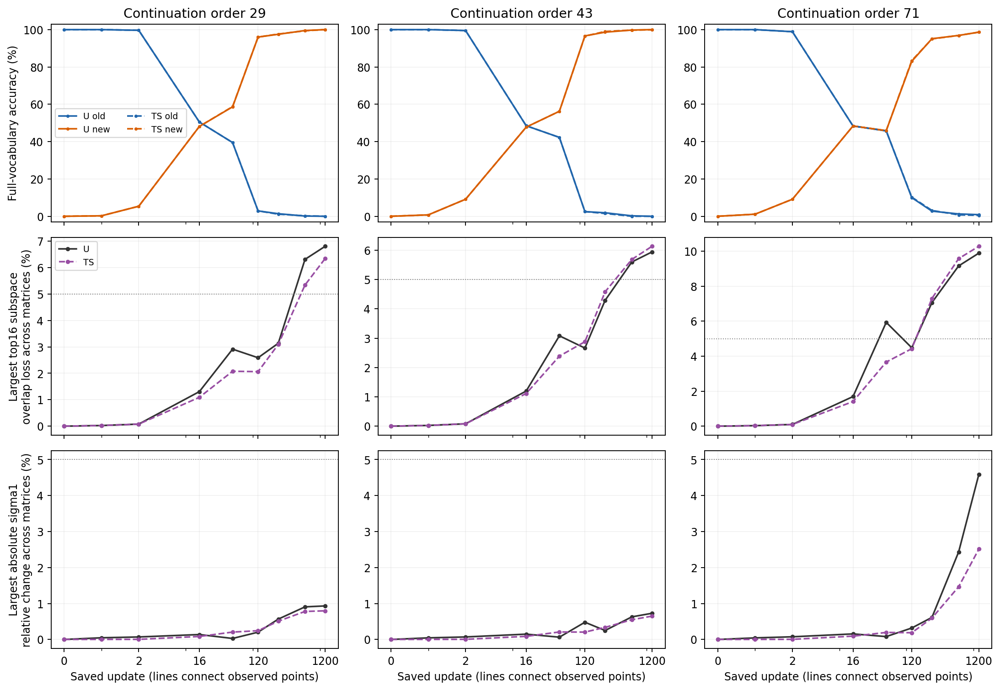
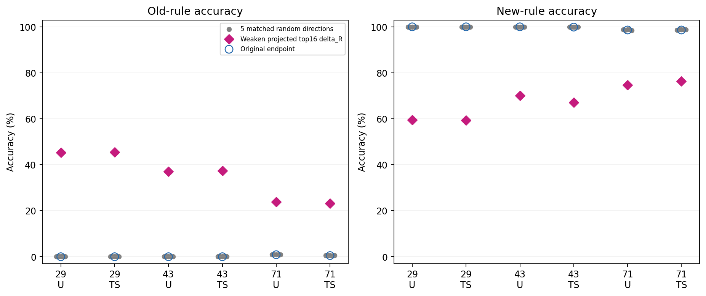

# Frozen A diagnosis: residual updates and whole computation

Read along three paths:

1. **Spectral change:** when amplification and dominant input/output subspaces change relative to behavior.
2. **Functional change:** how delta_C/delta_R affect identical real projection inputs and full-model answers.
3. **Intervention specificity:** whether weakening weight-selected residual components has more effect than equal-rank, equal-actual-norm random controls.

**Residual updates have direction-specific functional effects. Marked whole-weight subspace changes occur after early behavioral turnover. Weakening residual leading components restores some old accuracy while losing new learning, so this does not establish that newly large residual singular directions dominate or erase old computation.** [Protocol](protocol.md) · [Detailed](detailed.md) · [Fixed recognition update](recognition_update.md) · [Manifest](artifact_manifest.json). Facts are verified; interpretation is AI analysis, with researcher acceptance and next design decision Unknown.

## Complement and direction overlap

For each matrix use acquired-old W0 and the original fixed projection P: Ct=P(Wt), Rt=Wt−Ct, delta_C=Ct−C0, delta_R=Rt−R0. R contains preexisting R0; only delta_R is the additional residual update. P extracts16 paired singular rank-one coefficients per matrix.

Delta_R is nearly orthogonal to these16 parameter-matrix atoms, but total TS updates also contain nonzero delta_C. Parameter Frobenius orthogonality does not imply zero output on the16 input vectors or zero projection into their output vectors. In TS29 endpoint Q, the largest selected coefficient of delta_R is1.47e−11 while ‖delta_R V0‖F=0.841.

Singular values are scalar gains; directions are left/right singular vectors. Below, subspace overlap means average squared principal cosine: one for identical subspaces and zero for orthogonal ones, without matching numbered vectors.

| Matrix | R output/input subspace overlap | ΔR output/input subspace overlap | Max absolute delta_R atom inner product |
| --- | --- | --- | --- |
| Q | 0.028% / 0.111% | 1.62% / 2.45% | 0.00943 |
| K | 0.015% / 0.016% | 2.27% / 3.40% | 0.01618 |
| V | 0.006% / 0.009% | 1.45% / 2.79% | 0.00720 |
| O | 0.019% / 0.030% | 3.71% / 3.16% | 0.01984 |

Whole R leading spaces are close to orthogonal to the original selected spaces, whereas added delta_R has small nonzero overlap. Individual residual singular atoms need not be orthogonal; their selected-coordinate contributions can cancel in the complete delta_R. [All216 matrix rows](tables/aligned_spectra_behavior_216.csv) and [inner-product figure](figures/direction_inner_products_TS29.png) retain the full comparisons.

## Turnover precedes marked spectral change

U is unprotected continuation; TS attenuates candidate displacement. The three continuation orders share one acquired-old model. Spectral norm, sigma1, is the strongest input amplification. Each maximum below is taken over per-matrix statistics, not a sum of singular values.

| Order | Old accuracy at16 | Max sigma1 change at16 | Max subspace overlap loss at16 | First saved5% screen | Max overlap loss at1200 |
| --- | --- | --- | --- | --- | --- |
| 29 | 50.500% | 0.083% | 1.092% | 600 | 6.344% |
| 43 | 48.500% | 0.087% | 1.114% | 600 | 6.134% |
| 71 | 48.375% | 0.092% | 1.407% | 240 | 10.280% |

At update16, old accuracy is roughly half while maximum sigma1 changes are0.083%–0.092% and mean subspace-overlap losses1.09%–1.41%. The prespecified descriptive5% screen is first reached at240/600 for TS. Later subspace changes are real,6.13%–10.28%; the claim is temporal precedence, not absence of change. Maximum relative L2 change of the full singular-value spectrum is0.884%. Singular values and directions measure different properties.

Columns are continuation orders; rows show old/new accuracy, maximum overlap loss, and maximum absolute sigma1 change. Lines connect observations only;5% is an operational screen, not a functional theorem. [All54 aligned points](tables/saved_point_screen_54.csv) also retain old/new cross entropy and old selection of the new endpoint. Cross entropy is minus log correct-answer probability in nats/answer.

## Actual-input effects

The same800 old and800 new answers provide16,320 valid token positions per mode. Hold each starting-state projection input fixed and measure the RMS output-vector lengths produced by delta_C and delta_R, normalized by W0 output on those same inputs. At update16, TS delta_R changes are9.53%–22.56%, versus0.00386%–0.04366% for delta_C; endpoint delta_R changes are19.26%–38.87%. These are local linear-output measurements, not accuracy or loss attribution. Q/K, the query/key projections, still feed normalization and nonlinear attention; full-model evaluations execute those operations. [All432 local rows](tables/fixed_inputs_432.csv) and [endpoint actual-O-input checks](tables/endpoint_O_outputs_12.csv) preserve both modes and all cases.

## Frozen dose and matched interventions

Hold endpoint C and retain beta of delta_R while keeping R0. TS29 old/new accuracies are100%/0%,93.125%/26.5%,46.25%/56.625%,1%/99.75%,0%/100% at beta0/.25/.5/.75/1. All six cases show an old/new tradeoff; none of these five states has both mean accuracies≥95%. Beta is dose, not training time. [All30 dose rows](tables/intervention_behavior_66.csv) include CE and endpoint choices.

Select the top16 singular components of endpoint delta_R from weights alone and weaken them by50%. Subtract their P component to preserve C, giving effective rank32. Five random controls use the same construction and match numerical rank and per-matrix actual perturbation norm; all120 matches pass.

| Order | Target old accuracy | Mean random old accuracy | Target new accuracy | Mean random new accuracy |
| --- | --- | --- | --- | --- |
| 29 | 45.500% | 0.000% | 59.375% | 100.000% |
| 43 | 37.375% | 0.025% | 67.125% | 99.875% |
| 71 | 23.250% | 0.575% | 76.375% | 98.725% |

Specificity appears in all three orders and both U/TS, while random controls remain close to the original endpoints. New accuracy declines under the targeted intervention. TS29 target-minus-random old accuracy is+45.5 percentage points, conditional95% interval[44.125,46.750]; new accuracy is−40.625 points, interval[−42.375,−38.750]. Intervals resample paired word groups conditional on one parent/order/five fixed random draws. [All six contrasts](tables/specificity_6.csv).

Read old recovery on the left together with new loss on the right. The intervention locates functional structure in delta_R but does not separately identify whole-W spectral mediation.

## Hypothesis update and design meaning

- **H1: partial support, main-cause account unestablished.** Later subspace rotation and cross-order delta_R specificity are observed. Marked rearrangement follows early turnover, and targeted removal also reverses new learning. A necessary/main whole-W rearrangement account is weakened.
- **H2: supported within this scope.** Early per-matrix net updates of about2.1%–2.7% accompany large functional/behavioral changes while whole-weight spectra remain close. Internal conditional-use mechanisms are not located.
- **H3: retained, coverage-limitation version partially supported.** Sixteen coefficient constraints do not preserve complete input/output function. Whether the candidate itself is poorly chosen or where all old-critical computation lies remains unresolved.

AI recognition update: specify which residual changes alter which conditional answers and which old function must persist, rather than following newly largest singular directions. Context-dependent residual use, restrictions on functionally identified updates, and old input/output preservation are future comparison options. Parameter isolation has not been shown necessary, and none of these designs was run.

One reserved-H100 job, `pt-hfmdpfra`, succeeded with zero training updates,54 reused trajectory evaluations,7 reused intervention evaluations,59 new frozen intervention readouts, and7 required input captures.1904 saved-artifact checks pass. The original1200-update utility conclusion and audit archive bytes remain unchanged; the broader question is not closed.
