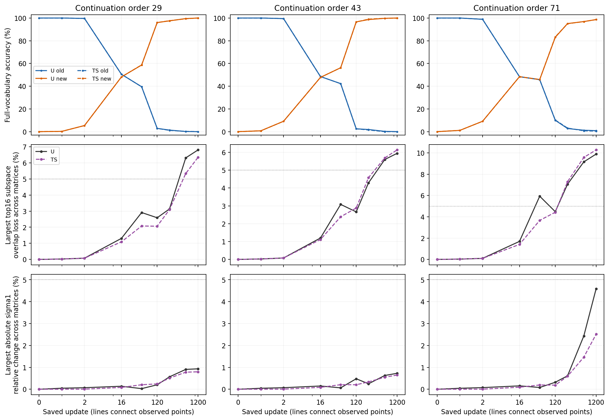
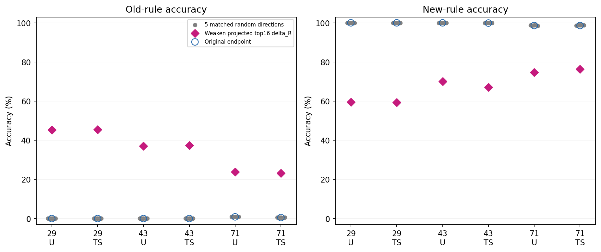

# A阶段冻结诊断：残差更新是否改变整体计算

本轮按三条路径阅读：

1. **谱是否改变**：权重最强放大倍数及主要输入/输出方向何时变化，是否早于行为转向。
2. **功能是否随之改变**：同一输入经过新增C/R更新后，投影输出改变多少；完整模型是否答成另一条规则。
3. **干预是否有特异作用**：削弱权重选出的残差主分量，是否比同秩、同实际参数位移的随机方向更能改变旧/新表现。

**结果：残差更新确实有方向特异的功能影响；明显的整体主子空间变化出现在早期行为转向之后。削弱残差主分量能恢复一部分旧表现，同时明显损失新学习，不能据此认定“残差的新大奇异方向压倒了旧计算”。** [冻结方案](protocol_cn.md) · [完整证据](detailed_cn.md) · [固定的认识更新](recognition_update_cn.md) · [证据索引](artifact_manifest.json)。事实核验完成，机制判断为AI分析；研究者的科学接受与后续设计决定仍Unknown。

## 先回答“补方向”和“方向内积”

对每张矩阵，用旧任务学完的权重W0作起点，原固定投影P取出16个配对奇异秩一系数。Ct=P(Wt)是所选部分，Rt=Wt−Ct是整个剩余权重。ΔCt=Ct−C0、ΔRt=Rt−R0才是新学习造成的变化。Rt本来含有R0，不能全叫新学内容。

**ΔRt确实近似位于这16个秩一矩阵的参数补空间中，但全部参数更新并非只发生在补空间。** TS只压低C更新，C仍可变化。这里的正交是把两个参数矩阵对应元素相乘后求和为零；它不要求残差更新对那16种输入产生零输出，也不要求输出避开那16种方向。

真实例子：TS29终点Q矩阵中，ΔR在固定16个系数上的最大投影只有1.47×10^-11，但它对这16个输入方向产生的输出矩阵长度为0.841。原系数几乎不动，相关输入的完整输出仍然可以变。

“奇异值”是放大倍数，本身没有方向；方向要比较左右奇异向量。下表比较TS29终点各自的前16输入/输出子空间与原16方向，1代表完全重合、0代表正交。表中百分比是16个主夹角余弦平方的平均，不是按编号硬配向量。

| 矩阵 | Rt输出/输入子空间重合 | ΔRt输出/输入子空间重合 | ΔRt单个秩一方向最大内积绝对值 |
| --- | --- | --- | --- |
| Q | 0.028% / 0.111% | 1.62% / 2.45% | 0.00943 |
| K | 0.015% / 0.016% | 2.27% / 3.40% | 0.01618 |
| V | 0.006% / 0.009% | 1.45% / 2.79% | 0.00720 |
| O | 0.019% / 0.030% | 3.71% / 3.16% | 0.01984 |

因此，整体R的主要方向与原方向接近正交；新增ΔR的主要方向有小而明确的重合。二者既不能统称方向一致，也不能统称每个方向都正交。完整ΔR投影接近零，允许它的不同奇异分量在所选系数上相互抵消。[全部24个终点及216条保存点矩阵记录](tables/aligned_spectra_behavior_216.csv)和[方向内积图](figures/direction_inner_products_TS29.png)保留其他顺序、组别及左右/秩一内积。

## 早期行为转向不需要先出现明显谱重排

U是不保护组，TS是原C方向更新衰减组；29、43、71是三个后续训练顺序，共用一个旧任务模型。谱范数即矩阵最强的放大倍数，记作σ1。子空间重合损失指主要16方向与起点的平均重合下降多少。下面每个“最大”都是四矩阵及相应输入/输出统计中的最大值，没有相加不同矩阵的奇异值。

| 顺序 | 16步旧准确率 | 16步最大σ1变化 | 16步最大子空间重合损失 | 首次保存点达到5%谱筛查 | 1200步最大子空间损失 |
| --- | --- | --- | --- | --- | --- |
| 29 | 50.500% | 0.083% | 1.092% | 600 | 6.344% |
| 43 | 48.500% | 0.087% | 1.114% | 600 | 6.134% |
| 71 | 48.375% | 0.092% | 1.407% | 240 | 10.280% |

第16步，旧题准确率已降到约一半，四矩阵的最大σ1变化仅0.083%—0.092%，主要子空间重合损失1.09%—1.41%。方案预先把5%作为“明显变化”的描述筛查；TS到240或600步才首次达到，不能拿它当普适理论门槛。后期确实有6.13%—10.28%的子空间变化，所以结论是**早期转向先于明显变化**，不是全程没有变化。完整奇异值谱的相对整体变化最大0.884%；方向变化和奇异值变化也不是同一件事。

三列为训练顺序，上排旧/新准确率，中排最大子空间重合损失，下排最大σ1相对变化。虚线5%是预设描述筛查，连线不代表测过未保存步骤。[全部54点对齐表](tables/saved_point_screen_54.csv)同时保留旧/新交叉熵及旧题选择新规则端点的比例。交叉熵是正确答案概率的负自然对数，单位nat/答案，越低越好。

## 残差更新改变了真实输入的计算

对相同的旧/新各800题，在起点捕获每个投影实际收到的输入，再固定这些输入，分别计算ΔC与ΔR的线性输出变化。每个模式有16,320个有效token位置；token是分词器处理的一个符号单位，填充位置不计。

TS各顺序第16步的ΔR输出变化，相对原矩阵在同样输入上的输出长度为9.53%—22.56%；ΔC为0.00386%—0.04366%。这里的长度是输出向量长度平方先平均、再开根号。它衡量局部计算变化，**不是准确率变化或损失贡献率**。终点ΔR为19.26%—38.87%，远大于ΔC。Q/K即查询/键投影，其变化还需经过归一化和注意力概率计算；本轮的完整模型评价实际执行这些非线性步骤。[432条局部输出记录](tables/fixed_inputs_432.csv)、[终点实际O输入的复核](tables/endpoint_O_outputs_12.csv)均已保存。

## 削弱哪些更新，结果会变？

保持终点C不动，只把新增残差更新保留比例β从0改到1；旧的R0始终保留。TS29的旧/新准确率依次为：β=0时100%/0%，0.25时93.125%/26.5%，0.5时46.25%/56.625%，0.75时1%/99.75%，1时0%/100%。六个终点均呈明显旧/新权衡，这五档中没有同时旧、新准确率均≥95%的状态。[完整30条剂量结果](tables/intervention_behavior_66.csv)包含准确率、交叉熵、端点选择率；β是冻结干预剂量，不是训练时间。

再按权重本身选出ΔR前16个奇异分量，削弱50%。为保持C，需要减掉这些分量落回C的投影，构造后的实际秩为32；五个随机对照使用同样构造并匹配实际秩和每矩阵位移长度，120项匹配全部通过。选择过程没有读取评价答案。

| 顺序 | 靶向后旧准确率 | 随机后旧准确率均值 | 靶向后新准确率 | 随机后新准确率均值 |
| --- | --- | --- | --- | --- |
| 29 | 45.500% | 0.000% | 59.375% | 100.000% |
| 43 | 37.375% | 0.025% | 67.125% | 99.875% |
| 71 | 23.250% | 0.575% | 76.375% | 98.725% |

旧表现恢复的方向特异性在三个顺序及U/TS均出现，随机方向基本保持原终点。但这伴随新准确率下降，不能称为兼顾新旧的保护方案。以TS29为例，靶向比随机的旧准确率高45.5个百分点，条件95%区间[44.125,46.750]；新准确率低40.625个百分点，区间[−42.375,−38.750]。区间固定同一个旧模型、训练顺序和五个随机方向，仅按成对词组抽样。[六组对比与全部区间](tables/specificity_6.csv)。

左图看旧表现恢复，右图同时看新表现损失。两图必须一起读。这个干预定位的是新增ΔR中的功能结构；它没有把完整Wt的谱变化与功能影响独立分开。

## 假设更新与设计意义

- **H1：部分支持，主因解释未成立。** 后期主子空间确实变化，ΔR主分量有跨顺序的功能特异性；但明显重排晚于早期转向，干预也同时削弱新学习。完整权重谱重排是必要条件或主要中介的版本被削弱。
- **H2：得到本范围的支持。** 早期完整权重谱接近起点时，约2.1%—2.7%的每矩阵参数净变化已伴随明显计算和行为改变。固定输入效应与冻结干预支持功能敏感性，尚未精确定位条件调用内部环节。
- **H3：保留，覆盖不足的版本部分支持。** 原16系数约束未覆盖完整输入输出功能；本轮仍不能判定候选完全选错，或确定旧任务关键计算的全部方向。

AI认识更新是：研究对象应从“追逐新的最大奇异方向”转到“哪些残差变化在什么输入条件下改变答案，以及什么旧功能必须保持”。按上下文选择残差、限制已识别的功能敏感更新、保持旧输入输出，是后续可比较的方案；本轮没有证明必须参数隔离，也未运行这些方案。

本轮单卡H100 reserve作业`pt-hfmdpfra`成功，零训练更新；复用54份轨迹评价和7份干预评价，新增59份冻结干预读出及7次必要输入捕获。1904项保存产物检查通过。原1200步效用结论及旧证据包原字节保持不变，不关闭整个研究问题。
