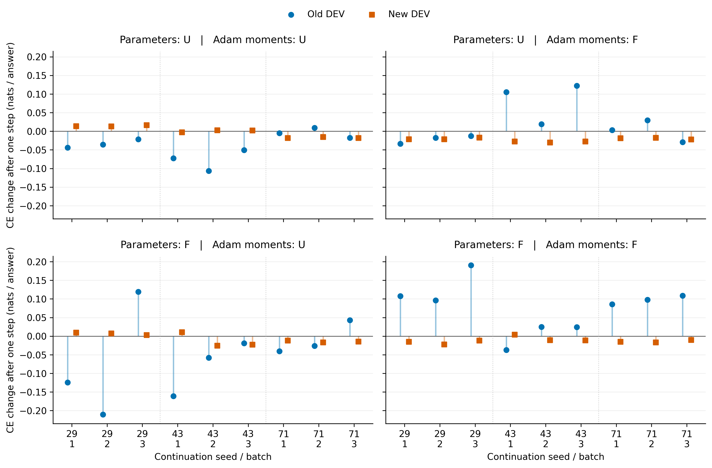

# 四格对照图

**问题：** 同一当前参数下，换一份 Adam 累积状态是否改变普通更新对旧／新任务的影响？

**观察：** 每行固定参数来源，每列固定 Adam 来源；蓝圆为旧 DEV、橙方为新 DEV，纵轴是单步交叉熵变化，负数更有利。横轴上行29／43／71是续训顺序种子，下行1／2／3是固定训练批次；所有面板同尺度，点各自独立，竖线仅连接零线与点，没有训练轨迹连线。

**更新判断：** F 参数这一行中，U Adam 比 F Adam 的旧 CE 变化9/9次更有利；U 参数这一行中，反向更换的旧效应8/9同向、1次反转，且交互大小和符号依种子而变。Adam 累积状态参与，不能忽略参数交互。

**不能推出：** 新损失常出现反向取舍；九个种子×批次不是九个独立模型，三种子共用旧模型，图中没有跨模型置信区间。只读出64旧＋64新固定 DEV，不代表完整800题面板或TEST；交换不是完整历史因果分解，也未评价长期续训。

来源：执行侧 `tables/candidate_DEV_effects_72.csv`，同名文件随交付；图只用原始逐批变化，不平滑、不挑选检查点、不合并旧新得分。数值精度见 `reproduce/independent_analysis_audit.json`。另交SVG与PDF矢量图和320 dpi PNG。
