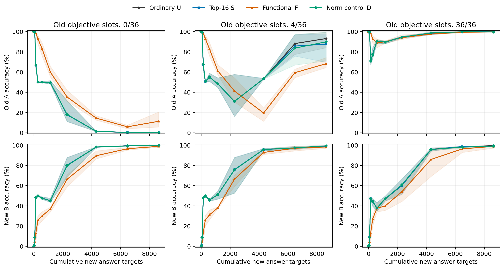

# R06: Fixed-new-exposure functional protection

36/36 step240 runs completed. All conditions share one acquired-old Qwen3-0.6B Base and update the same final Q/K/V/O matrices. Per update:36new answers,36old input slots with k=0/4/36 active, denominator72, plus64labelled old TRAIN probes for ALL methods. F/D use those labels even at k=0. TEST was not opened.

| old_nonzero | method | completed_seeds | old_accuracy_pct | new_accuracy_pct | old_ce | new_ce |
| --- | --- | --- | --- | --- | --- | --- |
| 0 | U | 3 | 0.125 | 99.833 | 9.711 | 0.010 |
| 0 | S | 3 | 0.208 | 99.750 | 9.925 | 0.010 |
| 0 | F | 3 | 11.292 | 98.792 | 5.839 | 0.038 |
| 0 | D | 3 | 0.125 | 99.792 | 9.836 | 0.010 |
| 4 | U | 3 | 93.125 | 99.042 | 0.189 | 0.036 |
| 4 | S | 3 | 87.542 | 98.958 | 0.331 | 0.038 |
| 4 | F | 3 | 68.250 | 98.208 | 0.795 | 0.054 |
| 4 | D | 3 | 89.875 | 99.292 | 0.241 | 0.032 |
| 36 | U | 3 | 99.708 | 99.458 | 0.009 | 0.019 |
| 36 | S | 3 | 99.917 | 99.167 | 0.005 | 0.029 |
| 36 | F | 3 | 99.750 | 98.792 | 0.009 | 0.039 |
| 36 | D | 3 | 99.667 | 99.042 | 0.009 | 0.023 |

U uses actual Adam displacement; S uses R05 paired Top16 coefficient attenuation on the original1200-step schedule; F projects harmful old-probe first-order displacement; D keeps its own candidate direction and matches its own F-candidate norm. Fresh AdamW lr1e-4. Means/ranges describe three continuation orders conditional on one old model.

| old_nonzero | comparison | old_mean_difference_pp | new_mean_difference_pp | operational_rule_pass |
| --- | --- | --- | --- | --- |
| 0 | F-U | 11.167 | -1.042 | True |
| 0 | F-S | 11.083 | -0.958 | True |
| 0 | F-D | 11.167 | -1.000 | True |
| 4 | F-U | -24.875 | -0.833 | False |
| 4 | F-S | -19.292 | -0.750 | False |
| 4 | F-D | -21.625 | -1.083 | False |
| 36 | F-U | 0.042 | -0.667 | False |
| 36 | F-S | -0.167 | -0.375 | False |
| 36 | F-D | 0.083 | -0.250 | False |

Primary endpoints stay240steps/8640new targets. The second consecutive scheduled new accuracy>=90% reading is secondary and missing readings remain explicit. Operational rule: F-U mean old>=5pp, every old difference positive, every new difference>=-5pp. Compare D before direction attribution. Replay changes both old label count and objective weight. No universal model/feature/routing/architecture conclusion. Researcher scientific judgment/closure remain Unknown. See Chinese Summary, Detailed and CSVs for every order, loss, cost, negative result and numerical receipt.

Curves: equal-weight3continuation orders; shading=min-to-max, notCI. Independent y axes for old/new behavior; no smoothing. [Answer CE curves](figures/answer_loss_curves.png). [All order endpoints](tables/endpoints_36.csv), [all readings](tables/curves.csv), [paired contrasts](tables/paired_contrasts_27.csv), [90percent operating points](tables/learning90_operating_points.csv), [frequency relative gains](tables/frequency_relative_gains.csv), [diagnostics](tables/diagnostic_overview.csv), [Detailed](detailed.md).

## AI interpretation within the frozen scope

At k=0, F improves mean old accuracy from0.125% (U/D) to11.292% (S0.208%), with new98.792% versus U99.833%. F has positive old differences in every continuation order and each new difference stays within5pp against U/S/D, meeting the registered operational rule. This is limited retention: old accuracy remains far below the100% start. D does not reproduce the gain, but own-state norm control does not prove that all trajectory slowing alternatives are eliminated. F uses64old TRAIN labels per update.

At k=4, U already reaches93.125%old/99.042%new, whereas F reaches68.250%/98.208%; F-old is lower in every order. At k=36, U reaches99.708%/99.458%, F99.750%/98.792%, without stable added retention. Thus supervision organization explains the large high-replay benefit more directly than a general advantage of this projection rule. F-minus-U old gains+11.167,-24.875,+0.042pp are nonmonotonic in all three orders; the frozen three-level frequency trend is unsupported.

69of90predeclared F finite-step checks show positive realized old-probe CE change despite near-nonpositive first-order prediction. These are selected fixed diagnostic steps, not a fraction of all updates or a statistical significance claim. Probe representativeness, finite-step remainder and optimizer trajectory contributions remain unresolved. At zero old objective, the second consecutive new90percent reading is step180for all U, versus240/180/240for F; this secondary operating point does not replace step240. No new training follows. These are AI bounded interpretations; researcher acceptance and parent-question closure remain Unknown.

**Report handoff timing deviation:** training and core analysis/registration finished within38minutes, but final packaging/archival in the later continuation exceeded the original4h wallclock window. No training or resource expansion occurred after the original terminal. The elapsed gap is not excluded; see[receipt](reproduce/report_budget_deviation.json).
