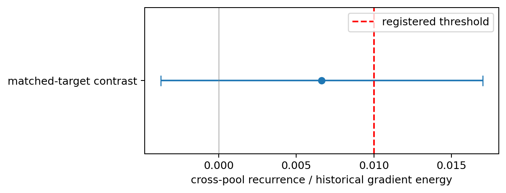
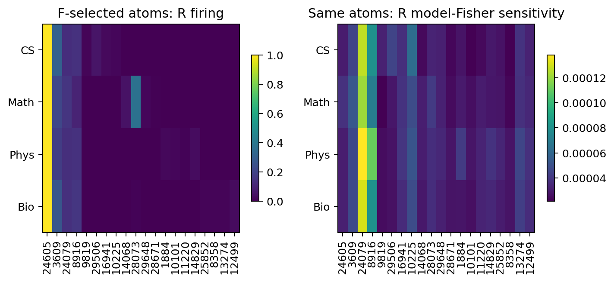

# Summary: natural-language statistics and local update structure

**Strict Smoke and complete Full finished; primary verdict INSUFFICIENT, due to precision rather than support or rejection.** Human scientific judgment: Unknown. Evidence is bounded by historical source exposure and approximate document independence, despite passed duplicate screening.

[Anchor](../../../../problem_anchors/17_shared_and_interference_learning/17_13_ntp_statistics_local_compatibility/17_13_ntp_statistics_local_compatibility_anchor.md); [Protocol](protocol.md); [Detailed evidence ledger](detailed.md); [completion receipt](evidence/completion_receipt.json).

## 1. Purpose

Measure whether fixed-model natural-language local updates have recurring domain structure, while using the existing SAE to expose activation differences and predictive directional sensitivity as distinct quantities.

## 2. Hypothesis

Primary H1: matched-real-target domain gradient-mean contrasts recur above1% of historical gradient energy. The strongest rival is finite-sample/target-composition structure without recurring domain means. The independent functional branch describes domain deviations in model-Fisher profiles and matched controls, without requiring SAE superiority or rescuing H1.

## 3. Analysis Method

- Fixed checkpoint/shared matrix; four actual targets and four domains;192 document-disjoint quartets; a stratified Welch95% interval calibrated in28 synthetic cases before R unsealing.
- Signed gradient-mean relations for natural/common-support/uniform-target mixtures at16 positions/document, plus mean/covariance and c/e/G geometry; signs are exploratory point estimates without qualified cell intervals.
- Freeze F-only SAE atom sets/PCA/random directions before R; pair activation and model-Fisher sensitivity on4096 contexts,8 probes/context, conditional MC errors and equal-rank controls; retain insufficient coverage branches.

## 4. Conclusion

1. **Primary precision is insufficient.** T=0.006637, CI95=[−0.003738,0.017012], SE=0.005170; the interval crosses the0.01 rule. [Primary source](evidence/primary.json).

   

   How to read: the point/interval cross the red1% threshold; neither establishment nor absence of recurring conditional mean structure follows.

2. **SAE participates in actual paired analysis.** Mean same-domain raw F/R sensitivity-profile cosine is0.9973 versus0.9952 for different domains. Equal-domain-centered cosines average0.5012 for same domains and−0.1679 otherwise, with diagonal values0.7206,0.4705,0.6794,0.1341. These are descriptive patterns; composition/source/population uncertainty remains. [Domain relations](evidence/functional_domain_relations.csv); [selected atoms and MC errors](evidence/sae_selected_functional_profiles.csv).

   

   How to read: identical F-selected atoms across R domains; left shows firing, right model predictive sensitivity. Neither quantity certifies causal feature use.

3. **SAE victory is not the criterion.** Rank32 R natural-context Fisher-trace coverage averages4.472% for the common SAE span,3.672% PCA,3.092%–3.154% random controls; domain-enriched SAE spans range2.444%–2.966%. These identical-context/probe quantities have no superiority significance test. [Controls](evidence/functional_span_controls.csv). F mathematics has only6period records, and R physics only7comma/of records; the8-record guard leaves corresponding target-controlled profiles insufficient. [Coverage/noise](evidence/fisher_probe_noise.csv).

### Claim Boundary

Can state: complete frozen measurement, insufficient primary precision, and paired SAE activation/sensitivity. All natural-mixture point estimates are positive, without a population sign verdict. Cannot establish predictive routing, true p−q bias, causal domain mechanism, capacity competition, negative interference, finite shared-W outcomes or long-term shared/separate benefit. Model Fisher is distinct from real-target empirical moments; p=q is not assumed.

### Next Step Analysis

Human next decision: Unknown. AI_PROPOSAL: decide whether to improve primary sampling precision before registering a refinement. The present interval does not justify scientific closure or redirection. Completion requires a researcher-owned uncertainty and revised sample/resource contract; changing the estimand requires registration. Functional diagnostics cannot repair primary insufficiency. No automatic expansion/training.

### Supplement: lexical_readout_01

CPU exploratory cached readout of320F-selected atoms is complete. Lexical association is present, without establishing one-word-one-atom: atom28737's firing has66.23%current` (`precision/82.59%recall; physics-enriched21638has36.00%current` the`precision;21737has31.32%actual-next` to`precision versus1.239%base prevalence. Five separate lexical modes retain counterexamples/coverage flags; no model update or change to primaryT. This subset does not cover all30000atoms or prove causal/unique word meaning. [Full supplementary ledger](detailed.md#supplement-lexical_readout_01--existing-atom-lexical-association-screen);[candidate table](evidence/lexical_readout_candidates.csv);[actual contexts](evidence/lexical_readout_examples.json). Human judgmentUnknown.
