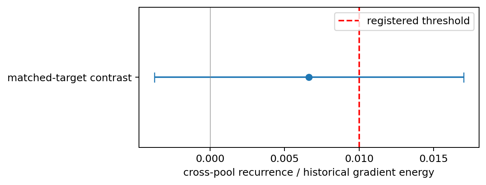
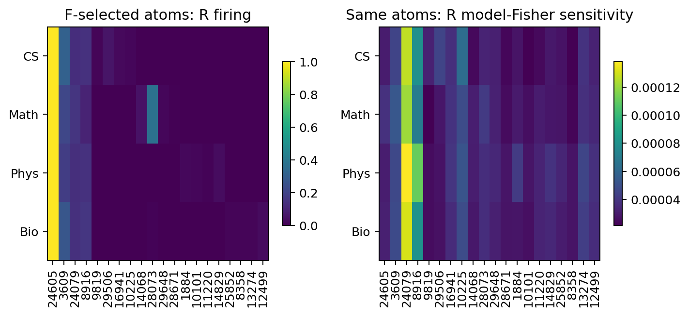

# Summary：自然语言统计与局部更新结构

**Smoke 与 Full 均完成；主检验为 INSUFFICIENT（精度不足），不是支持或否定。**研究者科学判断：Unknown。证据边界：重复记录／近重复筛查通过，但历史语料曝光及近似文档独立性使结果限于本轮描述分析。

[Anchor](../../../../problem_anchors/17_shared_and_interference_learning/17_13_ntp_statistics_local_compatibility/17_13_ntp_statistics_local_compatibility_anchor_cn.md)；[Protocol](protocol_cn.md)；[完整证据账本](detailed_cn.md)；[完成回执](evidence/completion_receipt.json)。

## 1. Purpose

观察固定模型的自然语言局部更新量是否形成可重复的领域结构，并让已有 SAE 分别呈现领域激活差异和模型预测的方向敏感性，为后续候选学习关系选择提供事实。

## 2. Hypothesis

主 H1：真实下一词身份可比时，领域平均梯度差的跨池复现量 (T) 超过历史梯度平方尺度的1%；最强竞争解释是有限样本波动与目标组成产生表面差异。独立功能分析检视 SAE 坐标下模型 Fisher 的领域偏离及对照，不要求 SAE 获胜，也不以功能结果替代 H1。

## 3. Analysis Method

- 固定检查点／共享矩阵，以四个实际目标、四领域组成192个不共享文档的四元组；用预先通过28类合成校准的分层 Welch 95%区间裁决 (T)。
- 在每片段16个测量位置计算自然、共同支持、等目标混合均值的有符号内积；另测均值／协方差、c/e/G方向结构。群体符号是探索点估计，没有合格的逐格符号区间。
- 先在F冻结SAE共同／富集集合与PCA／随机方向，再采集R；对4096个上下文、每个8个Fisher探针并列实际激活、方向敏感性、Monte Carlo误差和同秩对照；不足覆盖的单元单独标记。

## 4. Conclusion

1. **当前样本不足以裁决主假设。** (T=0.006637)，95%区间 ([-0.003738,,0.017012])，跨过0.01门槛；标准误0.005170。[主值与规则](evidence/primary.json)。

   

   读图：点为复现量，横线为区间，红线为1%门槛；区间跨线，因此不能说领域更新均值结构已经成立，也不能说不存在。

2. **SAE 已进入实际分析：出现差异与方向敏感性并列呈现。**自然上下文的同领域F/R原始敏感性profile cosine均值0.9973，但不同领域也达0.9952；去掉共同领域均值后，同领域cosine均值0.5012、不同领域−0.1679，四个同领域值为0.7206、0.4705、0.6794、0.1341。这是有差异的描述性图景，尚未排除目标组成、来源和抽样不确定性。[领域关系](evidence/functional_domain_relations.csv)；[选定atom与MC误差](evidence/sae_selected_functional_profiles.csv)。

   

   读图：两图列为同一批F选定的atom、行为R的四领域；左看出现频率，右看预测分布对该decoder方向的敏感性。高出现不保证高敏感，方向敏感也不证明该feature在此上下文被因果使用。

3. **结果不是“SAE必须赢”。**R自然上下文、输出子空间rank32下，共同SAE span的平均Fisher trace占比4.472%，PCA3.672%，三个随机对照3.092%–3.154%；领域富集SAE span为2.444%–2.966%。它们是同上下文／探针的描述量，没有优越性显著检验。[同秩对照](evidence/functional_span_controls.csv)。F数学的句号仅6篇，R物理的逗号／of各7篇，低于8篇门槛，因此对应匹配目标功能分析不足；不能据此声称领域敏感性已排除目标组成。[覆盖与探针噪声](evidence/fisher_probe_noise.csv)。

### Claim Boundary

可陈述：本轮模型冻结测量完整；主判据不足；SAE激活与模型敏感性确已联合测量；自然混合矩阵本轮点估计均为正，但没有资格宣布符号的总体结论。

不可陈述：已建立更新前预测、真实条件分布误差、领域因果性、容量竞争、负干扰、有限共享参数损失效应或长期共享／分开训练收益。模型Fisher不等于真实目标的经验二阶矩；本轮不假设模型概率等于真实分布。

### Next Step Analysis

研究者下一决定：Unknown。**AI建议：先决定是否提高主检验的采样精度，再登记一次微调**；当前区间不能支持停止或转向的科学结论。完成条件是研究者确定要消除的不确定性及新的样本／预算契约；若改变估计对象，则重新登记，不能把次级功能图当作主检验的补救。本轮不自动扩样或继续训练。

### Supplement：lexical_readout_01

320个F预选原子的CPU缓存词面探索读出已完成。发现词面关联，但一词一原子尚未成立：28737激活时当前` (`命中率66.23%、覆盖率82.59%；物理富集21638对当前` the`命中率36.00%；21737对下一词` to`命中率31.32%，基础出现率1.239%。五种独立词面模式同时保留反例和覆盖不足；模型／主T不改。不是全部30000原子的审计，也不证明唯一词义或因果语义。[Detailed补充账本](detailed_cn.md)；[候选表](evidence/lexical_readout_candidates.csv)；[实际上下文](evidence/lexical_readout_examples.json)。研究者判断Unknown。
