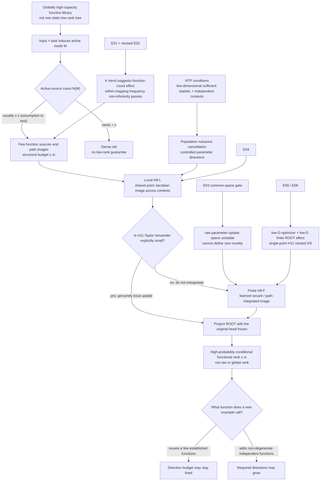

# From a Conditional Probabilistic Tree to NTP Conditional Functional Rank

## A complete theory of function reuse, independent rules, rare-item memory, and the Transformer representation bridge

## Abstract

The second question in the final summary of the 0721 group meeting was:
if task-relevant semantics has hierarchical structure, does next-token
prediction (NTP) make the parameter or representation space low-rank?
The strict answer is not an unconditional yes. It is the following conditional
statement:

> A language model may retain a globally high-capacity library of latent
> functions while an input and task induce one active computation mode. If a
> typical computation calls only a few task-relevant sources, each source has
> bounded task dimension, independent contexts cancel task-irrelevant NTP
> signal, and the resulting parameter updates reach the ROOT state through a
> context-shared path image, then the number of directions required at the
> registered ROOT task-summary state immediately before the answer token to
> preserve the original frozen-head task is bounded with high probability.

This theorem supports globally high capacity with conditionally low functional
rank. It does not support the claims that semantics is one fixed tree or that
NTP automatically produces global low rank.

The researcher's first proposed update is admissible as a model to test:
semantic computation is not one static tree, but an input-and-task-conditioned
probabilistic active tree. The phrase “usually sparse and rarely dense” must be
an explicit tail assumption on the number of active sources, not an established
fact about natural language. The second proposal requires a major correction:
generalizable information is not necessarily low-rank, and rare information
does not require high-rank memory in general. The strict control variables are
the number of independent task functions and whether their ROOT path images
are reused across contexts. A rare example may invoke an established rule and
generalize in low functional rank; a common workload may require many
independent functional directions.

The A14_02 experiments establish five distinctions. Repeating one
context is not the same as receiving independent evidence. Invariance to a new
context for a seen relation is not recombination of unseen component pairs.
Among capability-passing lookup controls, increasing the number of independent
mappings from 1 to 4 to 16 was accompanied by mean ROOT functional ranks of
10.2, 11.0, and 12.8. However, the shared condition did not pass the
recombination gate, and its rank advantage over lookup did not reach the
registered threshold. The current evidence therefore does not identify a
causal rank benefit from function reuse separately from the number-of-rules
effect.

The H9 audit adds two decisive distinctions. E04 supported a shared local
trained-point Jacobian image in 5/5 seeds. E05 and E06 then showed that the
actual optimizer displacement and exact finite ROOT effect were both
effectively eight-dimensional, while a single endpoint or reference Jacobian
captured little of that effect. The finite-displacement linearization
assumption H11 was refuted in 5/5 seeds, whereas the exact learned secant
passed all low-dimensional cross-context and frozen-head controls.

The sole next theoretical decision is therefore to use the exact learned
secant/path-integrated image for finite training, retaining the point-Jacobian
bridge only for updates with an explicitly small Taylor remainder. Neither
finite image is yet derived from NTP in general, and Router design remains
downstream.

---

## 1. Three different questions called “Question 2”

The 0721 notes contain three related but distinct questions:

1. **Downstream question:** if conditionally low-dimensional hierarchical
   computation exists, what does it imply for MoE, routing, or retrieval?
2. **Rare/common question:** how are rarity, memory, high rank, common patterns,
   and generalization related?
3. **Primary question here:** does hierarchical data under NTP cause a
   low-rank parameter or representation space?

This story answers the third question, uses the second to audit its meaning,
and keeps the first as a downstream boundary.

---

## 2. Definitions

### 2.1 Latent function library and conditional active tree

We do not assume that natural language itself is a tree. The weaker and
testable model is:

- the full model contains a high-capacity latent function graph or library;
- given input \(X\) and task condition \(T\), it induces a mode
  \(M\sim p(M\mid X,T)\);
- the finite dependency paths used by one computation can be unfolded into an
  active tree;
- that tree records what this computation called, not the ontology of all
  semantics.

A **function source** is a local innovation that adds task information. An
internal state that already contains all descendant information is not counted
again as a new source.

### 2.2 “Usually sparse, rarely dense”

Let \(N(M)\) be the number of function sources used by an active mode. The exact
assumption is

\[
\Pr[N(M)\le s]\ge 1-\delta_M.
\]

Thus, when a computation is sampled from the input-task distribution or a
stochastic routing process, at least \(1-\delta_M\) of the mass calls at most
\(s\) sources. The remaining tail, of mass at most \(\delta_M\), may be denser.

This is not a statement that an individual sentence is simultaneously sparse
and dense, and it is not yet an empirical result. For deterministic routing,
the probability comes from the input-task distribution; for stochastic
routing, it also includes routing randomness.

### 2.3 Frequency, reuse, and independent function count

Four quantities must remain separate:

- **instance repetition:** how many times the identical token sequence occurs;
- **independent context count:** how many genuinely distinct context draws
  contain the same relation;
- **function reuse:** how many examples call the same task map or function
  atoms;
- **independent function count:** how many linearly independent functional
  codes must be distinguished to preserve the output task.

Frequency is a count in the dataset. Reuse and independent function count are
properties of the function class. High frequency is neither sufficient nor
necessary for low functional rank.

### 2.4 Conditional fixed-readout functional rank

A **ROOT state** is the hidden state at the registered position after the model
has read the task input and immediately before it predicts the answer token.
A **nuisance** is variation that changes the input or internal state but should
not change the correct next token once task-sufficient information is given.
A **ROOT path image** is the set of ROOT-space directions that one function
source can produce after passing through the model's computation path.

Fix a trained model, its original output head \(W_o\), and an active mode \(m\).
For a ROOT state \(h_\rho\in\mathbb R^d\), define

\[
k_{\mathrm{func}}^{\mathrm{fix}}(\epsilon;m)
=
\min_P
\left\{
\operatorname{rank}(P):
\mathbb E\!\left[
\bigl(
\ell(W_oPh_\rho,Y)-\ell(W_oh_\rho,Y)
\bigr)_+
\mid M=m
\right]\le\epsilon
\right\},
\]

where \(P=P^\top=P^2\) is an orthogonal projection that cannot depend on the
test label and \(\ell\) is NTP cross-entropy. It asks:

> Without retraining the output head, how many ROOT directions must be kept to
> approximately preserve the model's original next-token function?

The quantity depends on the model, task distribution, ROOT location, frozen
head, and tolerance. It is not the intrinsic dimension of semantics and is not
the rank of a full Transformer parameter matrix.

---

## 3. Audit of the two proposed intuitions

### 3.1 “Semantics is a conditionally activated probabilistic tree”

The strongest admissible version is:

> For a given input and task, the finite dependency computation that is
> actually used may be approximated by an active tree. Its mode changes with
> the input and task, while the complete system may remain a high-capacity
> graph.

The following remain assumptions to test:

- active-source count has a sparse tail;
- the ROOT path image of one function is stable across contexts;
- the active subtree preserves the information required by the task.

This cannot be strengthened to “natural language itself is a tree” or “all
sentences share one low-dimensional tree space.”

### 3.2 “Generalizable information is low-rank; rare information is high-rank memory”

That statement collapses three different relations:

\[
\text{frequency}
\quad\overset{?}{\Longrightarrow}\quad
\text{generalization}
\quad\overset{?}{\Longrightarrow}\quad
\text{rank}.
\]

The strict theory retains only:

> If many examples reuse a small set of task functions and those functions
> have context-shared ROOT path images, increasing the number of examples need
> not increase the number of task directions. If new tasks add non-degenerate,
> linearly independent output codes, the fixed-readout direction requirement
> can grow with the number of independent functions.

Consequently:

- a rare instance may use an existing rule and need no new direction;
- a rare and functionally novel item may require a new direction or memory;
- a rank lower bound additionally needs non-degenerate independent output
  codes, a fixed readout, and the absence of an alternative compression path;
- a high-capacity network may memorize upstream and then compress the answer
  into a few prototypes, leaving the ROOT low-rank.

“Rare information can only be memorized in high rank” is therefore not a
current theorem and is false without additional conditions.

---

## 4. Why tree structure, NTP, and frequency are each insufficient

### 4.1 A tree specifies topology, not algebraic rank

Even if every leaf belongs to the same one-dimensional space, different role
operators may map it to \(e_1,e_2,\ldots\), producing a full-rank ROOT matrix
across examples. Compression and direction reuse, not the word “tree,” control
dimension.

### 4.2 NTP allows arbitrary high-rank nuisance

Given a task-sufficient state \(h_{\mathrm{task}}(x)\), append an arbitrary
high-rank vector \(n(x)\):

\[
h'(x)=
\begin{bmatrix}
h_{\mathrm{task}}(x)\\
n(x)
\end{bmatrix},
\qquad
W_o'=
\begin{bmatrix}
W_o&0
\end{bmatrix}.
\]

The logits and loss are unchanged. NTP risk alone therefore cannot control raw
hidden rank.

### 4.3 Lookup memory can be low-rank at ROOT

Arbitrarily many independent lookup entries with only \(L\) output classes can
be memorized upstream and mapped to
\(h_\rho(x)=e_{y(x)}\in\mathbb R^L\). ROOT rank is at most \(L\). Memory does not
imply high ROOT rank.

### 4.4 Low-dimensional parameter updates need not imply low-dimensional ROOT

Let the only parameter be a scalar \(\alpha\) and define
\(h_\rho(x_i;\alpha)=\alpha e_i\). Parameter-update dimension is one, while the
cross-example ROOT update matrix can be full-rank. The missing object is how
the context-dependent Jacobian maps parameter directions into ROOT space.

---

## 5. Theorem 1: structural dimension for a fixed active mode

Let \(T=(V,E)\) be a finite rooted active tree with root \(\rho\). Every active
function source \(u\) contributes

\[
\xi_u\in S_u\subseteq\mathbb R^d,
\qquad
\dim S_u=r_u\le r.
\]

Every active edge has a shared linear role operator \(W_e\). Node states obey

\[
h_v
=
\xi_v+\sum_{e=(w\to v)}m_eW_eh_w,
\qquad m_e\in\{0,1\}.
\]

For a fixed mode \(m\), let \(A(m)\) be the sources whose full paths to the root
are active, and let \(B_u(m)\) be the ordered operator product along source
\(u\)'s path.

### Theorem 1: path expansion and reachable space

\[
h_\rho^{(m)}
=
\sum_{u\in A(m)}B_u(m)\xi_u.
\]

Define

\[
\mathcal R_\rho(m)
=
\sum_{u\in A(m)}B_u(m)S_u,
\qquad
q(m)=\dim\mathcal R_\rho(m).
\]

For the cross-example ROOT matrix \(H_\rho^{(m)}\) under mode \(m\),

\[
\operatorname{rank}H_\rho^{(m)}
\le q(m)
\le\sum_{u\in A(m)}r_u
\le rN(m).
\]

### Proof

Recursively expand each node from leaves to root. Every active source
contributes exactly one term \(B_u(m)\xi_u\) along its unique active path; a
source on a closed path contributes zero. Each term belongs to
\(B_u(m)S_u\), so the ROOT lies in the sum of these path-image spaces. A linear
map cannot increase subspace dimension, and the dimension of a sum of
subspaces is no greater than the sum of their dimensions. The bound follows.

### Probabilistic corollary

If

\[
\Pr[N(M)\le s]\ge1-\delta_M,
\]

then

\[
\Pr[q(M)\le sr]\ge1-\delta_M.
\]

The spaces \(\mathcal R_\rho(m)\) for different modes may be mutually
orthogonal, so their global concatenation can still have rank \(d\). The theorem
is conditional low dimension, not global low rank.

---

## 6. Theorem 2: when reuse can fix the direction budget

Let a group of examples \(G\) call the function-atom set \(\mathcal J_G\). Assume
that each function atom \(j\) has a task-relevant ROOT path-image space
\(\mathcal S_j\) shared across examples, with

\[
\dim\mathcal S_j\le r_j.
\]

### Theorem 2A: reuse upper bound

If every ROOT component visible to the frozen readout lies in

\[
\mathcal S_G=\sum_{j\in\mathcal J_G}\mathcal S_j,
\]

so that its orthogonal projection \(P_G\) satisfies

\[
W_o(I-P_G)h_\rho=0,
\]

then

\[
k_{\mathrm{func}}^{\mathrm{fix}}(0;G)
\le
\dim\mathcal S_G
\le
\sum_{j\in\mathcal J_G}r_j.
\]

### Proof

Let \(P_G\) be the orthogonal projection onto \(\mathcal S_G\). By assumption the
projection leaves every output-visible ROOT component unchanged, so the logits
are unchanged. The first inequality follows from the definition of functional
rank; the second follows from the dimension bound for a sum of subspaces.

The bound depends on the union of called function atoms, not on the number of
examples. One hundred thousand examples that reuse two one-dimensional
functions can retain a budget of two directions, whereas ten examples that
require ten independent functions may require a larger budget.

A shared rule name is not enough. If the Transformer Jacobian rotates that
function into a different ROOT space in every context, no shared
\(\mathcal S_j\) exists and this reuse bound is unavailable.

### Theorem 2B: conditional lower bound for independent functions

Take ROOT states

\[
H=[h_1,\ldots,h_n],
\]

a frozen output head \(W_o\), and a full-row-rank contrast matrix \(C\) that
removes softmax's common-logit shift. Let the required contrast-logit code be

\[
Z^\star=CW_oH,
\qquad
q_\star=\operatorname{rank}(Z^\star).
\]

For every rank-\(k\) projection \(P\) with \(k<q_\star\),

\[
\|CW_oPH-Z^\star\|_{\mathrm{op}}
\ge
\sigma_{k+1}(Z^\star).
\]

### Proof

\(CW_oPH\) has rank at most \(\operatorname{rank}(P)\le k\). By the
Eckart--Young theorem, every rank-\(k\) matrix has operator-norm distance at
least \(\sigma_{k+1}(Z^\star)\) from \(Z^\star\).

This is a **contrast-logit fidelity lower bound**. Converting it into a
cross-entropy functional-rank lower bound additionally requires non-degenerate
softmax probabilities along the line between the original and projected
logits, or an equivalent local strong-convexity condition. Accuracy or a large
margin alone is insufficient.

This lower bound defines independence through the linear independence of
output task codes. A rule count \(K\) is not itself \(q_\star\). Few answer
prototypes, an output bottleneck, redundant rules, or nonlinear upstream
compression may yield \(q_\star\ll K\). Three lookup points cannot establish
one new direction per rule.

---

## 7. Theorem 3: when NTP favors task directions

### 7.1 Controlled ROOT--softmax model

Fix a mode \(m\). Let

- \(\phi(A,Z,m)\in\mathbb R^{p_m}\) be a sufficient task statistic for the next
  token;
- \(\psi(C)\in\mathbb R^q\) be context variation that should not change the
  target;
- the ROOT state be
  \[
  h_\rho=\Theta\phi+N\psi;
  \]
- the logits be \(o=W_oh_\rho\).

Assume

\[
Y\perp C\mid\phi,M,
\qquad
\mathbb E[\psi\mid\phi,M]=0.
\]

### Theorem 3A: population nuisance-gradient cancellation

At \(N=0\),

\[
\mathbb E[\nabla_N\ell\mid\phi,M]=0.
\]

### Proof

Softmax cross-entropy gives

\[
\nabla_N\ell
=
W_o^\top(p(o)-e_Y)\psi^\top.
\]

At \(N=0\), the logits depend only on \(\phi\). Conditional on \((\phi,Y,M)\), the
left factor is fixed, while task conditional independence and centering imply

\[
\mathbb E[\psi\mid\phi,Y,M]
=
\mathbb E[\psi\mid\phi,M]=0.
\]

The conditional expected gradient is therefore zero.

This is a population result at a controlled initialization. It does not prove
that a complete finite-sample Transformer training endpoint is low-rank.

### 7.2 Why independent contexts matter

If \(b\) independent contexts appear with weights \(w_j\), define the effective
independent sample size

\[
n_{\mathrm{eff}}
=
\frac{1}{\sum_{j=1}^bw_j^2}.
\]

Under conditional sub-Gaussian or comparable concentration assumptions, the
empirical nuisance gradient has typical scale

\[
O(n_{\mathrm{eff}}^{-1/2}).
\]

Repeating one realized context arbitrarily often gives
\(n_{\mathrm{eff}}=1\), so its nuisance term does not average away. This is the
theoretical interpretation of E01's result that duplicate exposure is not
context diversity.

### 7.3 Controlled parameter and ROOT rank

The single-example task-matrix gradient is an outer product:

\[
\nabla_\Theta\ell=v\phi^\top,
\qquad
v=W_o^\top(p-e_Y).
\]

If all output contrast directions stay in a fixed \(b\)-dimensional space,
\(\phi\) spans an \(a_m\)-dimensional space, the task block starts at zero, and a
subspace-preserving SGD/momentum optimizer is used, then

\[
\operatorname{rank}(\Delta\Theta)
\le\min(a_m,b)
\le p_m
\le rN(m).
\]

For a linear ROOT factorization,

\[
H_\rho^{(m)}=\Theta\Phi_m,
\]

so the ROOT rank is also at most \(rN(m)\).

This closed chain does not automatically cover a full parameter matrix, a
nonzero initial task block, Adam's coordinate-wise preconditioner, or a
general Transformer.

---

## 8. The representation bridge: local Jacobian versus finite secant

Let task updates lie in parameter subspace \(G_m\), and let

\[
J_\rho(x;\theta)=\frac{\partial h_\rho(x;\theta)}{\partial\theta}
\]

be the ROOT Jacobian.

### 8.1 Local bridge H9-L

At one registered parameter point \(\theta_\star\), a local shared image means

\[
J_\rho(x;\theta_\star)G_m
=
B_m^{\mathrm{loc}}A_x+E_x^{\mathrm{loc}},
\qquad
\dim\operatorname{Col}(B_m^{\mathrm{loc}})\le rN(m),
\]

with small \(E_x^{\mathrm{loc}}\). A measurable weak version asks whether

\[
C_m^{\mathrm{loc}}
=
\mathbb E[
J_\rho(x;\theta_\star)G_mG_m^\top
J_\rho(x;\theta_\star)^\top
\mid M=m
]
\]

has little spectral tail beyond its leading \(rN(m)\) directions.

This is a statement about cross-context sharing at one point. It does not say
that the local image remains fixed as the parameters move.

### 8.2 Finite-training bridge H9-F

For a registered reference model and trained endpoint, define the exact
learned secant

\[
\Delta h_{\mathrm{sec}}(x)
=
h_\rho(x;\theta_T)-h_\rho(x;\theta_{\mathrm{ref}}).
\]

A finite shared image means

\[
\Delta h_{\mathrm{sec}}(x)
=
B_m^{\mathrm{sec}}a_x+e_x^{\mathrm{sec}},
\qquad
\dim\operatorname{Col}(B_m^{\mathrm{sec}})\le rN(m).
\]

Along a differentiable path

\[
\theta(t)=\theta_{\mathrm{ref}}+t(\theta_T-\theta_{\mathrm{ref}}),
\]

the identity

\[
\Delta h_{\mathrm{sec}}(x)
=
\int_0^1
J_\rho(x;\theta(t))
(\theta_T-\theta_{\mathrm{ref}})
\,dt
\]

is exact. A common image for the integrand at every \(t\) is sufficient for
H9-F, but not necessary: instantaneous images may rotate and their integrated
effect may still concentrate.

### 8.3 The scale boundary

H9-L plus a measured small Taylor remainder H11 yields a local finite-update
bridge. H9-F yields a finite-training bridge directly and needs no one-point
linearization. Neither condition follows from NTP alone. The H9 audit shows
that conflating them changes the empirical verdict.

---

## 9. Main theorem: high-probability conditional ROOT functional rank

For mode \(m\), assume a task ROOT space \(\mathcal S_m\) satisfies

\[
\dim\mathcal S_m\le rN(m)
\]

and the frozen-head logit residual outside the space obeys

\[
\mathbb E[
\|W_o(I-P_m)h_\rho\|_2
\mid M=m
]
\le
\eta_{\mathrm{tot}}(m).
\]

The common error contains the initial ROOT residual, finite-context nuisance,
background-position gradients, and optimization leakage. The bridge error has
two valid alternatives:

\[
\eta_{\mathrm{bridge}}^{\mathrm{loc}}
=
\eta_{\mathrm{Jacobian}}^{\mathrm{loc}}
+\eta_{\mathrm{linearization}},
\]

or

\[
\eta_{\mathrm{bridge}}^{\mathrm{sec}}
=
\eta_{\mathrm{secant}}.
\]

Thus \(\eta_{\mathrm{tot}}\) uses H9-L plus H11 for a local update, or H9-F
for a finite training displacement. The latter does not include a Taylor
remainder because the secant is exact.

### Theorem 4: fixed-mode functional rank

\[
k_{\mathrm{func}}^{\mathrm{fix}}
(\sqrt2\,\eta_{\mathrm{tot}}(m);m)
\le rN(m).
\]

### Proof

The softmax cross-entropy gradient with respect to logits is \(p-e_Y\) and has
Euclidean norm at most \(\sqrt2\). Hence

\[
|\ell(o+\Delta,Y)-\ell(o,Y)|
\le\sqrt2\|\Delta\|_2.
\]

Set

\[
\Delta=-W_o(I-P_m)h_\rho
\]

and take the conditional expectation under mode \(m\). The positive excess loss
after projection is at most \(\sqrt2\,\eta_{\mathrm{tot}}(m)\), while the
projection has rank at most \(rN(m)\). The functional-rank definition gives the
claim.

### High-probability corollary

If

\[
\Pr[N(M)\le s]\ge1-\delta_M
\]

and the joint training, optimization, and selected-bridge good event has
probability at least \(1-\delta_g\), then no independence is needed:

\[
\Pr\!\left[
k_{\mathrm{func}}^{\mathrm{fix}}
(\sqrt2\,\eta_{\mathrm{tot}}(M);M)
\le sr
\right]
\ge
1-\delta_M-\delta_g.
\]

This is the strict theorem retained for a probabilistic active tree under NTP.

---

## 10. The correct relation among rare, common, memory, and generalization

| Data regime | Safe implication for direction demand | Reason |
|---|---|---|
| One rare instance repeated | No monotone rank implication | Repetition adds no independent context and does not identify function reuse |
| A rare instance calls an established rule | Low-functional-rank generalization is possible | The union of function atoms does not grow |
| A common rule is reused across independent contexts | The direction budget can remain fixed under the bridge conditions | Context diversity cancels nuisance and the path image is reused |
| A non-degenerate independent task function is added | Fixed-readout direction demand can rise | Contrast-logit code rank gives a lower bound |
| Independent lookup has few answer prototypes | ROOT may remain low-rank | An output bottleneck can compress upstream memory |
| One rule's Jacobian rotates across contexts | ROOT directions may still grow | Semantic reuse is not representation path-image reuse |

The refined judgment is:

> “Learned” means that a task-sufficient shared function can be called on
> held-out conditions; “memorized” means that seen entries can be answered.
> These behaviors interact with direction count, but neither has an
> unconditional one-to-one correspondence with rank. Functional novelty is
> closer to direction demand than raw frequency, and conditional functional
> rank is closer to task use than raw effective rank.

---

## 11. What A14_02 adjudicates

### 11.1 Direct results

[E01](../../experiments/A14/14_02_relation_reuse_root_effective_rank/A14_02_E01_shared_rule_vs_lookup_root_rank/summary.md)
found:

- low-exposure shared and lookup conditions memorized training entries but
  both had 0/5 new-context capability passes;
- repeating the same context remained at 0/5 for shared, while the passing
  diverse-context shared seeds reached about 0.991 new-context accuracy;
- capability-passing lookup controls at \(K=1/4/16\) had mean ROOT functional
  ranks of 10.2/11.0/12.8;
- the paired shared advantage over lookup \(K=16\) averaged 2.5 directions,
  below the registered 4-direction threshold.

[historical E02-v1](../../experiments/A14/14_02_relation_reuse_root_effective_rank/archive/e02_v1_component_recombination_capability/summary.md)
found:

- shared and lookup both passed seen-pair, new-context capability in 5/5
  seeds;
- shared unseen-component-pair recombination passed in 0/5 seeds, with mean
  accuracy 0.2125 against the 0.80 gate;
- lookup unseen-pair accuracy was about 0.0640, near chance;
- that historical experiment did not measure ROOT functional rank.

[revised E02](../../experiments/A14/14_02_relation_reuse_root_effective_rank/A14_02_E02_frequency_mapping_rank_separation/summary.md)
changed only target exact frequency under the same common mapping and generator:

- LowF/HighF frozen-head ROOT functional ranks averaged \(7.6/7.4\);
- paired mean difference was \(0.2\), with one-sided 95% upper bound \(0.5<2\),
  and all 10 pairs passed the registered non-inferiority gate;
- strict zero-exposure unseen-cell capability, rank replay, ROOT shuffle, and
  matched-rank random-subspace guards were all valid.

[E03](../../experiments/A14/14_02_relation_reuse_root_effective_rank/A14_02_E03_rare_common_subspace_reuse/summary.md)
stopped before full treatment as registered: leave-target-out common AdamW-step
held-out capture averaged \(0.5717\), ranged \(0.4780\)--\(0.6314\), and passed the
\(0.80\) gate in 0/10 seeds. Raw parameter-update space therefore could not
stably define an `outside-common` rare direction.

[E04](../../experiments/A14/14_02_relation_reuse_root_effective_rank/A14_02_E04_shared_jacobian_path_image/summary.md)
found:

- the trained calibration task-gradient subspace passed local H9 in 5/5 seeds;
- mean held-out tail beyond eight directions was 0.0393 and cross-context
  capture was 0.9607;
- a random eight-dimensional parameter subspace had mean tail 0.2206;
- projecting the complete final ROOT into the local image increased CE by
  0.6367 nat, confirming that local H9 is not complete-ROOT sufficiency.

[E05](../../experiments/A14/14_02_relation_reuse_root_effective_rank/A14_02_E05_trajectory_jacobian_closure/summary.md)
and
[E06](../../experiments/A14/14_02_relation_reuse_root_effective_rank/A14_02_E06_reference_jacobian_vs_secant/summary.md)
then found:

- the actual block displacement was 0.9975 captured by eight trajectory
  directions and preserved the trained function;
- the exact finite block ROOT effect had mean tail 0.0132;
- the endpoint image captured only 0.3672 of that exact effect;
- the reference-point linearization had relative error 1.2595 and H11 was
  refuted in 5/5 seeds;
- the exact learned secant had mean tail 0.0171, cross-context capture 0.9829,
  and passed frozen-head replay in all five seeds.
- a post-registered full-block-displacement guard retained 5/5 H11 refutation
  with mean relative error 1.2441 and excluded the small out-of-subspace
  displacement as the rival; it reused the same checkpoints and is not
  independent confirmation.

### 11.2 Belief updates

1. **Exposure count is not independent evidence count.** Independent diverse
   contexts, not raw repetition, support nuisance cancellation.
2. **Invariance is not compositionality.** Performing a seen map in a new
   context does not establish recombination of seen components.
3. **Function count may affect direction count.** The three lookup points are
   consistent with more independent functions requiring more directions, but
   they do not establish a universal law.
4. **Frequency does not directly determine functional direction count.** When
   other surfaces already learn the mapping, reducing target exact frequency
   from \(8\) to \(1\) did not cause a greater-than-two-direction rank increase.
5. **Context sharing is not training-time stability.** A local Jacobian image
   can be shared across contexts while rotating along a finite parameter path.
6. **The finite effect, not one point Jacobian, is the correct full-training
   object.** In the registered model both the optimizer displacement and
   learned secant are low-dimensional and functionally sufficient.

### 11.3 Effect that remains unidentified

The experiments now separate exact-frequency effects within one mapping from
functional direction demand, but they do not yet fully identify the causal
size of reuse relative to a number-of-rules effect:

- the lookup curve varies independent mapping count and confirms that rule
  count is a live explanation;
- the historical shared condition did not pass its unseen-pair recombination
  gate, so that generator is not known to have learned a compositional algorithm;
- the shared--lookup rank difference was below the registered threshold;
- revised E02 identifies frequency non-inferiority but does not independently
  manipulate mapping-union size;
- E03's raw AdamW common-space gate failed, so parameter-update geometry is not
  an identified mechanism.

The strongest current statement is therefore:

> When many examples truly reuse a few task functions and those functions
> share ROOT path images, theory allows the direction requirement to depend on
> function count rather than example count. When non-degenerate independent
> functions are added, the required directions can grow. A14_02 validates
> Revised E02 shows that rare exact frequency need not increase the functional
> direction budget when common mapping and capability are held; E01's \(K\)
> trend still only suggests that independent function count may raise it. The
> two do not yet form one causal estimate of how much reuse itself reduces rank.

The separate bridge statement is now stronger and decisive:

> In the registered one-layer Transformer, a shared local task Jacobian image,
> an effectively eight-dimensional optimizer displacement, and a
> cross-context low-dimensional finite ROOT effect coexist. A single endpoint
> or reference Jacobian does not identify the finite effect. The finite theory
> must therefore use a secant/path-integrated image unless a small Taylor
> remainder is measured.

---

## 12. Group-meeting flow

Every arrow from structural budget to conditional functional rank has a
separate condition. If any link is absent, the intuition cannot be stated as a
general Transformer theorem.

---

## 13. Proof, assumption, and evidence layers

| Status | Current content |
|---|---|
| Proved | Fixed-mode path expansion; \(q(m)\le rN(m)\); frozen-head CE functional-rank bound; nuisance cancellation in the controlled linear model; non-degenerate contrast-code lower bound |
| Proved in a controlled model | Task-parameter rank under subspace-preserving SGD; linear ROOT parameter-to-state closure; independent-context concentration |
| Assumption to test | Sparse active-source tail in natural tasks; local H9-L outside the registered model; finite H9-F as an NTP dynamical consequence; task sufficiency of the active subtree |
| Direct experiment | Duplicate exposure does not replace diverse contexts; lookup \(K\) curve rises; within-mapping frequency non-inferiority passes 10/10; raw common AdamW-space gate passes 0/10; local H9-L passes 5/5; H11 finite linearization fails 5/5; exact secant passes 5/5 |
| Current interpretation | Function reuse may cap direction demand; functional novelty may increase it; finite training must be represented by the secant/path integral rather than an unchecked point Jacobian |
| Forbidden promotion | Frequency necessarily means low rank; rare necessarily means high rank; shared necessarily means low rank; lookup necessarily means high rank; NTP automatically learns composition |

---

## 14. Router implication and boundary

The theory supplies only a candidate intermediate object:

\[
\text{input-task condition}
\longrightarrow
\text{few task functions}
\longrightarrow
\text{conditionally low-dimensional computation}.
\]

It does not prove that different conditions require different experts. One
shared network may implement all conditions through the same bottleneck.
Deriving a Router still requires evidence that:

- different conditions have stable functional differences across splits;
- a matched expert has counterfactual held-out utility over a mismatched
  expert;
- the expert difference is not an artifact of load, answer class, or surface
  geometry;
- sparse selection beats a shared-compute cost--utility baseline.

Router design is therefore the third question, not a corollary of conditional
functional rank.

---

## 15. Claim boundary

### Supported

- A probabilistic active tree is a self-consistent model that permits global
  high capacity and conditionally low-dimensional computation.
- For a fixed mode, ROOT reachable dimension is controlled by the sum of the
  active function-source path-image spaces.
- Independent diverse contexts, not raw repetition, support NTP nuisance
  averaging.
- In a controlled linear ROOT model with a subspace-preserving optimizer,
  task-parameter increments and ROOT states have conditional rank bounds.
- Given local H9-L plus a bounded Taylor remainder, or finite H9-F directly,
  frozen-head conditional functional rank is at most \(sr\) with high
  probability.
- In the registered one-layer model, local trained-task H9-L passed 5/5,
  the actual optimizer displacement and learned finite ROOT effect were
  effectively eight-dimensional, and the exact secant passed 5/5
  cross-context and functional controls.
- Increasing independent function count yields a direction lower bound only
  under non-degenerate output task coding.

### Not supported

- Natural language is a probabilistic tree.
- A sparse active-source tail has been measured for most natural sentences.
- All generalizable information lies in one low-rank space.
- Rare information can only be memorized in high rank.
- Frequency, sharing, or NTP alone causes low rank.
- The current shared generator has learned a compositional algorithm.
- A14_02 has identified rank reduction caused by reuse.
- A single point Jacobian represents the complete training displacement.
- NTP generally guarantees a shared finite secant image.
- Conditional functional rank implies expert specialization or Router utility.

---

## 16. Sole next decision

> Adopt the learned finite secant/path-integrated image as the canonical
> finite-training bridge. Retain point H9-L plus H11 only for explicitly local
> updates, and next ask under which concrete softmax-attention and NTP
> dynamical conditions H9-F follows rather than treating it as an empirical
> assumption.

This decision preserves the probabilistic active-tree and conditional
functional-rank theorem while removing the false full-training
single-Jacobian extrapolation.

---

## 17. Sources

- [Original 0721 meeting question](<../../../../../daily_research_reports/backup/2026/07/0723/meeting_recordings/0721 组会_笔记.md>)
- [Full technical proof](../../../../../daily_research_reports/backup/2026/07/0724/NTP_conditional_low_rank_theory_package/01_理论论文_共享组合结构与条件低有效秩.md)
- [Proof appendix](../../../../../daily_research_reports/backup/2026/07/0724/NTP_conditional_low_rank_theory_package/02_证明附录.md)
- [A14 parent anchor](../../problem_anchors/14_tree_low_rank_language_structure/14_00_tree_low_rank_language_structure/14_00_tree_low_rank_language_structure_anchor.md)
- [A14_02 functional-rank anchor](../../problem_anchors/14_tree_low_rank_language_structure/14_02_relation_reuse_root_effective_rank/14_02_relation_reuse_root_effective_rank_anchor.md)
- [A14_02_01 frequency--mapping anchor](../../problem_anchors/14_tree_low_rank_language_structure/14_02_relation_reuse_root_effective_rank/subanchors/14_02_01_frequency_mapping_rank_separation_anchor.md)
- [A14_02_E01 result](../../experiments/A14/14_02_relation_reuse_root_effective_rank/A14_02_E01_shared_rule_vs_lookup_root_rank/summary.md)
- [A14_02_E02 result](../../experiments/A14/14_02_relation_reuse_root_effective_rank/A14_02_E02_frequency_mapping_rank_separation/summary.md)
- [A14_02_E03 result](../../experiments/A14/14_02_relation_reuse_root_effective_rank/A14_02_E03_rare_common_subspace_reuse/summary.md)
- [A14_02_E04 result](../../experiments/A14/14_02_relation_reuse_root_effective_rank/A14_02_E04_shared_jacobian_path_image/summary.md)
- [A14_02_E05 result](../../experiments/A14/14_02_relation_reuse_root_effective_rank/A14_02_E05_trajectory_jacobian_closure/summary.md)
- [A14_02_E06 result](../../experiments/A14/14_02_relation_reuse_root_effective_rank/A14_02_E06_reference_jacobian_vs_secant/summary.md)
