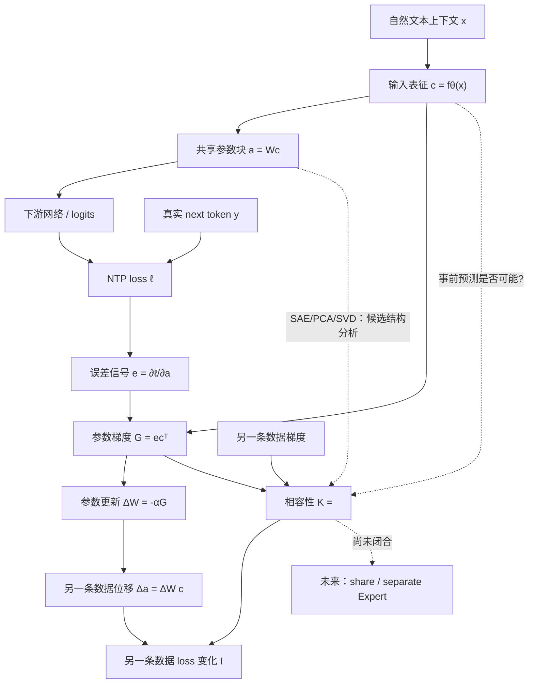
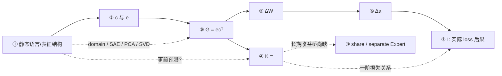

# 共享参数学习中的跨数据作用：从表征、梯度到自然文本更新结构

> 本文作为长篇展开与备查保留。当前三分钟组会使用[唯一短稿](../../../../../daily_research_reports/backup/2026/09/0930/meeting_report/0930_组会汇报稿.md)，实验结论以各自 Summary 为准。

> **核心问题：**不同类型的数据共享同一组参数学习时，为什么一次更新有时会帮助另一类数据、有时产生不利作用；进一步地，什么信息可能支持未来的 Expert 共享/分开判断？

---

## 0. 先给结论

本研究的长期目标不是“把语义不同的数据分开”，而是找到**学习意义上的共享依据**：哪些数据通过同一组参数学习时会互相促进，哪些更新需求可能不相容。

早期自然文本实验已经说明：领域表征可以明显不同，但一次局部更新仍可能平均帮助其他领域。因此：

\[
\boxed{\text{表征可分}\neq\text{学习不相容}}
\]

这迫使我们补上原先缺失的机制链。对一个共享线性参数块 \(W\)，设输入表征为 \(c\)，输出为 \(a=Wc\)，损失对输出的导数为 \(e=\partial\ell/\partial a\)。单位置梯度为

\[
G=ec^\top.
\]

两条数据 \(i,j\) 的局部更新相容性定义为

\[
\boxed{K_{ij}=\langle G_i,G_j\rangle_F=(c_i^\top c_j)(e_i^\top e_j)}.
\]

若只沿数据 \(i\) 的负梯度小步更新，则数据 \(j\) 的实际损失变化满足

\[
I_{i\to j}=\ell_j(W+\Delta W_i)-\ell_j(W)=-\alpha_iK_{ij}+R_{i\to j},
\]

其中 \(R\) 是有限步非线性余项。

所以当前完整主线是：

\[
\boxed{
\text{自然文本}
\to \text{输入表征 }c
\to \text{共享块输出 }a
\to \text{loss}
\to \text{误差信号 }e
\to \text{梯度 }G
\to \text{共享参数更新 }\Delta W
\to \text{另一条数据表征位移 }\Delta a
\to \text{另一条数据的 loss 变化 }I
}
\]

当前已经完成的是**局部机制链**；尚未完成的是“自然语言的什么稳定性质会形成可复现的 \(K\) 结构”，以及“这种局部关系是否足以支持长期 Expert 分配”。

---

# 1. 主要目的

## 1.1 长期问题

> **哪些数据适合共享同一个 Expert，哪些数据可能值得分开学习？**

这里不能直接用任何一个静态代理量作结论，例如：

- 人工领域标签；
- hidden-state 距离；
- PCA 可分性；
- SAE atom 重合；
- 单次负梯度内积。

这些分别描述语义、几何、稀疏结构和局部优化关系，不是同一对象。

## 1.2 当前阶段问题

当前阶段只回答更基础的问题：

> **一条数据的一次有效学习，怎样通过共享参数影响另一条数据？这种作用在自然文本中是否具有稳定、可观察的结构？**

只有这一步明确以后，才有资格讨论什么 Router 应该读取、是否需要低秩/SAE 表示，以及分开 Expert 是否长期有益。

---

# 2. 物理 / 机制先验假设

这里的“物理先验”指对系统计算结构的最小机制判断。

## Prior 1：跨数据作用首先来自共享参数

若两条数据的 loss 都通过同一个可训练参数矩阵 \(W\) 反向传播，那么一条数据的更新会改变另一条数据下一次看到的同一个 \(W\)。

“共享 SAE atom”与“共享参数”不是同义关系。

## Prior 2：表征耦合不单独决定帮助或伤害

\[
K_{ij}=(c_i^\top c_j)(e_i^\top e_j).
\]

- \(c_i^\top c_j\)：输入侧耦合；
- \(e_i^\top e_j\)：当前损失要求是否相容。

因此“表征相似”只能说明更新可能更容易相互传递，不能单独决定符号。

## Prior 3：真实 NTP 与任意 toy task 不同

Toy 可以固定输入、任意翻转监督规则，所以它证明的是：**静态表征不可能对任意任务唯一决定更新符号。**

真实语言模型训练则固定为 NTP：

\[
(X,Y)\sim P_{\rm NTP},\qquad Y=\text{真实下一 token}.
\]

固定模型状态 \(\theta\) 后：

\[
C=f_\theta(X),\qquad E=e_\theta(X,Y).
\]

因此 \(C,Y,E\) 由同一个自然数据分布和模型状态联合诱导。于是可以提出经验问题：

\[
\boxed{P(K_{ij}\mid c_i,c_j)\text{ 是否有稳定结构？}}
\]

但这不是数学恒等式保证的，必须实证。

## Prior 4：静态结构、更新路径、损失作用必须分开

\[
\boxed{\text{静态可读性}\not\Rightarrow\text{真实更新路径}\not\Rightarrow\text{损失作用}}
\]

因此 SAE、PCA、SVD、probe 都只是分析工具，不能直接替代功能性学习关系。

---

# 3. 数学模型

## 3.1 共享参数块

固定模型状态，只分析一个共享线性参数块：

\[
a=Wc.
\]

本研究主要使用 S7 最后一块 attention output matrix：

\[
W\in\mathbb R^{1024\times2048}.
\]

其中：

- \(c\in\mathbb R^{2048}\)：矩阵输入表征；
- \(a\in\mathbb R^{1024}\)：矩阵输出表征；
- 上游和其余下游参数在局部诊断中冻结。

这里的 S7 是训练时在第 7 号块设置 SAE 旁支的模型，主干约 **2.81 亿参数**，历史重构系数 \(\lambda_{\rm rec}=0.1\)。后文的 **33B 指累计训练 330 亿词元，不是 330 亿参数**；自然 NTP 分析仅测下一词损失，不加入 SAE 重构损失。

## 3.2 自然 NTP 事件

一条数据事件记作

\[
z_i=(x_{i,<t},y_i),
\]

其中 \(y_i\) 是真实 next token。

上游计算：

\[
c_i=f_\theta(x_{i,<t}),\qquad a_i=Wc_i.
\]

真实 NTP loss：

\[
\ell_i=-\log p_\theta(y_i\mid x_{i,<t}).
\]

## 3.3 误差信号

\[
\boxed{e_i=\frac{\partial\ell_i}{\partial a_i}}
\]

它描述输出表征各方向的微小变化会怎样改变当前真实目标 loss。降损方向是 \(-e_i\)。

\(e_i\) 同时依赖当前上下文、模型预测、真实目标和下游 Jacobian，因此不是与 \(c\) 独立的“外部标签信号”。

## 3.4 参数梯度

单个受 loss 影响的位置上：

\[
\boxed{G_i=e_ic_i^\top}
\]

这是链式法则下的精确关系。

若多个位置共同贡献，则先按真实损失权重聚合：

\[
G_i=\sum_t\omega_t e_{it}c_{it}^\top.
\]

不能用“平均 \(c\) × 平均 \(e\)”替代。

## 3.5 局部更新相容性

\[
\boxed{K_{ij}=\langle G_i,G_j\rangle_F}
\]

单位置时：

\[
\boxed{K_{ij}=(c_i^\top c_j)(e_i^\top e_j)}.
\]

解释：

- \(K_{ij}>0\)：普通标量 SGD 的一阶关系偏向互相帮助；
- \(K_{ij}<0\)：一阶关系偏向互相不利；
- \(K_{ij}\approx0\)：一阶项弱，有限步/曲率不可忽略。

\(K_{ij}=K_{ji}\)，但实际有限步后果通常不要求对称。

## 3.6 参数更新与目标表征位移

源数据 \(i\) 产生：

\[
\Delta W_i=-\alpha_iG_i,
\]

其中 \(\alpha_i>0\) 是实际更新尺度。

对另一条数据 \(j\)，固定输入 \(c_j\)：

\[
\boxed{\Delta a_j=\Delta W_ic_j}
\]

这是线性块上的精确关系。

单位置情况下：

\[
\Delta a_j=-\alpha_ie_i(c_i^\top c_j).
\]

## 3.7 从表征位移到损失变化

定义真实有限步后果：

\[
I_{i\to j}=\ell_j(W+\Delta W_i)-\ell_j(W).
\]

一阶局部项：

\[
I_{i\to j}^{(1)}=e_j^\top\Delta a_j=-\alpha_iK_{ij}.
\]

完整有限步：

\[
\boxed{I_{i\to j}=-\alpha_iK_{ij}+R_{i\to j}}
\]

其中 \(R\) 包含有限步曲率与非线性。

所以：

- \(I<0\)：目标实际变好；
- \(I>0\)：目标实际变差。

**局部不利项与净伤害必须分开。**

---

# 4. 流程图与模型分析

## 4.1 全链条流程图

## 4.2 数学关系与实验证据

| 环节 | 输入 | 变换 | 输出 | 性质 | 实验证据 |
|---|---|---|---|---|---|
| 文本 → \(c\) | 文本、固定模型 | Transformer forward | \(c\) | 模型计算 | 已采集 |
| \(c\) → \(a\) | \(c,W\) | \(a=Wc\) | \(a\) | **精确** | 数值核对通过 |
| \(a,y\) → loss | 下游状态、真实目标 | full-vocab CE | \(\ell\) | 模型计算 | 已使用真实 NTP |
| loss → \(e\) | \(\ell,a\) | autograd | \(e\) | **精确导数** | 已核对 |
| \(c,e\) → \(G\) | \(c,e\) | 外积 | \(G\) | 单位置**精确** | identity 核对通过 |
| \(G_i,G_j\) → \(K\) | 两梯度 | Frobenius 内积 | \(K\) | **精确定义** | 已计算 |
| \(G_i\) → \(\Delta W_i\) | 源梯度 | 注册更新规则 | \(\Delta W\) | 更新定义 | 受控实验已实施 |
| \(\Delta W,c_j\) → \(\Delta a_j\) | 参数变化、目标输入 | 矩阵乘法 | \(\Delta a\) | **精确** | 已核对 |
| \(e_j,\Delta a_j\) → 一阶 loss | 两向量 | 内积 | \(I^{(1)}\) | **局部近似** | 已分解 |
| 完整更新 → \(I\) | 更新后 forward | 重算真实 loss | \(I\) | **有限步实测** | 受控任务已测；0930 自然 NTP 确认有限步未运行 |
| \((c_i,c_j)\) → \(K\) | 更新前表征 | 统计读出器 | \(\hat K\) | **经验假设** | 0930 当前读出器未达到预定预测改善 |
| language/domain → \(G/K\) | 语言分组 | 条件统计 | 更新结构 | **经验问题** | 部分描述完成 |
| \(K/I\) → Router | 局部学习关系 | 尚未定义 | Expert 分配 | **设计跨度** | 未闭合 |

## 4.3 不能混淆的空间

| 对象 | 空间 | 作用 |
|---|---|---|
| \(c\) | 矩阵输入空间 | 决定共享矩阵看到什么 |
| \(a\) | 矩阵输出空间 | 参数变换后的内部状态 |
| SAE code \(z\) | 稀疏 latent | 对 \(a\) 的稀疏描述 |
| \(G\) | 参数空间 | 当前数据要求参数怎样改变 |

所以不能写成：

\[
\text{SAE common}=\text{输入重合}=\text{梯度重合}=\text{干扰空间}.
\]

---

# 5. 实验叙述：每个实验服务于哪一段链条

## Experiment A｜自然文本结构与一步更新

**逻辑问题：**领域/表征差异是否足以推出跨领域互害？

**实验：**自然数学、物理、计算机、生物文本；测静态结构，对某领域做一次真实梯度更新，再在其他领域测 NTP loss。

这一轮使用累计训练 **210 亿词元**的检查点和末块 **MLP 下投影矩阵**；后续 B–E 使用 330 亿词元状态的注意力输出矩阵。两者提供前后衔接的证据，但不是同一参数块上的连续测量。

**结果：**两个步长下 12 个跨组方向平均都仍为帮助；完整步长帮助量约 \(0.000532\)–\(0.002006\) nat/预测 token；六个领域对梯度 cosine 为 \(0.1229\)–\(0.3353\)，均为正。

**表 1｜跨领域平均更新后果。**帮助量是“更新前 loss − 更新后 loss”，正值表示帮助。

| 更新幅度 | 跨领域方向数 | 平均帮助量范围（nat/预测 token） | 逐方向描述性 95% 区间 |
| --- | --- | --- | --- |
| 完整步长 | 12 | 0.000532–0.002006 | 12/12 下界 > 0 |
| 半步长 | 12 | 0.000276–0.001043 | 12/12 下界 > 0 |

每个方向在 128 条留出目标记录上读出；区间条件于固定源更新，未校正多重比较，也不排除个别记录受害。表中是跨领域方向，不包含自身更新。来源：[0926 结果摘要](../../experiments/A17/17_12_domain_update_geometry/historical_support/structure_update/20260926/summary_cn.md)、[逐方向数值](/data/250010109/MoE_Router/experiments/20260926_structure_update_bridge/update_summary.csv)。

**链条作用：**否定“静态领域差异 → 平均跨组互害”的直接跳跃。

\[
\boxed{\text{领域可分}\not\Rightarrow\text{平均学习冲突}}
\]

---

## Experiment B｜受控方向 × 任务规则

**逻辑问题：**输入耦合与预测要求共同变化时，是否会调节跨数据作用？

**实验：**真实 S7 下游网络内构造两类可共同完成的二元任务；输入任务方向重合 0.1/0.8；B 规则保持/翻转；只用 A 正常更新。

更新沿 A 的负梯度方向，并固定相对参数变化幅度：\(\Delta W_A=-\varepsilon\|W_0\|_F G_A/\|G_A\|_F\)，取 \(\varepsilon=10^{-4}\) 和 \(5\times10^{-5}\)。因此不同条件不一定共用同一个有效学习率。这里的交互量为 \(M=(I_{\text{高,翻转}}-I_{\text{高,保持}})-(I_{\text{低,翻转}}-I_{\text{低,保持}})\)；输入重合条件改变的是 A/B 的联合方向构造。

**结果：**规则差异随输入重合增强：

\[
M=1.5206\times10^{-4},
\]

95% 区间 \([1.3617,1.6722]\times10^{-4}\)。但高重合+翻转下 B 实际仍：

\[
I\approx-0.0066649,
\]

即净帮助。

**图 1｜调节作用与净后果。**左图两个幅度的 \(M\) 及其 95% 区间都高于零；右图的实际 \(I\) 及区间都低于零，说明 B 仍然获益。区间来自 12 个配对方向族的 2,000 次层级 bootstrap；两种幅度是同一批构造的检查，不是独立实验重复。左右纵轴分别以 \(10^{-4}\) 和 \(10^{-3}\) nat/目标为单位。

来源：[0927 结果摘要](../../experiments/A17/17_10_shared_update_conditional_interference/20260927_controlled/summary_cn.md)、[图中数值与来源](../../../../../daily_research_reports/backup/2026/09/0930/figures/meeting_shared_update_mechanism/origins.json)。

**链条作用：**说明机制因素确实能调节作用，但“规则冲突”不等于“净伤害”。

---

## Experiment C｜局部不利分量定位

**逻辑问题：**净帮助下面是否仍存在任务相关局部不利作用？静态 SAE/PCA 空间是否就是它发生的位置？

**结果：**高重合+翻转条件：

\[
C_{sig}=+8.3126\times10^{-5},
\]

其余作用加余项约：

\[
-0.0067480,
\]

最终：

\[
I=-0.0066649.
\]

因此确实存在局部不利分量，但被更大的帮助抵消。

**表 2｜高重合、B 翻转、\(\varepsilon=10^{-4}\) 条件下的损失分解。**

| 分量 | 数值（nat/目标） | 含义 |
| --- | --- | --- |
| 任务信号相关项 \(C_{sig}\) | +0.000083126；95% 区间 [0.000082860, 0.000083411] | 局部增损 |
| 其余作用加有限步余项 | −0.0067480 | 更大的减损 |
| 实际总损失变化 \(I\) | −0.0066649；95% 区间 [−0.0066800, −0.0066492] | 净帮助 |

正负项相加得到总后果（表值经过舍入）。前两行是对同一批已保存更新、利用目标损失导数作的事后局部归因，不是分别实施两次干预；区间条件于已查看的 12 个方向族。来源：[0928 结果摘要与分解依据](../../experiments/A17/17_10_shared_update_conditional_interference/20260928_signal_localization/summary_cn.md)。

静态/动态错位：

- PCA-8 捕获静态方差约 **96.8%**；
- 实际任务相关更新位移仅约 **1.09%** 落入该空间；
- SAE 共同空间捕获该位移约 **3.22%**。

**表 3｜同一受控条件下，静态结构与真实更新位移的区别。**

| 空间与测量对象 | 捕获比例 | 回答的问题 |
| --- | --- | --- |
| PCA-8：B 的静态中心化方差 | 96.8% | 样本原先主要怎样变化？ |
| 同一 PCA-8：任务相关更新位移能量 | 1.09% | 学习造成的任务相关位移是否沿这些方向？ |
| 入选共同 atoms 的完整 SAE 空间：任务相关更新位移能量 | 3.22% | 同一位移有多少落入该 SAE 空间？ |

前两行使用同一 PCA 空间，但测量对象及分母不同，正是要检查的静态／动态落差。SAE 行不是与 PCA-8 的同秩胜负比较，也不是下文 E 的自然文本 rank64 空间。来源：[0928 结果摘要](../../experiments/A17/17_10_shared_update_conditional_interference/20260928_signal_localization/summary_cn.md)、[详细记录](../../experiments/A17/17_10_shared_update_conditional_interference/20260928_signal_localization/detailed.md)。

**链条作用：**

\[
\boxed{\text{static readability}\neq\text{dynamic update path}}
\]

以及

\[
\boxed{\text{local adverse component}\neq\text{net harm}}.
\]

---

## Experiment D｜自然 NTP 表征能否前瞻预测 \(K\)

**逻辑问题：**在真实 NTP 联合分布下，更新前完整表征能否在新文档上预测真实梯度相容性？

**实验：**固定 S7 的 33B 训练词元 checkpoint 与末块 attention output matrix；每个事件为“256-token prefix → 第257个真实 token”；预测时读出器只能看 \(c_i,c_j\)，不能看目标、\(e\)、\(G\)、\(K\)。预注册要求相对训练均值常数预测至少改善 5% MSE。

**结果：**完整表征：

\[
Q=-0.000138,
\quad 95\%\ CI=[-0.002768,0.002294].
\]

简单几何：

\[
Q=-0.001285,
\quad 95\%\ CI=[-0.003768,0.001165].
\]

完整表征与真实 \(K\) 的 Spearman 约 \(-0.0043\)。确认集 1024 对中 \(K>0\) 为 508 对，\(K<0\) 为 516 对。

**图 2｜完整表征读出没有达到预定的留出改善。**左图每点是一对确认文档，预测大多集中在训练均值附近；横纵轴尺度不同。右图的 \(Q=1-\mathrm{MSE}_{\text{读出器}}/\mathrm{MSE}_{\text{训练均值常数}}\)，零表示与常数相当，0.05 是预定的 5% 改善门槛。两种读出的 95% 区间均靠近零且完全低于 0.05。确认集常数 MSE 为 **0.638792**，完整表征为 **0.638881**，简单几何为 **0.639613**。

区间对 1,024 个不共享文档端点的数据对重抽样 2,000 次，条件于已固定的读出器；没有重训预测器。来源：[自然 NTP 预测结果](../../experiments/A17/17_11_natural_ntp_representation_compatibility/20260930/summary_cn.md)、[图源和原始数据](../../../../../daily_research_reports/backup/2026/09/0930/figures/SOURCES.md)。

**链条作用：**当前注册的 representation-only 读出没有建立“更新前表征 → 可泛化 \(K\)”这条经验桥。

**边界：**不能说“表征无信息”；确认有限步 loss 因 DEV 数值桥未过而未运行；PCA/SAE 等 14 个结构预测分支因未达到预设启动条件而未运行，因此不是负结果。

---

## Experiment E｜自然领域激活与更新结构

**逻辑问题：**如果 pairwise 表征读出没有泛化，那么自然语言分组和更新需求本身是否有可重复结构？

**实验：**固定同一 S7 的 33B 训练词元状态，在四个自然学术领域采集 \(c,a,e,G\)；比较整体均值与领域均值梯度；分析梯度 SVD；统计 30,000 SAE atoms；在 fit 选共同/富集集合，在 readout 检查激活复现和梯度覆盖。

使用 1,024 条历史学术文本记录，fit/readout 各 512 条，每个 split 每领域 128 条。fit 用于选轴、选 atoms 和估计均值，readout 用于留出读数；该面板曾被分析，且缺少论文 ID，因此这里是记录层面的描述性复现，不能称为全新独立确认。

### 结果 E1：领域平均激活模式可复现

同领域跨 split 的 30,000 维 SAE 频率 profile cosine：**0.972–0.991**；跨领域：**0.611–0.894**。

**表 4｜领域平均 SAE 发放频率的跨 split 相似度。**行来自 fit，列来自 readout；粗体为同领域。

| fit / readout | 计算机 | 数学 | 物理 | 生物 |
| --- | --- | --- | --- | --- |
| 计算机 | **0.990** | 0.611 | 0.684 | 0.851 |
| 数学 | 0.635 | **0.989** | 0.694 | 0.637 |
| 物理 | 0.695 | 0.685 | **0.991** | 0.744 |
| 生物 | 0.894 | 0.691 | 0.781 | **0.972** |

每个格子比较两个 30,000 维领域平均频率向量。同领域的重复相似度高于全部跨领域格子；这不是单条文本的分类准确率。来源：[完整频率表](../../experiments/A17/17_12_domain_update_geometry/20260930/evidence/activation_pattern_distances.csv)。

这说明静态领域激活统计真实存在，但不是学习作用证据。

### 结果 E2：当前领域均值梯度描述器没有留出收益

\[
Q_D=-0.005715,
\]

即相对整体均值 MSE 增加约 **0.5715%**。16目标平均也未改善。

**表 5｜领域均值与整体均值在相同留出记录上的比较。**\(Q_D=1-\mathrm{MSE}_{\text{领域}}/\mathrm{MSE}_{\text{整体}}\)，正值才表示改善。

| 更新对象 | 整体均值 MSE | 领域均值 MSE | \(Q_D\) |
| --- | --- | --- | --- |
| 单目标梯度 | 107.370350 | 107.984019 | -0.005715 |
| 16 目标梯度平均 | 6.427336 | 6.459862 | -0.005060 |

两行都没有留出收益；梯度聚合方式不同，不能直接用两行 MSE 的绝对大小比较模型优劣。此表只列可核对的点值：既有高维均值 bootstrap 尚未校准，不能把其区间当作可靠的总体显著性证据。来源：[原始主比较](../../experiments/A17/17_12_domain_update_geometry/20260930/evidence/primary.json)、[估计误差说明](../../experiments/A17/17_12_domain_update_geometry/20260930/detailed_cn.md)。

这只否定当前无收缩经验均值描述器的收益；由于高维均值估计和区间校准问题，不能推出“领域总体无更新结构”。

### 结果 E3：当前梯度主方向迁移有限

梯度 centered SVD 前64方向：fit 能量约 **39.17%**，readout 仅 **3.18%**。

**表 6｜固定 fit 前 64 个梯度方向，检查新记录覆盖。**

| 梯度对象 | fit 中心化能量覆盖 | readout 中心化能量覆盖 |
| --- | --- | --- |
| 单目标梯度 | 39.17% | 3.18% |
| 16 目标梯度平均 | 25.72% | 4.83% |

两组都使用 fit 均值作中心化，并将 fit 学到的方向原样投到 readout；没有在 readout 重新选方向。比例的分母分别是各 split 的中心化总能量。来源：[既有 SVD 谱表](../../experiments/A17/17_12_domain_update_geometry/20260930/evidence/spectral_reading_rows.csv)。

但 fit 只有512记录、梯度空间约209万维，不能据此否定总体低维结构。

### 结果 E4：SAE 共同空间覆盖一些梯度能量，但不足以解释主要相容性

共同 SAE rank64 输出空间在 pooled readout 上覆盖单目标梯度平方能量 **8.96%**；随机 rank64 为 **6.21–6.31%**，原生输出 PCA 为 **6.74%**。

**表 7｜相同输出空间秩下的单目标梯度能量覆盖。**

| 输出子空间（均为 rank64） | pooled readout 梯度平方能量覆盖 |
| --- | --- |
| 共同 SAE atoms | 8.96% |
| 原生输出 a 的 PCA | 6.74% |
| 随机空间（3 个种子） | 6.21–6.31% |
| 四个领域富集 SAE 集合 | 5.12–5.41% |

这里只比较同一批 readout 记录上的 \(\sum_i\|PG_i\|_F^2/\sum_i\|G_i\|_F^2\)。随机范围是三个种子的实际范围，不是置信区间；共同集合的较高覆盖不等于 SAE 的总体优势。这个 rank64 保留了全部 2048 个输入维度，对应参数空间投影秩为 \(64\times2048\)，不能与表 6 的 64 个完整梯度方向作同预算比较。来源：[完整投影结果](../../experiments/A17/17_12_domain_update_geometry/20260930/evidence/projection_results.csv)。

但该空间对非对角 \(K\) 的重建相对平方误差约：

\[
0.803.
\]

所以：

\[
\boxed{\text{梯度能量覆盖}\neq\text{有符号 pairwise compatibility 解释}}.
\]

### 结果 E5：真实预测目标是重要线索，但尚非因果结论

描述性读数：

- 同真实目标词 pair 的平均梯度 cosine 约 **0.193**；
- 不同目标约 **0.000458**；
- \(e\) 的 Gram 与 \(K\) alignment 约 **0.903**。

**表 8｜按真实目标 token 是否相同分组的描述性比较。**

| 真实目标关系 | 有向记录对数 | 平均梯度 cosine |
| --- | --- | --- |
| 相同 token ID | 1,944 | 0.193 |
| 不同 token ID | 259,688 | 0.000458 |

这些是 512 条 readout 记录排除自身后的有向组合，记录被多次使用，不能把约 26 万个对当作独立样本。“同目标”指同一 token ID，不保证是相同完整词或相同语义。两组也没有匹配上下文和预测概率，因此只提供后续分析线索。另一个读数 \(e\)-Gram 与 \(K\) 的 alignment=0.903 含二者共享的构造关系，不是独立的因果验证。来源：[目标分组及依赖关系](../../experiments/A17/17_12_domain_update_geometry/20260930/detailed_cn.md)、[Gram alignment 表](../../experiments/A17/17_12_domain_update_geometry/20260930/evidence/kernel_alignment.csv)。

但目标词、上下文、预测概率和下游 Jacobian 同时变化，所以不能说“目标词已被证明导致相容性”。

---

# 6. 结果放回逻辑链：哪一段已经解释，哪一段还缺

| 逻辑环 | 当前判断 | 关键证据 |
|---|---|---|
| 自然文本存在静态语言结构 | **已观察** | domain SAE profile 同域 cosine 0.972–0.991 |
| 静态可分 → 应分开 | **不能推出** | 0926 领域可分但跨域平均更新仍帮助 |
| \(c,e\to G\) | **数学闭合** | \(G=ec^\top\) |
| \(G_i,G_j\to K\) | **定义闭合** | \(K=\langle G_i,G_j\rangle\) |
| \(G\to\Delta W\to\Delta a\to I^{(1)}\) | **局部机制闭合** | \(\Delta a=\Delta Wc\)，\(I^{(1)}=-\alpha K\) |
| 局部不利 → 净伤害 | **不能直接推出** | 0928 局部正项被更大负项抵消 |
| 更新前完整表征 → \(K\) | **当前读出未达预定改善** | full representation \(Q=-0.000138\) |
| domain → 平均更新需求 | **当前均值描述器无收益；总体关系未定** | \(Q_D=-0.005715\) |
| SAE static → 主要 \(K\) 解释 | **未建立** | energy capture 8.96%，但 K reconstruction error≈0.803 |
| PCA/SVD 静态结构 → 动态路径 | **不能替代** | 0928 PCA静态96.8% vs 位移1.09%；0930梯度SVD留出3.18% |
| 自然 NTP 的 \(K\) → 实际有限步 \(I\) | **0930证据不足** | DEV bridge未过，确认有限步未运行 |
| \(K/I\) → 长期 Expert 分配 | **未闭合** | 尚需独立的资源匹配训练证据 |

---

# 7. 当前认识更新

## 7.1 从“表征是否不同”转向“学习需求是否相容”

早期叙事：

\[
\text{语义不同}\to\text{表征不同}\to\text{应该分开}
\]

当前叙事：

\[
\boxed{\text{自然文本}\to(c,e)\to G\to K/I\to\text{未来共享决策}}
\]

真正靠近训练机制的对象是 \(G,K,I\)，不是领域标签本身。

## 7.2 共同结构不自动等于共同学习价值

SAE common atoms、PCA 主方向、领域 activation profile 可以真实存在，但还必须分别检查：

1. 是否对应真实参数更新；
2. 是否对应有符号 \(K\)；
3. 是否对应有限步 loss；
4. 是否最终对应长期共享收益。

目前没有一个静态工具同时跨过这些层级。

## 7.3 自然语言的目标信息可能不可忽略

机制公式已经说明 \(e\) 是 \(K\) 的核心组成；0930 又观察到同目标词 pair 的梯度更相近。但目前只能说这是线索。

更准确的开放问题是：

> **领域、上下文、真实预测目标与当前模型状态，怎样共同组织自然文本的更新需求？**

---

# 8. 当前逻辑缺口与推理边界

## 问题 1：局部机制已经闭合，自然成因没有闭合

我们知道：

\[
c,e\to G\to K\to I^{(1)}.
\]

但不知道：

\[
\boxed{\text{自然文本的什么稳定性质}\to(c,e)\text{联合结构}\to K}.
\]

这是真正的机制缺口。

## 问题 2：未达到预定预测改善，不等于“表征没有信息”

0930 第一轮只否定当前注册的简单几何/full-\(c\)读出达到5%留出改善。它没有穷尽所有函数，也没有证明信息论上的不可预测。

## 问题 3：领域均值失败不等于“语义无关”

\(Q_D<0\) 只说明当前经验领域均值描述器不优于整体均值。非均值结构、高阶结构、收缩估计、目标条件关系仍可能存在。

## 问题 4：SAE/PCA/SVD 不能越级成为 Router

至少还缺：

\[
\boxed{\text{更新前可见信息}\to\text{可泛化学习关系}\to\text{分配策略收益}}.
\]

目前第一箭头尚未稳定建立，第二箭头更未验证。

## 问题 5：局部 \(K\) 不是长期共享/隔离收益

多步训练还受正向迁移、容量、曲率、优化器状态、专家负载和预算影响。因此 \(K<0\) 不能单独推出“分开 Expert 更好”。

---

# 9. 今天这份组会应该停在哪里

当前已有足够材料形成一个完整认识闭环：

1. **现象：** 领域表征不同，但局部更新可以互助；
2. **问题：** 为什么共享更新有时帮助、有时不利？
3. **机制：** \(c,e\to G\to K\to I\)；
4. **受控验证：** 规则调节跨数据作用，但局部不利不等于净伤害；
5. **自然预测：** 当前指定的完整表征读出未达到预定的留出 \(K\) 预测改善；
6. **自然结构：** 领域激活能复现，但当前领域均值描述器没有留出收益；SAE能量覆盖也不等于相容性解释；
7. **当前未知：** 自然语言中的领域、上下文和真实预测目标究竟怎样组织更新需求；
8. **更远边界：** 在这层关系清楚以前，不应提前决定 Router 形式。

---

# 10. 组会两分钟口头版本

> 我们最终想知道哪些数据适合共享参数。最开始我们观察到不同领域的表征确实不同，但实际一步更新没有表现为平均互害，所以不能直接用静态语义或表征距离决定是否分 Expert。
>
> 因此我们先把一次共享更新的机制写清楚。对一个共享矩阵，输入表征 \(c\) 和下游损失导数 \(e\) 共同形成梯度 \(G=ec^\top\)，两条数据的局部更新相容性是 \(K=\langle G_i,G_j\rangle\)。源数据更新以后，另一条数据的内部表征按 \(\Delta a=\Delta Wc\) 发生变化，再由它自己的损失导数决定这段变化是有利还是不利。所以表征共享本身不能决定最终后果。
>
> 受控实验中，任务规则确实会调节跨数据作用，但翻转规则只产生一个较小的局部不利分量，它被更大的帮助抵消，最终仍然是净帮助。这也说明静态可读出的方向不等于实际更新路径。
>
> 回到真实自然 NTP，我们进一步问更新前完整表征能不能直接预测真实梯度相容性。当前简单几何和完整表征读出都没有在新文档上获得预测增益。继续分析自然领域结构后，我们发现领域 SAE 激活模式可以稳定复现，但当前领域平均梯度并没有更好描述新记录；共同 SAE 空间可以覆盖一部分梯度能量，但还解释不了主要的有符号相容性。
>
> 所以目前我们的认识是：静态语言结构是真实存在的，但它和学习作用不是一回事。我们已经把共享更新的局部机制和正确观察对象定义清楚了，现在真正没有回答的是，自然语言中的领域、上下文和真实预测目标究竟怎样共同形成可复现的更新需求。这个问题讲清楚以后，再讨论 SAE、低维结构或者 Router 才有依据。

---

# 11. 最大可支持结论

> **在当前固定模型和参数块上，我们已经建立并验证了“表征—误差信号—梯度—共享更新—目标损失”的局部机制链；受控实验表明局部不利作用可以被更大的正向迁移抵消。回到自然文本，静态领域/SAE结构可以复现，但目前指定的表征预测器和领域均值描述器都没有建立可泛化的更新相容性读出。因此，当前最核心的科学缺口不是 Router 形式，而是自然语言信息如何对应模型的更新需求结构。**

---

# 12. 本报告不能推出什么

本文不支持以下说法：

- “领域不同，所以应该分 Expert”；
- “SAE common atom 就是干扰空间”；
- “PCA 主方向就是真实更新方向”；
- “full representation 没有 compatibility 信息”；
- “目标 token 已被证明是更新相容性的原因”；
- “负梯度内积意味着长期共同训练一定更差”；
- “已经证明低秩 Router / SAE Router 有效”。

---

## 结果与方法来源

- [0926：自然文本结构与一步更新](../../experiments/A17/17_12_domain_update_geometry/historical_support/structure_update/20260926/summary_cn.md)
- [共享参数、表征位移与损失变化的机制推导](../../experiments/A17/17_10_shared_update_conditional_interference/20260927_controlled/documents/01_机制推导与原论文审计.md)
- [0927：受控方向与任务规则实验](../../experiments/A17/17_10_shared_update_conditional_interference/20260927_controlled/summary_cn.md)
- [0928：局部不利分量与静态／动态空间定位](../../experiments/A17/17_10_shared_update_conditional_interference/20260928_signal_localization/summary_cn.md)
- [0930：自然 NTP 表征预测结果](../../experiments/A17/17_11_natural_ntp_representation_compatibility/20260930/summary_cn.md) · [完整证据](../../experiments/A17/17_11_natural_ntp_representation_compatibility/20260930/detailed_cn.md)
- [0930：自然领域更新结构结果](../../experiments/A17/17_12_domain_update_geometry/20260930/summary_cn.md) · [完整证据](../../experiments/A17/17_12_domain_update_geometry/20260930/detailed_cn.md)
