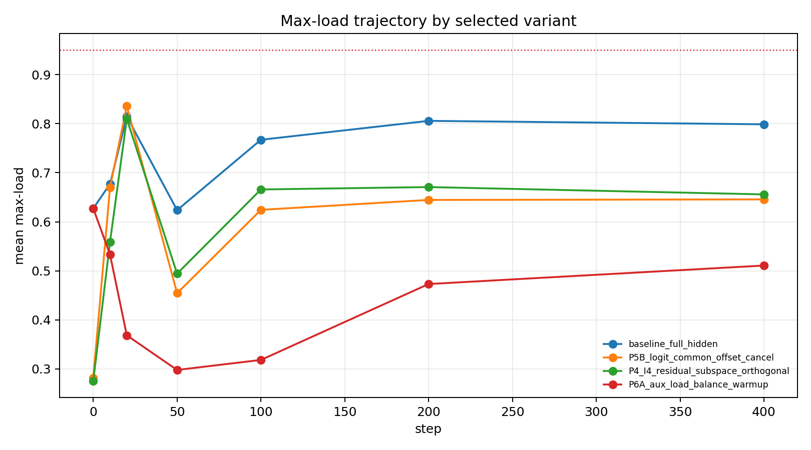
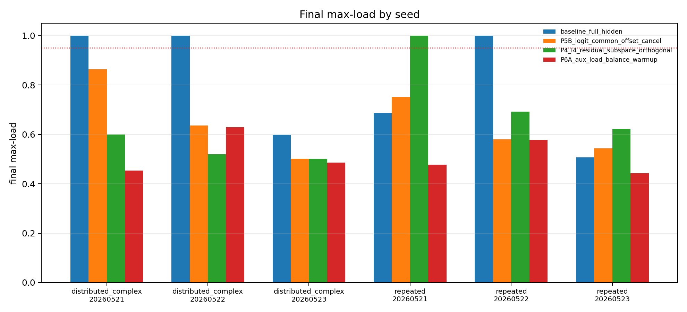
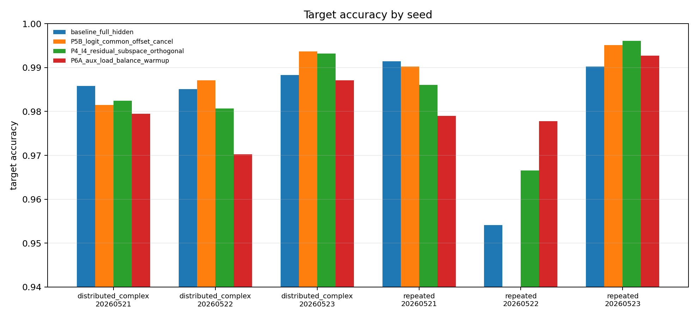
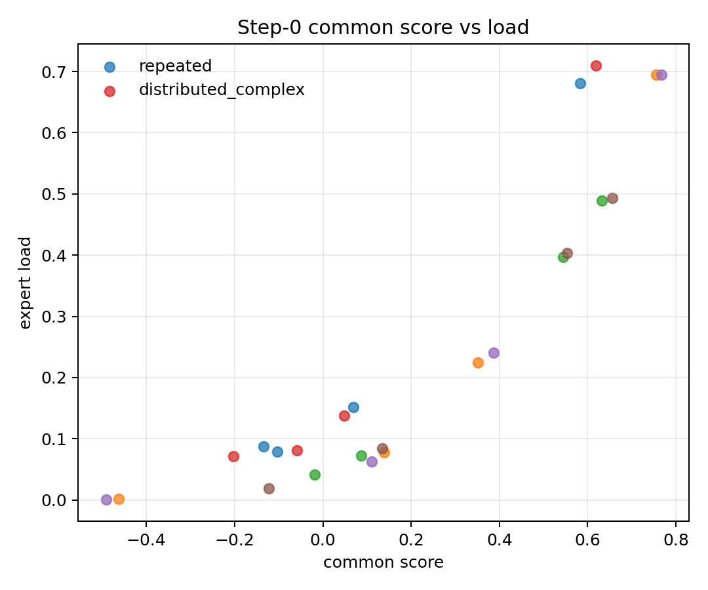
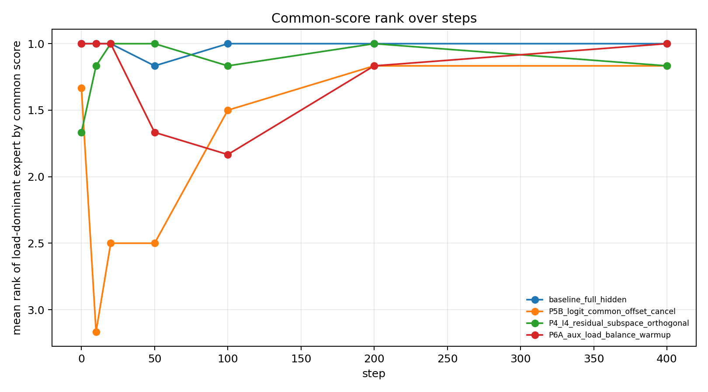
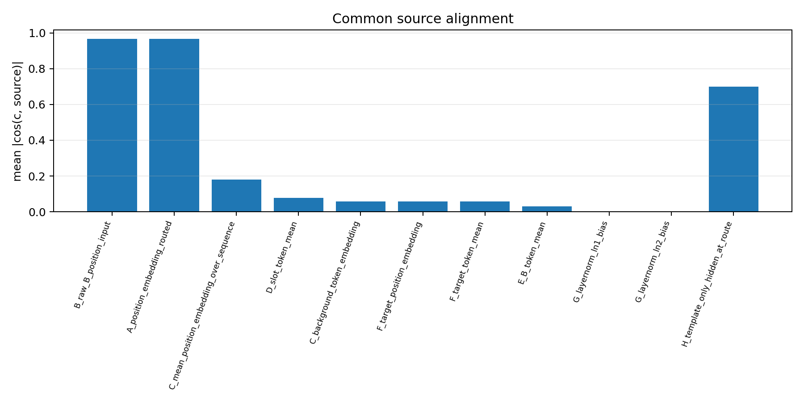
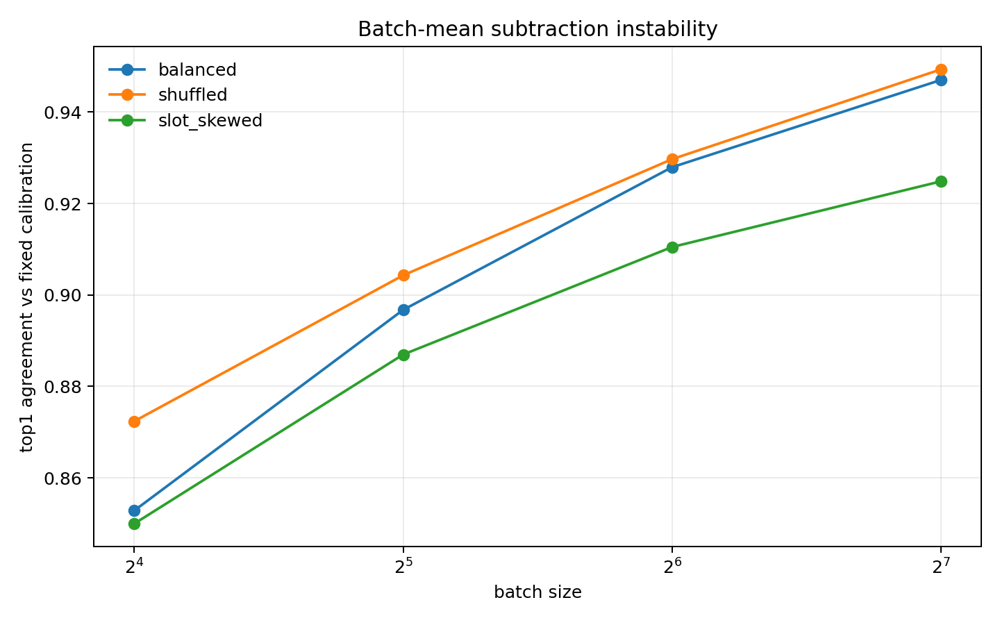

# 0608 Overnight Common-Source Audit Detailed Record

## 1. Question

In the original uniform feature setting, why does a bias-free linear top-1 router still collapse?

The audited mechanism model is:

$$
h_f = c + r_f
$$

$$
z_{f,e}=w_e^T h_f = w_e^T c + w_e^T r_f
$$

where $c$ is the across-feature common hidden component, $r_f$ is the feature-specific residual, and $w_e^T c$ is the effective expert-specific common offset.

## 2. Files Read

Required current-iteration files were available except for an optional `detailed.pdf`, which was not needed because `detailed.md` and raw CSV/JSON outputs were present.

| File | Status |
|---|---|
| `AGENTS.md` | read |
| `PROJECTS.md` | read |
| `Projects/graphs/expert_specialization.graph.yaml` | read |
| `Projects/from-attention-to-search/main/problem_anchors/05_03_uniform_collapse_common_offset_anchor.md` | read |
| `daily_research_reports/0608/uniform_collapse_common_offset/summary.md` | read |
| `daily_research_reports/0608/uniform_collapse_common_offset/detailed.md` | read |
| `daily_research_reports/0608/uniform_collapse_common_offset/tables/*.csv` | read |
| `Projects/from-attention-to-search/main/experiments/A05_03_uniform_collapse_common_offset/scripts/*.py` | read |
| `Projects/from-attention-to-search/XingyuD/Attention_Search_Experiments/active/synthetic_data_understanding/src/synthetic_data_understanding/tiny_moe.py` | read |
| `Projects/from-attention-to-search/XingyuD/Attention_Search_Experiments/active/synthetic_data_understanding/configs/h0605a_true_token_conditioned_inhibition_replay.json` | read |

## 3. Commands

Reproduction command:

```bash
python sync/0608_common_source_audit/raw_metrics/compute_0608_common_source_audit.py
```

The same command is recorded in `commands.sh`. The script writes only inside `sync/0608_common_source_audit/`.

## 4. Result Integrity Audit

| Item | Verdict | Evidence | Risk |
|---|---|---|---|
| exact command lines | PASS | A05_03 `detailed.md` Section 12; copied to daily 0608 detailed record | commands are report-recorded, not embedded in JSON manifest |
| git commit hash | PASS | `04852531949640e70542b79e0b01c31353dcc31d` | commit is current repo-side state, not stored per raw run |
| config files | PASS | `h0605a_true_token_conditioned_inhibition_replay.json` | none |
| same seeds | PASS | `20260521, 20260522, 20260523` | 3-seed audit only; no 20260524-20260527 extension |
| same data | PASS | same `generate_train_data` / `generate_feature_grid` functions; balanced exact pattern count is 1 | tensors are deterministically regenerated rather than stored as a fixed dataset file |
| same train steps | PASS | 400 | shortened mechanism run, not full 1600-step run |
| same eval grid | PASS | eval batch size 512, variants per key 4 | exact tensors are regenerated by seed |
| step0 is true init | PASS | `eval_state` is called before optimizer step | P4 step0 is after explicit initialization intervention |
| same checkpoint schedule | PASS | steps 0, 10, 20, 50, 100, 200, 400 | P3 CPU-shortened rows are separate and not used as main comparison |
| target accuracy comparable | PASS | same target-token count and full-sequence NTP objective | accuracy is a validity guard, not specialization evidence |

CSV: `tables/result_integrity_audit.csv`

## 5. Primary Metrics

Primary metric: final max-load, because the audited failure mode is load collapse. Accuracy is a validity guard: low accuracy would invalidate routing interpretation, but high accuracy does not prove specialization.

| Variant | Seeds | Final max-load mean | Final max-load std | Collapse rate | Load entropy mean | Accuracy mean | Step0 max-load mean | Step10 max-load mean | Step50 max-load mean | Dominant persistence | Common argmax agreement |
|---|---:|---:|---:|---:|---:|---:|---:|---:|---:|---:|---:|
| baseline_full_hidden | 6 | 0.7988 | 0.2276 | 0.5000 | 0.3234 | 0.9825 | 0.6272 | 0.6771 | 0.6237 | 0.6667 | 1.0000 |
| P5B_logit_common_offset_cancel | 6 | 0.6457 | 0.1374 | 0.0000 | 0.4808 | 0.9812 | 0.2818 | 0.6703 | 0.4543 | 0.5476 | 0.6667 |
| P4_I4_residual_subspace_orthogonal | 6 | 0.6558 | 0.1825 | 0.1667 | 0.4195 | 0.9842 | 0.2753 | 0.5590 | 0.4942 | 0.5238 | 0.6667 |
| P6A_aux_load_balance_warmup | 6 | 0.5108 | 0.0750 | 0.0000 | 0.7262 | 0.9810 | 0.6272 | 0.5331 | 0.2979 | 0.5000 | 1.0000 |

Full per-seed table: `tables/primary_metrics_by_seed.csv`  
Summary table: `tables/primary_metrics_summary.csv`



Interpretation: baseline often collapses by final checkpoint. P5B and P4-I4 reduce initialization imbalance but do not make final routing balanced. P6A gives the lowest final load concentration in this audit, but this is an anti-collapse/load-control result, not evidence of feature specialization.



Interpretation: seed-level variation is large; claims should stay at the 3-seed mechanism-audit level until a full 4-card run confirms the ranking.



Interpretation: target accuracy remains comparable across audited variants, so routing metrics are not mainly explained by task failure.

## 6. Common Component Geometry

Definition:

$$
h_f=\text{mean hidden state for feature }f
$$

$$
c=\frac{1}{F}\sum_f h_f
$$

$$
r_f=h_f-c
$$

The script used the balanced evaluation grid at step 0. It reports $||c||^2 / \text{mean}_f ||h_f||^2$ as `common_ratio`.

| Metric | Mean | Std |
|---|---:|---:|
| common_ratio | 0.5075 | 0.0380 |
| residual_ratio | 0.4925 | 0.0380 |
| centered top-PC ratio | 0.0231 | 0.0009 |
| cos(c, centered top-PC1) | 0.0292 | 0.0207 |

Table: `tables/common_component_geometry.csv`

Interpretation: the common component is a large mean shift. It is not the first centered residual principal component.

## 7. Common-Score Prediction

For each seed and pattern, the diagnostic computes:

$$
s_e=w_e^T c+b_e
$$

Then it compares the argmax of $s_e$ with the dominant expert by load.

| Pattern | Variant | Seeds | Agreement with dominant expert | Corr(common score, load) | Common-score margin mean | Verdict |
|---|---|---:|---:|---:|---:|---|
| repeated | baseline_full_hidden | 3 | 1.0000 | 0.9549 | 0.3351 | supports step-0 common-score prediction |
| distributed_complex | baseline_full_hidden | 3 | 1.0000 | 0.9475 | 0.3505 | supports step-0 common-score prediction |
| repeated | P6A_aux_load_balance_warmup | 3 | 1.0000 | 0.9549 | 0.3351 | same initialization as baseline; training control acts later |
| distributed_complex | P6A_aux_load_balance_warmup | 3 | 1.0000 | 0.9475 | 0.3505 | same initialization as baseline; training control acts later |
| repeated | P5B_logit_common_offset_cancel | 3 | 0.6667 | 0.5521 | 0.3351 | common-score control is weakened |
| distributed_complex | P5B_logit_common_offset_cancel | 3 | 0.6667 | 0.5895 | 0.3505 | common-score control is weakened |
| repeated | P4_I4_residual_subspace_orthogonal | 3 | 0.6667 | n/a | 0.0000 | common score is equalized by construction |
| distributed_complex | P4_I4_residual_subspace_orthogonal | 3 | 0.6667 | n/a | 0.0000 | common score is equalized by construction |

Full table: `tables/common_score_prediction_by_seed.csv`  
Summary table: `tables/common_score_prediction_summary.csv`



Interpretation: baseline step-0 load is strongly predicted by $w_e^T c$. P5B weakens this relation because it cancels the common logit offset in the forward assignment.



Interpretation: common-score rank is useful for initialization dominance, but final collapse still needs training-time amplification analysis.

## 8. Source Localization

Source-vector alignment uses absolute cosine between $c$ and each candidate vector, plus projection share. Forward ablations measure whether removing a candidate reduces `common_ratio` and step-0 max-load.

### 8.1 Source Alignment

| Candidate source | mean abs cos(c, source) | mean projection share | Interpretation |
|---|---:|---:|---|
| B_raw_B_position_input | 0.9680 | 0.9370 | Strongest aligned vector; includes routed position plus B-token input. |
| A_position_embedding_routed | 0.9675 | 0.9360 | Primary localized source direction. |
| H_template_only_hidden_at_route | 0.7008 | 0.4917 | Hidden template state is aligned, but not isolated from position effects. |
| mean_position_embedding_over_sequence | 0.1807 | 0.0370 | Weak relative to routed-position embedding. |
| slot_token_mean | 0.0782 | 0.0099 | Weak. |
| background_token_embedding | 0.0588 | 0.0049 | Weak. |
| target_position_embedding | 0.0581 | 0.0053 | Weak. |
| target_token_mean | 0.0572 | 0.0083 | Weak. |
| B_token_mean | 0.0298 | 0.0018 | Not a likely source. |
| layernorm ln1/ln2 bias | n/a | n/a | zero norm in this model instance. |

Table: `tables/common_source_alignment.csv`



Interpretation: the common component is almost collinear with the routed-position/B-position input direction, not with token-set means.

### 8.2 Forward Ablations

| Test | common_ratio mean | step0 max-load mean | cos(new c, old c) | Interpretation |
|---|---:|---:|---:|---|
| baseline_full_hidden | 0.5075 | 0.6261 | 1.0000 | Original step-0 common shift and imbalance. |
| subtract routed position embedding | 0.2105 | 0.4757 | -0.7094 | Removing routed position materially reduces common shift and load imbalance, but does not fully balance routing. |
| fixed calibration mean subtract | 0.0000 | 0.2845 | -0.0594 | Directly removes the measured common mean and makes step-0 load near random baseline. |
| zero background embeddings | 0.5023 | 0.6138 | 0.9831 | Background/start/end tokens are not the main source. |
| minimal sequence without nuisance tokens | 0.5119 | 0.6340 | 0.9987 | Nuisance/template tokens are not required for the common shift. |
| zero B-token embeddings | 0.9909 | 1.0000 | 0.9978 | B-token identity mean is not the source; removing B-token variation leaves position-dominated collapse. |

Table: `tables/common_source_ablation.csv`

Source conclusion: common shift is mostly position/template-derived, more specifically routed-position/B-position-input derived. The evidence does not support B-token mean, slot-token mean, background/start/end tokens, target token, or layernorm bias as primary sources.

Claim boundary: this is step-0 localization. It does not prove that routed position is the only cause of final collapse after training.

## 9. Batch Mean vs Logit Offset

Fixed calibration equivalence:

$$
z1_e=w_e^T(h-c_{calib})+b_e
$$

$$
z2_e=w_e^T h+b_e-w_e^T c_{calib}
$$

With fixed detached $c_{calib}$, the observed max absolute error was at most $1.25e-6$, top-1 assignment agreement was 1.000, and load L1 difference was 0.000.

Live batch mean subtraction:

| Composition | Batch size | Top-1 agreement with full-grid fixed mean | Mean max-load | Mean c-batch norm | Offset std mean |
|---|---:|---:|---:|---:|---:|
| balanced | 16 | 0.8529 | 0.3453 | 1.9797 | 0.3568 |
| balanced | 32 | 0.8967 | 0.3207 | 1.4027 | 0.3554 |
| balanced | 64 | 0.9279 | 0.3057 | 0.9800 | 0.3524 |
| balanced | 128 | 0.9470 | 0.2955 | 0.6925 | 0.3486 |
| full balanced grid | 4096 | 1.0000 | 0.2818 | 0.0000 | 0.3489 |
| slot_skewed | 16 | 0.8500 | 0.3417 | 2.0722 | 0.3557 |
| slot_skewed | 32 | 0.8870 | 0.3197 | 1.5701 | 0.3564 |
| slot_skewed | 64 | 0.9105 | 0.3059 | 1.2087 | 0.3522 |
| slot_skewed | 128 | 0.9248 | 0.2959 | 0.9955 | 0.3512 |

Table: `tables/batchmean_vs_logitoffset.csv`



Interpretation: fixed calibration mean subtraction is forward-equivalent to logit common-offset cancellation. Live batch mean subtraction is batch-size and batch-composition dependent, changes top-1 assignments, and should not be treated as the same intervention.

## 10. Claim Boundary After Audit

Can claim:

- In this 3-seed audit, baseline step-0 dominant expert is predicted by $w_e^T c$.
- The step-0 common component is mainly sourced from the routed-position/B-position input direction.
- Removing the routed-position embedding partially reduces step-0 common ratio and max-load.
- Direct fixed calibration mean subtraction reduces step-0 max-load close to random routing.
- P6A gives the best final load control among the audited shortened variants.

Cannot claim:

- Common offset alone explains final collapse.
- Collapse is solved.
- Load balance is specialization.
- P6A is sufficient for feature specialization.
- Live batch mean subtraction is equivalent to fixed logit-offset cancellation.
- Background tokens, B-token mean, target token, slot-token mean, or layernorm bias are primary sources.

Most important remaining uncertainty:

- Whether P6A, P5B, and P5B+P6A remain ordered the same way in a full 4-card confirmation run with the final intended training length and seed set.

## 11. Final Judgment

B/C mixed with bounded claims:

- C is supported for step 0: the dominant expert is explained by alignment with a global common hidden direction, and that common direction is mainly routed-position/B-position-input derived.
- B remains necessary for final collapse: P5B reduces initialization imbalance but final max-load remains high, so training-time lock-in or amplification is still part of the mechanism.

This audit does not support the statement that common-offset cancellation alone solves collapse.

## 12. Artifact Map

| Artifact | Path |
|---|---|
| summary | `sync/0608_common_source_audit/summary.md` |
| detailed record | `sync/0608_common_source_audit/detailed.md` |
| commands | `sync/0608_common_source_audit/commands.sh` |
| audit script | `sync/0608_common_source_audit/raw_metrics/compute_0608_common_source_audit.py` |
| manifest | `sync/0608_common_source_audit/raw_metrics/audit_manifest.json` |
| integrity table | `sync/0608_common_source_audit/tables/result_integrity_audit.csv` |
| primary seed table | `sync/0608_common_source_audit/tables/primary_metrics_by_seed.csv` |
| primary summary table | `sync/0608_common_source_audit/tables/primary_metrics_summary.csv` |
| common component table | `sync/0608_common_source_audit/tables/common_component_geometry.csv` |
| common score tables | `sync/0608_common_source_audit/tables/common_score_prediction_by_seed.csv`, `sync/0608_common_source_audit/tables/common_score_prediction_summary.csv` |
| source tables | `sync/0608_common_source_audit/tables/common_source_alignment.csv`, `sync/0608_common_source_audit/tables/common_source_ablation.csv` |
| batch mean table | `sync/0608_common_source_audit/tables/batchmean_vs_logitoffset.csv` |
| figures | `sync/0608_common_source_audit/figures/*.png` |
