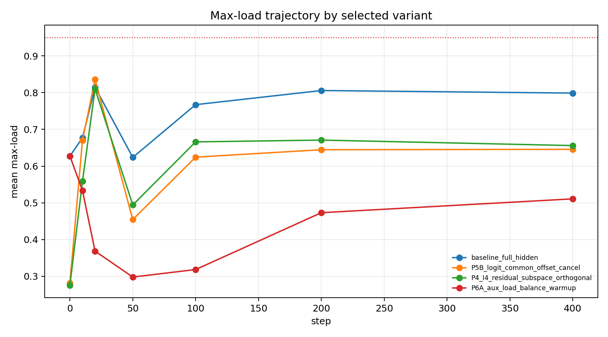
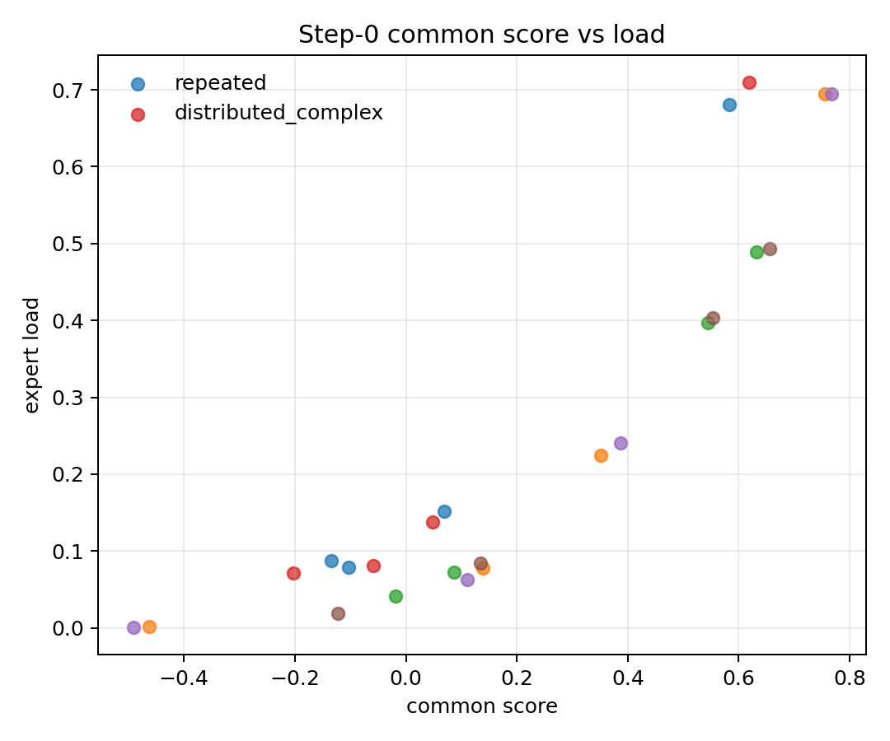
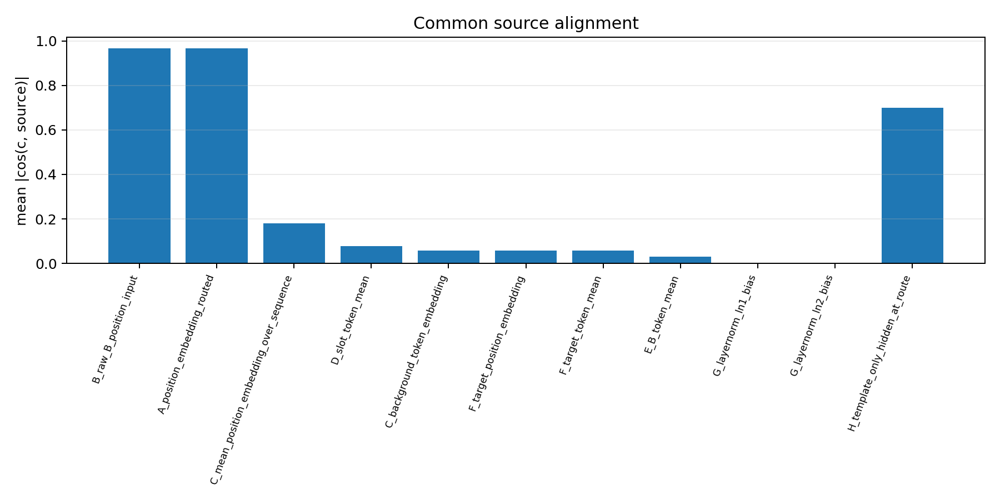
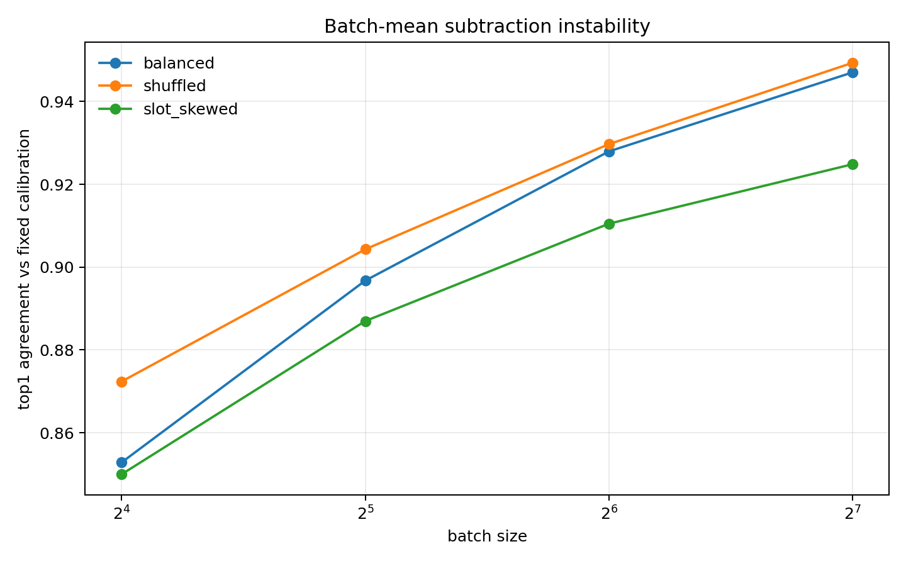

# 0608 Overnight Common-Source Audit Summary

## 0. One-Line Verdict

The 0608 evidence supports a step-0 common-score mechanism mainly sourced from the routed-position/B-position input direction, while final collapse still requires a separate training-time lock-in control.

## 1. What Was Audited

- existing result integrity: PASS on command provenance, commit hash, config, seeds, data generation, train steps, eval grid, step-0 definition, checkpoint schedule, and accuracy comparability; main risk is that this remains a 3-seed, 400-step mechanism audit.
- recomputed tables: primary metrics were recomputed from A05_03 CSV outputs, not copied from prior prose.
- source localization: step-0 common component, source-vector alignment, and cheap forward ablations were recomputed for seeds 20260521-20260523 across repeated and distributed-complex patterns.
- batch mean vs logit offset: fixed calibration mean subtraction was checked against logit-offset cancellation, then compared with live batch-mean subtraction across batch sizes and compositions.

## 2. Primary Metrics

| Variant | Seeds | Final max-load mean/std | Collapse rate | Accuracy | Verdict |
|---|---:|---:|---:|---:|---|
| baseline_full_hidden | 6 | 0.799 / 0.228 | 0.500 | 0.983 | Collapse is frequent under the original router input. |
| P5B_logit_common_offset_cancel | 6 | 0.646 / 0.137 | 0.000 | 0.981 | Reduces step-0 imbalance, but final load remains high. |
| P4_I4_residual_subspace_orthogonal | 6 | 0.656 / 0.182 | 0.167 | 0.984 | Weakens initialization imbalance, but is not robust. |
| P6A_aux_load_balance_warmup | 6 | 0.511 / 0.075 | 0.000 | 0.981 | Best final load in this audit; this is load control, not specialization. |

## 3. Common-Score Mechanism

| Pattern | Seeds | Agreement with dominant expert | Corr(common score, load) | Verdict |
|---|---:|---:|---:|---|
| repeated / baseline | 3 | 1.000 | 0.955 | Supports common-score prediction of the step-0 dominant expert. |
| distributed_complex / baseline | 3 | 1.000 | 0.947 | Supports common-score prediction of the step-0 dominant expert. |
| repeated / P5B | 3 | 0.667 | 0.552 | Offset cancellation weakens common-score control over load. |
| distributed_complex / P5B | 3 | 0.667 | 0.590 | Offset cancellation weakens common-score control over load. |

## 4. Common Source

| Candidate source | cos(c, source) | ablation effect on common_ratio | ablation effect on step0 load | Verdict |
|---|---:|---:|---:|---|
| routed position embedding | 0.967 | 0.508 -> 0.211 | 0.626 -> 0.476 | Primary localized source; subtracting it partially reduces common shift and load imbalance. |
| raw B-position input | 0.968 | no direct isolated ablation | no direct isolated ablation | Strongly aligned because this input contains routed position; not evidence that B-token identity is the source. |
| template-only hidden at route | 0.701 | no direct isolated ablation | no direct isolated ablation | Consistent with position/template hidden direction, but not independent source proof. |
| background/start/end tokens | 0.059 | 0.508 -> 0.502 | 0.626 -> 0.614 | Not primary in this diagnostic. |
| minimal sequence without nuisance tokens | n/a | 0.508 -> 0.512 | 0.626 -> 0.634 | Removing nuisance/template tokens does not remove the common shift. |
| B-token mean | 0.030 | zero B embeddings: 0.508 -> 0.991 | 0.626 -> 1.000 | B-token mean is not the source; B-token variation appears to supply residual diversity. |
| slot-token mean | 0.078 | not run | not run | Weak alignment; no causal source claim. |
| target token / target position | 0.057 / 0.058 | not run | not run | Weak alignment; no causal source claim. |
| layernorm bias | zero norm | not applicable | not applicable | Not a source in this model instance. |

## 5. Batch Mean vs Logit Offset

With a fixed detached calibration vector $c_{calib}$, $w_e^T(h-c_{calib})+b_e$ matched $w_e^T h+b_e-w_e^T c_{calib}$ up to max absolute error $1.25e-6$, with 1.000 top-1 agreement and 0.000 load-distribution difference. Live batch-mean subtraction was not equivalent: top-1 agreement ranged from 0.853 at balanced batch size 16 to 0.947 at balanced batch size 128, and slot-skewed batches remained less stable at the same sizes.

## 6. Can Claim / Cannot Claim

Can claim:

- In the audited 3-seed, 400-step setting, the baseline step-0 dominant expert is predicted by the common score $w_e^T c$.
- The common component is mainly aligned with the routed-position/B-position input direction.
- Fixed calibration mean subtraction and logit common-offset cancellation are forward-equivalent when the calibration vector is fixed and detached.
- P6A reduces final load concentration more than P5B or P4-I4 in this audit, but this is load control.

Cannot claim:

- Common offset alone explains final collapse.
- Collapse is solved.
- Load balance is specialization.
- B-token identity, background tokens, target token, or layernorm bias are the main common-shift source.
- Live batch mean subtraction is a clean replacement for fixed logit-offset cancellation.

## 7. Meeting-Ready Next Decision

Should the next 4-card run prioritize full verification of P6A versus baseline/P5B/P4-I4, with routed-position source diagnostics kept as fixed validity checks rather than a new architecture sweep?
