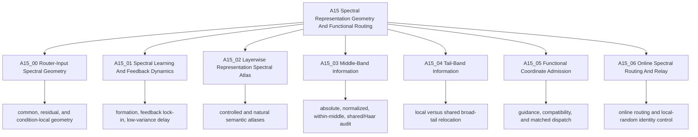

# A15: Spectral Representation Geometry And Functional Routing

This line asks how spectral coordinates arise, what information different
regions carry, and whether selecting those coordinates can create a useful
functional differentiation for routing. Geometry, information, and routing
gain are separate claims; no band is treated as a functional module merely
because it is stable, shared, late-ranked, or linearly readable.

## Direction Snapshot

**Root research question:** Which spectral coordinates are available to a
Router, how are they learned and populated by layerwise representations, and
under what additional evidence may any coordinate be admitted into a routing
method?

**Current answer:** Router-input covariance defines a real access geometry,
and both training dynamics and layerwise representations are non-uniform in
spectral coordinates. Existing results do not establish one universal
head/middle/tail semantic coordinate, nor do they establish that middle or
tail selection improves routing quality.

**Current claim boundary:** The line currently supports bounded geometric,
learning-dynamic, linear-readability, and controlled-routing observations.
It does not support the claims that the middle or tail is a functional module,
that local rank names the same direction across layers, or that spectral
selection gives a model-quality gain.

**One blocking uncertainty:** Does the target-common late semantic relocation
seen in local parameter rank enter a cross-layer shared broad tail, or is it
only a local-rank description without stable direction identity?

**Active parent Anchor:** [A15_04 Tail-Band Information](15_04_tail_band_information/15_04_tail_band_information_anchor.md).

**Why this Anchor is next:** It tests whether the retained local-rank
observation survives a shared-space and Haar-random control before any
functional use is discussed.

**Decision dependency chain:** establish a shared tail orientation or reject
that interpretation -> then decide whether the independent middle-band audit
should be prioritized -> only after a band carries reproducible information
may A15_05 test functional admission -> A15_06 remains the online method line,
not evidence for band semantics.

**Parked directions and reopening conditions:** A15_03 is an independent
`DRAFT_NOT_EXECUTABLE` middle-band audit and reopens after the A15_04 geometry
decision or an explicit priority change. A15_05 method construction reopens
only after a named coordinate and matched controls are admitted. The archived
matched spectral-dispatch contract stays closed unless its registered
compatibility gate is replaced by a newly approved Anchor.

**Exactly one next decision:** approve or correct the proposed A15_04 primary
metric, resampling design, and conjunctive Pass/Fail/Insufficient rule.

**Completion criterion:** Protocol blocks B--F are explicitly confirmed or
amended, cross-block consistency passes, and the document still records
`DRAFT_NOT_EXECUTABLE` until execution is separately approved.

**Resume action:** open the [A15_04 draft Protocol](/Projects/from-attention-to-search/main/experiments/A15/15_04_tail_band_information/A15_04_E01_shared_tail_geometry/protocol.md)
at its approval snapshot and review only the three pending choices named
there.

## Coordinate Systems

The line uses three different spectral coordinate systems. A band label is
meaningful only together with its basis.

| Coordinate system | Concrete object | What rank orders | What it cannot be silently used as |
| --- | --- | --- | --- |
| Router-input covariance | covariance of the actual vector consumed by the Gate | activation variance available to the Router | MLP parameter rank or a universal semantic axis |
| Representation covariance | covariance of residual states, attention writes, or the actual MLP-input increment $\Delta n$ | variation of one named activation object | parameter gain or cross-layer direction identity |
| MLP parameter geometry | eigensystem of $K_\ell=W_{gate,\ell}^{\top}W_{gate,\ell}+W_{up,\ell}^{\top}W_{up,\ell}$ | local MLP input gain | Router access, semantic usefulness, or identical directions across layers |

## Canonical Hierarchy

## Parent-Anchor Map

| Parent Anchor | Decision it owns | Depends on | Current state | Direction implication | Primary source |
| --- | --- | --- | --- | --- | --- |
| A15_00 Router-Input Spectral Geometry | What spectral structure the actual Router input exposes and what the trained Gate prefers | none inside A15 | completed, mixed and qualified | establishes access geometry; does not establish a universally head-dominant Router | [Anchor](15_00_router_input_spectral_geometry/15_00_router_input_spectral_geometry_anchor.md) |
| A15_01 Spectral Learning And Feedback Dynamics | How covariance scale, optimization, and selected-expert feedback create or delay spectral preference | A15_00 objects | controlled learning result passed; real-trajectory comparison was load-guard insufficient; feedback/delay tests completed | explains possible formation mechanisms without assigning semantic function to a band | [Anchor](15_01_spectral_learning_and_feedback_dynamics/15_01_spectral_learning_and_feedback_dynamics_anchor.md) |
| A15_02 Layerwise Representation Spectral Atlas | What layerwise semantic objects are readable and where their variance lies in named activation/parameter coordinates | fixed representations and matched task definitions | several atlases completed; one balanced taxonomy protocol remains draft | depth variation is reproducible in some objects, but a universal semantic rank coordinate is not validated | [Anchor](15_02_layerwise_representation_spectral_atlas/15_02_layerwise_representation_spectral_atlas_anchor.md) |
| A15_03 Middle-Band Information | Whether apparently stable normalized F2--F8 curves reflect real stability or normalization, cancellation, or rank averaging | A15_02_06/A15_02_07 frozen objects | independent `DRAFT_NOT_EXECUTABLE`; pending review | can distinguish a stable middle representation from three named artifacts; cannot establish function | [Anchor](15_03_middle_band_information/15_03_middle_band_information_anchor.md) |
| A15_04 Tail-Band Information | Whether target-common local rank relocation enters a shared F9--F16 orientation beyond matched Haar geometry | A15_02_06/A15_02_07 frozen objects | active `DRAFT_NOT_EXECUTABLE`; metric and verdict pending | decides whether “tail relocation” has cross-layer geometric content | [Anchor](15_04_tail_band_information/15_04_tail_band_information_anchor.md) |
| A15_05 Functional Coordinate Admission | Whether a named coordinate passes capability, compatibility, and matched functional controls before method use | admissible coordinate from A15_00/A15_02/A15_03/A15_04 | compatibility and matched-dispatch tests failed their registered functional claims; one old training contract archived unrun | no current evidence that selecting middle/tail yields quality gain | [Anchor](15_05_functional_coordinate_admission/15_05_functional_coordinate_admission_anchor.md) |
| A15_06 Online Spectral Routing And Relay | Whether an online spectral routing rule remains useful against identity and local-random controls | explicitly admitted online coordinate and matched training contract | completed evidence recorded, with control and single-seed boundaries | method evidence must not be back-projected into claims about band semantics | [Anchor](15_06_online_spectral_routing_and_relay/15_06_online_spectral_routing_and_relay_anchor.md) |

## Reading Index

The current primary synthesis is the [A15 full-line Story](/Projects/from-attention-to-search/main/stories/15_spectral_representation_and_functional_routing/02_spectral_representation_to_functional_routing.md).

### A15_00 Router-Input Spectral Geometry

- Parent: [Router-input spectral geometry](15_00_router_input_spectral_geometry/15_00_router_input_spectral_geometry_anchor.md).
- Subanchors: [cross-document common-space stability](15_00_router_input_spectral_geometry/subanchors/15_00_01_cross_document_subspace_stability_anchor.md), [Gate common/residual preference](15_00_router_input_spectral_geometry/subanchors/15_00_02_gate_common_residual_preference_anchor.md), and [condition-local residual modes](15_00_router_input_spectral_geometry/subanchors/15_00_03_condition_local_residual_modes_anchor.md).
- First result paths: [actual Router-input access](/Projects/from-attention-to-search/main/experiments/A15/15_00_router_input_spectral_geometry/A15_00_E01_actual_router_input_spectral_access/summary.md), [early alignment onset](/Projects/from-attention-to-search/main/experiments/A15/15_00_router_input_spectral_geometry/A15_00_E02_early_head_alignment_onset/summary.md), and [common-space stability](/Projects/from-attention-to-search/main/experiments/A15/15_00_router_input_spectral_geometry/A15_00_01_E01_cross_document_subspace_stability/summary.md).

### A15_01 Spectral Learning And Feedback Dynamics

- Parent: [learning and feedback dynamics](15_01_spectral_learning_and_feedback_dynamics/15_01_spectral_learning_and_feedback_dynamics_anchor.md).
- Subanchors: [selected-expert feedback lock-in](15_01_spectral_learning_and_feedback_dynamics/subanchors/15_01_01_selected_expert_feedback_lockin_anchor.md) and [low-variance functional delay](15_01_spectral_learning_and_feedback_dynamics/subanchors/15_01_02_low_variance_functional_delay_anchor.md).
- First result paths: [controlled covariance learning speed](/Projects/from-attention-to-search/main/experiments/A15/15_01_spectral_learning_and_feedback_dynamics/A15_01_E01_controlled_covariance_learning_speed/summary.md) and [real trajectory formation](/Projects/from-attention-to-search/main/experiments/A15/15_01_spectral_learning_and_feedback_dynamics/A15_01_E02_real_trajectory_spectral_formation/summary.md).

### A15_02 Layerwise Representation Spectral Atlas

- Parent: [layerwise representation spectral atlas](15_02_layerwise_representation_spectral_atlas/15_02_layerwise_representation_spectral_atlas_anchor.md).
- Subanchors: [controlled layer identity](15_02_layerwise_representation_spectral_atlas/subanchors/15_02_01_controlled_layer_information_identity_anchor.md), [natural hierarchy roles](15_02_layerwise_representation_spectral_atlas/subanchors/15_02_02_natural_hierarchy_role_localization_anchor.md), [architectural concentration](15_02_layerwise_representation_spectral_atlas/subanchors/15_02_03_architectural_head_channel_concentration_anchor.md), [compositional attention writes](15_02_layerwise_representation_spectral_atlas/subanchors/15_02_04_compositional_attention_write_atlas_anchor.md), [balanced taxonomy](15_02_layerwise_representation_spectral_atlas/subanchors/15_02_05_balanced_taxonomy_attention_write_atlas_anchor.md), [MLP parameter geometry](15_02_layerwise_representation_spectral_atlas/subanchors/15_02_06_mlp_parameter_geometry_and_semantic_location_anchor.md), and [matched semantic complexity](15_02_layerwise_representation_spectral_atlas/subanchors/15_02_07_matched_semantic_complexity_anchor.md).
- The complete experiment list and statuses are in the [A15 experiment index](/Projects/from-attention-to-search/main/experiments/A15/README.md).

### A15_03 Middle-Band Information

- Parent: [middle-band information](15_03_middle_band_information/15_03_middle_band_information_anchor.md).
- Review surface: [independent draft Protocol](/Projects/from-attention-to-search/main/experiments/A15/15_03_middle_band_information/A15_03_E01_middle_band_stability_decomposition/protocol.md). It is not executable and is not part of the tail experiment.

### A15_04 Tail-Band Information

- Parent: [tail-band information](15_04_tail_band_information/15_04_tail_band_information_anchor.md).
- Active review surface: [shared-tail geometry draft Protocol](/Projects/from-attention-to-search/main/experiments/A15/15_04_tail_band_information/A15_04_E01_shared_tail_geometry/protocol.md). No execution is approved.

### A15_05 Functional Coordinate Admission

- Parent: [functional coordinate admission](15_05_functional_coordinate_admission/15_05_functional_coordinate_admission_anchor.md).
- Subanchors: [shallow feature guidance](15_05_functional_coordinate_admission/subanchors/15_05_01_shallow_feature_guidance_anchor.md), [specificity pilot](15_05_functional_coordinate_admission/subanchors/15_05_02_shallow_feature_specificity_pilot_anchor.md), [progressive source routing](15_05_functional_coordinate_admission/subanchors/15_05_03_progressive_band_source_routing_anchor.md), [fixed-band compatibility](15_05_functional_coordinate_admission/subanchors/15_05_04_fixed_band_cross_update_compatibility_anchor.md), and [matched fixed-band dispatch](15_05_functional_coordinate_admission/subanchors/15_05_05_matched_fixed_band_dispatch_anchor.md).
- First result paths: [compatibility gate Fail](/Projects/from-attention-to-search/main/experiments/A15/15_05_functional_coordinate_admission/A15_05_04_E01_cross_update_compatibility_gate/summary.md) and [matched dispatch distribution-only Fail](/Projects/from-attention-to-search/main/experiments/A15/15_05_functional_coordinate_admission/A15_05_05_E01_2b_matched_band_dispatch/summary.md).
- Historical stop rule: [archived unrun matched-training contract](/Projects/from-attention-to-search/main/experiments/A15/archive/A15_05_blocked_matched_spectral_dispatch_training/protocol.md).

### A15_06 Online Spectral Routing And Relay

- Parent: [online spectral routing and relay](15_06_online_spectral_routing_and_relay/15_06_online_spectral_routing_and_relay_anchor.md).
- Subanchor: [local-random identity control](15_06_online_spectral_routing_and_relay/subanchors/15_06_01_local_random_identity_control_anchor.md).
- First result paths: [10B online routing](/Projects/from-attention-to-search/main/experiments/A15/15_06_online_spectral_routing_and_relay/A15_06_E01_10b_online_spectral_routing/summary.md) and [local-random identity control](/Projects/from-attention-to-search/main/experiments/A15/15_06_online_spectral_routing_and_relay/A15_06_E02_local_random_identity_control/summary.md).

## Legacy Anchor Migration Map

These mappings preserve provenance only. Old identifiers are not active
hierarchy.

| Legacy anchor | Canonical anchor |
| --- | --- |
| `15_00_covariance_head_gate_alignment` | `15_00_router_input_spectral_geometry` |
| `15_00_01_spectral_learning_dynamics` | `15_01_spectral_learning_and_feedback_dynamics` |
| `15_00_02_centered_common_subspace_stability` | `15_00_01_cross_document_subspace_stability` |
| `15_00_03_gate_transferable_vs_local_residual_alignment` | `15_00_02_gate_common_residual_preference` |
| `15_00_04_condition_stratified_residual_modes` | `15_00_03_condition_local_residual_modes` |
| `15_04_expert_feedback_tail_lockin` | `15_01_01_selected_expert_feedback_lockin` |
| `15_05_low_variance_route_stability` | `15_01_02_low_variance_functional_delay` |
| `15_01_05_coarse_fine_semantic_variance_atlas` | `15_02_layerwise_representation_spectral_atlas` |
| `15_01_02_layer_band_information_identity` | `15_02_01_controlled_layer_information_identity` |
| `15_01_03_natural_hierarchy_token_spectral_localization` | `15_02_02_natural_hierarchy_role_localization` |
| `15_01_06_mlp_input_channel_group_semantic_concentration` | `15_02_03_architectural_head_channel_concentration` |
| `15_01_07_compositional_attention_write_spectral_atlas` | `15_02_04_compositional_attention_write_atlas` |
| `15_01_08_balanced_three_level_taxonomy_attention_write_atlas` | `15_02_05_balanced_taxonomy_attention_write_atlas` |
| `15_01_09_mlp_parameter_commonality_attention_write_semantic_location` | `15_02_06_mlp_parameter_geometry_and_semantic_location` |
| `15_01_10_matched_semantic_complexity_parameter_spectrum` | `15_02_07_matched_semantic_complexity` |
| `15_01_12_middle_band_stability_decomposition` | `15_03_middle_band_information` |
| `15_01_11_shared_tail_semantic_relocation` | `15_04_tail_band_information` |
| `15_02_middle_tail_functional_resolution` | `15_05_functional_coordinate_admission` |
| `15_01_shallow_head_guided_deep_routing` | `15_05_01_shallow_feature_guidance` |
| `15_01_01_controlled_four_layer_shallow_head_pilot` | `15_05_02_shallow_feature_specificity_pilot` |
| `15_01_04_progressive_band_source_routing` | `15_05_03_progressive_band_source_routing` |
| `15_02_01_cross_update_compatibility_gate` | `15_05_04_fixed_band_cross_update_compatibility` |
| `15_03_matched_band_dispatch_effect` | `15_05_05_matched_fixed_band_dispatch` |
| `15_06_dynamic_online_spectral_routing` | `15_06_online_spectral_routing_and_relay` |

## Navigation Audit

- Root question and bounded answer: `PASS`.
- One blocking uncertainty and one next decision: `PASS`.
- Sibling parents versus subanchors: `PASS`.
- Coordinate-system separation: `PASS`.
- Draft and blocked states remain visible: `PASS`.
- Reading index grouped by decision ownership: `PASS`.
- Full evidence remains in Anchors and result records rather than this README: `PASS`.
