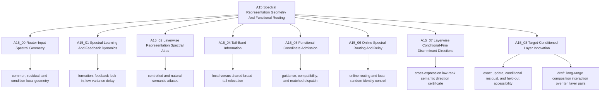

# A15: Spectral Representation Geometry And Functional Routing

> 主线结论：本地参数秩、broad band 或方差增长都不能单独定义“本层新增信息”。A15_08 E03 因身份与证据记录不符合冻结 Protocol 而为 `INELIGIBLE_GUARD`；E04 在一个受控的第 25 层同归一化 attention transition 上正式建立了旧状态线性读出之外的目标可访问性，但注册的二维表示只保留 33.24% 的全维增益。
> 谱定位：复杂更新方差的 98.41% 集中在公共基前 256 秩，但两个目标条件候选方向在那里只有 37.90% 的质量；当前证据排除“方差头部就是新增信息位置”，却尚未定位完整增量的最小充分子空间。
> 新结果：A15_08_01 E02 已完成 blocks 2--36；$T_{depth}=0.006102$ $[0.004119,0.007669]$ 为正，但 $A_{2F}=-0.011422$ $[-0.013994,-0.009812]$，注册 verdict 为 `H2_LC_FAIL_CONTROL_DEGRADATION`。
> 当前障碍：正的差中差并不等于远程两跳绝对新增可访问量增长；表征秩和公共基能量非单调且只作描述，不能推进到 Router。
> 公共坐标阶段：A15_02_06 已完成“公共参数基→Attention-write 方差曲线→粗中细谱位置→同层 shape→全相邻层变化”的完整审计。结果是深度后移依赖基、粗中细只在固定 Mean Response 基中呈轨迹级有序、曲线差异分散且相邻层变化非单调；这些对象仅作描述，不能定义新增信息。
> 当前研究锚点：A15_08 E04 保留 eligible `H2_PASS_H1_FAIL` 的局部事实；研究者已选择 A15_08_01 作为当前方向，并暂停 $r=3\ldots7$ 任务读出秩阶梯。A15_07 仍暂停且从未执行；A15_03 已归档并退出 active route。
> 允许范围：现有证据支持指定受控任务、答案 token、线性读出族内的局部新增可访问性，以及 blocks 2--36 的注册深度 Fail；不支持全局低秩、模型原生使用、expert utility 或 Router 收益。
> 关闭规则：不得把精确差分、谱位置、低 effective rank 或监督方向矩阵本身称为新知识；必须以新鲜留出目标增益和匹配对照裁定新增可访问性，且当前不进入任务读出秩、广义特征方向或 Router。
> 当前执行：Reserved 4×H100 任务 `pt-f0agvja0` 已成功完成，两组中央图、canonical Summary/Detailed 和日报结果草案已形成；唯一等待是研究者确认认识更新文字。

This line asks how spectral coordinates arise, what information different
regions carry, and whether selecting those coordinates can create a useful
functional differentiation for routing. Geometry, information, and routing
gain are separate claims; no band is treated as a functional module merely
because it is stable, shared, late-ranked, or linearly readable.

## Direction Snapshot

**Root research question:** Which spectral coordinates are available to a
Router, how are they learned and populated by layerwise representations, and
under what additional evidence may any coordinate be admitted into a routing
method?

**Current answer:** Router-input covariance defines a real access geometry, and
training dynamics and layerwise representations are non-uniform in named
coordinates. Yet local rank, shared tail, fixed band, and variance-growth
selectors have all failed as sufficient definitions of added information or
functional coordinates. A15_08 therefore changed the object: at one matched
layer-25 attention transition, subtract in the shared hidden coordinate, remove
the update component linearly predictable from the old state, and adjudicate
what remains by fresh held-out target gain. That local H2 passes; the registered
two-direction sufficiency H1' fails because it preserves only 33.24% of the
full gain.

**Current claim boundary:** The line supports bounded geometry, learning-
dynamic, linear-readability, controlled-routing observations, and one local
target-conditioned added-accessibility result. It does not support the claims
that the middle or tail is a functional module, that local rank names the same
direction across layers, that whole representations are low rank, or that the
A15_08 directions are natively used or improve routing.

**Current bounded answer:** the deep necessity-by-distance interaction is
positive, but absolute remote two-hop added accessibility declines, so the
interaction cannot by itself define more deep long-range information. The
representation spectrum is non-monotonic and has no registered low-rank verdict.

**Active parent Anchor:** [A15_08 Target-Conditioned Layer Innovation](15_08_target_conditioned_layer_innovation/15_08_target_conditioned_layer_innovation_anchor.md).

**Human-confirmed active child direction:** [A15_08_01 Layerwise Long-Range
Compositional Innovation](15_08_target_conditioned_layer_innovation/subanchors/15_08_01_layerwise_long_range_compositional_innovation_anchor.md)
uses a matched one-hop/two-hop by near/far task to measure blocks 2--36. Its
functional evidence is the layerwise ridge-gain interaction; its descriptive
geometry is representation effective rank in a TRAIN-only activation-derived
common basis. The direction, figure roles, basis, numerical contract, and
[E02 Protocol](/Projects/from-attention-to-search/main/experiments/A15/15_08_target_conditioned_layer_innovation/A15_08_01_E02_layerwise_long_range_gain_and_representation_rank_blocks_2_36/protocol.md)
are fixed. The [result](/Projects/from-attention-to-search/main/experiments/A15/15_08_target_conditioned_layer_innovation/A15_08_01_E02_layerwise_long_range_gain_and_representation_rank_blocks_2_36/summary.md)
is `H2_LC_FAIL_CONTROL_DEGRADATION`.

**Why this Anchor owns the decision:** Earlier work closed broad shared-tail,
fixed-band, and variance-growth shortcuts without defining added information.
A15_08 supplies an auditable local definition and has established its existence;
its failed rank-two clause leaves task-readout sufficiency unresolved. The
researcher has parked that local rank ladder and selected the cross-depth
long-range accessibility question instead.

**Decision dependency chain:** layerwise local-rank and shared-tail laws failed
-> two parameter-only common bases gave incompatible depth shifts -> the fixed
Mean Response basis retained a coarse--medium--fine ordering, but same-layer
shape differences were distributed and all adjacent-layer changes were
non-monotonic -> fixed-band functional admission and variance-growth selection failed ->
A15_08 defined the exact update $U$, conditional residual $R_U$, and held-out
added-accessibility gate -> E03 failed the frozen identity/record contract ->
E04 established local H2 but rejected rank-two sufficiency -> the researcher
parks the task-rank ladder -> E01 exposes structural-null block 1 -> E02 tests
blocks 2--36 in one activation-derived common basis -> positive interaction but
negative absolute 2F depth change yields typed Fail -> revise the measurement
question before any task-rank retrieval or functional admission is reconsidered.

**Parked directions and reopening conditions:** A15_04 is closed at a stable
Fail. A15_03 is archived outside the active route; A15_07 remains parked by the
researcher without a run or verdict. Neither is silently revived by A15_08.
A15_05 method construction reopens only
after a compact coordinate is identified and then independently passes matched
functional controls. The archived matched spectral-dispatch contract stays
closed.

**Exactly one next decision:** confirm whether the successor should directly
adjudicate absolute $G_{\ell,2F}$ rather than interaction growth.

**Completion criterion:** all four identity receipts, the TRAIN/DEV freeze,
untouched CONFIRMATION analysis, five decision intervals, rank tables, common-
basis curves, and two registered figure families pass lineage audit.

**Resume action:** confirm or correct the E02 knowledge update in the 0811 daily
report. No task-rank experiment or Router is currently authorized.

## Coordinate Systems

The line inherits three spectral coordinate systems. E04 added one supervised
conditional-innovation coordinate for its local rank-two test; the A15_08_01
child uses a separate target-label-free, activation-derived
common basis for cross-layer representation spectra. A rank or band label is
meaningful only together with its basis, target, and decision role.

| Coordinate system | Concrete object | What rank orders | What it cannot be silently used as |
| --- | --- | --- | --- |
| Router-input covariance | covariance of the actual vector consumed by the Gate | activation variance available to the Router | MLP parameter rank or a universal semantic axis |
| Representation covariance | covariance of residual states, attention writes, or the actual MLP-input increment $\Delta n$ | variation of one named activation object | parameter gain or cross-layer direction identity |
| MLP parameter geometry | eigensystem of $K_\ell=W_{gate,\ell}^{\top}W_{gate,\ell}+W_{up,\ell}^{\top}W_{up,\ell}$ | local MLP input gain | Router access, semantic usefulness, or identical directions across layers |
| Mean Response parameter basis | eigensystem of the equal-layer average of trace-normalized $K_\ell$ | average normalized MLP input-side parameter response shared by all layers | a basis-independent semantic axis, a simultaneous eigensystem, or added information |
| Conditional innovation | generalized eigenvectors of target-residual covariance $K_{new}$ against residual-update covariance $\Sigma_{R_U}+\rho I$ | target-related accessibility in the update not linearly predicted from the old state | a knowledge matrix, label-free coordinate, native-use certificate, or Router |
| Cross-layer long-range activation basis | eigensystem of the equal-layer average of TRAIN $D_\ell$ covariances after per-layer trace normalization | common-direction energy of the matched necessity-by-distance update across all 36 blocks | target accessibility along each direction, a task-sufficient rank, parameter rank, or Router function |

## Canonical Hierarchy

## Parent-Anchor Map

| Parent Anchor | Decision it owns | Depends on | Current state | Direction implication | Primary source |
| --- | --- | --- | --- | --- | --- |
| A15_00 Router-Input Spectral Geometry | What spectral structure the actual Router input exposes and what the trained Gate prefers | none inside A15 | completed, mixed and qualified | establishes access geometry; does not establish a universally head-dominant Router | [Anchor](15_00_router_input_spectral_geometry/15_00_router_input_spectral_geometry_anchor.md) |
| A15_01 Spectral Learning And Feedback Dynamics | How covariance scale, optimization, and selected-expert feedback create or delay spectral preference | A15_00 objects | controlled learning result passed; real-trajectory comparison was load-guard insufficient; feedback/delay tests completed | explains possible formation mechanisms without assigning semantic function to a band | [Anchor](15_01_spectral_learning_and_feedback_dynamics/15_01_spectral_learning_and_feedback_dynamics_anchor.md) |
| A15_02 Layerwise Representation Spectral Atlas | What layerwise semantic objects are readable and where their variance lies in named activation/parameter coordinates | fixed representations and matched task definitions | atlases completed; A15_02_06 shows basis-sensitive depth shift, basis-conditioned coarse < medium < fine, distributed coarse/fine shape differences, and non-monotonic adjacent transitions | retain Mean Response only as a descriptive coordinate; do not use rank, shape, or normalized variance as added information | [Anchor](15_02_layerwise_representation_spectral_atlas/15_02_layerwise_representation_spectral_atlas_anchor.md) |
| A15_04 Tail-Band Information | Whether target-common local rank relocation enters a shared F9--F16 orientation beyond matched Haar geometry | A15_02_06/A15_02_07 frozen objects | completed Fail: local/random/non-tail relocation; stage diagnosis mixed | closes global shared-tail interpretation and does not admit a functional test | [Anchor](15_04_tail_band_information/15_04_tail_band_information_anchor.md) |
| A15_05 Functional Coordinate Admission | Whether a named coordinate passes capability, compatibility, and matched functional controls before method use | admissible coordinate from A15_00/A15_02/A15_04 | compatibility and matched-dispatch tests failed their registered functional claims; one old training contract archived unrun | no current evidence that selecting a spectral coordinate yields quality gain | [Anchor](15_05_functional_coordinate_admission/15_05_functional_coordinate_admission_anchor.md) |
| A15_06 Online Spectral Routing And Relay | Whether an online spectral routing rule remains useful against identity and local-random controls | explicitly admitted online coordinate and matched training contract | completed evidence recorded, with control and single-seed boundaries | method evidence must not be back-projected into claims about band semantics | [Anchor](15_06_online_spectral_routing_and_relay/15_06_online_spectral_routing_and_relay_anchor.md) |
| A15_07 Layerwise Conditional-Fine Discriminant Directions | Whether within-parent child information concentrates in small layer-local directions that reproduce across expressions beyond Haar and label permutation | A15_02 conditional-fine objects plus A15_04/A15_05 band failures | parked by researcher, unrun, no verdict | preserved as a distinct inactive proposal; it does not own A15_08 | [Anchor](15_07_layerwise_conditional_fine_discriminant_directions/15_07_layerwise_conditional_fine_discriminant_directions_anchor.md) |
| A15_08 Target-Conditioned Layer Innovation | Whether one matched layer transition adds held-out target accessibility beyond its old state, and how long-range-specific gain and representation rank change across depth | variance-growth failure plus a named layer-25 transition and a matched one-hop/two-hop × near/far intervention | E04 eligible local H2 Pass and rank-two H1' Fail; A15_08_01 E01 standardization Insufficient; E02 blocks-2--36 `H2_LC_FAIL_CONTROL_DEGRADATION` because $T_{depth}>0$ but $A_{2F}<0$ | retains the local E04 fact, rejects interaction growth as sufficient evidence of absolute long-range gain, and keeps rank/Router parked | [Anchor](15_08_target_conditioned_layer_innovation/15_08_target_conditioned_layer_innovation_anchor.md) |

## Reading Index

The current primary synthesis is the [A15 full-line Story](/Projects/from-attention-to-search/main/stories/15_spectral_representation_and_functional_routing/02_spectral_representation_to_functional_routing.md).

### A15_00 Router-Input Spectral Geometry

- Parent: [Router-input spectral geometry](15_00_router_input_spectral_geometry/15_00_router_input_spectral_geometry_anchor.md).
- Subanchors: [cross-document common-space stability](15_00_router_input_spectral_geometry/subanchors/15_00_01_cross_document_subspace_stability_anchor.md), [Gate common/residual preference](15_00_router_input_spectral_geometry/subanchors/15_00_02_gate_common_residual_preference_anchor.md), and [condition-local residual modes](15_00_router_input_spectral_geometry/subanchors/15_00_03_condition_local_residual_modes_anchor.md).
- First result paths: [actual Router-input access](/Projects/from-attention-to-search/main/experiments/A15/15_00_router_input_spectral_geometry/A15_00_E01_actual_router_input_spectral_access/summary.md), [early alignment onset](/Projects/from-attention-to-search/main/experiments/A15/15_00_router_input_spectral_geometry/A15_00_E02_early_head_alignment_onset/summary.md), and [common-space stability](/Projects/from-attention-to-search/main/experiments/A15/15_00_router_input_spectral_geometry/A15_00_01_E01_cross_document_subspace_stability/summary.md).

### A15_01 Spectral Learning And Feedback Dynamics

- Parent: [learning and feedback dynamics](15_01_spectral_learning_and_feedback_dynamics/15_01_spectral_learning_and_feedback_dynamics_anchor.md).
- Subanchors: [selected-expert feedback lock-in](15_01_spectral_learning_and_feedback_dynamics/subanchors/15_01_01_selected_expert_feedback_lockin_anchor.md) and [low-variance functional delay](15_01_spectral_learning_and_feedback_dynamics/subanchors/15_01_02_low_variance_functional_delay_anchor.md).
- First result paths: [controlled covariance learning speed](/Projects/from-attention-to-search/main/experiments/A15/15_01_spectral_learning_and_feedback_dynamics/A15_01_E01_controlled_covariance_learning_speed/summary.md) and [real trajectory formation](/Projects/from-attention-to-search/main/experiments/A15/15_01_spectral_learning_and_feedback_dynamics/A15_01_E02_real_trajectory_spectral_formation/summary.md).

### A15_02 Layerwise Representation Spectral Atlas

- Parent: [layerwise representation spectral atlas](15_02_layerwise_representation_spectral_atlas/15_02_layerwise_representation_spectral_atlas_anchor.md).
- Subanchors: [controlled layer identity](15_02_layerwise_representation_spectral_atlas/subanchors/15_02_01_controlled_layer_information_identity_anchor.md), [natural hierarchy roles](15_02_layerwise_representation_spectral_atlas/subanchors/15_02_02_natural_hierarchy_role_localization_anchor.md), [architectural concentration](15_02_layerwise_representation_spectral_atlas/subanchors/15_02_03_architectural_head_channel_concentration_anchor.md), [compositional attention writes](15_02_layerwise_representation_spectral_atlas/subanchors/15_02_04_compositional_attention_write_atlas_anchor.md), [hierarchical semantic spectral differentiation](15_02_layerwise_representation_spectral_atlas/subanchors/15_02_05_balanced_taxonomy_attention_write_atlas_anchor.md), [MLP parameter geometry](15_02_layerwise_representation_spectral_atlas/subanchors/15_02_06_mlp_parameter_geometry_and_semantic_location_anchor.md), and [matched semantic complexity](15_02_layerwise_representation_spectral_atlas/subanchors/15_02_07_matched_semantic_complexity_anchor.md).
- A15_02_06 reading order: [shared-basis Attention projection](/Projects/from-attention-to-search/main/experiments/A15/15_02_layerwise_representation_spectral_atlas/A15_02_06_E02_shared_parameter_basis_attention_projection/summary.md) -> [coarse/medium/fine location and shape](/Projects/from-attention-to-search/main/experiments/A15/15_02_layerwise_representation_spectral_atlas/A15_02_06_E03_shared_basis_semantic_granularity/summary.md) -> [block 8→9 comparison](/Projects/from-attention-to-search/main/experiments/A15/15_02_layerwise_representation_spectral_atlas/A15_02_06_E04_layer8_to9_shared_basis_growth/summary.md) -> [all adjacent transitions](/Projects/from-attention-to-search/main/experiments/A15/15_02_layerwise_representation_spectral_atlas/A15_02_06_E05_all_adjacent_depth_transitions/summary.md).
- The complete experiment list and statuses are in the [A15 experiment index](/Projects/from-attention-to-search/main/experiments/A15/README.md).

### A15_04 Tail-Band Information

- Parent: [tail-band information](15_04_tail_band_information/15_04_tail_band_information_anchor.md).
- Completed evidence: [shared-tail geometry result](/Projects/from-attention-to-search/main/experiments/A15/15_04_tail_band_information/A15_04_E01_shared_tail_geometry/summary.md). The global F9--F16 verdict is Fail; stage diagnostics cannot rescue it.

### A15_05 Functional Coordinate Admission

- Parent: [functional coordinate admission](15_05_functional_coordinate_admission/15_05_functional_coordinate_admission_anchor.md).
- Subanchors: [shallow feature guidance](15_05_functional_coordinate_admission/subanchors/15_05_01_shallow_feature_guidance_anchor.md), [specificity pilot](15_05_functional_coordinate_admission/subanchors/15_05_02_shallow_feature_specificity_pilot_anchor.md), [progressive source routing](15_05_functional_coordinate_admission/subanchors/15_05_03_progressive_band_source_routing_anchor.md), [fixed-band compatibility](15_05_functional_coordinate_admission/subanchors/15_05_04_fixed_band_cross_update_compatibility_anchor.md), and [matched fixed-band dispatch](15_05_functional_coordinate_admission/subanchors/15_05_05_matched_fixed_band_dispatch_anchor.md).
- First result paths: [compatibility gate Fail](/Projects/from-attention-to-search/main/experiments/A15/15_05_functional_coordinate_admission/A15_05_04_E01_cross_update_compatibility_gate/summary.md) and [matched dispatch distribution-only Fail](/Projects/from-attention-to-search/main/experiments/A15/15_05_functional_coordinate_admission/A15_05_05_E01_2b_matched_band_dispatch/summary.md).
- Historical stop rule: [archived unrun matched-training contract](/Projects/from-attention-to-search/main/experiments/A15/archive/A15_05_blocked_matched_spectral_dispatch_training/protocol.md).

### A15_06 Online Spectral Routing And Relay

- Parent: [online spectral routing and relay](15_06_online_spectral_routing_and_relay/15_06_online_spectral_routing_and_relay_anchor.md).
- Subanchors: [local-random identity control](15_06_online_spectral_routing_and_relay/subanchors/15_06_01_local_random_identity_control_anchor.md) and [Router--expert functional specialization](15_06_online_spectral_routing_and_relay/subanchors/15_06_02_router_expert_specialization_anchor.md).
- First result paths: [10B online routing](/Projects/from-attention-to-search/main/experiments/A15/15_06_online_spectral_routing_and_relay/A15_06_E01_10b_online_spectral_routing/summary.md), [local-random identity control](/Projects/from-attention-to-search/main/experiments/A15/15_06_online_spectral_routing_and_relay/A15_06_E02_local_random_identity_control/summary.md), and [2B--10B Router--expert specialization audit](/Projects/from-attention-to-search/main/experiments/A15/15_06_online_spectral_routing_and_relay/A15_06_E06_2b_10b_router_expert_specialization_audit/summary.md).

### A15_07 Layerwise Conditional-Fine Discriminant Directions

- Parent: [canonical Anchor](15_07_layerwise_conditional_fine_discriminant_directions/15_07_layerwise_conditional_fine_discriminant_directions_anchor.md) and [Chinese companion](15_07_layerwise_conditional_fine_discriminant_directions/15_07_layerwise_conditional_fine_discriminant_directions_anchor_cn.md).
- Human judgment surface: [Thinking Card](15_07_layerwise_conditional_fine_discriminant_directions/15_07_layerwise_conditional_fine_discriminant_directions_thinking_card_cn.md).
- Current state: parked by researcher; no Protocol, implementation, run, or scientific verdict exists.

### A15_08 Target-Conditioned Layer Innovation

- Parent: [canonical Anchor](15_08_target_conditioned_layer_innovation/15_08_target_conditioned_layer_innovation_anchor.md) and [Chinese companion](15_08_target_conditioned_layer_innovation/15_08_target_conditioned_layer_innovation_anchor_cn.md).
- Active child result: [layerwise long-range compositional innovation](15_08_target_conditioned_layer_innovation/subanchors/15_08_01_layerwise_long_range_compositional_innovation_anchor.md), [Chinese companion](15_08_target_conditioned_layer_innovation/subanchors/15_08_01_layerwise_long_range_compositional_innovation_anchor_cn.md), [E02 Protocol](/Projects/from-attention-to-search/main/experiments/A15/15_08_target_conditioned_layer_innovation/A15_08_01_E02_layerwise_long_range_gain_and_representation_rank_blocks_2_36/protocol.md), and [E02 Summary](/Projects/from-attention-to-search/main/experiments/A15/15_08_target_conditioned_layer_innovation/A15_08_01_E02_layerwise_long_range_gain_and_representation_rank_blocks_2_36/summary.md). State: `RESULT_FAIL_AWAITING_HUMAN_KNOWLEDGE_CONFIRMATION`.
- Evidence qualification lessons: [E01 invalid-control diagnosis](/Projects/from-attention-to-search/main/experiments/A15/15_08_target_conditioned_layer_innovation/A15_08_E01_layer25_conditional_innovation_matrix/summary.md), [E02 confirmation-label pre-use diagnosis](/Projects/from-attention-to-search/main/experiments/A15/15_08_target_conditioned_layer_innovation/A15_08_E02_fresh_balanced_mismatch_repair/summary.md), and [E03 strict-conformance failure](/Projects/from-attention-to-search/main/experiments/A15/15_08_target_conditioned_layer_innovation/A15_08_E03_fresh_confirmation_freeze_repair/summary.md).
- Decisive result: [E04 eligible `H2_PASS_H1_FAIL`](/Projects/from-attention-to-search/main/experiments/A15/15_08_target_conditioned_layer_innovation/A15_08_E04_strict_conformance_repair/summary.md).

## Legacy Anchor Migration Map

These mappings preserve provenance only. Old identifiers are not active
hierarchy.

| Legacy anchor | Canonical anchor |
| --- | --- |
| `15_00_covariance_head_gate_alignment` | `15_00_router_input_spectral_geometry` |
| `15_00_01_spectral_learning_dynamics` | `15_01_spectral_learning_and_feedback_dynamics` |
| `15_00_02_centered_common_subspace_stability` | `15_00_01_cross_document_subspace_stability` |
| `15_00_03_gate_transferable_vs_local_residual_alignment` | `15_00_02_gate_common_residual_preference` |
| `15_00_04_condition_stratified_residual_modes` | `15_00_03_condition_local_residual_modes` |
| `15_04_expert_feedback_tail_lockin` | `15_01_01_selected_expert_feedback_lockin` |
| `15_05_low_variance_route_stability` | `15_01_02_low_variance_functional_delay` |
| `15_01_05_coarse_fine_semantic_variance_atlas` | `15_02_layerwise_representation_spectral_atlas` |
| `15_01_02_layer_band_information_identity` | `15_02_01_controlled_layer_information_identity` |
| `15_01_03_natural_hierarchy_token_spectral_localization` | `15_02_02_natural_hierarchy_role_localization` |
| `15_01_06_mlp_input_channel_group_semantic_concentration` | `15_02_03_architectural_head_channel_concentration` |
| `15_01_07_compositional_attention_write_spectral_atlas` | `15_02_04_compositional_attention_write_atlas` |
| `15_01_08_balanced_three_level_taxonomy_attention_write_atlas` | `15_02_05_balanced_taxonomy_attention_write_atlas` |
| `15_01_09_mlp_parameter_commonality_attention_write_semantic_location` | `15_02_06_mlp_parameter_geometry_and_semantic_location` |
| `15_01_10_matched_semantic_complexity_parameter_spectrum` | `15_02_07_matched_semantic_complexity` |
| `15_01_12_middle_band_stability_decomposition` | archived: `archive/15_03_middle_band_information` |
| `15_01_11_shared_tail_semantic_relocation` | `15_04_tail_band_information` |
| `15_02_middle_tail_functional_resolution` | `15_05_functional_coordinate_admission` |
| `15_01_shallow_head_guided_deep_routing` | `15_05_01_shallow_feature_guidance` |
| `15_01_01_controlled_four_layer_shallow_head_pilot` | `15_05_02_shallow_feature_specificity_pilot` |
| `15_01_04_progressive_band_source_routing` | `15_05_03_progressive_band_source_routing` |
| `15_02_01_cross_update_compatibility_gate` | `15_05_04_fixed_band_cross_update_compatibility` |
| `15_03_matched_band_dispatch_effect` | `15_05_05_matched_fixed_band_dispatch` |
| `15_06_dynamic_online_spectral_routing` | `15_06_online_spectral_routing_and_relay` |

## Navigation Audit

- Root question and bounded answer: `PASS`.
- One blocking uncertainty and one next decision: `PASS`.
- Sibling parents versus subanchors: `PASS`.
- Coordinate-system separation: `PASS`.
- Draft and blocked states remain visible: `PASS`.
- Reading index grouped by decision ownership: `PASS`.
- Full evidence remains in Anchors and result records rather than this README: `PASS`.
