# A15: Spectral Representation Geometry And Functional Routing

> 主线结论：本地参数秩、broad band、方差增长和 PCA 最大方差头部都不能单独定义分类所需的本层候选信息。A15_07_E01 已完成，证明受控数据中的冻结低秩功能可在新表达上保持，但自然数据的共享维数仍为证据不足。E05 进一步纠正了旧“单域 7 维、联合 56 维”解释：七维首先是八分类对比秩上限，不能当作语义内在秩。
> 几何边界：A15_09_E01 已完成直接粗—细对齐审计。24/24 个空间单元稳定有效，corrected overlap 为 0.0596--0.1445，且每个 raw overlap 都低于相应标签置换 null 中位数；这排除了“大量沿用共同粗类空间”作为当前默认解释，但仍未证明细类 residual 的因果充分性。
> 当前组会答案：physics 的 shallow > middle > deep 阶段排序在 C4/C5 复现，mathematics 的完整排序和单调符号不复现；两者都没有可复现的中段极值。最可靠更新是稳定粗细方向大体分离，而不是一条普遍单调的深度定律。
> 公共坐标阶段：A15_02_06 已完成“公共参数基→Attention-write 方差曲线→粗中细谱位置→同层 shape→全相邻层变化”的完整审计。结果是深度后移依赖基、粗中细只在固定 Mean Response 基中呈轨迹级有序、曲线差异分散且相邻层变化非单调；这些对象仅作描述，不能定义新增信息。
> 当前状态：仓库允许多个明确命名的活动工作流。A15_07_E01 与 A15_08_09_E03 均已完成计算并分别等待人的结论或外部数据护栏；A15_08_06_E06 的逐秩多表征审计已独立获得执行授权；这些状态都不阻塞粗—细方向对齐的设计审核。
> 当前执行：A15_15_E01 已在单节点 reserved 4×H100 上完成低静态可读第 1 块与高静态可读第 9 块的功能性 MoE 对照，并补齐 block-14 Flat Oracle。第 9 块提高语义路由一致性，但主交互在两个 seed 中异号，注册裁决为 `INSUFFICIENT`；Flat Oracle 相对 Flat task-only 有界改善。A15_13_E14 的边界不变：学习式对角高斯路由没有缩小 Oracle 差距。

This line asks how spectral coordinates arise, what information different
regions carry, and whether selecting those coordinates can create a useful
functional differentiation for routing. Geometry, information, and routing
gain are separate claims; no band is treated as a functional module merely
because it is stable, shared, late-ranked, or linearly readable.

## Direction Snapshot

**Root research question:** Which spectral coordinates are available to a
Router, how are they learned and populated by layerwise representations, and
under what additional evidence may any coordinate be admitted into a routing
method?

**Current answer:** Router-input covariance defines a real access geometry, but
local rank, shared tails, fixed bands, variance growth, and PCA variance heads
are not sufficient definitions of classification function. A15_07_E01 has now
completed the previously missing held-out function test: the controlled frozen
spaces pass, while the natural shared-dimension claim remains insufficient.
E04 establishes reproducible parent-local fine geometry in complete $Z$, and
E05 blocks the old intrinsic-rank reading of 7/56. A15_09_E01 now directly
measures coarse--fine direction alignment in the same native MoE-input state
and finds stable but null-subordinate overlap at every registered cell.

**Current claim boundary:** The line supports bounded geometry, learning-
dynamic, linear-readability, controlled-routing observations, and one local
target-conditioned added-accessibility result. It does not support the claims
that the middle or tail is a functional module, that local rank names the same
direction across layers, that whole representations are low rank, or that the
A15_08 directions are natively used or improve routing.

**Current bounded answer:** Controlled held-out low-rank function and natural
full-$R_U$ entry are established in their registered settings; natural shared
dimension is insufficient. In A15_09_E01, complete native MoE-input states
contain stable coarse and parent-local fine spaces, but their corrected overlap
is only 0.0596--0.1445 and every raw value falls below its matched permutation
median. Dominant shared-coarse geometry is disfavoured; residual function and
architecture utility remain unknown.

**Current active Focuses:** the primary [M2D2 frozen semantic geometric-form
audit](/daily_research_reports/0901/focus_m2d2_semantic_geometric_form.md), the independently owned secondary
[P3 diagonal-GMM pseudo-label supervision question](/daily_research_reports/0906/focus_gmm_pseudolabel_handoff.md), the secondary
[gold-label layerwise static audit](/daily_research_reports/0903/focus_gmm_pseudolabel_oracle_gap.md), the secondary
[layerwise MoE insertion validation](/daily_research_reports/0904/focus_layerwise_moe_insertion_validation.md), the secondary
[Qwen3-30B fixed-fact cross-expression audit](/daily_research_reports/backup/2026/08/0830/focus_qwen3_30b_semantic_representation_separability.md),
and the released secondary [counterfactual-utility residual expert-growth cycle](/daily_research_reports/backup/2026/08/0829/focus_gradient_consistent_hierarchical_routing.md).
The Native-$G$ audit, rank-specific multi-representation audit, and cross-parent
fine-function transfer audit are predecessor evidence, not experiment-level
Focuses. Their contracts and result records remain linked below.

**Current transfer Anchor and completed evidence:** [A15_10 Cross-Parent Fine-Function
Transfer](15_10_cross_parent_fine_function_transfer/15_10_cross_parent_fine_function_transfer_anchor.md)
and its [completed Summary](/Projects/from-attention-to-search/main/experiments/A15/15_10_cross_parent_fine_function_transfer/A15_10_E01_qwen3_30b_cross_parent_fine_function_transfer/summary.md).
The completed [A15_09_E01 Summary](/Projects/from-attention-to-search/main/experiments/A15/15_09_layerwise_coarse_fine_reuse_geometry/A15_09_E01_qwen3_30b_cross_depth_coarse_fine_reuse/summary.md)
is the direct geometry predecessor, not the owner of the new functional verdict.

**Current MVP subanchor and contract:** [A15_09_01 Native-$G$ Domain Consensus
And Variance Atlas](15_09_layerwise_coarse_fine_reuse_geometry/subanchors/15_09_01_native_g_domain_consensus_variance_atlas_anchor.md)
and its [approved Protocol](/Projects/from-attention-to-search/main/experiments/A15/15_09_layerwise_coarse_fine_reuse_geometry/A15_09_01_E01_native_g_domain_consensus_variance_atlas/protocol.md).
Block 46 is the sole verdict-bearing layer; the 48-layer atlas is explanatory
only and cannot turn a Block-46 Fail into support.

**Prior completed experiment contract:** [A15_07_E01 approved Protocol](/Projects/from-attention-to-search/main/experiments/A15/15_07_layerwise_conditional_fine_discriminant_directions/A15_07_E01_stable_domain_discriminant_subspaces/protocol.md)
has completed both registered tracks; its [Summary](/Projects/from-attention-to-search/main/experiments/A15/15_07_layerwise_conditional_fine_discriminant_directions/A15_07_E01_stable_domain_discriminant_subspaces/summary.md)
awaits human judgment. The new coarse--fine alignment workstream is independently
approved and does not inherit A15_07's functional verdict.

**Why this prior Anchor is relevant but does not own the new verdict:** A15_07
owns held-out function and stability of fine discriminant spaces on $R_U$.
The current meeting question instead compares coarse and conditional-fine
directions on complete $Z$. It therefore begins as a separate Focus and must
not inherit A15_07's functional verdict or object silently.

**Decision dependency chain:** layerwise local-rank and shared-tail laws failed
-> two parameter-only common bases gave incompatible depth shifts -> the fixed
Mean Response basis retained a coarse--medium--fine ordering, but same-layer
shape differences were distributed and all adjacent-layer changes were
non-monotonic -> fixed-band functional admission and variance-growth selection failed ->
A15_08 defined the exact update $U$, conditional residual $R_U$, and held-out
added-accessibility gate -> E03 failed the frozen identity/record contract ->
E04 established local H2 but rejected rank-two sufficiency -> the layerwise
successor returned a typed Fail -> the aligned E03/E04 studies then showed a
compact supervised $R_U$ class-contrast result with low PCA-head overlap and
reproducible domain-local $Z$ geometry, but no sealed-expression direction
certificate -> A15_07_E01 completes the held-out controlled/natural audit ->
E05 corrects the old 7/56 intrinsic-rank claim -> the 0826 meeting asks the
direct coarse--fine alignment question on complete $Z$ -> A15_09_E01 finds
stable but permutation-null-subordinate alignment -> the researcher rejects
another global coarse-complement deletion test as the immediate step -> A15_10
tests whether mathematics and physics fine spaces carry each other's target
function under a matched full-pipeline null.

**Parked directions and reopening conditions:** A15_04 is closed at a stable
Fail and A15_03 remains archived. Router/expert utility, label-free online
estimation, transfer, and the other project lines are listed in the project
[Parking Lot](/Projects/from-attention-to-search/main/parking_lot/README.md). A15_05 method construction reopens
only after A15_07 admits a stable compact coordinate and a later independent
expert-relative utility test passes.

**Current cross-parent-transfer next decision:** the researcher confirms or
corrects the bounded result reading and decides whether the next unique
question is a matched causal comparison of a shared fine Router and a
correct-parent-conditioned local fine Router. Router training remains out of
scope until that decision receives a new approved Protocol.

**Current A15_11 next decision:** the researcher confirms or corrects the
bounded reading that the supplied residual tree is a conditional
representability mechanism, while the current instantaneous hard utility
target is not a promotable training method. The only proposed successor is a
matched test of soft conditional expected utility measurable from the exact
Router-visible state; no Qwen training is authorized.

**Current A15_13 next decision:** retain E14's verdict `B`: gold forced paths
show bounded task value, but learned diagonal-GMM routing, hard pseudo paths,
and loss-free load bias did not close the Oracle gap. The prefix-conditioned
successor remains unapproved and cannot be inferred from the completed result.

**Current A15_15 next decision:** the full run passed completion audit, but the
block-1 versus block-9 functional interaction changes sign across seeds. The
researcher now decides whether static readout should remain only a candidate
generator followed by a cheap functional pilot; the result does not admit
static-readout-only layer selection.

**A15_10 completion criterion:** all six layers, both transfer directions, and both
panels produce eligible Own/Cross/full-pipeline-null RR results under one
frozen cross-fit contract, after which the researcher states the result and
claim boundary.

**A15_11 resume action:** read the [E01 Summary](/Projects/from-attention-to-search/main/experiments/A15/15_11_gradient_consistent_hierarchical_routing/A15_11_E01_qwen_native_router_access_gap/summary.md), [E03 Summary](/Projects/from-attention-to-search/main/experiments/A15/15_11_gradient_consistent_hierarchical_routing/A15_11_E03_counterfactual_utility_residual_tree/summary.md), and active Focus; then record the human result, cannot-claim boundary, and one next decision. Do not implement the proposed successor before that confirmation.

## Coordinate Systems

The line uses several non-interchangeable coordinate systems. A15_07 now adds
a per-domain regularized fine-class discriminant basis on $R_U$; E04 used a
different supervised conditional-innovation coordinate for its local rank-two
test, and A15_08_01 used a target-label-free activation basis for cross-layer
spectra. A rank or band label is meaningful only together with its basis,
target, construction split, and decision role.

| Coordinate system | Concrete object | What rank orders | What it cannot be silently used as |
| --- | --- | --- | --- |
| Router-input covariance | covariance of the actual vector consumed by the Gate | activation variance available to the Router | MLP parameter rank or a universal semantic axis |
| Representation covariance | covariance of residual states, attention writes, or the actual MLP-input increment $\Delta n$ | variation of one named activation object | parameter gain or cross-layer direction identity |
| MLP parameter geometry | eigensystem of $K_\ell=W_{gate,\ell}^{\top}W_{gate,\ell}+W_{up,\ell}^{\top}W_{up,\ell}$ | local MLP input gain | Router access, semantic usefulness, or identical directions across layers |
| Mean Response parameter basis | eigensystem of the equal-layer average of trace-normalized $K_\ell$ | average normalized MLP input-side parameter response shared by all layers | a basis-independent semantic axis, a simultaneous eigensystem, or added information |
| Conditional innovation | generalized eigenvectors of target-residual covariance $K_{new}$ against residual-update covariance $\Sigma_{R_U}+\rho I$ | target-related accessibility in the update not linearly predicted from the old state | a knowledge matrix, label-free coordinate, native-use certificate, or Router |
| Domain-local fine discriminant | per-domain generalized eigenvectors of fine-class center covariance $B_{p,\ell}$ against within-fine expression covariance $W_{p,\ell}+\rho I$ on E03 TRAIN-standardized $R_U$ | supervised within-domain fine-class separation under registered shrinkage | a PCA axis, Car fixed-axis score, intrinsic representation rank, native-use certificate, or Router |
| Cross-layer long-range activation basis | eigensystem of the equal-layer average of TRAIN $D_\ell$ covariances after per-layer trace normalization | common-direction energy of the matched necessity-by-distance update across all 36 blocks | target accessibility along each direction, a task-sufficient rank, parameter rank, or Router function |

## Canonical Hierarchy

```mermaid
flowchart TD
  A15["A15 Spectral Representation Geometry And Functional Routing"]
  A15 --> P00["A15_00 Router-Input Spectral Geometry"]
  A15 --> P01["A15_01 Spectral Learning And Feedback Dynamics"]
  A15 --> P02["A15_02 Layerwise Representation Spectral Atlas"]
  A15 --> P04["A15_04 Tail-Band Information"]
  A15 --> P05["A15_05 Functional Coordinate Admission"]
  A15 --> P06["A15_06 Online Spectral Routing And Relay"]
  A15 --> P07["A15_07 Layerwise Conditional-Fine Discriminant Directions"]
  A15 --> P08["A15_08 Target-Conditioned Layer Innovation"]
  A15 --> P09["A15_09 Layerwise Coarse--Fine Reuse Geometry"]
  A15 --> P10["A15_10 Cross-Parent Fine-Function Transfer"]
  A15 --> P11["A15_11 Counterfactual-Utility Residual Expert Growth"]
  A15 --> P12["A15_12 Fixed-Fact Cross-Expression Semantic Separability"]
  A15 --> P13["A15_13 Semantic Supervision And Middle-Layer Formation"]
  A15 --> P14["A15_14 Semantic Representation Geometric Form"]
  A15 --> P15["A15_15 Layerwise Readability-Guided MoE Insertion"]
  A15 --> P16["A15_16 Headwise Causal Semantic Retrieval Audit"]
  P00 --> P00a["common, residual, and condition-local geometry"]
  P01 --> P01a["formation, feedback lock-in, low-variance delay"]
  P02 --> P02a["controlled and natural semantic atlases"]
  P04 --> P04a["local versus shared broad-tail relocation"]
  P05 --> P05a["guidance, compatibility, and matched dispatch"]
  P06 --> P06a["online routing and local-random identity control"]
  P07 --> P07a["cross-expression low-rank semantic direction certificate"]
  P08 --> P08a["exact update, conditional residual, and held-out accessibility"]
  P08 --> P08b["draft: long-range composition interaction over ten layer pairs"]
  P09 --> P09a["stable but null-subordinate coarse--fine geometry"]
  P10 --> P10a["matched bidirectional fine-function transfer"]
  P11 --> P11a["native access audit plus progressive residual utility falsifier"]
  P12 --> P12a["parent, conditional-fine, and global joint linear-readout audit"]
  P13 --> P13a["gold, learned, and pseudo coarse--fine LoRA routing"]
  P14 --> P14a["direction, radius, and covariance-shape carrier audit"]
  P15 --> P15a["block-1 versus block-9 functional insertion and Flat Oracle closure"]
```

## Parent-Anchor Map

| Parent Anchor | Decision it owns | Depends on | Current state | Direction implication | Primary source |
| --- | --- | --- | --- | --- | --- |
| A15_00 Router-Input Spectral Geometry | What spectral structure the actual Router input exposes and what the trained Gate prefers | none inside A15 | completed, mixed and qualified | establishes access geometry; does not establish a universally head-dominant Router | [Anchor](15_00_router_input_spectral_geometry/15_00_router_input_spectral_geometry_anchor.md) |
| A15_01 Spectral Learning And Feedback Dynamics | How covariance scale, optimization, and selected-expert feedback create or delay spectral preference | A15_00 objects | controlled learning result passed; real-trajectory comparison was load-guard insufficient; feedback/delay tests completed | explains possible formation mechanisms without assigning semantic function to a band | [Anchor](15_01_spectral_learning_and_feedback_dynamics/15_01_spectral_learning_and_feedback_dynamics_anchor.md) |
| A15_02 Layerwise Representation Spectral Atlas | What layerwise semantic objects are readable and where their variance lies in named activation/parameter coordinates | fixed representations and matched task definitions | atlases completed; A15_02_06 shows basis-sensitive depth shift, basis-conditioned coarse < medium < fine, distributed coarse/fine shape differences, and non-monotonic adjacent transitions | retain Mean Response only as a descriptive coordinate; do not use rank, shape, or normalized variance as added information | [Anchor](15_02_layerwise_representation_spectral_atlas/15_02_layerwise_representation_spectral_atlas_anchor.md) |
| A15_04 Tail-Band Information | Whether target-common local rank relocation enters a shared F9--F16 orientation beyond matched Haar geometry | A15_02_06/A15_02_07 frozen objects | completed Fail: local/random/non-tail relocation; stage diagnosis mixed | closes global shared-tail interpretation and does not admit a functional test | [Anchor](15_04_tail_band_information/15_04_tail_band_information_anchor.md) |
| A15_05 Functional Coordinate Admission | Whether a named coordinate passes capability, compatibility, and matched functional controls before method use | admissible coordinate from A15_00/A15_02/A15_04 | compatibility and matched-dispatch tests failed their registered functional claims; one old training contract archived unrun | no current evidence that selecting a spectral coordinate yields quality gain | [Anchor](15_05_functional_coordinate_admission/15_05_functional_coordinate_admission_anchor.md) |
| A15_06 Online Spectral Routing And Relay | Whether an online spectral routing rule remains useful against identity and local-random controls | explicitly admitted online coordinate and matched training contract | completed evidence recorded, with control and single-seed boundaries | method evidence must not be back-projected into claims about band semantics | [Anchor](15_06_online_spectral_routing_and_relay/15_06_online_spectral_routing_and_relay_anchor.md) |
| A15_07 Layerwise Conditional-Fine Discriminant Directions | Whether classification-targeted $R_U$ directions with no excess pooled-PCA-head overlap at blocks 24/28 reproduce on sealed expressions and then admit qualified shared/specific components | E03 full-$R_U$ gain and supervised direction location; E04 bounded $Z$ local geometry | registered run complete; controlled stability passes, natural shared dimension insufficient; awaiting human judgment | prior evidence for the current geometry workstream, but not its object or verdict | [Anchor](15_07_layerwise_conditional_fine_discriminant_directions/15_07_layerwise_conditional_fine_discriminant_directions_anchor.md) |
| A15_08 Target-Conditioned Layer Innovation | Whether one matched layer transition adds held-out target accessibility beyond its old state, and how long-range-specific gain and representation rank change across depth | variance-growth failure plus a named layer-25 transition and a matched one-hop/two-hop × near/far intervention | E04 eligible local H2 Pass and rank-two H1' Fail; A15_08_01 E01 standardization Insufficient; E02 blocks-2--36 `H2_LC_FAIL_CONTROL_DEGRADATION` because $T_{depth}>0$ but $A_{2F}<0$ | retains the local E04 fact, rejects interaction growth as sufficient evidence of absolute long-range gain, and keeps rank/Router parked | [Anchor](15_08_target_conditioned_layer_innovation/15_08_target_conditioned_layer_innovation_anchor.md) |
| A15_09 Layerwise Coarse--Fine Reuse Geometry | Whether stable parent-conditional fine spaces reuse the common coarse Fisher space across six fixed depths | frozen C4/C5 native MoE-input states and stable rank-seven estimators | completed: 24/24 cells valid, all raw overlaps below matched permutation medians | disfavors dominant shared-coarse geometry but does not establish functional locality or Router value | [Anchor](15_09_layerwise_coarse_fine_reuse_geometry/15_09_layerwise_coarse_fine_reuse_geometry_anchor.md) |
| A15_10 Cross-Parent Fine-Function Transfer | Whether mathematics and physics fine spaces carry each other's held-out target discrimination under matched cross-fit | A15_09 stable fine spaces and cached native activations | completed: 0/6 layers passed the bidirectional C4/C5 rule; eligible RR 0.0339--0.1810; only 1/24 directional excess | weakens a shared-fine premise without proving strict parent locality; human result wording pending | [Anchor](15_10_cross_parent_fine_function_transfer/15_10_cross_parent_fine_function_transfer_anchor.md) |
| A15_11 Counterfactual-Utility Residual Expert Growth | Whether stagewise common→residual→1→2→4 training makes expert utility conditionally separable and sample-efficient only under a correct grouping | A15_09/A15_10 boundaries plus the 08:24 and 08:28 advisor intuitions | E01/E03 complete: access bottleneck localized; aligned mechanism supported; no registered utility or tree gain; human wording pending | retain the conditional theorem, reject current architecture promotion, and require Router-measurable utility before a real-model test | [Anchor](15_11_gradient_consistent_hierarchical_routing/15_11_gradient_consistent_hierarchical_routing_anchor.md) |
| A15_12 Fixed-Fact Cross-Expression Semantic Separability | How predictive, low-tail robust, globally coherent, and expression-invariant the parent/fine labels are in actual frozen MoE inputs | A15_09 cached activations plus the 08:28 semantic-versus-variance corrections | E01/E02 complete: Blocks 4/12/44 show robust within-bank but incompatible cross-bank boundaries; full two-bank training gives a common certificate at Blocks 4/12/20/44 | execute only the frozen-probe TAX-C4A joint-shift test next; no Router-utility inference | [Anchor](15_12_semantic_representation_separability/15_12_semantic_representation_separability_anchor.md) |
| A15_13 Semantic Supervision And Middle-Layer Formation | Whether coarse--fine semantic partitions can organize learned routing and create non-interchangeable expert function without sacrificing task quality | frozen Qwen3-0.6B, one block-14 LoRA hierarchy, and matched causal-language-model or answer-only controls | E14 established bounded path headroom; P1/P2 repaired its missing-parent-supervision defect; P3 completed 12/12 matched arms but H-task versus H-sem reversed across two seeds, so the confirmed verdict is `INSUFFICIENT` | freeze P3's boundary; the only proposed successor is a 0/0.25/0.5 supervision-strength localization awaiting Protocol confirmation | [Anchor](15_13_semantic_supervision_middle_layer_formation/15_13_semantic_supervision_middle_layer_formation_anchor.md) |
| A15_14 Semantic Representation Geometric Form | Whether M2D2 coarse and conditional-fine semantics in frozen Qwen3-0.6B states are carried by direction, radius, covariance shape, or a mixture | balanced M2D2-Wikipedia 3-by-3 natural text with matched PCA-64 and raw-1024 coordinates | E01 and E02 agree: the mean-pooled fixed cell is direction-primary and `RADIUS_CONTRIBUTING`; independent shape fails and final-position direction is near zero | confirm a current-token versus causal-prefix pooled lexical-control audit before token-Router geometry selection | [Anchor](15_14_semantic_representation_geometric_form/15_14_semantic_representation_geometric_form_anchor.md) |
| A15_15 Layerwise Readability-Guided MoE Insertion | Whether a high frozen static semantic readout predicts a functionally better insertion block for the same hierarchical LoRA MoE | A15_13 E15 descriptive block candidates plus the frozen M2D2 task and E12/E14 architecture controls | full run complete; block 9 improves route-label agreement, but two-seed Oracle-gap interactions disagree and expert function is not uniformly stronger; typed verdict `INSUFFICIENT`; Flat Oracle closure complete | retain static readout only as candidate generation unless a broader functional pilot qualifies it | [Anchor](15_15_layerwise_moe_insertion_validation/15_15_layerwise_moe_insertion_validation_anchor.md) |
| A15_16 Headwise Causal Semantic Retrieval Audit | Whether actual per-query-head attention retrieval outputs contain reproducibly unequal parent and conditional-child label information | frozen Qwen3-0.6B, M2D2 `3×3`, and the E15/A15.15 readability-function boundary | Phase 1 complete: block-20 heads `[4,5,13,7]` repeat descriptively, but both registered null gates fail; coarse/fine profiles nearly coincide | await human review before any causal-history comparator or intervention design | [Anchor](15_16_headwise_causal_semantic_retrieval/15_16_headwise_causal_semantic_retrieval_anchor.md) |

## Reading Index

The current primary synthesis is the [A15 full-line Story](/Projects/from-attention-to-search/main/stories/15_spectral_representation_and_functional_routing/02_spectral_representation_to_functional_routing.md).

### A15_00 Router-Input Spectral Geometry

- Parent: [Router-input spectral geometry](15_00_router_input_spectral_geometry/15_00_router_input_spectral_geometry_anchor.md).
- Subanchors: [cross-document common-space stability](15_00_router_input_spectral_geometry/subanchors/15_00_01_cross_document_subspace_stability_anchor.md), [Gate common/residual preference](15_00_router_input_spectral_geometry/subanchors/15_00_02_gate_common_residual_preference_anchor.md), and [condition-local residual modes](15_00_router_input_spectral_geometry/subanchors/15_00_03_condition_local_residual_modes_anchor.md).
- First result paths: [actual Router-input access](/Projects/from-attention-to-search/main/experiments/A15/15_00_router_input_spectral_geometry/A15_00_E01_actual_router_input_spectral_access/summary.md), [early alignment onset](/Projects/from-attention-to-search/main/experiments/A15/15_00_router_input_spectral_geometry/A15_00_E02_early_head_alignment_onset/summary.md), and [common-space stability](/Projects/from-attention-to-search/main/experiments/A15/15_00_router_input_spectral_geometry/A15_00_01_E01_cross_document_subspace_stability/summary.md).

### A15_01 Spectral Learning And Feedback Dynamics

- Parent: [learning and feedback dynamics](15_01_spectral_learning_and_feedback_dynamics/15_01_spectral_learning_and_feedback_dynamics_anchor.md).
- Subanchors: [selected-expert feedback lock-in](15_01_spectral_learning_and_feedback_dynamics/subanchors/15_01_01_selected_expert_feedback_lockin_anchor.md) and [low-variance functional delay](15_01_spectral_learning_and_feedback_dynamics/subanchors/15_01_02_low_variance_functional_delay_anchor.md).
- First result paths: [controlled covariance learning speed](/Projects/from-attention-to-search/main/experiments/A15/15_01_spectral_learning_and_feedback_dynamics/A15_01_E01_controlled_covariance_learning_speed/summary.md) and [real trajectory formation](/Projects/from-attention-to-search/main/experiments/A15/15_01_spectral_learning_and_feedback_dynamics/A15_01_E02_real_trajectory_spectral_formation/summary.md).

### A15_02 Layerwise Representation Spectral Atlas

- Parent: [layerwise representation spectral atlas](15_02_layerwise_representation_spectral_atlas/15_02_layerwise_representation_spectral_atlas_anchor.md).
- Subanchors: [controlled layer identity](15_02_layerwise_representation_spectral_atlas/subanchors/15_02_01_controlled_layer_information_identity_anchor.md), [natural hierarchy roles](15_02_layerwise_representation_spectral_atlas/subanchors/15_02_02_natural_hierarchy_role_localization_anchor.md), [architectural concentration](15_02_layerwise_representation_spectral_atlas/subanchors/15_02_03_architectural_head_channel_concentration_anchor.md), [compositional attention writes](15_02_layerwise_representation_spectral_atlas/subanchors/15_02_04_compositional_attention_write_atlas_anchor.md), [hierarchical semantic spectral differentiation](15_02_layerwise_representation_spectral_atlas/subanchors/15_02_05_balanced_taxonomy_attention_write_atlas_anchor.md), [MLP parameter geometry](15_02_layerwise_representation_spectral_atlas/subanchors/15_02_06_mlp_parameter_geometry_and_semantic_location_anchor.md), and [matched semantic complexity](15_02_layerwise_representation_spectral_atlas/subanchors/15_02_07_matched_semantic_complexity_anchor.md).
- A15_02_06 reading order: [shared-basis Attention projection](/Projects/from-attention-to-search/main/experiments/A15/15_02_layerwise_representation_spectral_atlas/A15_02_06_E02_shared_parameter_basis_attention_projection/summary.md) -> [coarse/medium/fine location and shape](/Projects/from-attention-to-search/main/experiments/A15/15_02_layerwise_representation_spectral_atlas/A15_02_06_E03_shared_basis_semantic_granularity/summary.md) -> [block 8→9 comparison](/Projects/from-attention-to-search/main/experiments/A15/15_02_layerwise_representation_spectral_atlas/A15_02_06_E04_layer8_to9_shared_basis_growth/summary.md) -> [all adjacent transitions](/Projects/from-attention-to-search/main/experiments/A15/15_02_layerwise_representation_spectral_atlas/A15_02_06_E05_all_adjacent_depth_transitions/summary.md).
- The complete experiment list and statuses are in the [A15 experiment index](/Projects/from-attention-to-search/main/experiments/A15/README.md).

### A15_04 Tail-Band Information

- Parent: [tail-band information](15_04_tail_band_information/15_04_tail_band_information_anchor.md).
- Completed evidence: [shared-tail geometry result](/Projects/from-attention-to-search/main/experiments/A15/15_04_tail_band_information/A15_04_E01_shared_tail_geometry/summary.md). The global F9--F16 verdict is Fail; stage diagnostics cannot rescue it.

### A15_05 Functional Coordinate Admission

- Parent: [functional coordinate admission](15_05_functional_coordinate_admission/15_05_functional_coordinate_admission_anchor.md).
- Subanchors: [shallow feature guidance](15_05_functional_coordinate_admission/subanchors/15_05_01_shallow_feature_guidance_anchor.md), [specificity pilot](15_05_functional_coordinate_admission/subanchors/15_05_02_shallow_feature_specificity_pilot_anchor.md), [progressive source routing](15_05_functional_coordinate_admission/subanchors/15_05_03_progressive_band_source_routing_anchor.md), [fixed-band compatibility](15_05_functional_coordinate_admission/subanchors/15_05_04_fixed_band_cross_update_compatibility_anchor.md), and [matched fixed-band dispatch](15_05_functional_coordinate_admission/subanchors/15_05_05_matched_fixed_band_dispatch_anchor.md).
- First result paths: [compatibility gate Fail](/Projects/from-attention-to-search/main/experiments/A15/15_05_functional_coordinate_admission/A15_05_04_E01_cross_update_compatibility_gate/summary.md) and [matched dispatch distribution-only Fail](/Projects/from-attention-to-search/main/experiments/A15/15_05_functional_coordinate_admission/A15_05_05_E01_2b_matched_band_dispatch/summary.md).
- Historical stop rule: [archived unrun matched-training contract](/Projects/from-attention-to-search/main/experiments/A15/archive/A15_05_blocked_matched_spectral_dispatch_training/protocol.md).

### A15_06 Online Spectral Routing And Relay

- Parent: [online spectral routing and relay](15_06_online_spectral_routing_and_relay/15_06_online_spectral_routing_and_relay_anchor.md).
- Subanchors: [local-random identity control](15_06_online_spectral_routing_and_relay/subanchors/15_06_01_local_random_identity_control_anchor.md) and [Router--expert functional specialization](15_06_online_spectral_routing_and_relay/subanchors/15_06_02_router_expert_specialization_anchor.md).
- First result paths: [10B online routing](/Projects/from-attention-to-search/main/experiments/A15/15_06_online_spectral_routing_and_relay/A15_06_E01_10b_online_spectral_routing/summary.md), [local-random identity control](/Projects/from-attention-to-search/main/experiments/A15/15_06_online_spectral_routing_and_relay/A15_06_E02_local_random_identity_control/summary.md), and [2B--10B Router--expert specialization audit](/Projects/from-attention-to-search/main/experiments/A15/15_06_online_spectral_routing_and_relay/A15_06_E06_2b_10b_router_expert_specialization_audit/summary.md).

### A15_07 Layerwise Conditional-Fine Discriminant Directions

- Parent: [canonical Anchor](15_07_layerwise_conditional_fine_discriminant_directions/15_07_layerwise_conditional_fine_discriminant_directions_anchor.md) and [Chinese companion](15_07_layerwise_conditional_fine_discriminant_directions/15_07_layerwise_conditional_fine_discriminant_directions_anchor_cn.md).
- Current state: full registered run completed; evidence awaits human judgment;
  [A15_07_E01](/Projects/from-attention-to-search/main/experiments/A15/15_07_layerwise_conditional_fine_discriminant_directions/A15_07_E01_stable_domain_discriminant_subspaces/protocol.md)
  is `APPROVED_FOR_FULL_RUN`, and its [Summary](/Projects/from-attention-to-search/main/experiments/A15/15_07_layerwise_conditional_fine_discriminant_directions/A15_07_E01_stable_domain_discriminant_subspaces/summary.md)
  is `EVIDENCE_COMPLETE_AWAITING_HUMAN_JUDGMENT`.

### A15_08 Target-Conditioned Layer Innovation

- Parent: [canonical Anchor](15_08_target_conditioned_layer_innovation/15_08_target_conditioned_layer_innovation_anchor.md) and [Chinese companion](15_08_target_conditioned_layer_innovation/15_08_target_conditioned_layer_innovation_anchor_cn.md).
- Active child result: [layerwise long-range compositional innovation](15_08_target_conditioned_layer_innovation/subanchors/15_08_01_layerwise_long_range_compositional_innovation_anchor.md), [Chinese companion](15_08_target_conditioned_layer_innovation/subanchors/15_08_01_layerwise_long_range_compositional_innovation_anchor_cn.md), [E02 Protocol](/Projects/from-attention-to-search/main/experiments/A15/15_08_target_conditioned_layer_innovation/A15_08_01_E02_layerwise_long_range_gain_and_representation_rank_blocks_2_36/protocol.md), and [E02 Summary](/Projects/from-attention-to-search/main/experiments/A15/15_08_target_conditioned_layer_innovation/A15_08_01_E02_layerwise_long_range_gain_and_representation_rank_blocks_2_36/summary.md). State: `RESULT_FAIL_AWAITING_HUMAN_KNOWLEDGE_CONFIRMATION`.
- Evidence qualification lessons: [E01 invalid-control diagnosis](/Projects/from-attention-to-search/main/experiments/A15/15_08_target_conditioned_layer_innovation/A15_08_E01_layer25_conditional_innovation_matrix/summary.md), [E02 confirmation-label pre-use diagnosis](/Projects/from-attention-to-search/main/experiments/A15/15_08_target_conditioned_layer_innovation/A15_08_E02_fresh_balanced_mismatch_repair/summary.md), and [E03 strict-conformance failure](/Projects/from-attention-to-search/main/experiments/A15/15_08_target_conditioned_layer_innovation/A15_08_E03_fresh_confirmation_freeze_repair/summary.md).
- Decisive result: [E04 eligible `H2_PASS_H1_FAIL`](/Projects/from-attention-to-search/main/experiments/A15/15_08_target_conditioned_layer_innovation/A15_08_E04_strict_conformance_repair/summary.md).

### A15_09 Layerwise Coarse--Fine Reuse Geometry

- Parent: [canonical Anchor](15_09_layerwise_coarse_fine_reuse_geometry/15_09_layerwise_coarse_fine_reuse_geometry_anchor.md).
- Completed result: [A15_09_E01 Summary](/Projects/from-attention-to-search/main/experiments/A15/15_09_layerwise_coarse_fine_reuse_geometry/A15_09_E01_qwen3_30b_cross_depth_coarse_fine_reuse/summary.md), [Detailed](/Projects/from-attention-to-search/main/experiments/A15/15_09_layerwise_coarse_fine_reuse_geometry/A15_09_E01_qwen3_30b_cross_depth_coarse_fine_reuse/detailed.md), and [Protocol](/Projects/from-attention-to-search/main/experiments/A15/15_09_layerwise_coarse_fine_reuse_geometry/A15_09_E01_qwen3_30b_cross_depth_coarse_fine_reuse/protocol.md).
- Current state: completed geometry predecessor; stable low overlap is retained, while the superseded coarse-complement deletion proposal is not the active next question.

### A15_10 Cross-Parent Fine-Function Transfer

- Parent: [canonical Anchor](15_10_cross_parent_fine_function_transfer/15_10_cross_parent_fine_function_transfer_anchor.md).
- Completed evidence: [A15_10_E01 Summary](/Projects/from-attention-to-search/main/experiments/A15/15_10_cross_parent_fine_function_transfer/A15_10_E01_qwen3_30b_cross_parent_fine_function_transfer/summary.md), [Detailed](/Projects/from-attention-to-search/main/experiments/A15/15_10_cross_parent_fine_function_transfer/A15_10_E01_qwen3_30b_cross_parent_fine_function_transfer/detailed.md), and [Protocol](/Projects/from-attention-to-search/main/experiments/A15/15_10_cross_parent_fine_function_transfer/A15_10_E01_qwen3_30b_cross_parent_fine_function_transfer/protocol.md).
- Current state: evidence complete; no registered transferable layer, with six retained insufficient cells; AI interpretation awaits the researcher's result and boundary confirmation.

### A15_11 Counterfactual-Utility Residual Expert Growth

- Parent: [canonical Anchor](15_11_gradient_consistent_hierarchical_routing/15_11_gradient_consistent_hierarchical_routing_anchor.md).
- Active contracts: [Qwen native-access E01](/Projects/from-attention-to-search/main/experiments/A15/15_11_gradient_consistent_hierarchical_routing/A15_11_E01_qwen_native_router_access_gap/protocol.md) and [progressive residual utility E03](/Projects/from-attention-to-search/main/experiments/A15/15_11_gradient_consistent_hierarchical_routing/A15_11_E03_counterfactual_utility_residual_tree/protocol.md).
- Historical boundary: [E02](/Projects/from-attention-to-search/main/experiments/A15/15_11_gradient_consistent_hierarchical_routing/A15_11_E02_synthetic_parent_first_moe/protocol.md) was superseded before implementation because its simultaneous two-bank construction did not instantiate the advisor's $1\rightarrow2\rightarrow4$ freeze-and-residual mechanism.
- Current state: implementation and one 8×RTX-5090 SPOT full run are explicitly authorized; Qwen semantic accessibility and synthetic counterfactual expert utility remain separate verdicts.

### A15_12 Fixed-Fact Cross-Expression Semantic Separability

- Parent: [canonical Anchor](15_12_semantic_representation_separability/15_12_semantic_representation_separability_anchor.md).
- Completed numerical evidence, with AI result wording awaiting human confirmation: [E01 Summary](/Projects/from-attention-to-search/main/experiments/A15/15_12_semantic_representation_separability/A15_12_E01_qwen3_30b_fixed_fact_expression_separability/summary.md) and [E02 Summary](/Projects/from-attention-to-search/main/experiments/A15/15_12_semantic_representation_separability/A15_12_E02_expression_bank_boundary_coverage_controls/summary.md).
- Active contract: [A15_12_E03 Protocol](/Projects/from-attention-to-search/main/experiments/A15/15_12_semantic_representation_separability/A15_12_E03_tax_c4a_unseen_fact_package_transfer/protocol.md).
- Current state: E03 implementation and local smoke are complete, but no GPU job has run. The audited 4x RTX5090 candidate awaits researcher confirmation; an 8x choice needs a separately frozen entry. C4E/C5E reuse the same facts, so the maximum current claim is cross-expression fixed-fact readability, not unseen-fact semantic generalization.

### A15_13 Semantic Supervision And Middle-Layer Formation

- Parent: [canonical Anchor](15_13_semantic_supervision_middle_layer_formation/15_13_semantic_supervision_middle_layer_formation_anchor.md).
- Current children: [CLINC150 functional-gradient audit](15_13_semantic_supervision_middle_layer_formation/subanchors/15_13_03_semantic_gradient_functional_alignment_anchor.md), [M2D2 causal-language-model semantic routing](15_13_semantic_supervision_middle_layer_formation/subanchors/15_13_04_m2d2_causal_lm_semantic_routing_anchor.md), and the current [diagonal-GMM Oracle-gap audit](15_13_semantic_supervision_middle_layer_formation/subanchors/15_13_05_gmm_pseudolabel_oracle_gap_anchor.md).
- Decisive completed evidence: [E07 learned route](/Projects/from-attention-to-search/main/experiments/A15/15_13_semantic_supervision_middle_layer_formation/A15_13_E07_m2d2_learned_semantic_router_ntp/summary.md), [E08 gold hard route](/Projects/from-attention-to-search/main/experiments/A15/15_13_semantic_supervision_middle_layer_formation/A15_13_E08_m2d2_hard_semantic_route_ntp/summary.md), [E09 pseudo labels](/Projects/from-attention-to-search/main/experiments/A15/15_13_semantic_supervision_middle_layer_formation/A15_13_E09_m2d2_baselines_last_layer_pseudolabel/summary.md), [E10 path decomposition](/Projects/from-attention-to-search/main/experiments/A15/15_13_semantic_supervision_middle_layer_formation/A15_13_E10_m2d2_frozen_router_path_decomposition/summary.md), [E12 ablations](/Projects/from-attention-to-search/main/experiments/A15/15_13_semantic_supervision_middle_layer_formation/A15_13_E12_m2d2_decommon_parent_freeze_ablation/summary.md), [E13 answer-only continuation](/Projects/from-attention-to-search/main/experiments/A15/15_13_semantic_supervision_middle_layer_formation/A15_13_E13_qwen06b_mixed_answer_only_semantic_router/summary.md), E14 [Summary](/Projects/from-attention-to-search/main/experiments/A15/15_13_semantic_supervision_middle_layer_formation/A15_13_E14_gmm_pseudolabel_oracle_gap/summary.md) and [Detailed evidence](/Projects/from-attention-to-search/main/experiments/A15/15_13_semantic_supervision_middle_layer_formation/A15_13_E14_gmm_pseudolabel_oracle_gap/detailed.md), [P1 path audit](/Projects/from-attention-to-search/main/experiments/A15/15_13_semantic_supervision_middle_layer_formation/A15_13_E14_P1_coarse_path_intervention/summary.md), [P2 parent repair](/Projects/from-attention-to-search/main/experiments/A15/15_13_semantic_supervision_middle_layer_formation/A15_13_E14_P2_parent_router_supervision_repair/summary.md), and [P3 matched comparison](/Projects/from-attention-to-search/main/experiments/A15/15_13_semantic_supervision_middle_layer_formation/A15_13_E14_P3_matched_training_semantic_comparison/summary.md).
- Frozen contracts: [original E14 Protocol](/Projects/from-attention-to-search/main/experiments/A15/15_13_semantic_supervision_middle_layer_formation/A15_13_E14_gmm_pseudolabel_oracle_gap/protocol.md) and [P3 matched-comparison Protocol](/Projects/from-attention-to-search/main/experiments/A15/15_13_semantic_supervision_middle_layer_formation/A15_13_E14_P3_matched_training_semantic_comparison/protocol.md).
- Current state: P3 completed all 12 registered core arms at 512/load-off with every guard passing. H-sem beat shuffled supervision in both seeds, but its task-only contrast was +0.010320 in seed 17 and -0.002078 in seed 29, yielding researcher-confirmed `INSUFFICIENT`. A no-training audit found the reversal from update 128 and no registered operational anomaly; one weaker-supervision localization is proposed but not approved for execution.

### A15_14 Semantic Representation Geometric Form

- Parent: [canonical Anchor](15_14_semantic_representation_geometric_form/15_14_semantic_representation_geometric_form_anchor.md).
- Approved contracts: [E01 PCA-64 Protocol](/Projects/from-attention-to-search/main/experiments/A15/15_14_semantic_representation_geometric_form/A15_14_E01_m2d2_direction_norm_covariance_atlas/protocol.md) and [E02 raw-1024 Protocol](/Projects/from-attention-to-search/main/experiments/A15/15_14_semantic_representation_geometric_form/A15_14_E02_m2d2_full_dimension_geometry_robustness/protocol.md).
- Completed evidence: [E01 Summary](/Projects/from-attention-to-search/main/experiments/A15/15_14_semantic_representation_geometric_form/A15_14_E01_m2d2_direction_norm_covariance_atlas/summary.md) and [E02 Summary](/Projects/from-attention-to-search/main/experiments/A15/15_14_semantic_representation_geometric_form/A15_14_E02_m2d2_full_dimension_geometry_robustness/summary.md).
- Current state: PCA-64 and raw-1024 analyses both return `RADIUS_CONTRIBUTING`. Direction remains the larger carrier, independent shape fails, and final-position clustering is near zero, so token-Router promotion is blocked pending human approval of one causal-prefix audit.

### A15_15 Layerwise Readability-Guided MoE Insertion

- Parent: [canonical Anchor](15_15_layerwise_moe_insertion_validation/15_15_layerwise_moe_insertion_validation_anchor.md).
- Approved contract: [A15_15_E01 Protocol](/Projects/from-attention-to-search/main/experiments/A15/15_15_layerwise_moe_insertion_validation/A15_15_E01_layerwise_semantic_moe_insertion/protocol.md).
- Current state: implementation and `12/12` regression tests are complete. The first ACP attempt stopped before training on a false-positive frozen-gradient audit; its repaired replacement `pt-lxue71oe` passed smoke and is running on reserved 4×H100. No Summary or functional verdict is eligible yet.

## Legacy Anchor Migration Map

These mappings preserve provenance only. Old identifiers are not active
hierarchy.

| Legacy anchor | Canonical anchor |
| --- | --- |
| `15_00_covariance_head_gate_alignment` | `15_00_router_input_spectral_geometry` |
| `15_00_01_spectral_learning_dynamics` | `15_01_spectral_learning_and_feedback_dynamics` |
| `15_00_02_centered_common_subspace_stability` | `15_00_01_cross_document_subspace_stability` |
| `15_00_03_gate_transferable_vs_local_residual_alignment` | `15_00_02_gate_common_residual_preference` |
| `15_00_04_condition_stratified_residual_modes` | `15_00_03_condition_local_residual_modes` |
| `15_04_expert_feedback_tail_lockin` | `15_01_01_selected_expert_feedback_lockin` |
| `15_05_low_variance_route_stability` | `15_01_02_low_variance_functional_delay` |
| `15_01_05_coarse_fine_semantic_variance_atlas` | `15_02_layerwise_representation_spectral_atlas` |
| `15_01_02_layer_band_information_identity` | `15_02_01_controlled_layer_information_identity` |
| `15_01_03_natural_hierarchy_token_spectral_localization` | `15_02_02_natural_hierarchy_role_localization` |
| `15_01_06_mlp_input_channel_group_semantic_concentration` | `15_02_03_architectural_head_channel_concentration` |
| `15_01_07_compositional_attention_write_spectral_atlas` | `15_02_04_compositional_attention_write_atlas` |
| `15_01_08_balanced_three_level_taxonomy_attention_write_atlas` | `15_02_05_balanced_taxonomy_attention_write_atlas` |
| `15_01_09_mlp_parameter_commonality_attention_write_semantic_location` | `15_02_06_mlp_parameter_geometry_and_semantic_location` |
| `15_01_10_matched_semantic_complexity_parameter_spectrum` | `15_02_07_matched_semantic_complexity` |
| `15_01_12_middle_band_stability_decomposition` | archived: `archive/15_03_middle_band_information` |
| `15_01_11_shared_tail_semantic_relocation` | `15_04_tail_band_information` |
| `15_02_middle_tail_functional_resolution` | `15_05_functional_coordinate_admission` |
| `15_01_shallow_head_guided_deep_routing` | `15_05_01_shallow_feature_guidance` |
| `15_01_01_controlled_four_layer_shallow_head_pilot` | `15_05_02_shallow_feature_specificity_pilot` |
| `15_01_04_progressive_band_source_routing` | `15_05_03_progressive_band_source_routing` |
| `15_02_01_cross_update_compatibility_gate` | `15_05_04_fixed_band_cross_update_compatibility` |
| `15_03_matched_band_dispatch_effect` | `15_05_05_matched_fixed_band_dispatch` |
| `15_06_dynamic_online_spectral_routing` | `15_06_online_spectral_routing_and_relay` |

## Navigation Audit

- Root question and bounded answer: `PASS`.
- One blocking uncertainty and one next decision: `PASS`.
- Sibling parents versus subanchors: `PASS`.
- Coordinate-system separation: `PASS`.
- Draft and blocked states remain visible: `PASS`.
- Reading index grouped by decision ownership: `PASS`.
- Full evidence remains in Anchors and result records rather than this README: `PASS`.
