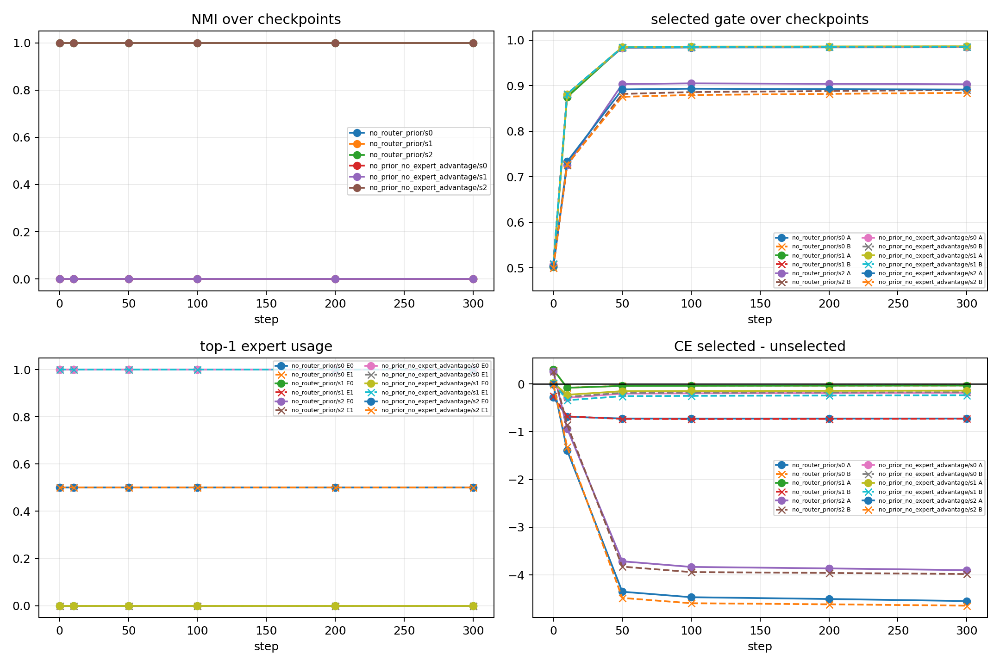
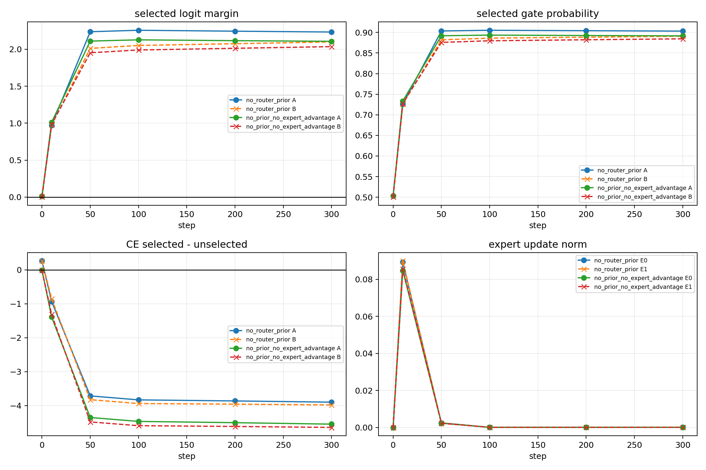
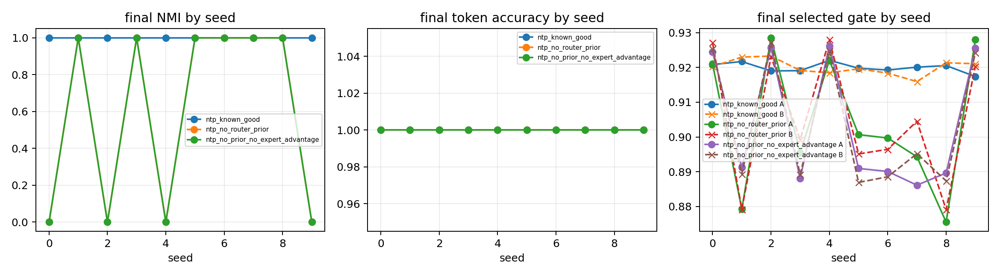

# Result Summary

Anchor: `02_ntp_style_top1_router_lockin_anchor.md`
Parent anchor: `../../anchors/expert_specialization/01_slot_context_dominance_router_specialization_anchor.md`
Protocol: `protocol_for_approval.md`
Detailed: `detailed.md`

## Closure Summary

目的：审查 top-1 router collapse 是否由 early lock-in 驱动。

问题 / 假设：如果 A/B 在 step 0/10 进入同一个 expert，selected gate 和 expert starvation 会放大 collapse；如果 A/B 初始分开，训练会稳定保持分发。

结论：当前最小 NTP-style top-1 proxy 支持这个机制判断。

关键证据：失败 seeds 在 step 0 已 collapse；成功 seed 在 step 0 split 并保持；去掉 router bias 将 random-init split 从 3/10 提高到 6/10。

结论边界：只说明最小 top-1 NTP-style proxy 的 route-pattern dynamics，不说明 full LM、attention 或 utility-aligned specialization。

下一步决策：只测试一个 anti-lock-in 机制，优先 structured router initialization。

## Observation

| audit | observation |
|---|---|
| early lock-in | failed seeds step 0 already same expert; final NMI 0 |
| success dynamics | success seed step 0 split; final NMI 1 |
| no-router-bias | random-router split improves from 3/10 to 6/10 |

## Key Figures



This is the primary figure: failed seeds are already collapsed at step 0, so
the main failure is not late optimization drift.



This is the control figure: a seed that starts split stays split and builds a
counterfactual CE advantage for the selected expert.



This is the diagnostic figure: removing router bias improves split probability
but does not guarantee route-pattern separation.

## Interpretation

```text
initial same expert -> selected-gate amplification + starvation -> collapse
initial different experts -> co-amplification -> stable route-pattern separation
router bias -> shared expert preference -> higher collapse probability
```

## Claim Update

Supported:

```text
Early top-1 assignment is the main mechanism in this minimal proxy.
```

Weakened:

```text
NTP CE alone is sufficient to discover route-pattern separation.
```

Still unclear:

```text
Which anti-lock-in mechanism transfers best to the real multi-B / slot setting.
```

## What Cannot Be Claimed

```text
utility-aligned specialization
full LM behavior
attention setting behavior
complete ABC failure explanation
```

## Next Decision

```text
Run one structured router initialization or load-balancing diagnostic.
```
