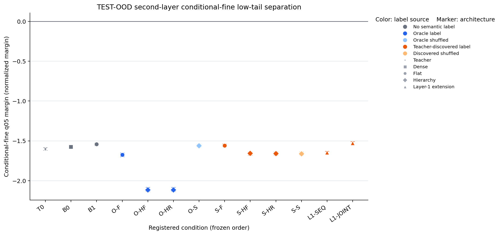

# Summary: Final-Layer Semantic Supervision And Staged Middle-Layer Expert Growth

Primary Anchor: [A15_13 Anchor](/Projects/from-attention-to-search/main/problem_anchors/15_spectral_representation_and_functional_routing/15_13_semantic_supervision_middle_layer_formation/15_13_semantic_supervision_middle_layer_formation_anchor.md)

Frozen Protocol: [protocol.md](protocol.md), SHA-256
`d90da0f617a970b905072443744a4006ef76ed0f489dc8f52f43dc3fb4d881ac`

Detailed record: [detailed.md](detailed.md)

Curated machine evidence: [aggregate.json](/Projects/from-attention-to-search/main/experiments/A15/15_13_semantic_supervision_middle_layer_formation/A15_13_E01_three_layer_semantic_supervision_residual_growth/evidence/aggregate.json),
[primary metrics](tables/primary_metrics.csv), and
[registered contrasts](tables/registered_contrasts.csv)

## Result Snapshot

**Execution closed successfully, but the scientific verdict is
`INSUFFICIENT`.** The one-node four-reserved-H100 run completed both 8,000-step
teachers and all 24 registered 4,000-step second-stage conditions. The
preflight, artifact, job-receipt, and completion audits passed. No condition
was skipped when Oracle or learned-label entrance failed.

The first failed link was the required high-level semantic entrance. Both
teachers reached 100% answer accuracy on held-out content using training
templates, but only 29.99% and 29.15% on unseen DEV templates. Their frozen
third-layer true-parent probe balanced accuracies were 50.96% and 50.35%, near
binary chance rather than the registered 80% entrance. The experiment
therefore did not establish the premise that the final layer already carried
the registered linear readout of target coarse semantics at the final layer on
the verdict distribution.

No registered representation contrast was stably positive. The primary metric
is the smaller, across the two true parents, of the TEST-OOD fifth-percentile
signed normalized fine-label margin at the effective second-layer output;
higher is better and a positive value means even the difficult low tail lies
on the correct side of its parent-specific linear boundary. Every condition's
absolute interval remained below zero.

Because the teacher entrance failed, **no group contrast qualifies for the
Protocol's tomorrow-first-view causal report**. The clearest same-direction
Oracle comparisons below are retained only as diagnostics of this failed
realization; all remain globally `INSUFFICIENT`:

| Same-direction diagnostic | Primary delta, 95% group-bootstrap interval | Paired seed deltas | Function guard | Global qualification |
| --- | ---: | ---: | --- | --- |
| Staged hierarchy, `O-F -> O-HF` | -0.441858 [-0.451985, -0.425010] | -0.222005 / -0.494056 | PASS | `INSUFFICIENT`; both seeds worsened after failed entrance |
| Remove the learned coarse direction from the fine Gate input, `O-HF -> O-HR` | +0.000537 [-0.002207, +0.002100] | +0.018272 / +0.000449 | PASS | `INSUFFICIENT`; interval crosses zero |
| Correct versus shuffled fine labels, `O-S -> O-HR` | -0.554912 [-0.564454, -0.538265] | -0.061431 / -0.656635 | PASS | `INSUFFICIENT`; correct labels did not beat shuffled labels |

The most direct semantic-supervision comparison, `B1 -> O-F`, is excluded
from that same-direction view because its seed deltas disagreed
(+0.068932/-0.179721). Its pooled delta was -0.130936
[-0.145225, -0.117843], its function guard passed, and its global
qualification remained `INSUFFICIENT`.

The learned-label entrance also failed. The two frozen candidate partitions
were balanced and had 99.64%/99.67% paraphrase agreement, but their registered
group-bootstrap stability was only 0.5377/0.7628 against the 0.80 requirement.
In the separate post-freeze diagnostic, TEST-OOD parent alignment was
50.46%/50.72% and four-leaf alignment was 26.25%/26.11%, approximately chance.
All learned-label conditions completed, but they are training diagnostics
rather than evidence that the model discovered the target semantics.

All eight registered language-function guards passed. This means no treatment
exceeded the registered *additional* degradation relative to its matched
control. It does not rescue the failed geometry metric, and it does not mean
the underlying OOD language task was good: condition answer accuracies stayed
around 28%--31% on TEST-OOD.

The zero line is the robust-separation target. All absolute condition intervals
are below it. Colors indicate label source and markers indicate architecture.

## Four-Element Knowledge Update

1. **Purpose.** Test the advisor's minimum mechanism: final-layer semantic
   information supervises the second layer; parent information is learned and
   frozen before within-parent fine splitting; the fine Gate then optionally
   reads a state with the coarse discriminant direction removed.
2. **Hypothesis.** Correct semantic labels should first beat matched
   next-token-only continuation; staged parent-first growth should then beat
   flat four-way supervision; coarse-direction removal should add a further
   gain; finally, frozen teacher-discovered labels should reproduce the Oracle
   direction and beat a shuffled-label control.
3. **Analysis method.** Hold the paired teacher, data, capacity, active adapter
   compute, training budget, and checkpoint rule fixed. Change one registered
   factor at a time. Judge TEST-OOD second-layer low-tail margins first, then
   require full-sequence NLL, answer NLL, and answer-accuracy guards.
4. **Bounded conclusion.** The current data--teacher--training instance did not
   pass the registered third-layer target-semantic linear-readability entrance,
   and neither the Oracle nor learned-label branch established a stable
   positive second-layer chain. This is a failure of the present experimental
   realization. It is not a general refutation of final-to-middle semantic
   supervision, staged freezing, or residual fine routing.

## Claim Boundary

### Can claim

- The exact approved full run completed on one reserved four-H100 node with
  two teacher seeds and all 24 second-stage conditions.
- In this run, the teachers solved held-out content under seen templates but
  failed the registered unseen-template answer and third-layer parent-semantic
  entrances.
- No registered single-variable comparison produced a stable positive
  second-layer low-tail-margin result; the entire Oracle chain above was
  non-positive or indistinguishable from zero.
- The frozen learned partitions were balanced and paraphrase-consistent but
  unstable and nearly chance-aligned with the generator's coarse/fine truth.
- Every registered relative language-function guard passed around an already
  poor OOD answer baseline.

### Cannot claim

- That the advisor's general high-level-semantic-to-low-level mechanism is
  false. Its required high-level semantic premise was not established here by
  the registered DEV-OOD final-layer linear-readability entrance.
- That staged freezing is individually harmful: `O-F -> O-HF` changes the
  hierarchy, schedule, and parent-first freeze package together.
- That subtracting one coarse Gate discriminant removes a complete shared
  semantic subspace.
- That teacher-discovered clusters are semantic, or that Search can replace
  Oracle labels.
- That low-tail linear readability implies native Gate use, expert utility,
  language-function gain, open-domain semantics, or compute advantage.
- That the layer-one conditions answer whether the first layer gained target
  semantics. They ran, but the registered aggregate evaluates the effective
  second-layer output and their learned-label prerequisite was ineligible.

## Next Decision

**Do not migrate this mechanism to a more natural semantic task yet.** First
build one repaired entrance-gate dataset in which every surface token appears
in TRAIN and OOD holds out only combinations, not an untrained embedding.
Keep full-sequence cross entropy and the three-block teacher fixed. Rerun the
two teachers; only if both meet the registered answer and third-layer semantic
entrances, run the minimal `B1` versus `O-F` Oracle comparison. Reopen staged
hierarchy and learned-label Search only after that positive control is stably
positive and passes the function guards.
