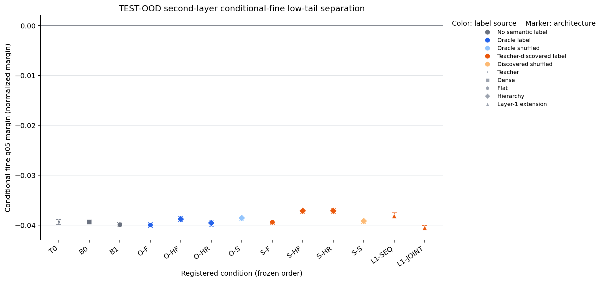
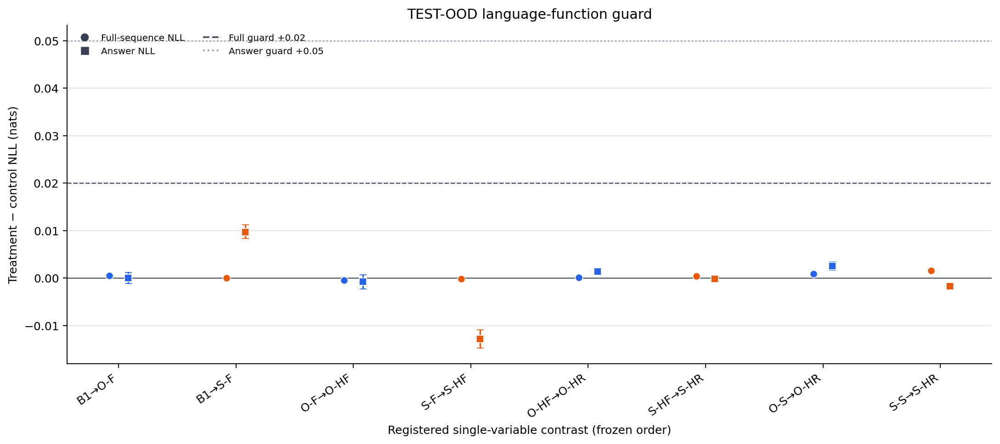

# Detailed: A15_13_E02 Repaired Teacher Entrance And Full Semantic Supervision

Primary Anchor: [A15_13](/Projects/from-attention-to-search/main/problem_anchors/15_spectral_representation_and_functional_routing/15_13_semantic_supervision_middle_layer_formation/15_13_semantic_supervision_middle_layer_formation_anchor.md)  
Frozen Protocol and registered revision: [protocol.md](protocol.md), scientific body SHA-256 `55bb327cdcd749270a6f5e88ab341dfe21e718c22afc669521a1043da900907e`, append-only amendments A1--A4  
Summary: [summary.md](summary.md)  
Result eligibility: machine evidence is complete. E02's original teacher matrix is an eligible teacher-entrance failure. E02-R's repaired teacher entrance is eligible and passed. The full second-stage grid is complete, but the registered mechanism chain is `INSUFFICIENT`. Human result judgment remains pending.

## 0. Quick Recap

**Purpose:** determine whether the original failure came from an unlearnable language task or from where the learned rule information entered the three-layer model, then execute the frozen semantic-supervision grid only after a valid teacher entrance.

**Hypothesis:** a top-only repaired teacher should learn unseen-template rule behavior while leaving h2 unsaturated; true semantic supervision should then improve h2 over matched no-semantic continuation before hierarchy and Search can be interpreted.

**Experiment logic:** complete the original 24-lineage audit; preserve its failure; repair only representation placement with a separately named lineage; gate TEST and the second stage on two non-truth seeds; execute every registered condition even if a local link fails; adjudicate with paired group bootstrap and language-function guards.

**Direct result:** the repair passed the teacher entrance in both seeds. The second stage completed, but Oracle flat supervision disagreed across seeds, Search labels failed the two-seed stability entrance, and every later hierarchy/removal/specificity link was insufficient. All function guards passed.

**Machine verdict:** teacher `PASS`; full mechanism chain `INSUFFICIENT`.

**Claim boundary:** this is a controlled synthetic representation-geometry result, not evidence about open-domain semantics, native routing, functional expert specialization, or compute efficiency.

## 1. Terminology / Definitions

| Term | Plain meaning | Concrete object / computation | Unit or formula | Why it matters | Cannot prove |
| --- | --- | --- | --- | --- | --- |
| Next-token prediction | predict every following token | cross entropy over 21 transitions in each 22-token sequence | nat/token | forces an actual causal language task | explicit rule reasoning |
| Paraphrase group | four wordings of one mathematical example | identical rule, demonstrations, and query; four distinct templates | resampling unit | prevents treating paraphrases as independent seeds | natural-language diversity |
| DEV-OOD | development on unseen wording combinations | 2,000 groups / 8,000 rows | answer accuracy and probes | selects teacher entrance without TEST | open-domain generalization |
| TEST-OOD | untouched confirmation on different unseen combinations | 6,000 groups / 24,000 rows | primary confirmation surface | adjudicates the frozen contrast | deployment performance |
| Non-truth teacher | teacher trained without generator rule/class metadata | repaired behavior branch uses only its own two-query predictions | seed-level model | enables a self-generated teacher gate | semantic correctness by itself |
| Oracle | direct generator labels | true parent/fine/leaf or affine coefficients in registered auxiliary losses | positive-control condition | tests whether correct supervision can work | deployability or self-supervision |
| Search label | truth-free partition of frozen h3 states | 16 starts, 20 group bootstraps, at most 20,000 fit groups | four frozen cluster IDs | tests label recovery without truth | true semantic alignment unless post-freeze audit passes |
| Primary q05 margin | difficult-tail fine-label separation within parents | signed L2-logistic distance divided by weight norm; fifth percentile in each parent; take worse parent | normalized margin | registered representation outcome | native Router use or expert function |
| Stable positive | reproducible positive treatment effect | both seed deltas positive and pooled one-sided 95% lower bound above zero | contrast status | protects against pooled-only effects | broad replication beyond two seeds |
| NLL guard | language degradation check | treatment minus control negative log likelihood | nat/token or nat/query | blocks representation gains bought by task damage | representation improvement |

## 2. Anchor Link And Decision Point

The Anchor asks whether final-layer semantic information can be used to shape an earlier layer, and whether the mentor's sequence—single expert, coarse split, frozen coarse path, parent-conditional fine split, optional removal of the learned coarse direction from the fine Gate—adds value over flat supervision. E02 first had to establish the premise that a three-layer teacher could learn the rule task without already saturating h2.

The ordered decision point was intentionally strict: `B1 -> O-F` had to establish that correct labels can shape h2 before `O-F -> O-HF`, residual removal, or truth-free Search could support the mechanism story.

## 3. Protocol Freeze, Conformance, And Deviations

| Registered item | Expected | Actual | Status | Evidence | Eligibility impact |
| --- | --- | --- | --- | --- | --- |
| Approval and freeze | choices 1--13 confirmed; full run authorized | protocol status and freeze recorded before run | PASS | [protocol](protocol.md) | none |
| Data identity | v2b hash `586f...caca`, exact balance and split isolation | hash and all structural audits passed | PASS | full run `logs/data_audit.log` | none |
| Hardware | one node, four reserved H100 80GB | exact inventory passed | PASS | full run `logs/gpu_contract.log`; ACP job `pt-0kqh48ql` | none |
| Original teacher matrix | 24 complete lineages | 24/24 complete | PASS | `e02-full-20260830T225500Z/teacher_matrix_completion.json` | eligible failure retained |
| Original teacher entrance | stop if h2 already saturated | every family failed only the h2 non-saturation clause | PASS | original `teacher_gate.json` | stage two correctly blocked |
| Repair A4 | distinct top-only plus behavior-distilled and Oracle pair | both seeds and both branches completed under distinct root | PASS | repaired `teacher_gate.json` | E02-R eligible |
| TEST seal | no TEST before paired non-truth entrance | unseal receipt written after both behavior seeds passed | PASS | `test_unsealed.json` | none |
| Second-stage grid | 13 records per seed including T0, 24 trainable conditions total | 26 records / 24 trainable receipts complete | PASS | `stage2/completion.json` | none |
| Analysis | fixed B1 probe penalty, 2,000 paired group bootstraps | aggregate records selected C=1.0 and 2,000 draws | PASS | `stage2/results/aggregate.json` | none |
| Figures | primary margin and language guards | both rendered and visually audited | PASS | [figures](/Projects/from-attention-to-search/main/experiments/A15/15_13_semantic_supervision_middle_layer_formation/A15_13_E02_repaired_rule_induction_teacher_entrance_and_full_semantic_supervision/figures) | none |

**Frozen Protocol revision:** scientific body SHA-256 `55bb327cdcd749270a6f5e88ab341dfe21e718c22afc669521a1043da900907e`.

**Execution scope approved:** implementation, tests, data, smoke, troubleshooting within frozen candidates, original 24-lineage full audit, A4 repaired entrance, and gated full second stage.

**Amendments:** A1 clarified objective/optimizer/entrance operations before training; A2 restored seed-paired initialization; A3 removed leaf/template coupling and froze v2b; A4 preserved the failed joint-training run and added the separately named top-only behavior-distilled repair after development-only diagnosis.

**Retries and exclusions:** a three-step engineering smoke and v2a are ineligible by construction. The first repaired cluster smoke exposed a distributed error-propagation hang when too few steps produced only three behavior signatures; it was stopped, reproduced locally, fixed with a durable error receipt, and replaced by a 1,000-step engineering smoke. Neither smoke contributes scientific values.

**Missing conditions or artifacts:** none for the registered E02-R full run.

**Post-hoc analyses:** post-freeze Oracle alignment of Search labels is registered as a diagnostic and never selected the labels. No post-hoc result is used to rescue a primary contrast.

## 4. Actual Setup

**Data:** modulo-11 affine rules with four target leaves: `u+1`, `u+3`, `-u+3`, and `-u+1`. Each visible row contains three demonstrations and one query in natural-language-like templates; labels never appear in text. TRAIN has 25,000 groups / 100,000 rows; DEV-ID and DEV-OOD each 2,000 / 8,000; TEST-ID 3,000 / 12,000; TEST-OOD 6,000 / 24,000. D1 and D2 each add 81,360 rows, with D2 spanning 113 non-target affine rules.

**Teacher:** three decoder blocks, width 256, eight attention heads, feed-forward width 1,024, pre-normalization, SwiGLU, rotary positions, tied embeddings/head, zero dropout. AdamW uses learning rate $3\times10^{-4}$, weight decay 0.1, global batch 256, 5% warm-up, cosine decay, gradient clipping 1.0, bfloat16 activations, and float32 losses.

**Original training:** `D0,D1,D2 x O0,O1,O2,O3 x seeds 1701,2903`. D0 uses 8,000 target updates; D1/D2 use 8,000 pretraining plus 8,000 target updates. O1 adds answer cross entropy with weight 0.2; O2 adds truth-free paraphrase consistency; O3 adds Oracle affine-coefficient heads.

**Repair training:** for each seed, D0-O1 trains for 8,000 target updates with embeddings/tied head and Blocks 1--2 frozen; only Block 3 and final normalization update. The frozen base predicts answers for query 0 and query 1; these two predictions define its own affine behavior signature. The four most frequent signatures become labels and rare signatures map to the nearest center modulo 11. A non-truth behavior branch and matched Oracle coefficient branch then train for 2,000 updates with the same 10% shared-gradient auxiliary calibration while lower layers remain frozen.

**Second-stage architecture:** freeze the repaired base model and insert modules after Block 2. `B1/O-F/S-F` are matched flat adapters. Hierarchy uses two parent and four leaf adapters. The schedule is 500 root language-only steps, 1,500 coarse steps, then 2,000 fine steps; at the fine transition the coarse Gate and parent experts freeze. Residual conditions remove only the normalized learned coarse discriminant from the fine Gate input. `L1-SEQ` and `L1-JOINT` test whether supervision propagated to the first layer sequentially or jointly.

**Seeds:** 1701 and 2903 are the two independent model initializations and the only across-run replication units. Paraphrase groups are the within-seed bootstrap units, not additional model seeds.

**Worker:** `/data/250010109/MoE_Router/experiments/20260830_a15_13_semantic_supervision_hierarchical_experts`. Full repaired run: `runs/e02r-full-20260831T000800Z`. ACP job: `pt-0kqh48ql`, one reserved `n6ls.iu.i40.4` node with four H100 80GB GPUs.

## 5. Metrics And Registered Decision Rules

Teacher entrance requires both non-truth seeds to have DEV-ID answer accuracy at least 95%, DEV-OOD at least 85%, h3 true-parent balanced probe accuracy at least 80%, and raw h2 worse-parent conditional-fine q05 at most zero.

The second-stage primary value is the worse of two parent-specific TEST-OOD fifth-percentile normalized fine margins. Parent-specific L2-logistic probes fit on TRAIN. The penalty is selected once on `B1` DEV-OOD (`C=1.0`) and reused everywhere. Each contrast uses 2,000 paired complete-group bootstrap draws, stratifies by true parent, and pools the two seeds equally. `STABLE_POSITIVE` requires both seed deltas above zero and a positive pooled one-sided 95% lower bound.

Function guards require the pooled 95% upper bound of treatment-minus-control full-sequence NLL at most +0.02 nat/token, answer NLL at most +0.05 nat/query, and the answer-accuracy lower bound at least -0.01.

## 6. Evidence Lineage

| Claim or decision | Protocol criterion | Raw artifact | Computation / revision | Aggregation and uncertainty | Observed value | Eligibility | Verdict | Limitation |
| --- | --- | --- | --- | --- | --- | --- | --- | --- |
| Repaired teacher unlocks stage two | all four entrance checks in both non-truth seeds | `teacher_gate.json`; teacher evaluation arrays | fixed DEV probes and threshold checks | no averaging-to-pass across seeds | both seeds pass; DEV-OOD 99.03% / 97.38% | ELIGIBLE | PASS | synthetic task only |
| Oracle labels shape h2 | `O-F - B1` stable positive plus guards | paired TEST-OOD evaluation arrays | fixed probes; treatment-minus-control q05 | 2,000 paired group draws, equal seeds | -0.000046; interval [-0.000333, 0.000171]; seed signs differ | ELIGIBLE | INSUFFICIENT | two seeds and one regularizer realization |
| Search labels are admissible | both frozen partitions pass balance, paraphrase, stability | frozen Search receipts | truth-free fitting; post-freeze audit | 20 group bootstraps per seed | stability 0.357 / 0.813 | ELIGIBLE DIAGNOSTIC | INSUFFICIENT | clustering algorithm-specific |
| Search flat changes geometry | `S-F - B1` stable positive plus guards | paired TEST-OOD arrays | same fixed probes | 2,000 paired draws | +0.000488; interval [+0.000247,+0.000704] | BOUNDED | stable geometric shift only | Search gate and semantic alignment fail |
| Hierarchy adds value | flat-to-hierarchy positive in both seeds | Oracle/Search condition arrays | paired q05 differences | 2,000 paired draws | one negative seed in each link | ELIGIBLE | INSUFFICIENT | ordered Oracle prerequisite already insufficient |
| Residual removal adds value | full-state-to-residual positive in both seeds | O-HF/O-HR and S-HF/S-HR arrays | paired q05 differences | 2,000 paired draws | Oracle pooled negative; Search near zero; seed disagreement | ELIGIBLE | INSUFFICIENT | removes one learned direction only |
| Language function preserved | all three guard inequalities | TEST-OOD NLL/accuracy arrays | treatment-minus-control | paired group bootstrap | all eight contrasts pass | ELIGIBLE | PASS GUARD | cannot establish representation benefit |

Full numeric tables are in [tables/result_tables.md](tables/result_tables.md).

## 7. Main Results

### 7.1 Original joint-training audit: valid failure

All 24 teacher lineages learned unseen-template answering, typically near 100%, and h3 parent information was highly readable. They all failed the entrance for the same reason: h2 was already strongly fine-separable. D0-O0, for example, had raw h2 q05 0.256 and 0.324. More pretraining or truth supervision generally increased this saturation. The original status `FAIL_NO_NONTRUTH_TEACHER_ENTRANCE` therefore localizes the problem to representation placement rather than task non-learning.

### 7.2 Repaired teacher: eligible pass

Top-only training plus behavior distillation reached DEV-OOD answer accuracy 99.03% and 97.38%, h3 parent balanced accuracy 98.73% and 96.05%, while raw h2 q05 stayed -0.0223 and -0.0325. The paired Oracle branches also passed but were non-selectable. TEST was unsealed only afterward.

### 7.3 Oracle positive control: insufficient

`O-F - B1` is the first causal link. Its pooled effect was effectively zero and its two seed deltas had opposite signs. All language guards passed, so the result is not explained by language-function collapse. Under the frozen rule this is `INSUFFICIENT`, not a pass and not an eligible stable-negative failure.

### 7.4 Search labels: geometric effect without semantic admissibility

`S-F - B1` met the numerical stable-positive geometry rule. However, one Search partition had bootstrap stability 0.357, far below 0.80, and the post-freeze four-way alignment was approximately 26% accuracy with adjusted mutual information near zero. The partition therefore cannot be called the intended four semantic labels. The observed shift is bounded to “this frozen partition changed the probe geometry.”

### 7.5 Mentor-intuition architecture links: not supported by this run

Oracle and Search flat-to-hierarchy comparisons each had a positive pooled estimate but a negative second-seed delta. Coarse-direction removal was negative for Oracle and essentially zero for Search, again with seed disagreement. Correct versus shuffled labels also disagreed across seeds. `L1-SEQ` and `L1-JOINT` remained negative in absolute q05 and were not registered to rescue failed earlier links.

## 8. Visualization Results

### Primary second-layer difficult-tail separation

**Purpose:** compare all frozen conditions on the registered representation outcome.  
**Metric:** worse-parent TEST-OOD q05 normalized fine margin.  
**Source:** aggregate SHA-256 `df507e...fb0f`; lineage rows above.  
**Aggregation:** fixed TRAIN probes, equal seed pooling, 2,000 complete-group bootstraps.  
**How to read:** higher is better; zero is the positive-separation boundary; color is label source and marker is architecture.  
**Observed result:** all absolute values remain between roughly -0.041 and -0.037.  
**Allowed conclusion:** conditions differ slightly in synthetic probe geometry.  
**Cannot prove:** semantic discovery, routing use, expert utility, or open-domain transfer.

### Language-function preservation

**Purpose:** determine whether representation interventions damaged the causal language task.  
**Metric:** treatment-minus-control full-sequence and answer NLL in nats.  
**Source:** same aggregate and paired contrasts.  
**Aggregation:** 2,000 paired complete-group bootstrap draws.  
**How to read:** values below the +0.02 and +0.05 guard lines pass.  
**Observed result:** every contrast passes both NLL guards and the separately stored answer-accuracy guard.  
**Allowed conclusion:** no registered contrast failed because of excessive language-function degradation.  
**Cannot prove:** that representation geometry improved.

## 9. Stage Evidence And Failure Decomposition

| Stage | Evidence | Status | Failure reason | What this rules out | What remains live |
| --- | --- | --- | --- | --- | --- |
| Data | exact counts, balance, token support, split isolation, leakage audit | PASS | none | malformed or shortcut-coupled v2 data | synthetic-to-natural transfer |
| Original teacher learning | near-perfect OOD answers in 24 lineages | PASS task / FAIL entrance | h2 already saturated | “tiny model simply cannot learn this task” | representation placement |
| Repaired teacher | both behavior seeds pass | PASS | none | teacher non-learning and missing h3 readout | downstream objective coupling |
| Search construction | one seed stability 0.357; truth alignment near random | INSUFFICIENT | partition not reproducible in both seeds | semantic interpretation of Search gains | alternative label construction |
| Oracle flat shaping | opposite seed deltas | INSUFFICIENT | no reproducible positive-control effect | strong claim that correct labels reliably shape h2 | gradient strength/location and metric sensitivity |
| Hierarchy/residual | all later links have seed disagreement | INSUFFICIENT | prerequisites and replication fail | hierarchy advantage claim | only after objective coupling is fixed |
| Language guards | all pass | PASS | none | catastrophic task degradation | subtle function differences below guards |

**Failure localization:** the data and teacher-learning priors are not falsified by E02-R. The current bottleneck is the second-stage operationalization: correct labels did not reproducibly move the registered h2 low-tail metric, and the truth-free Search did not recover a stable semantic partition. This does not prove the mentor's physical intuition false; it shows that this implementation does not yet instantiate it in an identifiable way.

## 10. Full Experiment Record

- Original full job: `pt-f2192fu8`, state `SUCCEEDED`, run `e02-full-20260830T225500Z`, 24/24 teacher lineages, stage two correctly blocked.
- Repaired smoke 1: `pt-nv8oqed4`, engineering-only and stopped after exposing three-signature/error-propagation behavior.
- Repaired smoke 2: `pt-ai98x660`, state `SUCCEEDED`, 151 tests and mechanically complete smoke grid.
- Repaired scientific full job: `pt-0kqh48ql`, state `SUCCEEDED`, run `e02r-full-20260831T000800Z`.
- Data hash: `586f53b12289beebe90f81fa1ecf33b7e865898613f3782e0c5452ec5751caca`.
- Aggregate hash: `df507efaaab6f0e4773567ac47d4d55b68ccc5998dc0ae394b33efae3e11fb0f`.
- Completion: 24 trainable condition receipts, two teacher records, 26 registered seed-condition records including T0.
- Tests in cluster: 151 passed, 70 warnings; no failures.

## 11. Interpretation

The strongest supported update is a separation between three questions that had previously been conflated. First, the tiny model can learn the repaired rule task. Second, freezing lower layers can place task knowledge primarily in the final block while retaining an unsaturated h2. Third, neither fact guarantees that a downstream classification auxiliary loss will causally reshape h2 in the registered low-tail geometry. The third question remains unresolved here.

Search supplies an additional distinction: a final state can be highly readable with truth-supervised probes while unsupervised clustering of that state fails to recover the intended labels. Readability and discoverability are different evidentiary levels.

## 12. Claim Boundary

**Can claim:** the repaired teacher entrance is feasible in both seeds; the original saturation failure was not a lack of task learning; the complete second-stage matrix and language guards ran; the Oracle positive control and all hierarchy links are insufficient under the registered replication rule; the Search partition is not eligible as the intended semantic label source.

**Cannot claim:** direct semantic supervision is generally ineffective; the mentor's intuition is false; Search can never recover semantic labels; hierarchy has no value under a better-coupled objective; the probe geometry is native routing or functional specialization; the synthetic result transfers to natural language.

## 13. Next Decision

**AI-proposed decision, pending researcher ownership:** audit the Oracle auxiliary objective's direct coupling to effective h2 before running any new hierarchy or Search variant.

**Completion criterion:** on development data only, measure a non-zero Oracle gradient/update on h2 and a same-direction h2 margin change in both seeds relative to B1, with teacher, data, labels, and architecture fixed.

**Resume action:** the researcher records the closed-book direct result, updated judgment, cannot-claim boundary, and one next decision in the active Focus. Do not write a daily report or promote a new protocol until that human result account exists.

## 14. Artifact Manifest

| Artifact | Purpose | Producer / revision | Source inputs | Hash or identity | Complete | Claim-eligible | Notes |
| --- | --- | --- | --- | --- | --- | --- | --- |
| `protocol.md` | frozen contract | Research_System, A1--A4 | confirmed design | scientific body `55bb...907e` | yes | yes | append-only after start |
| v2b manifest/audit | data identity | `e02_data.py` | target and affine-rule generators | dataset `586f...caca` | yes | yes | raw data remains worker-side |
| original teacher gate | saturation failure | `e02_pipeline.py` | 24 teacher lineages | run `e02-full-20260830T225500Z` | yes | yes | retained unchanged |
| repaired teacher gate | stage-two authorization | `e02_repair_runner.py` | paired behavior and Oracle branches | run `e02r-full-20260831T000800Z` | yes | yes | Oracle non-selectable |
| Search receipts | truth-free partitions | `e02_stage2.py` | frozen h3 TRAIN states | seeds 1701/2903 | yes | diagnostic | one seed fails entrance |
| stage-two aggregate | all metrics and contrasts | `analysis.py`, 2,000 draws | 26 evaluation records | SHA-256 `df507e...fb0f` | yes | yes/bounded by row | primary source |
| `tables/result_tables.md` | curated numeric reading path | this evidence audit | aggregate and gate receipts | canonical table | yes | yes | no new computation |
| `e02r_primary_margin.png` | primary geometry figure | `render_results.py` | aggregate | SHA-256 `5e82...1fb2` | yes | yes | visually audited |
| `e02r_language_guard_nll.png` | function-guard figure | `render_results.py` | aggregate | SHA-256 `7677...759` | yes | yes | visually audited |
| job `pt-0kqh48ql` | hardware/execution receipt | SCO ACP | full pipeline | `SUCCEEDED` | yes | yes | four reserved H100 |

## 15. Links

- Anchor: [A15_13 anchor](/Projects/from-attention-to-search/main/problem_anchors/15_spectral_representation_and_functional_routing/15_13_semantic_supervision_middle_layer_formation/15_13_semantic_supervision_middle_layer_formation_anchor.md)
- Protocol: [protocol.md](protocol.md)
- Summary: [summary.md](summary.md)
- Tables: [result tables](tables/result_tables.md)
- Code workspace: `/data/250010109/MoE_Router/experiments/20260830_a15_13_semantic_supervision_hierarchical_experts`
- Runner: `scripts/run_e02r_pipeline.sh`
- Data: `runs/e02-data-v2b-1701`
- Original failed run: `runs/e02-full-20260830T225500Z`
- Repaired full run: `runs/e02r-full-20260831T000800Z`
- Figures: [figures](/Projects/from-attention-to-search/main/experiments/A15/15_13_semantic_supervision_middle_layer_formation/A15_13_E02_repaired_rule_induction_teacher_entrance_and_full_semantic_supervision/figures)
- Job IDs: original `pt-f2192fu8`; repaired full `pt-0kqh48ql`
