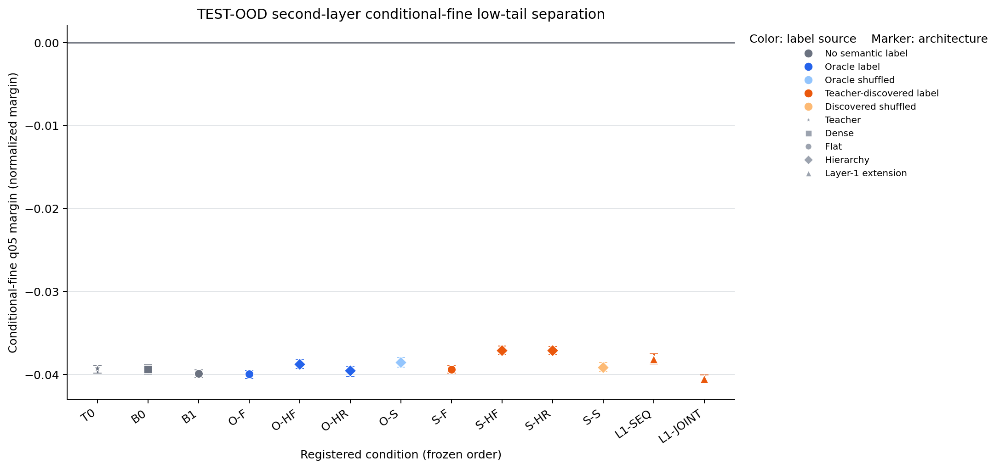
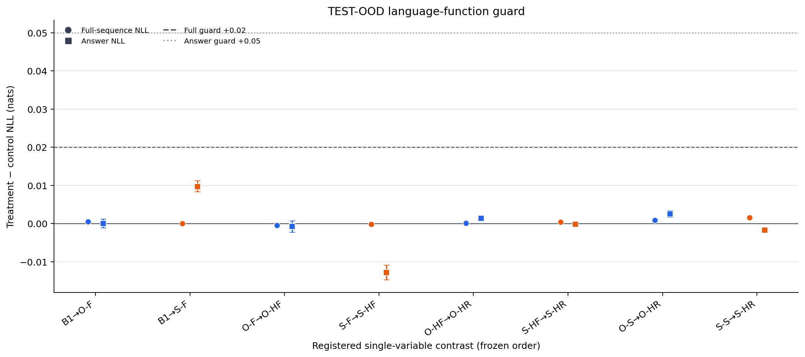

# Summary: A15_13_E02 Repaired Teacher Entrance And Full Semantic Supervision

Primary Anchor: [A15_13](/Projects/from-attention-to-search/main/problem_anchors/15_spectral_representation_and_functional_routing/15_13_semantic_supervision_middle_layer_formation/15_13_semantic_supervision_middle_layer_formation_anchor.md)  
Frozen Protocol: [protocol.md](protocol.md)  
Detailed record: [detailed.md](detailed.md)  
Result status / eligibility: the repaired teacher entrance is eligible and passed; the complete second-stage matrix is present, but the registered mechanism chain is `INSUFFICIENT` because its Oracle positive control disagreed across seeds and the Search-label entrance failed one seed. The researcher's closed-book result judgment has not yet been recorded.

## Result Snapshot

**Machine verdict:** teacher `PASS`; Oracle flat semantic link `INSUFFICIENT`; Search entrance `INSUFFICIENT`; every hierarchy, residual-removal, and specificity link `INSUFFICIENT` under the registered two-seed rule.

**What the measurements establish:** the repaired data plus top-only, behavior-distilled training produced two non-truth teachers that answer unseen template combinations while leaving the second layer unsaturated. This resolves the upstream teacher-learning blocker.

**What the measurements do not establish:** direct true-label supervision did not stably improve the second-layer low-tail margin over matched flat continuation, and the truth-free Search partition was not reproducible in both seeds or aligned with the generator's four semantic classes. The run therefore does not support the full “final-layer semantics -> earlier-layer semantic separation -> hierarchy advantage” chain.

**AI-proposed next decision, pending researcher ownership:** audit the coupling between the Oracle classification loss and the effective second-layer state before changing hierarchy, routing, data, or teacher training again.

## Decision-Bearing Setup

**Question:** after a valid three-layer teacher has learned the task, can labels derived from its final-layer information causally improve second-layer parent-conditional fine separation, and do staged hierarchy and coarse-information removal add value over flat supervision?

**Treatment and control:** first compare true-label flat supervision `O-F` with no-semantic flat continuation `B1`. Only if that positive control is stable are Oracle hierarchy and Search interpretations admissible. Search conditions use a truth-free frozen partition; shuffled-label conditions control arbitrary auxiliary classification.

**Changed variable:** second-stage supervision source and inserted adapter/routing architecture.

**Held fixed:** two repaired seed-matched teachers, data and splits, frozen base Transformer, training budgets, optimizer, probe selection, TEST seal, 2,000-draw paired bootstrap, and language-function guards.

**Primary metric and unit:** the smaller of the two true-parent-specific fifth-percentile normalized fine-label margins on held-out TEST-OOD paraphrase groups. Higher is better; a treatment contrast is stable positive only if both seed deltas are positive and the pooled one-sided 95% lower bound is above zero. A positive readout margin is evidence of this probe geometry, not native Router use or expert utility.

## Verdict Basis

| Registered rule | Observed value | Guard / eligibility | Machine verdict | Evidence source |
| --- | --- | --- | --- | --- |
| Both non-truth teacher seeds pass four entrance checks | Seed 1701: DEV-OOD 99.03%, h3 parent 98.73%, h2 q05 -0.0223; seed 2903: 97.38%, 96.05%, -0.0325 | Data, hardware, seed, and TEST-seal receipts pass | PASS | [teacher table](tables/result_tables.md#teacher-entrance) |
| Oracle flat must improve over no-semantic flat | Delta -0.000046, 95% interval [-0.000333, 0.000171]; seed deltas +0.000640 / -0.001227 | Language guard passes; seed directions disagree | INSUFFICIENT | [contrast table](tables/result_tables.md#registered-second-stage-contrasts) |
| Both frozen Search partitions must pass | Stability 0.357 / 0.813; first seed is below 0.80 | No truth read during fitting; both-seed prerequisite fails | INSUFFICIENT | [Search table](tables/result_tables.md#search-label-entrance) |
| Search flat improves geometry over B1 | Delta +0.000488, 95% interval [+0.000247, +0.000704]; both seed deltas positive | Language guard passes, but Search semantic entrance fails | Stable geometric shift; ineligible as semantic evidence | [contrast table](tables/result_tables.md#registered-second-stage-contrasts) |
| Later hierarchy/removal/specificity links pass | Every later comparison has at least one non-positive seed delta | Function guards pass; ordered prerequisite already failed | INSUFFICIENT | [contrast table](tables/result_tables.md#registered-second-stage-contrasts) |

## Key Evidence

The original joint-training matrix completed 24/24 lineages and learned the language task, but every candidate had already made raw h2 fine separation positive; it therefore failed the registered “high layer knows, middle layer not yet saturated” entrance. Amendment A4 repaired placement rather than adding more data or steps: embeddings, language head, and Blocks 1--2 stayed frozen while Block 3 learned the task, followed by behavior-label distillation. Both repaired seeds passed.

The second stage then completed all 24 trainable conditions plus the two teacher records on one reserved four-H100 node. All eight registered language-function contrasts stayed within the negative-log-likelihood and answer-accuracy guards. The lack of a stable Oracle representation benefit therefore cannot be explained by catastrophic loss of the language task.

## Central Figures

Each point is one condition's pooled TEST-OOD primary value; error bars are 95% complete-group bootstrap intervals. Color denotes label source and marker denotes architecture. All absolute low-tail margins remain negative. This figure compares synthetic probe geometry only.

Circles and squares show treatment-minus-control full-sequence and answer negative log likelihood in nats. Dashed and dotted lines are the frozen upper guards. Every registered comparison stays below its guard; this cannot rescue a failed or ineligible representation contrast.

## Claim Boundary

**Can claim from eligible evidence:** the revised synthetic data and repaired teacher-training placement can make a tiny three-layer Transformer solve the unseen-template affine task while preserving an unsaturated earlier layer; the full registered second-stage grid and function guards completed.

**Cannot claim:** that direct semantic regularization robustly shaped h2; that the truth-free Search recovered the four intended semantic labels; that hierarchy, fixed coarse paths, or coarse-removal routing improved representation geometry; that probes imply Router readability or expert utility; or that any result transfers to natural language or larger models.

## Next Decision

**AI-proposed decision:** before another full architecture run, perform one objective-coupling audit that verifies whether the Oracle auxiliary gradient reaches and changes effective h2 in the intended semantic direction.

**Completion criterion:** demonstrate, on development data only, both a non-zero Oracle-to-h2 gradient/update effect and a reproducible h2 margin change relative to `B1` in both seeds, without changing the teacher or data.

**Resume action:** the researcher records or corrects the direct result, claim boundary, and one next decision in the active Focus; only then may this proposal become the project-owned next experiment or a daily report be written.
