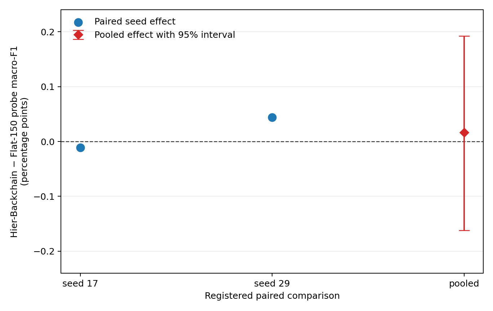
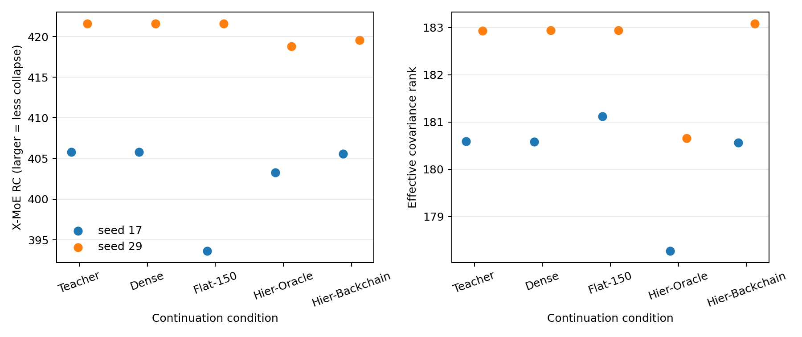

# Detailed: A15_13_E03 Qwen3-0.6B CLINC150 One-Layer Backward Hierarchical Router

Primary Anchor: [15_13_01_clinc150_one_layer_backward_hierarchical_router_anchor.md](/Projects/from-attention-to-search/main/problem_anchors/15_spectral_representation_and_functional_routing/15_13_semantic_supervision_middle_layer_formation/subanchors/15_13_01_clinc150_one_layer_backward_hierarchical_router_anchor.md)  
Frozen Protocol and registered revision: [protocol.md](protocol.md), approved before execution on 2026-08-30  
Summary: [summary.md](summary.md)  
Result eligibility: machine evidence complete and eligible; registered verdict `INSUFFICIENT`; researcher judgment pending

## 0. Quick Recap

**Purpose:** replace the stalled synthetic-rule task with a real fine-grained language task and test the advisor-aligned rule at one middle layer: learn coarse structure, freeze it, remove coarse routing information, and continue with fine experts supervised from the final layer.

**Hypothesis:** `HIER_BACKCHAIN` should produce a higher domain-local fine-intent linear-probe macro-F1 than the matched `FLAT150` Router without losing more than one final-task F1 point.

**Experiment logic:** train two common Qwen3-0.6B teachers; freeze each teacher; insert one residual Router after block 15; run Dense, Flat, Oracle hierarchy, and learned backward hierarchy; select only on development; unseal test once; compare learned hierarchy with Flat using paired seeds and 10,000 stratified bootstrap draws.

**Direct result:** seed effects were -0.0109 and +0.0440 percentage points. The pooled effect was +0.0166 points, 95% interval [-0.1618, +0.1922]. Final-task changes were -0.4297 and +0.1717 points.

**Eligibility:** eligible. Data, teacher, resource, identity, paired-run, test, and completion guards passed after pre-decision implementation corrections described below.

**Verdict:** `INSUFFICIENT`, because seed directions disagree and the pooled interval crosses zero.

**Claim boundary:** this rejects promotion of the exact learned-chain recipe as demonstrated improvement; it does not reject the advisor's general hierarchy intuition.

## 1. Terminology / Definitions

| Term | Plain meaning | Concrete object / computation | Unit or formula | Why it matters | Cannot prove |
| --- | --- | --- | --- | --- | --- |
| Next-token loss | predict each next token in the visible utterance | causal cross entropy on all non-padding input tokens | mean cross entropy per token | preserves a language-model continuation objective | rule reasoning or out-of-distribution generalization |
| Teacher | common stage-one Qwen model used by all stage-two arms of one seed | Qwen3-0.6B plus 150-intent and 10-domain heads | validation metrics | proves the base model can perform the real task | middle-layer causal mechanism |
| Fine-intent probe | frozen linear readout of fine intent from the target representation | 10 separate 15-way multinomial logistic regressions; regularization selected on development | macro-F1, percent | primary separability measure | expert utility or nonlinear information |
| Backward chain | final semantic distribution supervises an earlier Router | teacher soft intent probabilities become parent and conditional child targets | semantic cross entropy | operationalizes final-to-middle supervision | unsupervised semantic discovery |
| Freeze-and-remove | retain the coarse path and remove its linear routing direction before fine gating | freeze parent gate/experts; project child-gate input out of centered parent-gate row space | deterministic transform | matches the advisor's “freeze coarse, continue fine” intuition | removal of every possible coarse semantic feature |
| X-MoE RC | within-class scatter relative to between-class scatter | $\mathrm{Tr}(\Sigma_W\Sigma_B^\dagger)$ over 150 intents | nonnegative scalar; smaller means stronger collapse | secondary collapse guard | semantic separability by itself |
| Effective rank | spread of covariance energy over dimensions | exponentiated entropy of normalized covariance eigenvalues | effective dimensions | secondary geometry guard | task relevance |
| Paired bootstrap | resample the same test utterances for treatment and control | sample within each intent 10,000 times and recompute the equally weighted domain score | 95% percentile interval | uncertainty for the primary contrast | independent model replications beyond two seeds |

## 2. Anchor Link And Decision Point

The parent question is whether final-layer semantics can actively shape an earlier representation, rather than merely reveal information already readable there. E03 makes this decidable in a real task by comparing the advisor-aligned hierarchy with a budget-matched nonlinear flat Router. The decision point is whether to promote the exact learned backward chain beyond this one-layer 0.6B setting.

## 3. Protocol Freeze, Conformance, And Deviations

| Registered item | Expected | Actual | Status | Evidence | Eligibility impact |
| --- | --- | --- | --- | --- | --- |
| Data | official CLINC150 closed-set hierarchy | raw 15,000/3,000/4,500; five exact cross-split text duplicates removed from later splits, yielding 15,000/2,997/4,498 | Conformant | `data/data_audit.json` | none |
| Model | official Qwen3-0.6B-Base | local official 28-layer, hidden-size-1024 checkpoint | Conformant | `config.json`, model files | none |
| Resources | one 8x5090 Spot node; no H100 fallback | `n12lp.nn.i10a.8`, eight RTX 5090 devices, 32 GiB each | Conformant | GPU preflight logs and job receipts | none |
| Teacher gate | intent >=85%, domain >=95%, weakest domain-local intent >=75% | 94.09/95.15/93.27% and 93.91/95.22/91.68% for seeds 17/29 | Passed after scope correction | teacher selections and before-fix copies | none; checkpoint unchanged |
| Domain-local F1 implementation | score only the 15 registered intents in each domain | initial code also added off-domain predicted classes to the macro denominator; corrected before stage two | Corrected pre-decision | `selection_before_metric_scope_fix.json`, `repair_teacher_metric.py` | no model or checkpoint change; aligns code with Protocol wording |
| Mixed precision | BF16 Qwen, FP32 heads/Router | explicit FP32 head/Router computation with BF16 residual return | Corrected in smoke | failed smoke logs; passing smoke report | none after passing identity and gradient guards |
| Layer interface | wrapped Qwen block retains required interface | `attention_type` forwarded from original block | Corrected in smoke | failed and passing smoke jobs | none after passing smoke |
| Stage-two execution | incomplete conditions restart from teacher | first attempt stopped before any pass checkpoint because 8 processes each opened about 195 CPU threads; restarted with four threads per process | Conformant condition-level restart | stopped job and final histories | none; no partial checkpoint reused |
| Test unsealing | one analysis after development selection | one complete analysis generated; platform retry reused `aggregate.json` and did not recompute test | Conformant | analysis timestamps and resume guard | none |
| Completion audit | all required artifacts | first path check looked under `artifacts/` instead of `data/`; corrected after metrics existed | Engineering correction | old and final completion logs | none to scientific values |
| Main figure | show the registered contrast legibly | initial 0–100 absolute-score view replaced after result by a delta-and-interval view from the unchanged aggregate | Visualization-only amendment | figure hashes | none; no estimator change |

Frozen Protocol revision: the approved [protocol.md](protocol.md) remained the scientific contract.  
Execution scope approved: user delegated data/task selection and requested autonomous full execution on 4 or 8 non-H100 GPUs; the canonical available profile was 8 RTX 5090 GPUs.  
Retries and exclusions: two failed smoke jobs, one safely stopped stage-two attempt with no pass checkpoint, one full job stopped at the teacher gate due the metric-scope bug, and one final job retry caused only by the completion-audit path. No example, seed, or completed arm was excluded.  
Post-hoc analyses: none used for the verdict. The Oracle difference and geometry measures are descriptive secondary evidence only.

## 4. Actual Setup

**Research question:** Does the learned final-to-middle coarse-to-fine Router improve fine-intent linear separability over a matched flat Router?

**Data construction and provenance:** official CLINC150 in-scope utterances and `domains.json`: 150 intents arranged as 10 domains with 15 intents each. Exact normalized text overlap was removed by train-then-development-then-test priority without consulting labels. Inputs were rendered as `User request: <utterance>`.

**Train / development / confirmation split:** 15,000 train, 2,997 development, 4,498 test. Development selected checkpoints and linear-probe regularization. Test was used only after all eight stage-two selections existed.

**Learning task and supervision:** full visible-sequence causal next-token cross entropy plus 150-way intent cross entropy plus 0.2 times 10-way domain cross entropy for the teacher. Stage two kept that task loss and added the condition-specific semantic Router loss.

**Model / architecture / algorithm:** Qwen3-0.6B-Base, 28 decoder blocks, hidden size 1024. One residual module was inserted after zero-indexed block 14, meaning after the 15th block. Each expert used a 1024-to-48-to-1024 SiLU bottleneck and residual scale 0.1. Router and expert output projections were zero-initialized.

**Training stages:**

1. Teacher: three epochs, two seeds 17 and 29, global batch 256, base learning rate $2\times10^{-5}$, head rate $10^{-4}$.
2. Stage two: freeze the teacher and all original weights; four full passes, micro-batch 64, global batch 256, Router rate $3\times10^{-4}$.
3. Hierarchical passes: shared expert in pass 1; 10 parent domain experts in pass 2; freeze parent and train 150 conditional child experts in passes 3–4. The child gate receives the representation after removing the centered parent-gate row space.

**Conditions:**

- `DENSE`: two shared dense residual experts, task continuation only; 198,752 trainable residual parameters.
- `FLAT150`: 150 experts, top-2, teacher soft fine-intent supervision; 15,060,150 trainable residual parameters.
- `HIER_ORACLE`: the registered hierarchy with gold domain and fine-intent labels.
- `HIER_BACKCHAIN`: the same hierarchy with teacher soft domain and conditional fine-intent distributions.

**Checkpoint selection:** highest development domain-local fine-intent probe score, then lower intent cross entropy, then earlier pass. Hierarchical selection was restricted to child-stage passes 3–4.

**Selected passes:** seed 17: Dense 1, Flat 3, Oracle 3, Backchain 3. Seed 29: Dense 1, Flat 1, Oracle 3, Backchain 4.

**Known setup limitations:** only one target layer, one small base model, one intent dataset, two model seeds, a fixed human-provided hierarchy, and a linear-readout primary metric.

## 5. Metrics And Registered Decision Rules

The primary score is the equal mean of 10 domain-local 15-way probe macro-F1 values. The primary effect is `HIER_BACKCHAIN - FLAT150` in percentage points. A Pass requires both seed effects above zero, the pooled 95% interval lower bound above zero, and no seed losing more than one final intent-F1 point. Missing, nonfinite, incomplete, resource-invalid, or guard-invalid evidence is Insufficient.

Secondary measures cannot rescue the primary result: final task F1, 5-nearest-neighbor F1, normalized centroid margin fifth percentile, X-MoE RC, effective rank, Router normalized mutual information, load entropy, and utilization.

## 6. Evidence Lineage

| Claim or decision | Protocol criterion | Raw artifact | Computation / revision | Aggregation and uncertainty | Observed value | Eligibility | Verdict | Limitation |
| --- | --- | --- | --- | --- | --- | --- | --- | --- |
| Teacher can perform the real task | all three teacher thresholds pass | teacher epoch-3 checkpoints and validation predictions | corrected domain label scope only; checkpoint unchanged | per seed | seed 17: 94.09/95.15/93.27%; seed 29: 93.91/95.22/91.68% | Eligible | Passed | does not prove the Router mechanism |
| Learned hierarchy improves separability over Flat | both seed deltas positive and interval lower >0 | ten condition prediction files | fixed validation-selected probes; paired test predictions | 10,000 intent-stratified paired draws | -0.0109, +0.0440 pp; pooled +0.0166; 95% [-0.1618,+0.1922] | Eligible | `INSUFFICIENT` | two seeds; interval includes small gains and losses |
| Final task is not materially harmed | each learned-minus-flat task delta >=-1 pp | condition test metrics | intent macro-F1 difference | per seed | -0.4297, +0.1717 pp | Eligible | Guard passed | does not imply better representation |
| Oracle localizes the bottleneck | registered typed clue, not primary | Oracle and Flat metrics | descriptive paired difference | no registered interval | +0.0824, +0.1284 pp | Bounded | Suggestive only | too small and lacks registered uncertainty test |
| Geometry guards corroborate a gain | secondary directions should be coherent | geometry records | per-condition calculations | two seeds | kNN, RC, and effective rank have mixed directions | Eligible secondary | No coherent support | secondary metrics cannot rescue primary |
| Full run is complete on allowed hardware | all required artifacts; 5090 only | preflight, job receipts, completion JSON | schema audit | whole run | pass=true; eight RTX 5090 GPUs | Eligible | Passed | Spot retries are engineering history |

## 7. Main Results

### 7.1 Primary decision evidence

| Condition | Seed 17 probe F1 (%) | Seed 29 probe F1 (%) | Two-seed mean (%) |
| --- | ---: | ---: | ---: |
| Teacher | 92.2889 | 91.9919 | 92.1404 |
| Dense | 92.2301 | 91.9927 | 92.1114 |
| Flat-150 | 92.2569 | 92.0364 | 92.1467 |
| Hier-Oracle | 92.3394 | 92.1649 | 92.2521 |
| Hier-Backchain | 92.2461 | 92.0804 | 92.1632 |

The learned hierarchy is nearly tied with Flat: worse by 0.0109 points in seed 17 and better by 0.0440 points in seed 29. The pooled point estimate is only +0.0166 points and is not distinguishable from zero under the registered interval.

### 7.2 Functional guard

| Seed | Flat final intent F1 (%) | Backchain final intent F1 (%) | Difference (pp) | Guard |
| --- | ---: | ---: | ---: | --- |
| 17 | 93.0720 | 92.6424 | -0.4297 | Pass |
| 29 | 92.1926 | 92.3643 | +0.1717 | Pass |

### 7.3 Secondary geometry

| Condition | Mean kNN F1 (%) | Mean margin q05 | Mean X-MoE RC | Mean effective rank |
| --- | ---: | ---: | ---: | ---: |
| Teacher | 82.7439 | -0.07393 | 413.7077 | 181.7618 |
| Dense | 82.7539 | -0.07396 | 413.7080 | 181.7599 |
| Flat-150 | 82.7680 | -0.07472 | 407.6152 | 182.0271 |
| Hier-Oracle | 82.8337 | -0.07445 | 411.0413 | 179.4649 |
| Hier-Backchain | 82.8032 | -0.07382 | 412.5691 | 181.8245 |

The means look slightly different, but seed-level directions for kNN, RC, and effective rank are not coherent. RC is especially not a semantic-separability verdict: Backchain is less collapsed than Flat in seed 17 but more collapsed in seed 29.

### 7.4 Routing diagnostics

All Flat arms used all 150 experts. Backchain used 146 child experts and all 10 parent experts in both seeds. Intent normalized mutual information was 0.803/0.660 for the Flat gate and 0.685/0.695 for the Backchain child route. These values show correlation, not expert utility, and the flat and conditional route labels are not structurally identical comparisons.

## 8. Visualization Results

### Primary paired effect

**Purpose:** answer the registered primary question directly.  
**Metric:** Backchain minus Flat domain-local probe macro-F1, percentage points.  
**Raw source:** per-condition `predictions.npz`; lineage row 2.  
**Aggregation:** two seed effects and a pooled 10,000-draw 95% interval.  
**How to read:** values above zero favor Backchain; the dashed line is no effect.  
**Observed result:** seed directions disagree and the interval crosses zero.  
**Take-home:** no reliable advantage is established.  
**Cannot prove:** the generic hierarchy intuition is false.

### Collapse and effective-rank guards

**Purpose:** check whether the primary pattern is accompanied by coherent covariance geometry.  
**Metric:** X-MoE RC, where larger means less collapse, and covariance effective rank.  
**Observed result:** both measures vary by seed and do not provide a consistent learned-hierarchy advantage.  
**Take-home:** auxiliary geometry does not rescue the primary result.  
**Cannot prove:** route utility or semantic specialization.

## 9. Stage Evidence And Failure Decomposition

| Stage | Evidence | Passed / failed / unclear | Failure reason | What this rules out | What remains live |
| --- | --- | --- | --- | --- | --- |
| Data | 150 intents, 10 domains, no effective exact-text overlap | Passed | none | split/schema failure | broader dataset transfer |
| Teacher | both seeds exceed all gates | Passed | initial metric denominator bug corrected | “0.6B cannot learn CLINC150” | teacher-posterior quality for routing |
| Smoke | identity error 0.0 for all arms; finite gradients and reload | Passed | two interface/dtype bugs repaired | basic no-op, gradient, checkpoint failure | scientific mechanism |
| Full stage two | all 8 histories and selections complete | Passed | one no-checkpoint restart for CPU over-threading | missing-arm explanation | small algorithmic effects |
| Primary test | paired directions disagree; interval crosses zero | Insufficient | effect not stable or resolved | claim of demonstrated learned-chain improvement | small positive, zero, or small negative true effect |
| Oracle clue | both numerical deltas positive | Unclear | no registered uncertainty test | nothing causal | supervision-quality rival |

**Falsified physical prior:** none; the broad “remove coarse, learn fine” intuition was not directly falsified.  
**Falsified mathematical model:** none as a theorem; the exact operational package lacks positive evidence.  
**Falsified operationalization / proxy:** no; the primary probe functioned, but it measures linear readability only.  
**Falsified implementation:** smoke and completion guards rule out the identified implementation failures in the final eligible run.  
**Falsified metric:** the original domain-local denominator implementation was invalid and was corrected before stage two.  
**Remaining rival explanations:** teacher soft targets may be too diffuse; freeze-and-remove may discard useful fine information; the effect may be much smaller than this two-seed design resolves; or this layer may already be near a separability ceiling.

## 10. Full Experiment Record

| Job ID | Role | State | Material event |
| --- | --- | --- | --- |
| `om-1f8odldt` | smoke | Failed | exposed BF16 hidden state versus FP32 head mismatch |
| `om-7aul446b` | smoke | Failed | exposed missing Qwen `attention_type` on the wrapper |
| `om-ixj7vpsz` | smoke | Succeeded | all identity, gradient, checkpoint, and RTX 5090 guards passed |
| `om-62c7nlat` | initial full | Failed safely | teachers trained; stopped at incorrectly scoped weakest-domain metric |
| `om-mu5g10bu` | metric-fix resume | Suspended intentionally | stopped before any pass checkpoint after diagnosing CPU over-threading |
| `om-b6p1mbge` | final resume/full analysis | Succeeded | all stage-two arms, test analysis, figures, and completion audit finished |

Final worker root: `/data/250010109/MoE_Router/experiments/20260830_a15_13_e03_qwen06b_clinc150_backward_hierarchical_router`  
Final run root: `/data/250010109/MoE_Router/experiments/20260830_a15_13_e03_qwen06b_clinc150_backward_hierarchical_router/runs/20260830T230452Z`

## 11. Interpretation

The safest reading is a near tie, not a win. The base teacher already exposes about 92% linearly readable fine-intent performance at the target layer, leaving limited headroom. Backchain does not improve that score consistently relative to a matched nonlinear flat Router. Oracle is numerically higher than Flat in both seeds, which keeps supervision quality as a live rival, but the experiment did not register an Oracle uncertainty comparison and therefore cannot localize failure conclusively.

## 12. Claim Boundary

**Can claim:** under this exact Qwen3-0.6B, CLINC150, block-15, two-seed protocol, the learned backward hierarchical Router did not demonstrate a reliable linear-separability improvement over the matched flat Router.

**Cannot claim:** hierarchy is generally useless; semantic supervision cannot shape representations; Oracle is reliably superior; the representation gained functional expert specialization; the method improves compute efficiency; or the result transfers beyond this dataset, layer, model, and objective.

## 13. Next Decision

**Decision:** proposed, awaiting researcher confirmation: stop scaling the unchanged learned-chain recipe and require one learned-supervision repair that first closes the descriptive Oracle-versus-learned gap.

**Completion criterion:** under a new frozen protocol, both seed effects must be positive, the pooled interval lower bound must exceed zero, and the final-task guard must pass.

**Resume action:** specify one mechanism-changing repair before running more seeds or a larger model; do not treat replication of the unchanged recipe as a mechanism repair.

## 14. Artifact Manifest

| Artifact | Purpose | Producer / revision | Source inputs | Hash or identity | Complete | Claim-eligible | Notes |
| --- | --- | --- | --- | --- | --- | --- | --- |
| [protocol.md](protocol.md) | frozen contract | approved E03 Protocol | Anchor and meeting record | local canonical file | Yes | Yes | scientific contract unchanged |
| `data/data_audit.json` | data identity and overlap audit | `data_contract.py` | official CLINC files | SHA256 `5e4fba84...` for report; source hashes inside | Yes | Yes | effective overlap zero |
| `analysis/aggregate.json` | primary and secondary aggregate | `analyze.py` | ten condition analyses | SHA256 `9886c024...` | Yes | Yes | verdict source |
| `primary_bootstrap_samples.npy` | all 10,000 primary draws | `analyze.py` | paired predictions | SHA256 `69995f28...` | Yes | Yes | uncertainty source |
| [primary_backchain_vs_flat.png](figures/primary_backchain_vs_flat.png) | central decision figure | visualization-only rerender | unchanged aggregate | SHA256 `2c151bc9...` | Yes | Yes | axes and interval visually audited |
| [geometry_guards.png](figures/geometry_guards.png) | secondary geometry view | `analyze.py` | condition geometry | SHA256 `478cf13a...` | Yes | Secondary only | cannot rescue primary |
| `completion_audit.json` | required-artifact gate | corrected `completion_audit.py` | run tree | SHA256 `c8357334...` | Yes | Yes | pass=true |
| smoke report | implementation guard | `smoke.py` | official model and all four residual arms | job `om-ixj7vpsz` | Yes | Yes | device RTX 5090; identity error 0.0 |
| code workspace | executable source | worker directory | local files | current core hashes recorded in run audit; visualization and completion fixes occurred after metric generation | Yes | Bounded provenance | worker is not a Git repository |

## 15. Links

- anchor: [formal subanchor](/Projects/from-attention-to-search/main/problem_anchors/15_spectral_representation_and_functional_routing/15_13_semantic_supervision_middle_layer_formation/subanchors/15_13_01_clinc150_one_layer_backward_hierarchical_router_anchor.md)
- protocol: [protocol.md](protocol.md)
- summary: [summary.md](summary.md)
- code workspace: `/data/250010109/MoE_Router/experiments/20260830_a15_13_e03_qwen06b_clinc150_backward_hierarchical_router`
- runner: `/data/250010109/MoE_Router/experiments/20260830_a15_13_e03_qwen06b_clinc150_backward_hierarchical_router/run_pipeline.sh`
- config: `/data/250010109/MoE_Router/experiments/20260830_a15_13_e03_qwen06b_clinc150_backward_hierarchical_router/runs/20260830T230452Z/config.json`
- data / manifest: `/data/250010109/MoE_Router/experiments/20260830_a15_13_e03_qwen06b_clinc150_backward_hierarchical_router/runs/20260830T230452Z/data`
- result dir: `/data/250010109/MoE_Router/experiments/20260830_a15_13_e03_qwen06b_clinc150_backward_hierarchical_router/runs/20260830T230452Z/analysis`
- logs / checkpoints: `/data/250010109/MoE_Router/experiments/20260830_a15_13_e03_qwen06b_clinc150_backward_hierarchical_router/runs/20260830T230452Z`
- final job: `om-b6p1mbge`
