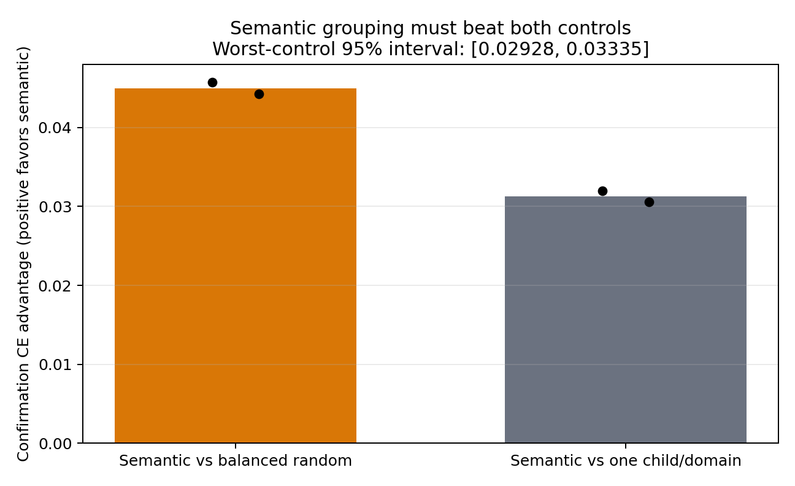
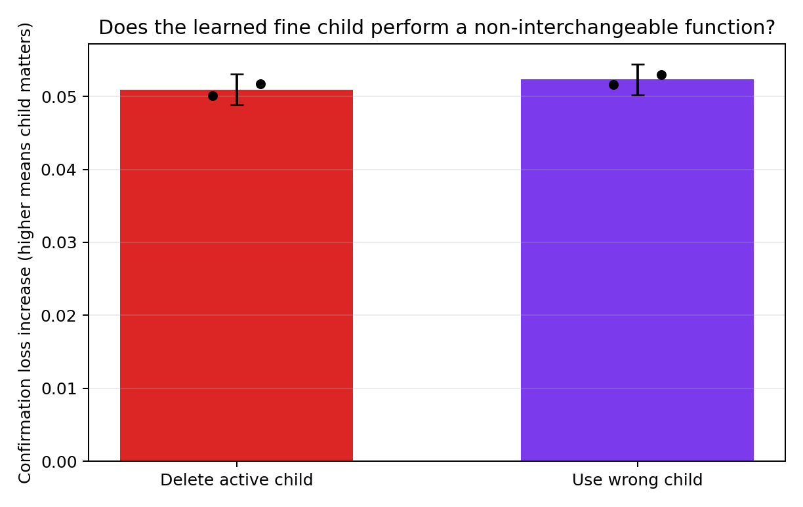
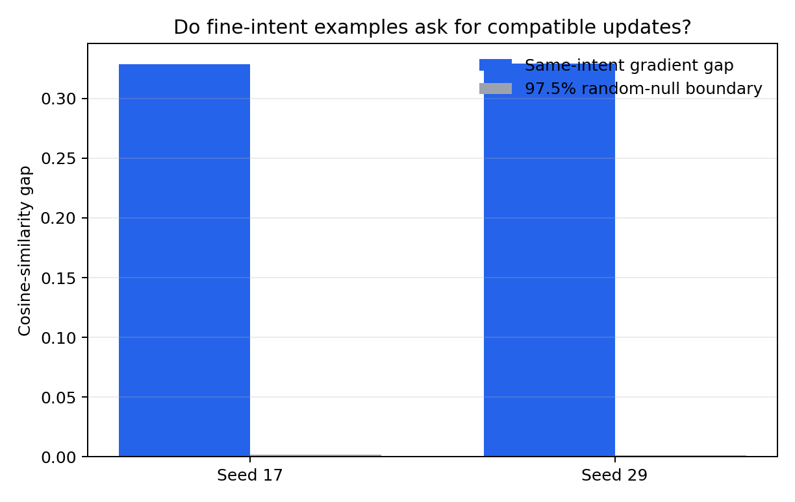
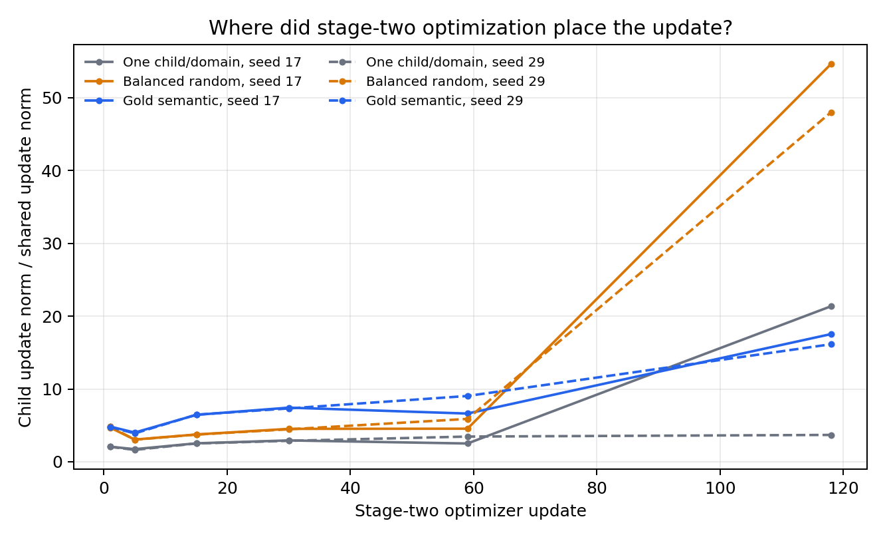

# Detailed: A15_13_E06 CLINC150 Hard-Route Gradient And Functional Audit

Primary Anchor: [A15_13_03](/Projects/from-attention-to-search/main/problem_anchors/15_spectral_representation_and_functional_routing/15_13_semantic_supervision_middle_layer_formation/subanchors/15_13_03_semantic_gradient_functional_alignment_anchor.md)  
Frozen Protocol and registered revision: [protocol.md](protocol.md), SHA-256 `de8f842cf8224f92dcbebaae4faf808110f9df6e06f307fc529eeb4accc809ac`  
Summary: [summary.md](summary.md)  
Result status: `AI_DRAFT_AWAITING_HUMAN_CONFIRMATION`  
Result eligibility: `ELIGIBLE`

## 0. Quick Recap

**Purpose:** remove route-prediction contamination and test whether CLINC150 fine intents are useful functional partitions for post-training.  
**Hypothesis:** gold fine-intent groups should have compatible task gradients, beat matched random and unsplit controls on held-out task loss, and form non-interchangeable child-expert functions.  
**Experiment logic:** hard-select all experts with coefficient one, keep the Router diagnostic-only, and change only the stage-two child grouping rule.  
**Direct result:** semantic grouping beat both controls in both seeds; the pooled worst-control cross-entropy advantage was `0.03126` with 95% interval `[0.02928, 0.03335]`. Both deletion and wrong-substitution gates passed.  
**Eligibility:** complete and eligible; six main stage-two arms, two seeds, eight mandatory update-118 checkpoints, two gradient audits, six confirmation evaluations, six intervention archives, four figures, and one completion audit exist.  
**Registered verdict:** `PASS_SEMANTIC_FUNCTIONAL_VALUE`.  
**Claim boundary:** this is a hard gold-route Oracle result, not evidence that a learned Router or unsupervised labeler recovers the value.

## 1. Terminology And Definitions

| Term | Plain meaning | Concrete computation | Unit | Why it matters | Cannot prove |
| --- | --- | --- | --- | --- | --- |
| Hard route | a registered label directly chooses an expert | selected residual is added with coefficient exactly `1.0` | none | removes Router-confidence scaling | deployability |
| Shadow Router | a diagnostic classifier that cannot affect experts | predicts domain or local intent from a detached block input | macro F1 / NMI | records semantic readability without contaminating routing | semantic expert use |
| Confirmation CE advantage | how much lower semantic loss is than a control | control CE minus semantic CE, intent weighted equally | natural-log units/example | primary held-out task value | causal mechanism by itself |
| Gradient alignment gap | same-intent update similarity minus different-intent similarity within domain | mean cosine difference at the child residual interface | cosine gap | asks whether labels group compatible local updates | realized training benefit |
| Deletion utility | loss increase after removing the active child residual | deleted CE minus intact CE | natural-log units/example | tests whether child computation matters | child identity selectivity alone |
| Wrong-substitution utility | loss increase after replacing the active child by the mean of 14 wrong within-domain children | substituted CE minus intact CE | natural-log units/example | tests non-interchangeability | learned routing |

The experimental independence unit is the training seed. Confirmation examples are paired observational units inside each seed and are resampled within intent for uncertainty; they are not treated as independent model replications.

## 2. Anchor Link And Decision Point

E05 showed semantic route alignment and weak parent-expert selectivity, but did not establish fine-expert task value. E06 asks the narrower prerequisite question: if correct labels choose the paths directly, does fine semantic partitioning itself help? A Pass moves the line to learned-route recovery; a Fail would stop treating CLINC150 fine intents as sufficient evidence for this architecture.

## 3. Protocol Freeze, Conformance, And Deviations

| Registered item | Expected | Actual | Status | Evidence | Eligibility impact |
| --- | --- | --- | --- | --- | --- |
| Approval | implementation, smoke, full run, analysis approved | approved before implementation | Pass | Protocol section 0 | none |
| Hard expert coefficient | exactly `1.0`; no Router probability | direct indexed expert residual, no probability in forward path | Pass | `hard_route_model.py`; 14 unit tests | none |
| Shadow isolation | detached input; no expert choice, scaling, or gradient | implemented and identity-tested | Pass | `hard_route_model.py`; `unit_tests.log` | none |
| Data | 15,000 / 2,997 / 4,498 after deduplication | exact match; cross-split duplicates `5 -> 0` | Pass | `data_manifest.json` | none |
| Model | frozen Qwen3-0.6B-Base, block 14, rank 8 | exact match | Pass | code manifest and checkpoints | none |
| Stages | two epochs and 118 updates per stage | exact for both stage-one seeds and all six stage-two arms | Pass | histories and update-118 checkpoints | none |
| Main arms | semantic, balanced random, common; two seeds | six of six completed | Pass | worker receipts and evaluation archives | none |
| Confirmation | untouched until code, checkpoints, and gate frozen | evaluation launched only after stage-two completion and gate record | Pass | pipeline order and timestamps | none |
| Primary analysis | equal-intent, equal-seed paired bootstrap, 10,000 draws | exact match | Pass | `analysis_core.py`, `aggregate.json` | none |
| Functional gates | deletion and wrong-child substitution both required | both computed separately and passed | Pass | `child_utility.npz`, aggregate | none |
| Conditional child-only branch | run only if gradient plus one-step gate passes while natural value fails | gate false; no conditional tasks launched | Registered not-run | `conditional_gate.json`, empty worker receipts | not missing; no impact |
| One-step scale | one common-controlled norm held across conditions | common-controlled norm selected separately inside each seed, then held across the three conditions of that seed | Bounded deviation | `one_step.json` | one-step cross-seed mechanism comparison is bounded; primary, functional gates, and branch decision are unaffected because natural development value was already positive in both seeds |

Pre-run clarification `C001` registered deletion and wrong-child substitution as separate mandatory gates before any smoke or full result was observed. Smoke job `pt-xma6m2aa` succeeded once. Full job `pt-wq03mmdj` succeeded once. No shard was retried, excluded, or resumed. No post-hoc condition was added.

## 4. Actual Setup

### Data and task

- Source: verified CLINC150 snapshot `data_full.json` SHA-256 `36923c...56e0` and `domains.json` SHA-256 `b947b5...11b3a`.
- Effective splits: 15,000 training, 2,997 development, 4,498 confirmation utterances.
- Labels: ten gold domains and 150 gold intents, with 15 intents per domain.
- Input: raw utterance only, maximum 96 tokens; no label string is inserted.
- Task: one 150-way sequence-level intent prediction for each utterance; every example contributes cross-entropy.

### Model and algorithm

- Base: Qwen3-0.6B-Base, all original parameters frozen.
- Injection: additive rank-eight shared, parent, and child LoRA residuals at zero-indexed Transformer block 14.
- Stage one hard path: gold domain selects one of ten parent experts, coefficient `1.0`.
- Stage two hard path: one common child, a deterministic balanced-random child, or the gold-intent child is selected inside the gold domain, coefficient `1.0`.
- Shadow Router: predicts gold domain in stage one and local fine intent in stage two from a detached native block input. Its loss updates only Router parameters.

### Actual training stages

| Field | Stage one: coarse domain | Stage two: fine grouping comparison |
| --- | --- | --- |
| Trainable | shared LoRA, parent LoRA, 150-way task head, shadow domain Router | shared LoRA, selected child banks, task head, shadow fine Router |
| Frozen | Base, all child experts, shadow fine Router | Base, parent LoRA, shadow domain Router |
| Data passes | two epochs over 15,000 examples | two epochs over the same 15,000 examples |
| Optimizer updates | 59 per epoch, 118 total | 59 per epoch, 118 total in every arm |
| Batch | microbatch 64, accumulation 4, effective batch 256 | same |
| Objective | task CE + unit-weight shadow-domain CE | task CE + unit-weight shadow-fine CE |
| Optimizer | AdamW; LoRA/Router LR `3e-4`, head LR `1e-3`, weight decay `0.01` | optimizer and cosine scheduler restart with same settings |
| Schedule | 5-update warmup, cosine decay, clip norm `1.0` | same |
| Selection | fixed update 118, no development checkpoint selection | fixed update 118, no development checkpoint selection |
| Handoff | save one coarse checkpoint per seed | reload seed-matched coarse state; semantic and random receive byte-identical child initialization before assignments diverge |

Stage one genuinely completed before stage two. At update 118, development intent macro F1 was `88.97%` for seed 17 and `88.93%` for seed 29.

### Execution identity

- Smoke: `pt-xma6m2aa`, `SUCCEEDED`.
- Full: `pt-wq03mmdj`, `SUCCEEDED`, 2026-09-01 10:11:18--10:28:02 UTC.
- Resource: one reserved `n6ls.iu.i40.4` worker, four NVIDIA H100 80GB GPUs, four independent condition processes.
- Full run root: `/data/250010109/MoE_Router/experiments/20260901_a15_13_e06_clinc150_hard_route_gradient_functional_audit/runs/full-20260901T101117Z`.
- Primary aggregate SHA-256: `6c9a001e2fc1eee479d3fdd7ba8d8474892a2c219e0bbc5f7ab9c6ca827b0015`.
- Completion audit SHA-256: `589c19bcb8c2c7b92570339224e12b9b4648cb3312fde0d612dffee35134565f`.
- Data manifest SHA-256: `b9aa7b74fecc7d82457d71d8ce43cf4f68b796b5a2d9bed61d89ece73edec9e8`.

## 5. Metrics And Registered Decision Rules

The primary value is

$$
V_{\mathrm{task}}=\min(\bar\ell_{\mathrm{random}}-\bar\ell_{\mathrm{semantic}},\bar\ell_{\mathrm{common}}-\bar\ell_{\mathrm{semantic}}).
$$

Pass requires both differences to be positive in both seeds, the 10,000-draw paired intent-stratified 95% lower bound of the pooled minimum to exceed zero, and both child functional interventions to be positive in both seeds with positive pooled lower bounds. Any failed primary clause gives a registered Fail; missing mandatory evidence gives `INSUFFICIENT`.

## 6. Evidence Lineage

| Claim or decision | Protocol criterion | Raw artifact | Computation | Aggregation and uncertainty | Observed value | Eligibility | Verdict | Limitation |
| --- | --- | --- | --- | --- | --- | --- | --- | --- |
| semantic grouping has held-out value | semantic beats both controls in each seed | six `evaluation.npz` archives | paired per-example CE, intent-equal means | seeds equal; 10,000 paired draws | worst advantage `0.03126`, interval `[0.02928, 0.03335]` | Eligible | Pass | gold routes only |
| active child computation matters | deletion increases semantic-model loss | two semantic `child_utility.npz` archives | deleted minus intact loss | same bootstrap | `0.05092`, interval `[0.04883, 0.05304]` | Eligible | Pass | deletion alone is not selectivity |
| children are non-interchangeable | wrong substitution increases loss | same archives, 14 within-parent shifts | mean wrong-child loss minus intact | same bootstrap | `0.05230`, interval `[0.05015, 0.05444]` | Eligible | Pass | gold path defines the intended child |
| fine intents group compatible local gradients | gap exceeds random null | two interface-gradient archives | same-intent minus different-intent cosine gap | 1,000 random nulls per seed | `0.32863`, `0.32944`; null q97.5 `0.00153`, `0.00150` | Eligible diagnostic | Positive | cannot prove training value |
| one local step explains the full gain | semantic one-step reduction beats controls | two `one_step.json` files | norm-matched child update | common-selected norm within seed | semantic reduction `-0.000138`, `-0.000081` | Bounded diagnostic | Negative | scale selected seedwise; full training remains positive |
| conditional branch is required | positive gradient/one-step gate plus failed natural value | `conditional_gate.json` | Boolean pre-registered gate | both seeds required | false; natural development value positive | Eligible | Not run by design | cannot diagnose child-only training |

## 7. Main Results

### 7.1 Primary confirmation task result

Equal-intent confirmation cross-entropy:

| Seed | One child/domain | Balanced random | Gold semantic | Random minus semantic | Common minus semantic |
| --- | ---: | ---: | ---: | ---: | ---: |
| 17 | 0.29155 | 0.30531 | 0.25958 | +0.04574 | +0.03197 |
| 29 | 0.29861 | 0.31233 | 0.26806 | +0.04426 | +0.03054 |

The smaller pooled contrast is common minus semantic: `+0.03126`. Its 95% interval excludes zero. Confirmation macro F1 is directionally consistent: semantic `92.47%`/`92.68%`, random `91.12%`/`91.23%`, and common `91.59%`/`91.62%`. Worst-decile intent F1 is semantic `79.29%`/`79.54%`, random `74.80%`/`76.35%`, and common `76.16%`/`77.16%`.

### 7.2 Functional child result

| Intervention on semantic model | Seed 17 | Seed 29 | Pooled mean | 95% interval | Gate |
| --- | ---: | ---: | ---: | ---: | --- |
| delete active child | +0.05008 | +0.05175 | +0.05092 | [0.04883, 0.05304] | Pass |
| substitute wrong child | +0.05164 | +0.05296 | +0.05230 | [0.05015, 0.05444] | Pass |

These interventions show that the semantic child contributes to the task and cannot be replaced freely by another within-domain child.

### 7.3 Mechanism evidence and boundary

Same-intent gradients are substantially more aligned than different-intent gradients at stage-two entry. However, a single norm-matched semantic child update slightly increased development loss in both seeds and did not beat both controls. Therefore the evidence supports a gradient grouping structure and a realized multi-step training advantage, but not the stronger claim that the final advantage is explained by the registered one-step local approximation.

The semantic child/shared residual ratio rose to `0.0923`/`0.0963`, compared with `0.0169`/`0.0171` for random. The random arms nevertheless placed larger optimizer-update norm ratios into child parameters than semantic arms. Thus “more child update magnitude” is not sufficient; assignment structure matters. This is an explanatory observation, not a new causal test.

Shadow fine-intent macro F1 remained near `68%` across arms. It confirms that the diagnostic classifiers learned semantic information, but it did not choose the hard routes and cannot explain the treatment difference.

## 8. Visualization Results

### 8.1 Held-out task value

**Purpose:** test whether semantic grouping beats both matched controls.  
**Metric:** confirmation CE control-minus-semantic advantage; positive favors semantic.  
**Source:** lineage row 1 and aggregate SHA `6c9a...b0015`.  
**Aggregation:** intent-equal and seed-equal; black points are seeds; title reports the paired 95% interval of the worse contrast.  
**How to read:** both contrast bars and all seed points are above zero.  
**Take-home:** semantic grouping clears the primary task-value gate.  
**Cannot prove:** predicted routing can recover the benefit.

### 8.2 Child functional utility

**Purpose:** test whether the selected child matters and is non-interchangeable.  
**Metric:** confirmation loss increase after deletion or wrong substitution.  
**Source:** lineage rows 2--3.  
**Aggregation:** paired intent-stratified bootstrap; black points are seeds and bars show pooled means.  
**How to read:** both intervals are entirely above zero.  
**Take-home:** both registered functional gates pass.  
**Cannot prove:** semantic route discovery or general expert specialization.

### 8.3 Gradient grouping structure

**Purpose:** test whether fine-intent examples request compatible local updates.  
**Metric:** within-domain same-intent minus different-intent gradient cosine gap.  
**Source:** lineage row 4.  
**Aggregation:** full development set; gray bars are 97.5% boundaries from 1,000 balanced-random nulls.  
**How to read:** observed blue bars exceed the random boundaries by more than two orders of magnitude.  
**Take-home:** fine labels mark a strong gradient partition at this interface.  
**Cannot prove:** the negative one-step diagnostic or the full-training gain by itself.

### 8.4 Optimization responsibility

**Purpose:** inspect whether positive task value merely follows larger child updates.  
**Metric:** child optimizer-update norm divided by shared-path update norm at registered snapshots.  
**Source:** stage-two gradient trajectories.  
**How to read:** random grouping ends with larger child/shared update ratios than semantic grouping despite worse task loss.  
**Take-home:** update magnitude alone does not explain semantic value.  
**Cannot prove:** a causal allocation mechanism, because no update-magnitude-matched full-training intervention was run.

## 9. Stage Evidence And Failure Decomposition

| Stage | Evidence | Result | What this rules out | What remains live |
| --- | --- | --- | --- | --- |
| hard/shadow identity | 14 tests pass | Passed | Router probability or shadow gradient contamination | real learned Router behavior |
| coarse stage | 118 updates; dev macro F1 about 89% | Passed | an untrained coarse start | whether coarse experts are optimal |
| static gradients | gap about 0.329, null q97.5 about 0.0015 | Passed | absence of fine gradient organization | label-code contribution |
| norm-matched one step | semantic reductions negative | Failed diagnostic | simple one-step explanation | multi-step dynamics and specialization |
| natural stage two | semantic dev and confirmation CE lowest | Passed | random capacity and no-split rivals | transfer and learned-route recovery |
| child interventions | deletion and substitution positive | Passed | complete shared/head bypass | strength under predicted routes |

No physical prior, implementation guard, primary metric, or functional gate was falsified. The one-step local optimization proxy was falsified as a sufficient explanation. The strongest live rival is that Oracle label information creates a task-specific conditional-computation advantage that a realistic learned Router may fail to recover.

## 10. Full Experiment Record

- Required stage-one checkpoints: 2/2 final and 2/2 update 118.
- Required main stage-two checkpoints: 6/6 final and 6/6 update 118.
- Required evaluations: 6/6 task arrays and 6/6 intervention arrays.
- Gradient audits: 2/2, each with 1,000 null draws.
- Conditional branch: 0 tasks, correctly skipped by recorded false gate.
- Analysis figures: 4/4 and visually inspected.
- Completion audit: `complete: true`, `missing: []`.
- Failed or resumed shards: none.

## 11. Interpretation

The decisive result is not merely that labels are decodable or that routes are balanced. With Router prediction and probability scaling removed, assigning semantically matched examples to the same child produces lower held-out task loss than both an equal-capacity random partition and a no-fine-split control. The matched interventions then show that the chosen child is task-relevant and not freely replaceable. This closes the narrow prerequisite that E05 left unresolved: CLINC150 fine intents can define useful expert functions under hard supervision.

The result does not solve the larger routing problem. It establishes an upper-bound target. The next scientific question is whether a learned Router can recover this hard-route value without using confirmation labels, not whether more clustering methods should be compared immediately.

## 12. Claim Boundary

**Can claim:** under one frozen Qwen3-0.6B-Base, one injection layer, rank-eight LoRA, two seeds, and hard gold CLINC150 paths, semantic fine grouping improves held-out intent loss over matched random and common controls and yields non-interchangeable child functions.

**Cannot claim:** that the frozen native representation improved; that route semantics caused a general language-model gain; that shadow routing was used by the model; that an unsupervised or predicted Router will recover the Oracle result; or that the effect transfers across datasets, architectures, layers, generation tasks, languages, or larger seed populations.

## 13. Next Decision

**Decision:** await human confirmation that learned-Router recovery is the sole next question.  
**Completion criterion:** the researcher confirms the direct result, boundary, and whether the Oracle gain is sufficient to justify that experiment.  
**Resume action:** after confirmation, freeze a protocol comparing predicted-route recovery against this hard-route upper bound while leaving the current expert checkpoints and confirmation boundary unchanged.

## 14. Artifact Manifest

| Artifact | Purpose | Producer | Identity | Complete | Claim-eligible | Notes |
| --- | --- | --- | --- | --- | --- | --- |
| [protocol.md](protocol.md) | frozen test contract | Research_System | SHA `de8f...09ac` | yes | yes | includes C001 |
| `logs/code_sha256.txt` | code identity | full pipeline | per-file SHA list | yes | yes | worker surface |
| `prepared/data_manifest.json` | data identity and counts | `prepare_data` | SHA `b9aa...ec9e8` | yes | yes | no duplicates after cleaning |
| `stage1/seed_*/HARD_DOMAIN/final.pt` | coarse starts | stage-one workers | update 118 | 2/2 | yes | one per seed |
| `stage2/seed_*/*/final.pt` | main trained models | stage-two workers | update 118 | 6/6 | yes | three arms per seed |
| `gradient_audit/seed_*` | alignment and one-step diagnostics | gradient workers | two seeds | yes | alignment yes; one-step bounded | one-step scale selected within seed |
| `evaluation/seed_*/*/evaluation.npz` | per-example task arrays | evaluation workers | six archives | yes | yes | aligned confirmation rows |
| `evaluation/seed_*/HARD_SEMANTIC/child_utility.npz` | decision-bearing interventions | evaluation workers | two archives | yes | yes | deletion and 14 wrong shifts |
| `analysis/aggregate.json` | frozen estimators and verdict | `analyze_run.py` | SHA `6c9a...b0015` | yes | yes | canonical worker aggregate |
| `completion_audit.json` | completeness | `completion_audit.py` | SHA `589c...565f` | yes | yes | no missing artifacts |
| [figures/task_value.png](figures/task_value.png) | primary task figure | aggregate data | SHA `e16a...803b` | yes | yes | visually audited |
| [figures/child_functional_utility.png](figures/child_functional_utility.png) | functional figure | utility arrays | SHA `d74c...8d7c` | yes | yes | visually audited |
| [figures/gradient_alignment.png](figures/gradient_alignment.png) | mechanism figure | gradient arrays | SHA `171e...fd42` | yes | diagnostic | visually audited |
| [figures/module_update_responsibility.png](figures/module_update_responsibility.png) | allocation diagnostic | trajectory logs | SHA `15a4...10a` | yes | diagnostic | visually audited |

## 15. Links

- Anchor: [A15_13_03](/Projects/from-attention-to-search/main/problem_anchors/15_spectral_representation_and_functional_routing/15_13_semantic_supervision_middle_layer_formation/subanchors/15_13_03_semantic_gradient_functional_alignment_anchor.md)
- Protocol: [protocol.md](protocol.md)
- Summary: [summary.md](summary.md)
- Worker code: `/data/250010109/MoE_Router/experiments/20260901_a15_13_e06_clinc150_hard_route_gradient_functional_audit`
- Full result directory: `/data/250010109/MoE_Router/experiments/20260901_a15_13_e06_clinc150_hard_route_gradient_functional_audit/runs/full-20260901T101117Z`
- Reproduction command: `MODE=full RUN_STAMP=<stamp> ALLOW_SUBMIT=1 DRY_RUN=0 PROTOCOL_APPROVED=1 bash submit_h100_4_reserved.sh`
- Jobs: smoke `pt-xma6m2aa`; full `pt-wq03mmdj`
