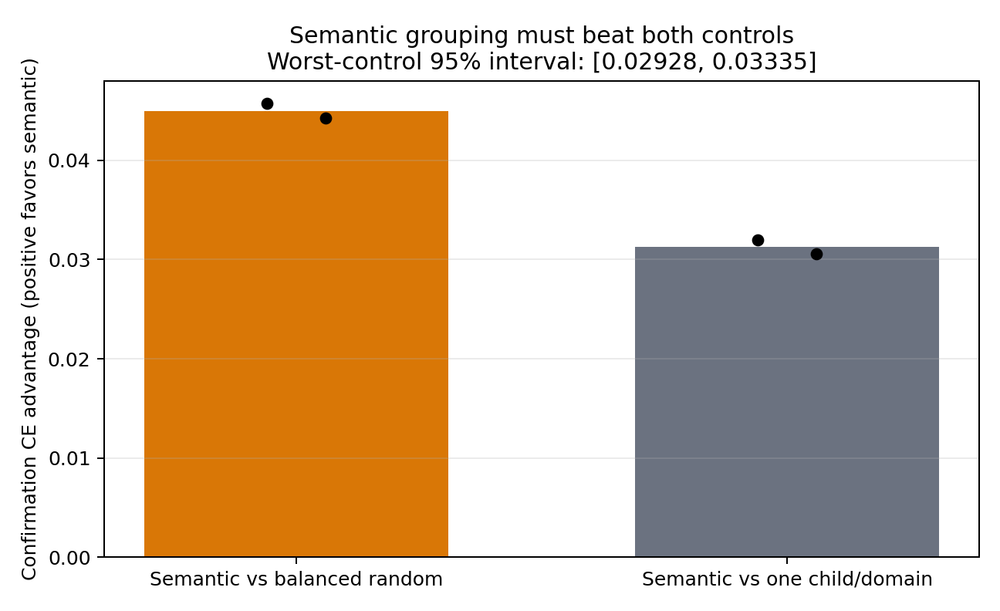
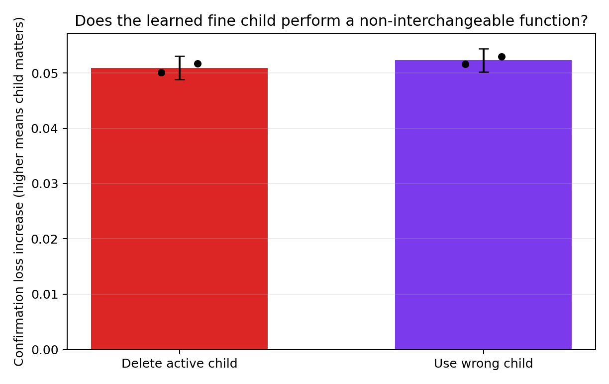

# Summary: A15_13_E06 CLINC150 Hard-Route Gradient And Functional Audit

Primary Anchor: [A15_13_03](/Projects/from-attention-to-search/main/problem_anchors/15_spectral_representation_and_functional_routing/15_13_semantic_supervision_middle_layer_formation/subanchors/15_13_03_semantic_gradient_functional_alignment_anchor.md)  
Frozen Protocol: [protocol.md](protocol.md)  
Detailed record: [detailed.md](detailed.md)  
Result status: `AI_DRAFT_AWAITING_HUMAN_CONFIRMATION`  
Evidence eligibility: `ELIGIBLE`

## Result Snapshot

**Registered verdict:** `PASS_SEMANTIC_FUNCTIONAL_VALUE`.

The hard gold-intent split beat both matched controls on untouched confirmation cross-entropy in both seeds. Its worst-control advantage was `0.03126` natural-log units per example, with a paired intent-stratified 95% interval of `[0.02928, 0.03335]`. Deleting the active child increased loss by `0.05092` `[0.04883, 0.05304]`; replacing it by a wrong within-domain child increased loss by `0.05230` `[0.05015, 0.05444]`. Both functional gates passed in both seeds.

This establishes a bounded Oracle result: on CLINC150, gold fine-intent grouping can create useful and non-interchangeable child functions under the registered frozen-base, one-layer LoRA post-training setup. It does not show that a learned Router can recover the gain.

## Decision-Bearing Setup

**Question:** Do CLINC150 fine intents define functionally useful task-update groups once route prediction error is removed?  
**Treatment and controls:** hard gold-intent child selection versus a balanced-random within-domain split and one common child per domain.  
**Changed variable:** only the stage-two child grouping rule.  
**Held fixed:** Qwen3-0.6B-Base, block 14, rank, data, stage-one checkpoint, active hard-route coefficient `1.0`, update count, optimizer, task, and diagnostic shadow Router.  
**Primary metric:** the smaller of the two confirmation cross-entropy advantages of semantic grouping, in natural-log units per example.  
**Known limitation:** all expert choices use gold labels; the shadow Router never chooses or scales an expert.

## Verdict Basis

| Registered rule | Observed value | Eligibility guard | Verdict | Evidence source |
| --- | --- | --- | --- | --- |
| Semantic beats random and common in both seeds | random minus semantic: `0.04574`, `0.04426`; common minus semantic: `0.03197`, `0.03054` | all six arms use fixed update 118 and aligned confirmation rows | Pass | [Detailed evidence](detailed.md) |
| Pooled worst-control interval is positive | `0.03126`, 95% interval `[0.02928, 0.03335]` | 10,000 paired, intent-stratified draws; seeds weighted equally | Pass | [task figure](figures/task_value.png) |
| Active child deletion is harmful | `+0.05092`, 95% interval `[0.04883, 0.05304]` | positive in both seeds | Pass | [functional figure](figures/child_functional_utility.png) |
| Wrong child substitution is harmful | `+0.05230`, 95% interval `[0.05015, 0.05444]` | positive in both seeds | Pass | [functional figure](figures/child_functional_utility.png) |

## Key Evidence

The confirmation macro F1 of semantic grouping was `92.47%` and `92.68%`, compared with `91.12%` and `91.23%` for balanced random and `91.59%` and `91.62%` for the common-child control. This supports the cross-entropy result but is secondary because cross-entropy was the frozen primary endpoint.

The stage-entry gradient gap was `0.32863` and `0.32944`, far above the corresponding 97.5% random-null boundaries `0.00153` and `0.00150`. However, the norm-matched one-step semantic update did not beat both controls. Therefore the full-training result supports realized semantic partition value, while the one-step diagnostic remains a negative local-mechanism result.

## Central Figures

**How to read:** both bars and both seed points are above zero; the smaller registered advantage also has a fully positive 95% interval.

**How to read:** both deletion and wrong-child substitution raise confirmation loss, so the learned fine child matters and is not interchangeable with another child.

## Claim Boundary

**Can claim:** supervised fine-intent partitioning has held-out task value and creates non-interchangeable child functions in this hard-routed CLINC150 post-training realization.

**Cannot claim:** deployable learned routing, unsupervised semantic discovery, improved frozen-base representation geometry, token-level routing benefit, generation benefit, or transfer to MASSIVE, another model, another layer, or another seed population.

## Next Decision

**Decision:** await the researcher's confirmation of whether this Oracle value is strong enough to open a learned-Router recovery experiment.  
**Completion criterion:** the researcher confirms the result wording, cannot-claim boundary, and that learned-route recovery is the sole next question.  
**Resume action:** only then freeze a protocol that measures how much of the hard-route gain a predicted Router can recover without changing the expert training result.
