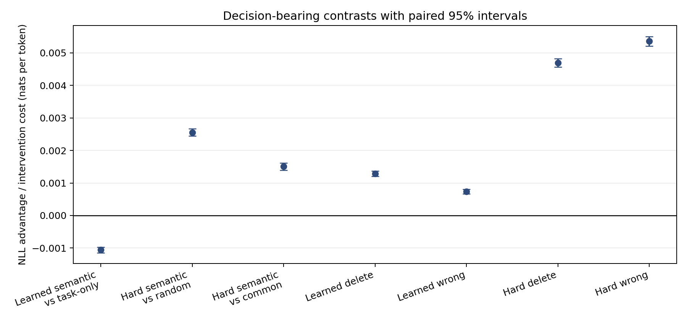
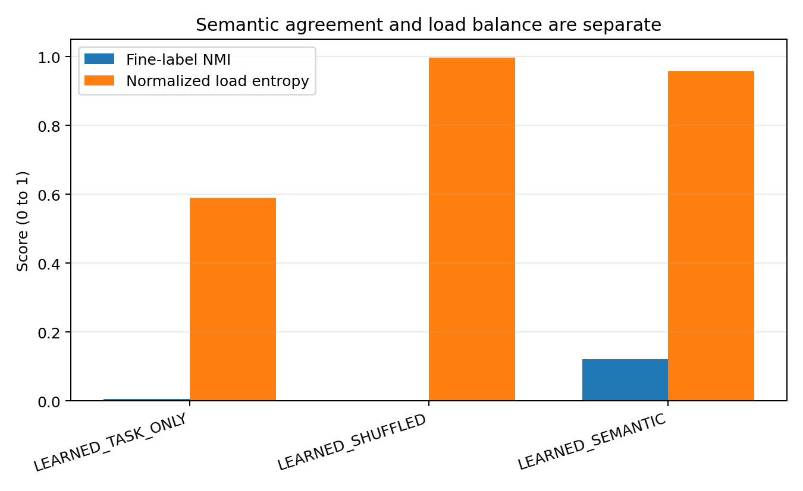
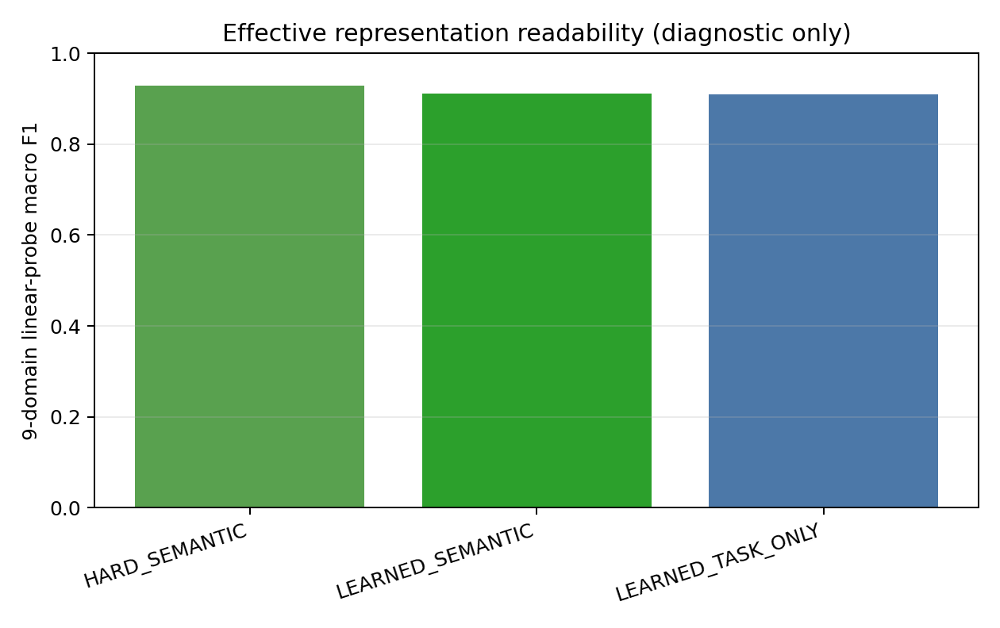

# Detailed: A15_13_E07 M2D2 Learned Semantic Router Next-Token Prediction

Primary Anchor: [A15_13_04](/Projects/from-attention-to-search/main/problem_anchors/15_spectral_representation_and_functional_routing/15_13_semantic_supervision_middle_layer_formation/subanchors/15_13_04_m2d2_causal_lm_semantic_routing_anchor.md)  
Frozen Protocol: [protocol.md](protocol.md)  
Summary: [summary.md](summary.md)  
Result eligibility: `ELIGIBLE`; `AI_DRAFT_AWAITING_HUMAN_CONFIRMATION`

## 0. Quick Recap

Purpose: test whether fine-domain supervision gives a learned causal token Router functional language-modeling value.  
Direct result: routing semantics and expert interventions improved, but semantic supervision raised held-out NLL versus task-only in both seeds.  
Verdict: `FAIL_NO_LEARNED_FUNCTION`.  
Boundary: this rejects the registered learned route-and-probability policy, not the semantic partition itself.

## 1. Terminology And Metrics

| Term | Plain meaning | Computation | Decision role | Cannot prove |
| --- | --- | --- | --- | --- |
| Token NLL | surprise assigned to the correct next token | mean `-log p(target)` over positions 64--255, nats/token | primary task endpoint | semantic routing by itself |
| Fine-route NMI | label/route association independent of route naming | normalized mutual information over all target positions | semantic dispatch diagnostic | task gain or expert utility |
| Deletion cost | reliance on the current child | NLL with child zeroed minus intact NLL | expert utility | that the child is the right semantic child |
| Wrong-child cost | non-interchangeability | mean NLL with either other same-parent child minus intact NLL | expert selectivity | deployable selection |
| Effective representation | native block input plus learned LoRA residual | target-position mean, 1,024 dimensions | readability diagnostic | change inside frozen Base |

## 2. Protocol Conformance And Deviations

| Registered item | Expected | Actual | Status | Eligibility impact |
| --- | --- | --- | --- | --- |
| Data | 1,024/256/512 windows per fine domain | 9,216/2,304/4,608 total; zero exact cross-domain/split duplicates | Pass | none |
| Task mask | context 64; targets 192 | exact 192 positions | Pass | none |
| Causality | no future Router access | suffix intervention max Router error `0.0` | Pass | none |
| Staging | coarse 144 then frozen parent; fine 144 | all four stage-one and twelve stage-two trajectories reached fixed update 144 | Pass | none |
| Matched start | same child initialization per seed | tensor equality passed for all three learned arms | Pass | none |
| Frozen parent | byte-identical after stage two | tensor equality passed | Pass | none |
| Seeds | 17 and 29 | both complete | Pass | none |
| Confirmation | opened after fixed checkpoints | 38 evaluation/intervention files generated after training | Pass | none |
| Runtime compatibility | trusted cache loads in PyTorch 2.8 | `C001` explicitly set `weights_only=False`; first smoke stopped before training | Recorded correction | no scientific change |
| Per-domain figure | registered secondary analysis | generated post hoc from frozen per-window arrays after primary verdict | Post-hoc presentation | eligible only as boundary diagnostic |

The final job `pt-i9fis3c8` ran from `2026-09-01T17:41:49Z` to `18:04:49Z` on one reserved four-H100 node and ended `SUCCEEDED`. Completion audit reports `complete: true`, no missing artifact, and smoke false.

## 3. Actual Setup And Training

- Model: Qwen3-0.6B-Base; all original weights and tied language head frozen.
- Injection: zero-indexed block 14 MLP output; rank-eight shared, parent, and child LoRA banks; three parent routes and three local children per parent.
- Router input: uncentered block input at every token; the state predicting target `x_j` is position `j-1`.
- Stage one: shared LoRA, parent experts, and coarse Router train; child bank and fine Router frozen. Objective is NTP plus unit-weight coarse route cross-entropy.
- Stage two: parent experts and coarse Router frozen; shared LoRA, child bank, and fine Router train. Task-only uses NTP; semantic and shuffled add unit-weight fine route cross-entropy.
- Each stage: two full train passes, 72 updates/pass, 144 updates total; microbatch 8, accumulation 16, effective batch 128.
- Optimizer: AdamW, learning rate `3e-4`, weight decay `0.01`, clipping `1.0`, five-update warmup, cosine decay; optimizer and scheduler restart at stage two.
- Selection: fixed update 144 only. Development never selected a checkpoint.

## 4. Conditions And Direct Results

| Condition | Plain meaning | Held-out NLL seed 17 | seed 29 | mean |
| --- | --- | ---: | ---: | ---: |
| Frozen Base | no continued training | — | — | `2.969889` |
| Task-only learned Router | fine route gets only language gradient | `2.880171` | `2.880564` | `2.880368` |
| Shuffled supervision | balanced unrelated fine labels | `2.882454` | `2.882218` | `2.882336` |
| Semantic supervision | true fine-domain route labels | `2.881524` | `2.881320` | `2.881422` |

All continued-training arms improve strongly over the frozen Base, but that shared adaptation gain is not the semantic-supervision effect. The paired semantic effect is task-only minus semantic: `-0.001054 [-0.001142, -0.000966]`, negative in both seeds and all nine fine domains.

## 5. Evidence Lineage

| Claim or decision | Criterion | Raw artifact | Computation | Observed value | Eligibility | Verdict | Limitation |
| --- | --- | --- | --- | --- | --- | --- | --- |
| Learned recovery | positive task-only minus semantic in both seeds and pooled lower bound | per-window confirmation arrays | equal domain/seed weighting; 10,000 paired within-domain bootstraps | `-0.001054 [-0.001142,-0.000966]` | Eligible | Fail | route and probability effects coupled |
| Semantic dispatch | route-label agreement improves | per-token route arrays | macro-F1, NMI, load entropy | NMI `0.00646 -> 0.12059`; F1 `0.284 -> 0.564` | Eligible diagnostic | Positive | cannot prove value |
| Expert utility | deletion and wrong-child costs positive | paired intervention arrays | same bootstrap | delete `+0.001292`; wrong `+0.000737` | Eligible diagnostic | Positive | smaller than Oracle intervention effects |
| Representation readability | effective/child residual label access | development fit, confirmation test arrays | L2 logistic probe and 5-nearest-neighbor | effective probe `0.91048 -> 0.91094`; child probe about `0.694 -> 0.851` | Diagnostic | child signal positive; effective change tiny | child route can encode supplied label |

## 6. Visual Evidence

### The learned endpoint fails despite functional children

How to read: the learned semantic-versus-task-only point is negative, while deleting or replacing its child is harmful. This means the experts participate, but the whole learned routing policy is not better.

### Route semantics and balanced load are different

How to read: shuffled supervision has almost maximal load entropy but near-zero NMI; correct supervision raises NMI to about `0.12`. Balanced use alone is not semantic routing.

### Effective-state readability barely changes

How to read: learned semantic and task-only effective-state probe scores are almost equal near `0.91`. Stronger child-residual label access does not become a decisive change in the full effective state.

## 7. Stage And Failure Decomposition

| Stage | Evidence | Status | What it rules out | What remains live |
| --- | --- | --- | --- | --- |
| Data and causal guard | exact balance, zero duplicates, future error zero | Pass | target leakage and gross split mismatch | topical lexical shortcuts |
| Coarse stage | four checkpoints complete; parent route F1 about `0.64` | Pass constructibility | missing coarse handoff | imperfect coarse choice |
| Fine semantic stage | fine NMI/F1 improve in both seeds | Pass semantic dispatch | supervision ignored | route errors and attenuation |
| Expert interventions | both positive | Pass function diagnostic | completely unused child bank | insufficient/global harmful policy |
| Task endpoint | semantic NLL worse in both seeds/all nine domains | Fail | a hidden average win | why recovery is lost |

The observed pattern is not “the model failed to learn semantics.” It learned a modest semantic route and functional children. The failure is that these changes did not beat the task-only allocation policy. Because the learned forward path combines top-1 selection and probability scaling, the current experiment cannot decide whether wrong route choice, small route confidence, or the auxiliary route-loss trade-off is responsible.

## 8. Claim Boundary And Next Decision

Can claim: semantic supervision has a causal effect on route organization and child use, but not a positive held-out task effect under the registered learned policy.

Cannot claim: the Oracle semantic partition is invalid, no deployable learned Router can work, native Base geometry changed, or representation collapse explains the NLL failure.

Next decision: without retraining, cross predicted/gold path with learned/unit expert coefficient on the frozen semantic checkpoints. Stop method changes until this bridge attributes the lost Oracle value.

## 9. Artifact Manifest

| Artifact | Purpose | Identity | Complete | Claim eligible | Notes |
| --- | --- | --- | --- | --- | --- |
| Full run | checkpoints, arrays, logs | `/data/250010109/MoE_Router/experiments/20260901_a15_13_e07_e08_m2d2_causal_lm_semantic_routing/runs/full-20260901T174147Z` | yes | yes | job `pt-i9fis3c8` |
| Dataset | frozen processed tensors | SHA `8cd04d99...51a8` | yes | yes | 16,128 windows total |
| Aggregate | primary and diagnostics | SHA `e3d7deaf...354b9` | yes | yes | frozen analysis output |
| Completion audit | completeness and causal guard | SHA `35886070...5d2e` | yes | yes | no missing artifacts |
| Figures | curated reading path | local `figures/` | yes | as labeled | per-domain plot is post-hoc presentation |

Worker code: `/data/250010109/MoE_Router/experiments/20260901_a15_13_e07_e08_m2d2_causal_lm_semantic_routing`  
Reproduction entry: `MODE=full DRY_RUN=0 ALLOW_SUBMIT=1 PROTOCOL_APPROVED=1 bash submit_h100_4_reserved.sh`
