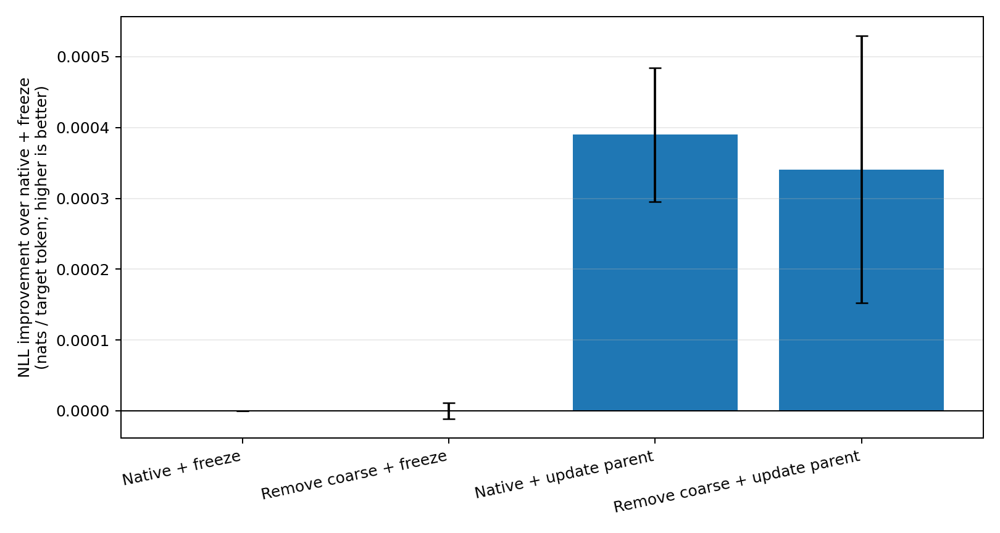
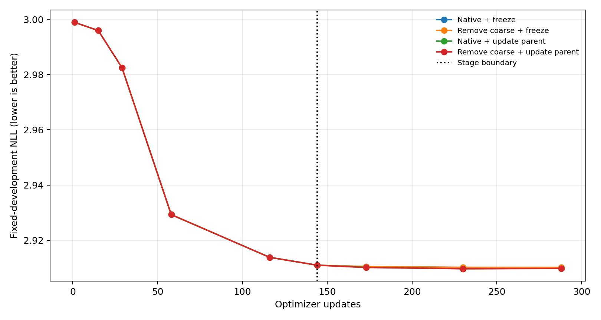
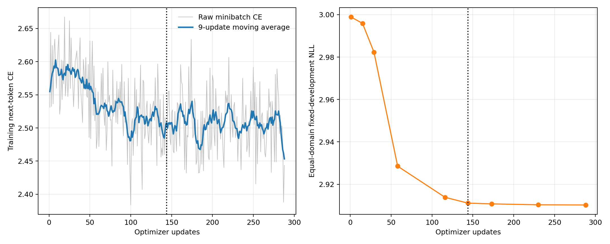

# Summary: A15_13_E12 M2D2 Coarse-Removal And Parent-Freeze Ablation

Primary Anchor: [A15_13_04](/Projects/from-attention-to-search/main/problem_anchors/15_spectral_representation_and_functional_routing/15_13_semantic_supervision_middle_layer_formation/subanchors/15_13_04_m2d2_causal_lm_semantic_routing_anchor.md)
Frozen Protocol: [protocol.md](protocol.md)
Detailed record: [detailed.md](detailed.md)
Result status: `ELIGIBLE`; `AI_DRAFT_AWAITING_HUMAN_CONFIRMATION`

## Result Snapshot

Allowing the coarse experts to continue updating in stage two produced a small NLL improvement in both seeds: `+0.000462` and `+0.000269` nats per target token. Removing the coarse Router's discriminative row space before the fine Router had no stable effect: `+0.000013` in seed 17 but `-0.000062` in seed 29.

This supports one narrow implementation choice: freezing the coarse Router does not require freezing the coarse experts. It does **not** support the current linear “remove common/coarse information” operator, and the tiny or sign-unstable wrong-expert effects do not show stronger fine-expert specialization.

## Two-Stage Training Audit

The run was genuinely staged.

- Stage one: two data passes, 144 optimizer updates, microbatch 8 with accumulation 16 (effective batch 128), AdamW at `3e-4`, next-token CE plus coarse route CE. The base model and language head were frozen; shared and coarse LoRA plus the coarse Router trained.
- Handoff: each seed's exact adapter, optimizer, scheduler, and update-144 state was loaded into all four stage-two branches.
- Stage two: two more data passes, updates 145--288, next-token CE plus fine route CE. The coarse Router was frozen in every branch. The two binary factors were whether the coarse experts remained trainable and whether the fine Router input had the coarse Router row space projected out.

## Final Comparison

| Stage-two condition | Seed 17 NLL | Seed 29 NLL | Two-seed mean |
| --- | ---: | ---: | ---: |
| Native fine input; freeze coarse experts | `2.884636` | `2.883990` | `2.884313` |
| Remove coarse row space; freeze coarse experts | `2.884628` | `2.883998` | `2.884313` |
| Native fine input; update coarse experts | **`2.884179`** | **`2.883667`** | **`2.883923`** |
| Remove coarse row space; update coarse experts | `2.884162` | `2.883783` | `2.883972` |

Route/source NMI remained about `0.205--0.215` in every branch; coarse removal changed it by roughly `0.001` rather than improving it. Deletion and wrong-child costs were only around `10^-5--10^-4` NLL and changed sign in some branches. Therefore the NLL gain from updating coarse experts cannot be promoted to stronger semantic expert utility.

## Central Figures

How to read: positive bars beat the original “native input plus frozen coarse experts” setting. Updating coarse experts gives the only repeatable gain; projecting out coarse information stays at zero.

How to read: all branches share the same first 144 updates; after the dotted handoff, the trainable-coarse-expert branches finish slightly lower, while the coarse-removal branches do not separate consistently.

How to read: the left raw minibatch CE is jagged even after smoothing, but the right fixed nine-domain development NLL descends smoothly. The jagged line is a batch-composition diagnostic, not the learning-efficiency verdict.

## Claim Boundary

**Can claim:** under this two-stage block-14 LoRA setup, keeping coarse experts trainable gives a small repeatable task-NLL gain while keeping the coarse Router frozen.

**Cannot claim:** that coarse-information removal is generally useless, that the small gain is semantic, or that fine experts became more non-interchangeable. The tested removal operator only deletes the at-most-two-dimensional centered linear row space of the coarse Router.

## Next Decision

Retain the “frozen coarse Router, trainable coarse experts” branch in later work. Do not retain the current row-space subtraction as a default method without a stronger definition of common information.
