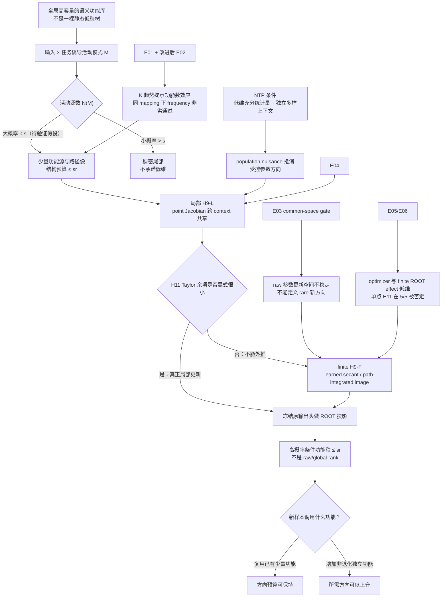

# 从条件概率树到 NTP 条件功能秩

## 功能复用、独立规则、rare 记忆与 Transformer 表示桥的完整理论故事

## 摘要

0721 组会最后总结中的第二个问题是：若任务相关语义具有层级结构，
NTP（next-token prediction，下一词预测）是否会使参数或表示空间低秩？
当前最严格的回答不是“是”，而是一个条件命题：

> 语言模型可以拥有全局高容量的潜在功能库；输入与任务条件诱导一个活动模式。
> 若一次计算大概率只调用少量任务功能源，每个源的任务维数受控，独立上下文使
> NTP 的无关变化在训练信号中抵消，优化更新经 Transformer 后又落入跨上下文共享的
> ROOT 路径像空间，那么冻结原输出头后，完成该次任务所需的 ROOT（答案 token
> 前的注册任务摘要状态）方向数以高概率
> 受控。

这一定理支持“全局高维、条件低功能秩”，不支持“语义是一棵固定树”或
“NTP 自动产生全局低秩”。

用户提出的两条认识中，第一条可以保留为待检验模型：语义计算不是一棵静态树，
而是输入—任务条件诱导的概率活动树；“大概率稀疏、小概率稠密”必须写成活动源数的
概率尾界，不能当成已经观察到的自然语言事实。第二条需要重要修正：可泛化信息并非
必然低秩，rare 信息也并非只能高秩记忆。严格控制量是**独立任务功能数**以及这些
功能在不同上下文中的**路径像复用**。rare 样本若调用已有规则，也可能低功能秩地
泛化；common 样本若包含许多彼此独立的功能，也可能需要更多方向。

A14_02 的结果已经确定五件事：重复同一上下文不等于独立证据；已见关系的
跨上下文不变性不等于未见组件重组；lookup 的独立映射数从 1、4、16 增加时，任务
ROOT 功能秩均值从 10.2、11.0、12.8 上升。但 shared 条件没有通过组合重组门，
shared 相对 lookup 的秩差也未达到注册阈值。因此，现有证据尚未把“功能复用效应”
与“独立规则数量效应”分开。

H9 审计又给出两个决定性区分。E04 在 5/5 seeds 支持训练点的共享局部
Jacobian 像；E05/E06 发现实际 optimizer 位移和精确 finite ROOT effect 都有效
八维，但 endpoint/reference 单点 Jacobian 只能捕获很少的真实效应。H11
有限位移线性化在 5/5 seeds 被否定，而真实 learned secant 在 5/5 seeds 通过
跨 context 和冻结读出正对照。

当前唯一下一理论决策是：对完整训练使用精确 learned secant／path-integrated
image；只有在 Taylor 余项显式很小时才使用 point-Jacobian 桥。finite H9-F
仍未由一般 NTP 动力学推出，Router 设计仍在下游。

---

## 1. 需要回答的三个不同问题

0721 记录中有三个容易混淆的“问题 2”。

1. **下游问题：**若层级条件低维成立，对 MoE、Router、Retrieval 有什么意义？
2. **rare/common 问题：**rare、记忆、高秩、common 与泛化是什么关系？
3. **本次主问题：**树状或层级数据在 NTP 下是否导致参数或表示空间低秩？

本 story 直接回答第三问，用第二问校验理论含义，并把第一问保留为下游边界。

---

## 2. 先定义对象

### 2.1 潜在功能库与条件活动树

我们不假设“自然语言本体是一棵树”。更弱也更可检验的模型是：

- 完整模型拥有一个高容量的潜在功能图或功能库；
- 给定输入 $X$ 与任务条件 $T$，模型诱导活动模式
  $M\sim p(M\mid X,T)$；
- 将一次计算实际使用的有限依赖路径展开后，可写成活动树；
- 活动树只描述这次计算调用了什么，不描述全部语义世界。

**功能源**是活动树中新加入任务信息的局部 innovation，而不是已经包含全部后代信息
的完整内部节点。这样可以避免把同一信息沿路径重复计数。

### 2.2 “大概率稀疏、小概率稠密”

令 $N(M)$ 为一次活动模式真正调用的功能源数。精确假设是：

$$
\Pr[N(M)\le s]\ge 1-\delta_M.
$$

它表示从输入—任务分布或随机路由中抽取一次计算时，至少 $1-\delta_M$ 的计算调用
不超过 $s$ 个源；其余至多 $\delta_M$ 的尾部可以更稠密。

这不是“每个句子本身既稀疏又稠密”，也不是已有实验结论。若模型路由是确定的，
随机性来自输入—任务分布；若路由本身随机，概率还包含路由随机性。

### 2.3 频率、复用与独立功能数

必须区分四个量：

- **样本重复次数：**完全相同序列出现多少次；
- **独立上下文数：**同一关系在多少个真正不同的上下文抽样中出现；
- **功能复用：**多少样本调用同一个任务映射或同一组功能原子；
- **独立功能数：**为保持任务输出，必须区分多少个线性独立的功能编码。

频率是数据计数；复用和独立功能数是函数结构。高频既不充分也不必要地推出低功能秩。

### 2.4 条件固定读出功能秩

**ROOT 状态**是模型已经读取注册任务输入、即将预测答案 token 时指定位置的
hidden state。**nuisance（任务无关变化）**是会改变输入或内部状态、但在给定任务
充分信息后不应改变正确 next token 的变化。**ROOT 路径像**是某个功能源经过模型
计算路径后，在 ROOT 坐标中能够产生的方向集合。

固定训练后的模型、原输出头 $W_o$ 和活动模式 $m$。对 ROOT 表示
$h_\rho\in\mathbb R^d$，定义

$$
k_{\mathrm{func}}^{\mathrm{fix}}(\epsilon;m)
=
\min_P
\left\{
\operatorname{rank}(P):
\mathbb E\!\left[
\bigl(
\ell(W_oPh_\rho,Y)-\ell(W_oh_\rho,Y)
\bigr)_+
\mid M=m
\right]\le\epsilon
\right\},
$$

其中 $P=P^\top=P^2$ 是不能依赖测试标签的正交投影，$\ell$ 是 NTP
cross-entropy。它回答：

> 在不重训输出头的情况下，至少保留多少 ROOT 方向，才能近似保持原模型的
> next-token 功能？

该量依赖模型、任务分布、ROOT 位置、固定输出头与容差。它不是语义本体的维数，
也不是完整 Transformer 参数矩阵的秩。

---

## 3. 认知审计：两条直觉分别保留到哪里

### 3.1 “语义是条件激活的概率树”

**可保留的最强版本：**

> 对一个给定输入—任务，实际使用的有限依赖计算可以近似展开为活动树；活动模式随
> 输入和任务变化，完整系统可保持图结构和高容量。

**仍是待验证假设：**

- 活动源数具有稀疏尾界；
- 同一功能的路径像跨上下文稳定复用；
- 活动子树保留当前任务所需信息。

**不能升级为：**自然语言本身是一棵树，或所有句子共享一个低维树空间。

### 3.2 “可泛化信息低秩，rare 信息高秩记忆”

这句话把三个不同关系压成了一个因果命题：

$$
\text{频率}
\quad\overset{?}{\Longrightarrow}\quad
\text{可泛化性}
\quad\overset{?}{\Longrightarrow}\quad
\text{秩}.
$$

严格理论只保留下列版本：

> 若许多样本复用少量任务功能，而且这些功能经 ROOT 的路径像跨上下文共享，则
> 样本数增加不必增加任务方向数。若新增任务具有非退化且线性独立的输出功能编码，
> 则固定读出下所需方向数可以随独立功能数上升。

所以：

- rare 实例调用已有规则时，可以泛化且无需新增方向；
- rare 且功能新颖时，可能需要新增方向或记忆；
- 只有增加“非退化独立输出编码、固定读出、无额外压缩”等条件，才能证明方向下界；
- 高容量网络也可以在上游高维记忆后，把结果压成少量答案原型，使 ROOT 仍低秩。

因此，“rare 只能高秩记忆”不是当前定理，也是一般情况下的假命题。

---

## 4. 为什么树、NTP 和频率都不能单独推出低秩

### 4.1 树只规定拓扑

即使所有叶子都在同一一维空间，不同角色算子也可分别把它映到
$e_1,e_2,\ldots$，使根的跨样本矩阵满秩。低维来自路径压缩与方向复用，不来自
“树”这个标签。

### 4.2 NTP 允许任意高秩 nuisance

给定任务表示 $h_{\mathrm{task}}(x)$，附加任意高秩向量 $n(x)$：

$$
h'(x)=
\begin{bmatrix}
h_{\mathrm{task}}(x)\\
n(x)
\end{bmatrix},
\qquad
W_o'=
\begin{bmatrix}
W_o&0
\end{bmatrix}.
$$

logits 与 loss 完全不变。因此 NTP 风险无法约束 raw hidden rank。

### 4.3 lookup 也可以在 ROOT 处低秩

任意多条独立 lookup 若只输出 $L$ 个答案，可以先在上游记忆，再令
$h_\rho(x)=e_{y(x)}\in\mathbb R^L$。ROOT rank 至多为 $L$。所以
“记忆必然高 ROOT rank”不成立。

### 4.4 低维参数更新也不能自动推出低维 ROOT

即使参数只有一个标量 $\alpha$，也可令第 $i$ 个上下文的 ROOT 为
$h_\rho(x_i;\alpha)=\alpha e_i$。参数更新空间是一维，跨样本 ROOT 更新矩阵却可
满秩。缺失对象正是上下文相关 Jacobian 如何把参数方向映到 ROOT。

---

## 5. 定理一：固定活动模式的结构维数

设 $T=(V,E)$ 是有限有根活动树，根为 $\rho$。每个活动功能源 $u$ 提供

$$
\xi_u\in S_u\subseteq\mathbb R^d,
\qquad
\dim S_u=r_u\le r.
$$

每条活动边有共享线性角色算子 $W_e$。节点递推为

$$
h_v
=
\xi_v+\sum_{e=(w\to v)}m_eW_eh_w,
\qquad m_e\in\{0,1\}.
$$

对固定模式 $m$，令 $A(m)$ 为能沿完整活动路径到达根的源集合，
$B_u(m)$ 为源 $u$ 到根的路径算子积。

### 定理 1：路径展开与可达空间

$$
h_\rho^{(m)}
=
\sum_{u\in A(m)}B_u(m)\xi_u.
$$

令

$$
\mathcal R_\rho(m)
=
\sum_{u\in A(m)}B_u(m)S_u,
\qquad
q(m)=\dim\mathcal R_\rho(m).
$$

对共享模式 $m$ 的跨样本 ROOT 矩阵 $H_\rho^{(m)}$：

$$
\operatorname{rank}H_\rho^{(m)}
\le q(m)
\le\sum_{u\in A(m)}r_u
\le rN(m).
$$

### 证明

从叶到根递归展开。每个活动源只留下沿唯一活动路径传播的一项
$B_u(m)\xi_u$；关闭路径的源贡献为零。每项属于 $B_u(m)S_u$，因此根属于这些
路径像空间之和。线性映射不增加子空间维数，而子空间和的维数不超过各维数之和，
所以得到上界。证毕。

### 概率推论

若

$$
\Pr[N(M)\le s]\ge1-\delta_M,
$$

则

$$
\Pr[q(M)\le sr]\ge1-\delta_M.
$$

不同模式的 $\mathcal R_\rho(m)$ 可以彼此正交，所以所有模式拼接后的全局秩仍可达到
$d$。这正是“全局高容量、条件低维”而非“全局低秩”。

---

## 6. 定理二：复用为何可能固定方向预算

设一组样本 $G$ 调用功能原子集合 $\mathcal J_G$。对每个功能原子 $j$，假设其在
ROOT 处具有跨样本共享的任务路径像空间 $\mathcal S_j$，且

$$
\dim\mathcal S_j\le r_j.
$$

### 定理 2A：复用上界

若所有样本在固定读出下可见的 ROOT 分量都位于

$$
\mathcal S_G=\sum_{j\in\mathcal J_G}\mathcal S_j,
$$

即对 $\mathcal S_G$ 的投影 $P_G$ 有

$$
W_o(I-P_G)h_\rho=0,
$$

则

$$
k_{\mathrm{func}}^{\mathrm{fix}}(0;G)
\le
\dim\mathcal S_G
\le
\sum_{j\in\mathcal J_G}r_j.
$$

### 证明

取 $P_G$ 为 $\mathcal S_G$ 的正交投影。所有固定读出可见 ROOT 分量均在
$\mathcal S_G$ 中，所以投影不改变 logits；由功能秩定义即得第一式。第二式来自
子空间和的维数上界。证毕。

该上界依赖被调用的功能原子并集，不依赖样本数。十万条样本若都调用同一组两个
一维功能，其方向预算仍可为 2；十条样本若分别要求十个独立功能，则预算可能上升。

但“同名规则”不够。若 Transformer Jacobian 把同一功能在不同上下文中旋转到不同
ROOT 空间，就不存在共享 $\mathcal S_j$，复用上界也不能使用。

### 定理 2B：独立功能的条件下界

取一批 ROOT 状态

$$
H=[h_1,\ldots,h_n],
$$

固定输出头 $W_o$，以及去除 softmax 公共平移的满行秩 contrast 矩阵 $C$。
令任务要求的 contrast-logit code 为

$$
Z^\star=CW_oH,
\qquad
q_\star=\operatorname{rank}(Z^\star).
$$

对任意 rank-$k$ 投影 $P$，若 $k<q_\star$，则

$$
\|CW_oPH-Z^\star\|_{\mathrm{op}}
\ge
\sigma_{k+1}(Z^\star).
$$

### 证明

$CW_oPH$ 的秩至多为 $\operatorname{rank}(P)\le k$。由
Eckart–Young 定理，任何 rank-$k$ 矩阵到 $Z^\star$ 的谱范数距离至少为
$\sigma_{k+1}(Z^\star)$。证毕。

这是一个 **contrast-logit 保真下界**。要把它转成 cross-entropy 功能秩下界，还需
沿原 logits 与投影 logits 之间的路径控制 softmax 概率非退化，或提供等价的局部
强凸条件；仅有 accuracy 或高 margin 不够。

这个下界把“独立功能”具体化为输出任务编码的线性独立性。规则标签数量 $K$ 本身不
等于 $q_\star$；少量答案原型、输出瓶颈、规则冗余或上游非线性压缩都可使
$q_\star\ll K$。因此不能把三个 lookup 点外推成“每增加一个规则就增加一个方向”。

---

## 7. 定理三：NTP 在什么条件下偏向任务方向

### 7.1 受控 ROOT–softmax 模型

固定模式 $m$。令

- $\phi(A,Z,m)\in\mathbb R^{p_m}$ 为决定 next token 的任务充分统计量；
- $\psi(C)\in\mathbb R^q$ 为不应改变目标的上下文变化；
- ROOT 为
  $$
  h_\rho=\Theta\phi+N\psi;
  $$
- logits 为 $o=W_oh_\rho$。

假设

$$
Y\perp C\mid\phi,M,
\qquad
\mathbb E[\psi\mid\phi,M]=0.
$$

### 定理 3A：population nuisance gradient cancellation

在 $N=0$ 时，

$$
\mathbb E[\nabla_N\ell\mid\phi,M]=0.
$$

### 证明

softmax CE 给出

$$
\nabla_N\ell
=
W_o^\top(p(o)-e_Y)\psi^\top.
$$

在 $N=0$ 时，logits 只依赖 $\phi$。条件于 $(\phi,Y,M)$ 后，左因子固定；
任务条件独立与条件中心化给出

$$
\mathbb E[\psi\mid\phi,Y,M]
=
\mathbb E[\psi\mid\phi,M]=0.
$$

故条件梯度期望为零。证毕。

这一定理只说明 population 动力学在受控初始化处不会系统性写入 nuisance；它不说明
一般 Transformer 的完整有限样本训练终点低秩。

### 7.2 为什么需要独立上下文

若 $b$ 个独立上下文分别以权重 $w_j$ 出现，定义有效独立样本数

$$
n_{\mathrm{eff}}
=
\frac{1}{\sum_{j=1}^bw_j^2}.
$$

在条件 sub-Gaussian 等标准集中条件下，经验 nuisance 梯度的典型尺度为

$$
O(n_{\mathrm{eff}}^{-1/2}).
$$

同一 realized context 重复任意多次时，$n_{\mathrm{eff}}=1$，其梯度项不会因重复而
抵消。这给出 E01“duplicate exposure 不等于 context diversity”的理论解释。

### 7.3 受控参数与 ROOT 秩

任务矩阵的单样本梯度具有外积形式：

$$
\nabla_\Theta\ell=v\phi^\top,
\qquad
v=W_o^\top(p-e_Y).
$$

若输出对比方向始终位于固定 $b$ 维空间、$\phi$ 的张成维数为 $a_m$、任务块从零
初始化，并使用保持该矩阵子空间的 SGD/momentum 类优化器，则任务参数增量满足

$$
\operatorname{rank}(\Delta\Theta)
\le\min(a_m,b)
\le p_m
\le rN(m).
$$

在线性 ROOT factorization 中，

$$
H_\rho^{(m)}=\Theta\Phi_m,
$$

所以 ROOT 秩也不超过 $rN(m)$。

这条闭环不自动覆盖完整参数矩阵、非零初始参数块、Adam 的逐坐标预条件或一般
Transformer。

---

## 8. 表示桥：局部 Jacobian 与 finite secant

令参数更新位于任务子空间 $G_m$，ROOT Jacobian 为

$$
J_\rho(x;\theta)=\frac{\partial h_\rho(x;\theta)}{\partial\theta}.
$$

### 8.1 局部桥 H9-L

在注册参数点 $\theta_\star$，局部共享像定义为

$$
J_\rho(x;\theta_\star)G_m
=
B_m^{\mathrm{loc}}A_x+E_x^{\mathrm{loc}},
\qquad
\dim\operatorname{Col}(B_m^{\mathrm{loc}})\le rN(m),
$$

其中 $E_x^{\mathrm{loc}}$ 小。可测的弱版本要求

$$
C_m^{\mathrm{loc}}
=
\mathbb E[
J_\rho(x;\theta_\star)G_mG_m^\top
J_\rho(x;\theta_\star)^\top
\mid M=m
]
$$

在前 $rN(m)$ 个特征方向之外具有小尾部能量。

它只描述一个参数点上的跨 context 共享，不说明该像沿训练保持不变。

### 8.2 finite-training 桥 H9-F

对注册参考模型与训练终点，定义精确 learned secant：

$$
\Delta h_{\mathrm{sec}}(x)
=
h_\rho(x;\theta_T)-h_\rho(x;\theta_{\mathrm{ref}}).
$$

finite 共享像定义为

$$
\Delta h_{\mathrm{sec}}(x)
=
B_m^{\mathrm{sec}}a_x+e_x^{\mathrm{sec}},
\qquad
\dim\operatorname{Col}(B_m^{\mathrm{sec}})\le rN(m).
$$

沿可微路径

$$
\theta(t)=\theta_{\mathrm{ref}}+t(\theta_T-\theta_{\mathrm{ref}})
$$

有精确恒等式

$$
\Delta h_{\mathrm{sec}}(x)
=
\int_0^1
J_\rho(x;\theta(t))
(\theta_T-\theta_{\mathrm{ref}})
\,dt.
$$

整条路径的瞬时作用共享一个像足以推出 H9-F，但不是必要条件：瞬时像可以旋转，
积分后的效应仍可集中。

### 8.3 尺度边界

H9-L 加显式小 Taylor 余项 H11 才得到局部有限更新桥。H9-F 直接得到完整
finite-training 桥，不需要单点线性化。二者都不由 NTP 自动推出；E04–E06
表明把它们混为一谈会改变实验结论。

---

## 9. 主定理：高概率条件 ROOT 功能秩

对模式 $m$，假设存在任务 ROOT 子空间 $\mathcal S_m$，

$$
\dim\mathcal S_m\le rN(m),
$$

并且投影外的固定读出 logit 残差满足

$$
\mathbb E[
\|W_o(I-P_m)h_\rho\|_2
\mid M=m
]
\le
\eta_{\mathrm{tot}}(m).
$$

共同误差包含初始 ROOT residual、有限 context nuisance、其他位置背景梯度和
optimization leakage。桥接误差有两种合法选择：

$$
\eta_{\mathrm{bridge}}^{\mathrm{loc}}
=
\eta_{\mathrm{Jacobian}}^{\mathrm{loc}}
+\eta_{\mathrm{linearization}},
$$

或

$$
\eta_{\mathrm{bridge}}^{\mathrm{sec}}
=
\eta_{\mathrm{secant}}.
$$

局部更新使用 H9-L 加 H11；完整训练位移使用 H9-F。后者的 secant 是精确
有限差，因此不含 Taylor 余项。

### 定理 4：固定模式功能秩

$$
k_{\mathrm{func}}^{\mathrm{fix}}
(\sqrt2\,\eta_{\mathrm{tot}}(m);m)
\le rN(m).
$$

### 证明

softmax CE 对 logits 的梯度为 $p-e_Y$，其二范数至多 $\sqrt2$。因此

$$
|\ell(o+\Delta,Y)-\ell(o,Y)|
\le\sqrt2\|\Delta\|_2.
$$

取

$$
\Delta=-W_o(I-P_m)h_\rho
$$

并对模式 $m$ 条件取期望，得到投影后的正 excess loss 至多
$\sqrt2\,\eta_{\mathrm{tot}}(m)$。投影秩至多 $rN(m)$，由功能秩定义即得。证毕。

### 高概率推论

若活动稀疏事件满足

$$
\Pr[N(M)\le s]\ge1-\delta_M,
$$

而训练、优化与所选桥接 good event 的概率至少为 $1-\delta_g$，则无须假设
二者独立，union bound 给出

$$
\Pr\!\left[
k_{\mathrm{func}}^{\mathrm{fix}}
(\sqrt2\,\eta_{\mathrm{tot}}(M);M)
\le sr
\right]
\ge
1-\delta_M-\delta_g.
$$

这就是当前严格保留的“概率树 + NTP 条件功能秩”定理。

---

## 10. rare、common、记忆与泛化的正确关系

| 数据情形 | 可安全推断的方向需求 | 原因 |
|---|---|---|
| 同一 rare 实例反复出现 | 无单调结论 | 重复不增加独立上下文，也不决定功能是否共享 |
| rare 实例调用已学共享规则 | 可以低功能秩泛化 | 新样本不增加功能原子并集 |
| common 规则跨独立上下文复用 | 在桥接条件下方向预算可固定 | 多样上下文消噪，功能路径像复用 |
| 新增非退化、独立任务功能 | 固定读出所需方向可上升 | contrast-logit code rank 上升给出下界 |
| 独立 lookup 但答案原型很少 | ROOT 仍可低秩 | 输出瓶颈可压缩上游记忆 |
| 同一规则的 Jacobian 随上下文旋转 | ROOT 方向仍可上升 | 语义复用不等于表示路径像复用 |

因此，更准确的认识是：

> “学会”对应能否在 held-out 条件下调用任务充分的共享功能；“记住”对应能否只在已见
> 条目上给出答案。两者与方向数有关，但没有无条件一一对应。功能新颖性比 raw
> frequency 更接近方向需求，条件功能秩比 raw effective rank 更接近任务使用。

---

## 11. A14_02 对宏观认识的裁定

### 11.1 直接结果

[E01](/Projects/from-attention-to-search/main/experiments/A14/14_02_relation_reuse_root_effective_rank/A14_02_E01_shared_rule_vs_lookup_root_rank/summary_cn.md)
显示：

- 低曝光 shared 与 lookup 都能记住训练条目，但新 context 能力均为 0/5 通过；
- 重复相同 context 的 shared 仍为 0/5；多样 context 的通过 seeds 新 context
  accuracy 约为 0.991；
- 能力通过的 lookup $K=1/4/16$ 的 ROOT 功能秩均值为 10.2/11.0/12.8；
- shared 相对 lookup $K=16$ 的配对秩差均值为 2.5，低于注册的 4 方向标准。

[历史 E02-v1](/Projects/from-attention-to-search/main/experiments/A14/14_02_relation_reuse_root_effective_rank/archive/e02_v1_component_recombination_capability/summary_cn.md)
显示：

- shared 与 lookup 的已见配对、新 context 能力均为 5/5 通过；
- shared 未见组件配对为 0/5 通过，平均 accuracy 0.2125，低于 0.80 门槛；
- lookup 未见配对约为 0.0640，接近随机；
- 该历史实验没有测量 ROOT 功能秩。

[改进后 E02](/Projects/from-attention-to-search/main/experiments/A14/14_02_relation_reuse_root_effective_rank/A14_02_E02_frequency_mapping_rank_separation/summary_cn.md)
在同一 common mapping 和同一 generator 下只改变 target exact frequency：

- LowF/HighF 的冻结读出 ROOT 功能秩均值为 $7.6/7.4$；
- 配对差 $\bar D=0.2$，单侧 95% upper bound 为 $0.5<2$，10/10 pairs
  通过注册非劣门；
- strict zero-exposure unseen-cell 能力、rank replay、ROOT shuffle 与
  matched-rank random-subspace guards 全部有效。

[E03](/Projects/from-attention-to-search/main/experiments/A14/14_02_relation_reuse_root_effective_rank/A14_02_E03_rare_common_subspace_reuse/summary_cn.md)
在 full treatment 前按协议停止：leave-target-out common AdamW step space 的
held-out capture 均值为 $0.5717$、范围 $0.4780$--$0.6314$，0/10 达到 $0.80$。
因此 raw 参数更新空间不足以稳定定义 rare 的 `outside-common` 方向。

[E04](/Projects/from-attention-to-search/main/experiments/A14/14_02_relation_reuse_root_effective_rank/A14_02_E04_shared_jacobian_path_image/summary_cn.md)
显示：

- 训练后的 calibration 任务梯度子空间在 5/5 seeds 通过局部 H9；
- 八维外 held-out 谱尾均值为 0.0393，跨 context 捕获为 0.9607；
- 同维随机参数空间谱尾为 0.2206；
- 把完整 final ROOT 投入局部像会使 CE 增加 0.6367 nat，说明局部 H9
  不等于完整 ROOT 充分性。

[E05](/Projects/from-attention-to-search/main/experiments/A14/14_02_relation_reuse_root_effective_rank/A14_02_E05_trajectory_jacobian_closure/summary_cn.md)
与
[E06](/Projects/from-attention-to-search/main/experiments/A14/14_02_relation_reuse_root_effective_rank/A14_02_E06_reference_jacobian_vs_secant/summary_cn.md)
显示：

- 实际 block 位移被八维轨迹方向捕获 0.9975，且保持训练函数；
- 精确 finite block ROOT effect 的谱尾均值为 0.0132；
- endpoint 像只能捕获该精确效应的 0.3672；
- reference point 线性化相对误差为 1.2595，H11 在 5/5 seeds 被否定；
- 精确 learned secant 谱尾为 0.0171、跨 context 捕获为 0.9829，并在
  5/5 seeds 通过冻结读出重放。
- 注册后的完整 block 位移方向审计仍以相对误差 1.2441 在 5/5 否定 H11，
  排除了轨迹子空间外少量位移这一竞争解释；它复用同一 checkpoints，不是
  独立确认。

### 11.2 已改变的认识

1. **出现次数不是独立证据数。**真正支持 nuisance 抵消的是独立、多样上下文。
2. **不变性不是组合性。**模型能跨 context 执行已见映射，不代表能重组已见组件。
3. **功能数可能影响方向数。**lookup 三点与“独立功能更多，需要更多方向”一致，但
   只是一项受控描述，不是普适定律。
4. **频次不直接决定功能方向数。**在 mapping 已由其他 surfaces 学会时，target
   exact frequency 从 $8$ 降至 $1$ 没有造成超过两方向的功能秩上升。
5. **跨 context 共享不等于训练过程稳定。**局部 Jacobian 像可以共享，但仍
   随有限参数路径旋转。
6. **完整训练的正确对象是 finite effect。**当前模型中 optimizer 位移和
   learned secant 都低维且功能充分。

### 11.3 尚未被识别的效应

现有实验已经把“同一 mapping 下的 exact frequency 效应”从功能方向数中分离，
但仍没有完全识别“复用效应”相对“规则数量效应”的因果大小：

- lookup 曲线只改变独立映射数量，说明规则数量是活跃解释；
- 历史 shared 条件未通过未见组件重组门，无法确认那个生成器学到了可组合算法；
- shared–lookup 秩差低于注册阈值；
- 改进后 E02 识别了频次非劣效，但没有独立操纵 mapping 并集大小；
- E03 的 raw AdamW common-space gate 失败，不能把参数更新几何当作已识别机制。

所以当前最强结论是：

> 当大量样本确实复用少量任务功能且 ROOT 路径像共享时，理论上所需方向可以由功能数
> 而非样本数控制；独立功能数量增加时，在非退化固定读出条件下所需方向可以上升。
> 改进后 E02 已表明：在 common mapping 与能力保持时，rare exact frequency 不必
> 增加功能方向预算；E01 的 $K$ 趋势仍只提示独立功能数量可能增加方向。两者尚未
> 合成对“复用本身降低多少秩”的单一因果估计。

独立的参数—ROOT 桥现在可以给出更强且决定性的结论：

> 在注册的一层 Transformer 中，共享局部任务 Jacobian 像、有效八维 optimizer
> 位移和跨 context 低维 finite ROOT effect 同时存在；endpoint/reference
> 单点 Jacobian 不能识别该 finite effect。若没有小 Taylor 余项证据，有限训练
> 理论必须使用 secant/path-integrated image。

---

## 12. 组会叙事流程图

图中从“结构预算”到“条件功能秩”的每条边都有独立条件。任何一条缺失，都不能把
直觉写成一般 Transformer 定理。

---

## 13. 证明、假设与经验命题的分层

| 类型 | 当前内容 |
|---|---|
| 已证明 | 固定模式路径展开；$q(m)\le rN(m)$；CE 固定读出功能秩界；受控线性模型中的 nuisance cancellation；非退化 contrast-code 下界 |
| 受控模型证明 | 子空间保持型 SGD 的任务参数增量秩界；线性 ROOT 的参数—表示闭环；独立上下文集中 |
| 待验证假设 | 自然任务的活动源稀疏尾界；注册模型之外的 local H9-L；作为 NTP 动力学结果的 finite H9-F；活动子树任务充分 |
| 直接实验结果 | duplicate 不能替代 diverse context；lookup $K$ 曲线上升；同 mapping 下 frequency 非劣 10/10 通过；raw common AdamW-space gate 0/10；local H9-L 5/5 通过；finite H11 5/5 失败；精确 secant 5/5 通过 |
| 当前解释 | 功能复用可能限制方向预算，功能新颖性可能增加方向需求；完整训练应由 secant/path integral 表示，而不是未经检查的单点 Jacobian |
| 禁止升级 | 高频必然低秩；rare 必然高秩；shared 必然低秩；lookup 必然高秩；NTP 自动学会组合 |

---

## 14. 对 Router 的启发与边界

本理论只提供一个候选中间对象：

$$
\text{输入—任务条件}
\longrightarrow
\text{少量任务功能}
\longrightarrow
\text{条件低维计算}.
$$

它没有证明不同条件必须使用不同专家。一个共享网络也可能在同一低维瓶颈内实现所有
条件。要推出 Router，仍需另证：

- 不同条件具有稳定、跨切分可复现的功能差异；
- 匹配专家相对不匹配专家具有反事实 held-out utility；
- 专家差异不是负载、答案类别或表面几何造成；
- 稀疏选择优于共享计算的成本—效用基线。

所以 Router 是第三个问题，不是条件功能秩定理的推论。

---

## 15. Claim Boundary

### 可以声称

- 概率活动树是一个允许全局高容量、条件低维计算的自洽模型。
- 固定活动模式下，ROOT 可达维数由活动功能源路径像空间之和控制。
- 多样独立上下文而非 raw repetition 支持 NTP nuisance 消噪。
- 在受控线性 ROOT 模型和子空间保持型优化器下，任务参数增量与 ROOT 表示具有条件
  秩界。
- 在 local H9-L 加小 Taylor 余项，或直接满足 finite H9-F 时，固定读出条件
  功能秩以高概率不超过 $sr$。
- 在注册一层模型中，local H9-L 为 5/5 通过；实际 optimizer 位移和 finite
  ROOT effect 有效八维；精确 secant 在 5/5 跨 context 与功能对照中通过。
- 独立功能数增加只有在输出任务编码非退化时才给出方向下界。

### 不能声称

- 自然语言就是一棵概率树；
- 大多数自然句子的活动源稀疏尾界已经被测得；
- 所有可泛化信息都在一个低秩空间；
- rare 信息只能以高秩形式记忆；
- 高频、shared 或 NTP 任一因素单独导致低秩；
- 当前 shared 生成器已经学会组合算法；
- A14_02 已经识别共享复用带来的 rank reduction；
- 单点 Jacobian 可以代表完整训练位移；
- NTP 一般保证共享 finite secant image；
- 条件功能秩已经推出专家分化或 Router utility。

---

## 16. 当前唯一下一决策

> 把 learned finite secant／path-integrated image 采纳为完整训练的标准桥；
> 只有对显式局部更新才使用 point H9-L 加 H11。下一理论问题是：哪些具体
> softmax-attention 与 NTP 动力学条件可以推出 H9-F，而不是把它保留为经验
> 假设。

这一决定保留概率活动树与条件功能秩主定理，同时删除错误的完整训练单点
Jacobian 外推。

---

## 17. 来源

- [0721 组会原始问题](</daily_research_reports/backup/2026/07/0723/meeting_recordings/0721 组会_笔记.md>)
- [完整技术证明](/daily_research_reports/backup/2026/07/0724/NTP_conditional_low_rank_theory_package/01_理论论文_共享组合结构与条件低有效秩.md)
- [证明附录](/daily_research_reports/backup/2026/07/0724/NTP_conditional_low_rank_theory_package/02_证明附录.md)
- [A14 总锚点](/Projects/from-attention-to-search/main/problem_anchors/14_tree_low_rank_language_structure/14_00_tree_low_rank_language_structure/14_00_tree_low_rank_language_structure_anchor_cn.md)
- [A14_02 功能秩锚点](/Projects/from-attention-to-search/main/problem_anchors/14_tree_low_rank_language_structure/14_02_relation_reuse_root_effective_rank/14_02_relation_reuse_root_effective_rank_anchor_cn.md)
- [A14_02_01 frequency–mapping anchor](/Projects/from-attention-to-search/main/problem_anchors/14_tree_low_rank_language_structure/14_02_relation_reuse_root_effective_rank/subanchors/14_02_01_frequency_mapping_rank_separation_anchor_cn.md)
- [A14_02_E01 结果](/Projects/from-attention-to-search/main/experiments/A14/14_02_relation_reuse_root_effective_rank/A14_02_E01_shared_rule_vs_lookup_root_rank/summary_cn.md)
- [A14_02_E02 结果](/Projects/from-attention-to-search/main/experiments/A14/14_02_relation_reuse_root_effective_rank/A14_02_E02_frequency_mapping_rank_separation/summary_cn.md)
- [A14_02_E03 结果](/Projects/from-attention-to-search/main/experiments/A14/14_02_relation_reuse_root_effective_rank/A14_02_E03_rare_common_subspace_reuse/summary_cn.md)
- [A14_02_E04 结果](/Projects/from-attention-to-search/main/experiments/A14/14_02_relation_reuse_root_effective_rank/A14_02_E04_shared_jacobian_path_image/summary_cn.md)
- [A14_02_E05 结果](/Projects/from-attention-to-search/main/experiments/A14/14_02_relation_reuse_root_effective_rank/A14_02_E05_trajectory_jacobian_closure/summary_cn.md)
- [A14_02_E06 结果](/Projects/from-attention-to-search/main/experiments/A14/14_02_relation_reuse_root_effective_rank/A14_02_E06_reference_jacobian_vs_secant/summary_cn.md)
