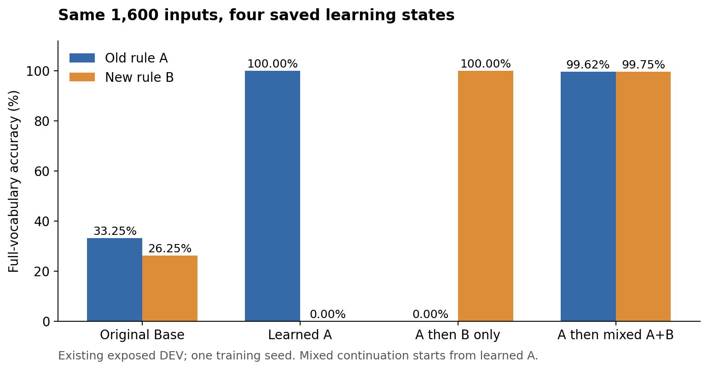
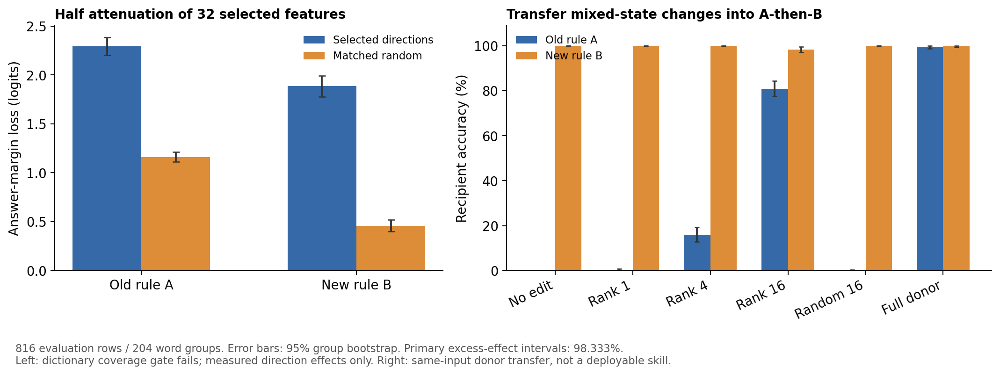

派生阅读副本；原件位置：`Projects/from-attention-to-search/main/experiments/A15/15_25_02_learning_history_representation/20261023/summary.md`。
[精确原始文件](../../../../../../../../sources/Projects/from-attention-to-search/main/experiments/A15/15_25_02_learning_history_representation/20261023/summary.md)；研究修改仍回到原件。

---

# How does learning history change conditional-rule representations, and which directions matter most for answering?

**A 16-dimensional subspace of observed state changes restores most old-task answers, but this analysis has not identified an independent, transferable rule module.** On 816 evaluation examples excluded from this analysis's selection, projecting the mixed-minus-sequential residual difference onto these directions and adding it to the sequential state raises old-task accuracy from 0% to **80.88%**. Equal-rank, equal-perturbation-norm random controls average **0.12%**. New-task accuracy decreases from 100% to **98.28%**. The existing CrossCoder fails whole-reconstruction qualification, so its feature list is not an adequate complete mechanism decomposition.

This is exploratory evidence from one training seed and previously exposed DEV. Directions are fixed on discovery examples, but their per-example transfer coefficients still require the mixed model's representation of that same input. This is not a repair that runs using the sequential model alone. [Primary evidence](evidence_tables.md#primary-contrasts) · [All interventions](evidence_tables.md#all-253-intervention-conditions)

## Purpose: connect different learning outcomes to changes that affect answers

The question is where representations change after different learning histories, which changes affect answering, and whether those directions are sufficient to explain successful answering under both rules. A more elaborate feature graph is not itself the objective.

Inputs contain a visible mode, a command and three words. In old task A, 甲 selects the first word and 乙 the last. New task B reverses the mapping under another visible mode. For the list 红 黄 牛, mode one plus 甲 requires 红; mode two plus 甲 requires 牛. We compare original Base, acquired A, A followed only by B, and A followed by mixed A+B. All parameters are frozen during this analysis. Mixed continuation starts from acquired A, not directly from Base. [Data guide](dataset_guide.md)

The hypothesis is that answer-sensitive directions have greater effects than equally large nonspecific perturbations. The strongest rival is frequent background, output bias or arbitrary large displacement. Three analysis paths provide behavior, representation and controlled intervention evidence.

## 1. Behavior and factor controls: establish what each state can answer

| State | Old task A accuracy | New task B accuracy |
|---|---:|---:|
| Original Base | 33.25% | 26.25% |
| Acquired A | 100% | 0% |
| A followed only by B | 0% | 100% |
| A followed by mixed A+B | 99.625% | 99.75% |

These are full-vocabulary accuracies on all 1,600 DEV examples, 800 per task. When only the visible mode changes, holding command and list fixed, predictions change in **0.125%, 0%, and 99.625%** of pairs for acquired A, sequential, and mixed states respectively. The first two states respond to the command but almost never switch with the mode; mixed behavior accommodates both modes. This is an input/output observation, not an internal rule implementation diagnosis. [Behavior table](evidence_tables.md#native-behavior) · [Paired factor checks](../../../../../../../../UNAVAILABLE.md)

Blue denotes the old rule and orange the new rule. B-only continuation exchanges which rule is answered correctly; mixed continuation retains both. B exposure differs between endpoints, so the figure does not isolate curriculum causality.

## 2. Representations and layerwise organization: locate changes and qualify CrossCoder

The source training changed only the final block's attention Q/K/V/O weights. All thirteen measured earlier-layer residuals are exactly equal on every paired input; changes occur in the final block. Mixed and sequential final residuals have mean cosine similarity **0.8562**, yet their change norm averages **50.41%** of the sequential residual norm. Similar-looking vectors need not produce the same answers. [Raw geometry](evidence_tables.md#paired-raw-geometry)

CrossCoder jointly encodes fourteen layers into one shared activation vector. A feature has different decoder contributions across layers; there are not fourteen independent feature inventories. A change in shared activations therefore does not establish that each earlier layer changed. Final-layer centered variance explained is negative for all four states, below the registered 0.8 gate. Replacing the mixed state's final residual with its entire dictionary reconstruction lowers accuracy from **99.6875% to 56.75%**. The existing dictionary/current interface does not faithfully retain the task-relevant representation differences. This analysis does not uniquely attribute that failure to distribution change or computation precision. [Qualification table](evidence_tables.md#dictionary-qualification)

In the [feature heatmap](../../../../../../../../sources/Projects/from-attention-to-search/main/experiments/A15/15_25_02_learning_history_representation/20261023/figures/03_features.png), each row is a candidate ID, and color is its mean activation divided by its maximum across displayed conditions. Darker color is not greater task importance; IDs are not semantic names. The [qualification and spectrum figure](../../../../../../../../sources/Projects/from-attention-to-search/main/experiments/A15/15_25_02_learning_history_representation/20261023/figures/04_qualification_geometry.png) separately shows instrument validity and concentration of raw state changes.

## 3. Functional interventions and quality: distinguish occurrence, influence and sufficient recovery

Select on 784 discovery examples and intervene on 816 evaluation examples in 204 unordered-word groups excluded from selection. Every selective CrossCoder edit is added to the original residual, preserving its actual reconstruction error. Random features approximately match occurrence and decoder norm by nearest neighbors, with the same feature count; their actual perturbation norms are then equalized per example. There are zero isotropic fallbacks for missing control support.

**The CrossCoder candidates have local effects but do not recover old-rule answering.** The 32 candidates selected separately for mixed old/new tasks share **30 IDs**. Half attenuation reduces the correct-versus-opposite-endpoint logit margin by **2.291 / 1.885**, compared with **1.161 / 0.458** for matched random controls. Excess damage is **1.130 [1.037, 1.228] / 1.427 [1.274, 1.575]**, with 98.333% group intervals. The main effect is reduced answer advantage, with little accuracy change. Transferring these coefficients from mixed to sequential leaves old accuracy at **0%**. Half attenuation of the 32 most frequent features does not lower accuracy in this comparison; occurrence alone is not an importance criterion. The two candidate lists have not been identified as separate task modules. [Candidates and controls](evidence_tables.md#frozen-candidate-ids)

**The raw 16-dimensional state-change subspace has a clearer recovery effect.** For each input, subtract its sequential residual from its mixed residual. Fit common difference directions with singular value decomposition (SVD) on discovery examples only, then add the projected difference to the sequential residual. Random comparisons average eight subspaces of equal rank, with equal perturbation magnitude for each input.

| Change transferred into the sequential model | Old accuracy | New accuracy |
|---|---:|---:|
| No edit | 0% | 100% |
| First difference direction | 0.25% | 100% |
| First 4 directions | 15.93% | 100% |
| First 16 directions | **80.88%** | **98.28%** |
| Equal-rank, equal-norm random 16-dimensional subspace | 0.12% | 100% |
| Entire mixed residual | 99.51% | 99.75% |

The recipient retains its entire original residual; only the added difference is sixteen-dimensional. This does not show that sixteen dimensions alone perform the task.

This table has 408 evaluation rows per task, explaining the slight difference between full donor replacement and the all-DEV behavior table. Rank-16 old accuracy has a 95% group interval of **77.45%–84.31%**. Its excess old-answer margin improvement over random is **17.808 [16.739, 18.897]**, using the registered 98.333% interval. The first direction contains **28.34%** of state-change energy but recovers almost no old answers. The first sixteen contain **75.48%** and recover most answers. **The largest change direction is not automatically the most task-important direction.** [Spectrum](evidence_tables.md#discovery-spectrum) · [Intervention table](evidence_tables.md#all-253-intervention-conditions)

The left axis measures answer-margin loss: larger means greater damage to the correct answer's advantage. The right axis measures accuracy after different transfers. Error bars are 95% word-group bootstrap intervals; the three primary excess effects separately use 98.333% intervals. The left panel does not establish a complete dictionary decomposition. The right panel still uses the same-input mixed model as donor.

One actual example illustrates the computation: on mode one, command 甲, list 红 黄 牛, the sequential model assigns almost all probability to 牛. Adding the rank-16 difference raises the probability of 红 to **99.81%**. For mode two on the same list and command, 牛 remains above **99.9999%**. This is a successful example; approximately 19.1% of old evaluation answers remain incorrect, so the example cannot substitute for the population result. [Sample cards](sample_cards.md)

## Bounded answer and next question

**Observation:** between these fixed endpoints, a 16-dimensional raw state-change subspace has answer effects beyond equal-size random directions. **Provisional AI interpretation:** it carries a substantial part of the state difference needed to recover old answers. Existing CrossCoder candidates have local effects but do not supply a sufficient decomposition of that ability.

It remains unknown whether these directions primarily carry mode-conditioned selection or concrete answer-word information. This analysis does not establish cross-task reuse, parameter separation, joint training from Base, or long-term training benefit. One seed, exposed DEV, unequal B exposure and donor-dependent transfer coefficients limit generalization.

**AI suggestion for the next question: does the recovery persist when mode conditions are separated from answer-word identity?** Researcher mechanism judgment and next decision remain `Unknown`. Execution is complete; the question remains open. [Detailed record and three audits](detailed.md) · [Frozen Protocol](protocol.md) · [Engineering deviations](amendments.md)
