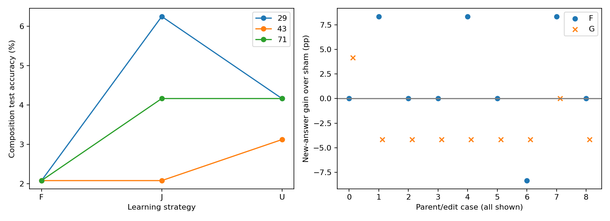

派生阅读副本；原件位置：`Projects/from-attention-to-search/main/experiments/A15/15_26_low_frequency_compositional_reuse/R01_controlled_operations/detailed_cn.md`。
[精确原始文件](../../../../../../../../sources/Projects/from-attention-to-search/main/experiments/A15/15_26_low_frequency_compositional_reuse/R01_controlled_operations/detailed_cn.md)；研究修改仍回到原件。

---

# A15_26 / R01完整实验记录

[Summary](summary_cn.md) · [冻结Protocol](protocol_cn.md) · [冻结时Anchor快照](sources/anchor_at_freeze/15_26_low_frequency_compositional_reuse_anchor_cn.md)。A15_26为独立父Anchor；R01与并行订单V2分别持有数据、协议和运行，不混合结论。当前Anchor的V2扩展不追溯改变R01。

## 先看结果与资格

原问法单操作可拟合，跨问法与留出组合资格未通过。全部有限登记条件已执行；[完整数值附录](evidence_tables_cn.md)列出每个种子、容量条件、修订比较和状态诊断。[所有轨迹](../../../../../../../../sources/Projects/from-attention-to-search/main/experiments/A15/15_26_low_frequency_compositional_reuse/R01_controlled_operations/tables/all_runs.csv)也保留初始资格试验。本轮完成了登记实验，但组成跨问法资格与组合资格均未通过；结果不能裁决“已经获得可调用组成能力之后是否复用”，也不能外推自然语言或MoE收益。研究者对机制、下一轮和问题关闭的判断仍为Unknown。

## 实验怎样回答问题

32个符号是对象名，四个F、四个G是固定置换。模型读提示，在完整151936词表中预测下一个答案token，目标是y=G_j(F_i(x))。这是外部语义，不是已证实的内部步骤。[任务说明](dataset_guide_cn.md)定义数据与对照，[实测题目](sample_cards_cn.md)把原子预测、组合目标和实际错误连起来。

单操作256训练题覆盖所有表和输入；另256题只换问法。每个操作对20/6/6输入构成320/96/96组合划分，同一对内不重叠。整数约束在任何模型结果前配平输入/答案边际。生成种子20261024只给一个操作世界；29/43/71是此世界的训练随机性。早期未配平候选已存档，未用于训练。报告期追加审计发现，F—输入/G—中间符号联合计数未匹配，因此曝光比较也改变具体组成条目的练习量；这比登记的边际控制更细，结果解释已收窄。测试不是未见符号或未见操作对。

P学正确组成，C以相同格式、词表、预算学另一组置换，B保留Base。随后组合监督匹配。与B相比P确实多了预训练；C控制预训练数量和形式，但错误映射可能产生负迁移。U更新选定原参数，F仅训练适配器，J训练同结构适配器与同范围原参数。均衡、不均衡、交换条件都给46,080个答案，每个F/G11,520次、输入/答案符号各1440次；每对均衡2880、不均衡5120/640，交换反过来。

操作修订从每个P-U均衡终点出发，只改F0或G0。固定601/607/613三个完全换表，每个edit和sham各1024次更新，每批16个目标操作、16个其他原操作回放，不教组合。sham保持旧标签和相同输入顺序。每个角色影响24个组合测试题，其余72题用于保持检查。只有原父模型与修订后资格均通过，组合按新规则改变才可解释为登记的功能迁移。

内部载体候选来自组合学习前P的128个F单操作训练状态。按32个中间符号求均值并中心化，在末层attention输出和block输出做SVD；VAL96只选择attention rank8/16，平局选较小秩，TEST96锁定确认。替换值保证受体G(z′)与旧答案、供体原子答案都不同。条件包括定向、同中间符号、另一F表面、no-op、五个等秩等幅随机、半剂量、晚层输出和移除。晚层输出只是答案搬运诊断；移除后恢复等于同值替换，不重复当作独立证据。no-op确认预测相同，不声称全部logit精确相同。半剂量原始`norms`记录的是乘alpha前的候选变化量，实际施加范数为它的一半；该元数据限制不改变实测预测或全剂量随机对照的范数匹配。

## 真实计算与训练

模型为精确的Qwen3-0.6B Base；配置和权重完整hash见[English Detailed](detailed.md)和[产物清单](artifact_manifest_cn.md)。前27个原生block固定，FP32缓存进入第28个block的hidden，保留原生位置处理、归一化和词表头。全部1024行原生/缓存最大logit差0、argmax相同。

初始1440步只训练末层q/k/v/o，共6,291,456参数。seed29跨问法资格失败后，按预登记进行唯一修订：P/C每种子从相同Base训练完整末层2880步，共15,730,944参数；之后组合与修订沿用这个范围。适配器B·GELU(Ah)在attention输出、原残差相加前加入，rank32为65,536参数，rank128为262,144；B零初始化。Smoke验证F/J起点与同一父模型逐位一致。新增适配器是工程结构，不是发现的语义模块。

训练统一FP32、确定性原生SDPA、关闭TF32，答案token全词表交叉熵，无辅助项。AdamW学习率1e−4，betas(.9,.999)、eps1e−8、weight_decay0、梯度裁剪1，foreach/fused关闭，常数学习率。全局32例，微批8累积4次；每次恰好32个有效答案监督，提示token不计为答案监督。每个新阶段有意重置优化器，同条件匹配随机种子与曝光顺序。

保存0、1、2、8、32、128、360、720、half、final中在范围内的不同点。状态含可训练参数、Adam、RNG、调度、数据游标/顺序hash、更新/token计数、精确Base和父状态引用；它们依赖父模型，不是独立完整模型。每步检查冻结版本。Smoke以独立进程比较连续3步和2→3步续训，权重/优化器/RNG/计数完全相同；没有声称每个终点独立续训通过。

## 先核契约，再读解释

| Item | Registered / actual | Status and impact |
| --- | --- | --- |
| Authority | Explicit full delegation; no total GPU limit; single Reserved preferred | Same scope; one H100 throughout |
| Identity | Protocol frozen2026-10-24T15:53:59Z; dataset SHA a394a653…c1614f | Identity checks pass; exact hashes in provenance |
| Acquisition | Attention pilot1440; at most one final-block2880 repair | Triggered on seed29 changed-format guard; all P/C seeds repaired, no relaxation |
| Composition | P U/F/J ×3 exposure ×3 seeds; B/C balanced U ×3 | All33 executed; original-frequency identities retained |
| Capacity | If rank32 F train<95%, balanced rank128 F/J all seeds | All6 executed; primary rank32 retained |
| Revision | 3 parents ×2 roles ×3 derangements ×edit/sham;1024 updates | All36 executed; downstream mechanism ineligible |
| State tests | Atomic-parent donor; VAL rank choice; locked TEST controls | All36 confirmation conditions executed; exploratory |
| Engineering | E01 failure-state handling; E02 input registration; E03 output path | No scientific value change; original snapshots and failure retained |
| Retry | Path-fix job later failed on storage ENOSPC during last revision save128 | 81 cases reused; complete32 restored; no partial128 resume |
| Qualified resume | Actual block1→2 exact state replay before32→1024 | Prefix telemetry rebuilt; metrics33..128 replay exactly; no scientific change |
| Higher-order exposure audit | Registered marginals match; finer joint counts differ | Posthoc reporting audit D01; exposure claim bounded, data unchanged |
| Missing / exclusions | No primary condition missing; no result-based exclusion | Scientific acceptance and closure Unknown |

表中技术字段与英文契约对齐：所有登记条件完成，失败资格保留。E01改变异常保存方式，E02增加输入checkpoint登记，E03修复文件路径；均不改数值或科学门槛。旧作业失败证据与源版本保留。源文件hash提供来源约束，不等于完整运行字节码证明。

## 统计量与判断门槛

准确率为原生全词表argmax命中目标。帮助要求P−B、P−C均至少5个百分点且三个种子同向，另报验证AUC；曝光要求同一对高−低至少5个百分点且方向一致。冻结要求组合95%、低频90%、单操作均值损失≤1个百分点且每项95%、F相对J不差于2个百分点。96题不能因为未检出差异就证明2个百分点等价。

修订要求基线合格，修改及各未改原子操作95%、未受影响组合edit−sham≥−2个百分点，新答案≥80%且增益≥20个百分点。载体要求原生/保持95%、定向新答案80%、超过随机20个百分点，同值/另一表面在2个百分点内保持。所有机制起点资格失败，不把探索条件混成合格平均。

配对重抽样按固定测试中的输入符号聚类，5000次、种子20261024；主域98.333%区间，次级95%。按组总和/计数保持原行权重。区间条件于固定操作、划分与父轨迹，不覆盖新任务世界或完整训练随机性。每对只有6个测试输入，一题就是16.67个百分点；三个种子单独列出，没有测试驱动选点。

## 从原始测量到有界主张

下列原始路径相对执行目录`/data/250010109/MoE_Router/experiments/20261024_a15_26_compositional_reuse`。

| Result | Raw observation | Computation / criterion | Curated evidence | Eligibility |
| --- | --- | --- | --- | --- |
| Atomic competence | runs/acquisition/*/evaluations/step_002880.json | accuracy per32 rows/operation; each≥95% | tables/factual_results.json | Format qualification failed |
| Explicit composition | analysis/positive_{seed}.json | compose exhaustive atomic predictions; n96 | tables/factual_results.json | Positive control; extra calls/interface |
| Help | runs/combination/{P,B,C}_{seed}_balanced_U/test.json;curve.json | paired final accuracy and VAL AUC; P−B/C≥5pp, all seeds positive | tables/help.csv;learning_curves.csv | BOUNDED; ≥5pp/consistent-sign prediction not met; callable premise failed |
| Exposure | P_{seed}_{skew,swap}_U/test.json | same-pair high−low; input-cluster5000 bootstrap;≥5pp | tables/exposure.csv;pairs.csv | BOUNDED; ≥5pp positive prediction not met; finer component-map exposures differ |
| Freezing | P_*_{F,J}/test.json;final evaluations | combo95%,low90%,atomic retention and F−J≥−2pp | tables/freeze.csv;all_runs.csv | INELIGIBLE for reuse; tested freezing success criterion not met |
| Capacity | runs/capacity128/* | prespecified training-capacity check | tables/all_runs.csv | Secondary; never substitutes rank32 |
| Revision | runs/revision/*/revision_evaluation.json | new edit−sham≥20pp,new≥80%;atomic/unaffected guards | tables/revisions.csv | All baseline-ineligible |
| Carrier | analysis/interventions/{seed}/test_results.json | directed≥80%,random gap≥20pp;native95% and preservation | tables/factual_results.json | All baseline-ineligible |
| Execution fidelity | TensorBoard;step JSON/PT;Smoke;data audit | full coordinates,finite losses,count/save/replay guards | provenance/final_output_audit.json;smoke.json | Engineering PASS; no mechanism implication |

完整数值只在[附录](evidence_tables_cn.md)保留一次；逐题原始输出留执行目录。[图源说明](figures/SOURCES.md)解释两图的来源、计量单位、轴和限制。

左图是每种子均衡U/F/J测试，右图是全部角色与编辑的受影响新答案edit−sham差值。它们显示实际测量，包括不合格条件；不能把局部差值升格为可用冻结路径或内部复用。

## 失败拆解、覆盖与完整产物

数据配平、原生缓存、精确Smoke续训、全部标量/计数/参数审计通过。首个完整作业因我们自己的路径代码失败，E03修复后复用完成轨迹。后续共享写入ENOSPC使最后修订在保存128时失败；E04保留81条完成轨迹，无损引用重复文件，先验证实际完整末层1→2状态完全一致，再从完整32续训。原始前32步遥测保留，33..128重放指标完全相同，不读取半写入128。恢复到1024后的重复终点保存又失败；E05以真实1024文件hash、完整曲线和1024步指标核定完成，随后只补测量，没有增加训练。科学资格在许可修订后仍失败；独立后续分支照常完成并明确标记。没有因此否定整个物理先验，也没有证明唯一内部算法。格式绑定、计算接口/深度、优化与整对记忆仍是竞争解释。

| Stage | Trajectories | Execution | Scientific use |
| --- | --- | --- | --- |
| acquisition | 7 | COMPLETE | Bounded; failed atomic prerequisite |
| combination | 33 | COMPLETE | Bounded; failed atomic prerequisite |
| capacity128 | 6 | COMPLETE | Bounded; failed atomic prerequisite |
| revision | 36 | COMPLETE | EXPLORATORY; no qualified baseline |
| Intervention discovery | 12 VAL candidates;3 parents | COMPLETE | Selection only; no TEST choice |
| Intervention confirmation | 36 conditions;3 parents | COMPLETE | EXPLORATORY; native guards failed |
| Smoke | 3 cases;8 saves | PASS | Engineering qualification only |

正式共82条轨迹、111,744步、3,575,808个答案监督。实际清点788个保存状态，其中Smoke8、正式780，共117,900,159,002逻辑负载字节（重复内容可由内部引用共享）。里程碑数不是独立训练模型数，Smoke也不混入正式统计。另有1个完整末层续训验证保存点，单独登记为`checkpoint_a15_26_20261024_recovery_block_probe`，在runs/之外。96次重放与1次验证更新是恢复开销，不混入唯一正式轨迹计数。[实际保存成员清单](../../../../../../../../sources/Projects/from-attention-to-search/main/experiments/A15/15_26_low_frequency_compositional_reuse/R01_controlled_operations/provenance/actual_checkpoints_full.json)。

本轮完成了登记实验，但组成跨问法资格与组合资格均未通过；结果不能裁决“已经获得可调用组成能力之后是否复用”，也不能外推自然语言或MoE收益。研究者对机制、下一轮和问题关闭的判断仍为Unknown。 原因与认识分别见[猜想](mechanism_conjectures_cn.md)、[认识更新](recognition_update_cn.md)。唯一AI建议是先决定是否建立跨语境可调用的组成前提；尚未成为下一轮授权。[产物清单](artifact_manifest_cn.md)列精确资产、作业和访问凭证。本轮无commit/push或外部发布。

[交付审计](result_audit_cn.md)。
